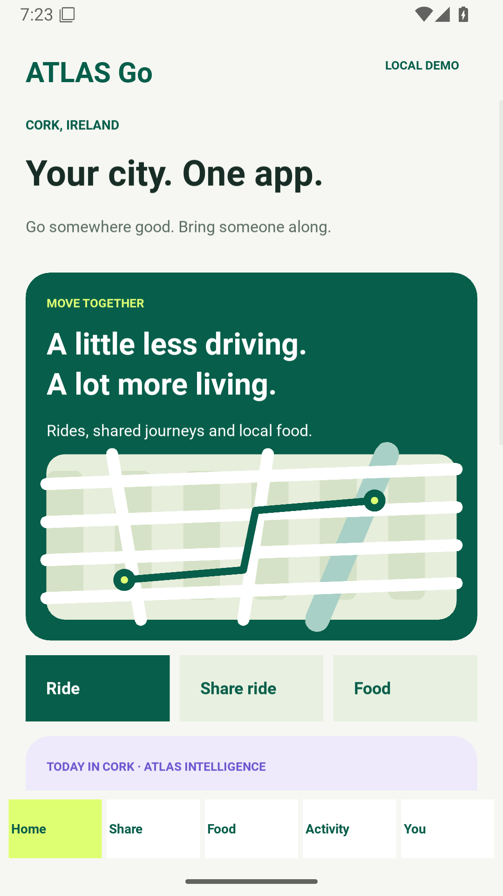
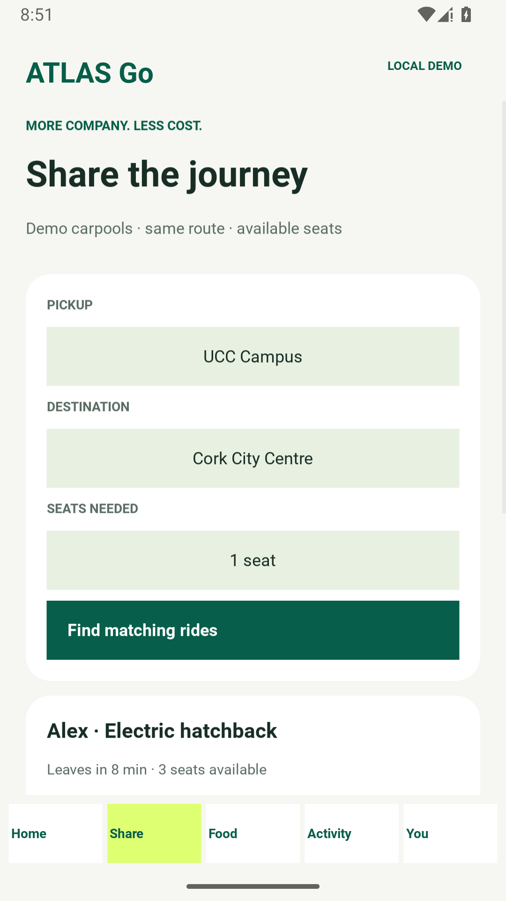
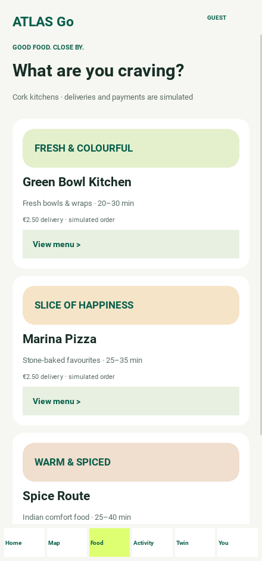
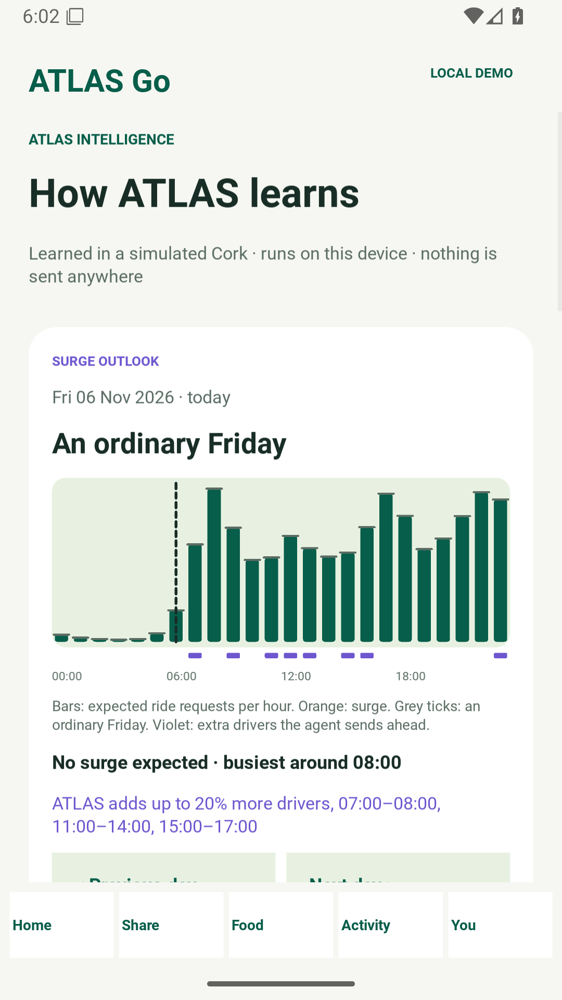

# ATLAS — Supplementary Code and Data

Code, data, trained models and raw results for the article

> **ATLAS: Learning to Rewire the Web — Predictive Architecture Transformation for Autonomous Cloud Systems**
> 
> Basker Palaniswamy and Paolo Palmieri, Dept. of C.S. & I.T., University College Cork (UCC), Ireland, European Union.
> 
> *Future Internet* (MDPI).

The repository reproduces every table and data-driven figure of the evaluation:
forecasting (LSTM, Bi-LSTM and statistical baselines), out-of-distribution and
cross-node tests, anomaly detection, the architecture comparison with
statistical tests, the forecaster-value and ablation studies, the load and
sensitivity sweeps, the connected-vehicle case study, recovery times and BIP
solve times, the process-level prototype measurements, and the
second-revision checks (exact vs. linearised optimisation, blast-radius and
availability assumptions, system-level value of the anomaly detector, and a
combined-factor stress test).

## Live architecture explorer

Explore the ride-hailing reference design, trace trip and driver events, and inspect the deployment layout.  

1) [Open the ATLAS Architecture Explorer](https://fullscipts.github.io/ATLAS/)

2) [Source and server deployment guide](https://github.com/FUllSCIPTS/ATLAS/tree/architecture-explorer/architecture-explorer)

3) [Final handover and acceptance checks](https://github.com/FUllSCIPTS/ATLAS/blob/architecture-explorer/architecture-explorer/starter/docs/FINAL_HANDOVER.md) · [UML blueprint and class/function catalog](https://github.com/FUllSCIPTS/ATLAS/blob/architecture-explorer/architecture-explorer/starter/docs/UML_BLUEPRINT.md)

4) [ATLAS Go Python Android app — rides, shared rides and food](android-app/README.md) · [Screenshots and user guide](android-app/docs/USER_GUIDE.md) · [Google Play release guide](android-app/docs/GOOGLE_PLAY.md)

5) [▶ Watch the ATLAS Go demo video (4 min 52 s) — the app (ride booking, driver gets location, food order, shop-to-home delivery); how an RL agent learns who to dispatch and when to send the courier; two years of Cork's holidays and events, with the agent's experience log helping the LSTM predict surges hours ahead; then ATLAS rewiring itself as users scale up and down: monolith → hybrid → microservices → monolith](android-app/docs/video/atlas-go-demo.mp4)

## ATLAS Go Android app 

A Python/Kivy passenger-app model with solo ride booking, shared-seat reservations,
food menus, basket/checkout, simulated tracking, activity history and local data
reset. It works offline; all rides, restaurants, deliveries and payments are
simulated. Application code and tests are in Python.

| Open or download | Contents |
|---|---|
| [Installable Android APK 1.1.0](https://github.com/FUllSCIPTS/ATLAS/releases/download/atlas-go-v1.1.0/atlas-go-demo.apk) | Debug demonstration with ATLAS intelligence (learned dispatch, courier timing, surge outlook, learning lab) |
| [All 1.1.0 downloads and checksums](https://github.com/FUllSCIPTS/ATLAS/releases/tag/atlas-go-v1.1.0) | APK, unsigned AAB (sign before Play upload), fourteen screenshots and verification evidence |
| [Signed Play bundle 1.0.0 — atlas-go-play.aab](https://github.com/FUllSCIPTS/ATLAS/releases/download/atlas-go-v1.0.0/atlas-go-play.aab) | Earlier version 1.0.0 / versionCode 1, without ATLAS intelligence; [1.0.0 downloads](https://github.com/FUllSCIPTS/ATLAS/releases/tag/atlas-go-v1.0.0) |
| [Python source and run instructions](android-app/README.md) | App screens, domain rules, persistence, tests and build configuration |
| [▶ Demo video — atlas-go-demo.mp4](android-app/docs/video/atlas-go-demo.mp4) | 4 min 52 s. Act I: book a ride, driver receives the pickup location, order food, courier collects at the shop and delivers home (simulated). Act II — The Learner: an RL agent learns from delayed rewards which driver to offer a ride to and when to dispatch a food courier (toy simulation). Act III — The City's Calendar: two years of synthetic Cork demand over Ireland's real 2025–2026 public holidays; the agent pre-positions drivers, and its log of unserved requests helps the LSTM forecast surges 3–6 hours ahead (toy simulation). Act IV: as demand rises to ≈14,000 req/s and falls back, the ATLAS controller moves the six services from Tight (monolith) to Hybrid to Loose (microservices) and, after a 300 s hysteresis dwell, back to Tight — driven by `atlas_sim` on a synthetic surge |
| [Screenshots and user guide](android-app/docs/USER_GUIDE.md) | Home, solo/shared rides, food, basket, tracking, activity, privacy, How ATLAS learns and the learning lab |
| [Architecture and integration blueprint](android-app/docs/ARCHITECTURE.md) | Folder structure, classes and future service integration |
| [Google Play handover](android-app/docs/GOOGLE_PLAY.md) | Signing, store assets, privacy notice and Console submission steps |
| [Test results](android-app/releases/VALIDATION.md) · [Signing record](android-app/releases/SIGNED_VALIDATION.json) | Source revision, successful build, binary hashes and certificate fingerprint |

| Home | Shared rides | Food | How ATLAS learns |
|---|---|---|---|
|  |  |  |  |

**Verified (1.1.0):** 68 Python regression cases, 102 desktop UI assertions in each of two
screen configurations, and 130 Android 16 UI assertions passed, with fourteen screenshots
([evidence](android-app/releases/VALIDATION.md)). The 1.1.0 AAB is unsigned: sign it with your
private upload key before a Play upload. The signed 1.0.0 bundle's signature and structure were
validated earlier; the private upload key remains private.

The signed AAB is prepared for an internal-test upload. Google Play account
declarations, any required testing and store review remain owner steps.

## Quick start

```bash
git clone https://github.com/FUllSCIPTS/ATLAS.git
cd ATLAS
python3 -m venv .venv && source .venv/bin/activate
pip install -r requirements.txt

# regenerate the figures from the included results (seconds)
python3 make_figures.py

# rerun all experiments from scratch (about 2–3 h on 2 CPU cores)
./run_all.sh
```

`run_all.sh` skips LSTM training when `results/forecast.json` is present;
delete it to retrain. All random seeds are fixed. The prototype needs
`openssl` on the `PATH`; it generates its own short-lived test certificates in
`prototype/certs/` (not committed).

## Repository layout

| Path | Purpose |
|---|---|
| `atlas_sim/traffic.py` | Synthetic workloads (one-year e-commerce trace with flash sales, connected-vehicle fleet trace) and telemetry/anomaly generators |
| `atlas_sim/forecast.py` | LSTM / Bi-LSTM forecaster (PyTorch), Ridge-AR, seasonal-naive and persistence baselines, metrics |
| `atlas_sim/cluster.py` | 1-s cluster simulator with continuous-time failure/recovery events; static monolith, static microservices, HANSEL-like, Predictive-Hybrid, XScale-like and ATLAS (BIP optimiser, state machine, self-healing); option `blast="process"` for the conservative whole-process blast radius |
| `prototype/` | Process-level prototype: a stateful module served in-process or over HTTPS with mutual TLS; switching and recovery protocols measured with real timestamps |
| `run_forecast.py` | Trains the LSTM (3 seeds), Bi-LSTM and baselines; vehicle-fleet LSTM |
| `run_ood.py` | Out-of-distribution and cross-node tests; online forecaster selector |
| `val_preds.py` | Forecasts on the validation period (used only for tuning) |
| `run_anomaly.py` | Isolation Forest: full metric set, contamination and severity sensitivity |
| `run_cluster.py` | Tuning, 30-run architecture comparison (Wilcoxon/Holm), forecaster value, ablation, offered-load sweep, sensitivity analysis |
| `run_vehicle.py` | Connected-vehicle case study (14 held-out test days) |
| `run_recovery_mc.py` | Event-level recovery time per crash class |
| `run_bip_timing.py` | Measured BIP solve times (enumeration, HiGHS branch-and-bound, LP + rounding) |
| `run_round2.py` | Second-revision experiments: exact vs. linearised optimisation (gap in the nonlinear objective), blast-radius and availability checks, system-level value of the anomaly detector (with an oracle detector), 2^4 combined-factor stress test, detector firing pattern |
| `export_datasets.py` | Writes `data/`; `--full` writes the complete 525,600-row trace |
| `make_figures.py` | Regenerates the data-driven figures into `figures/` (override with `ATLAS_FIG_DIR`) |
| `data/` | Anomaly dataset, failure schedule, simulation configuration, 7-day traffic excerpt |
| `results/` | Raw result files (JSON/NPZ) and trained model weights used in the paper |
| `figures/` | Figures as they appear in the paper |
| `run_all.sh` | Runs everything in order |

## Experiment → script → result file

| Paper content | Script | Result file |
|---|---|---|
| Forecast accuracy, surge lead times, seeds | `run_forecast.py` | `results/forecast.json` |
| Out-of-distribution and cross-node tests | `run_ood.py` | `results/ood.json` |
| Anomaly detection metrics and sensitivity | `run_anomaly.py` | `results/anomaly.json` |
| Architecture comparison, statistical tests, forecaster value, ablation, load sweep, sensitivity | `run_cluster.py` | `results/cluster.json` |
| Connected-vehicle case study | `run_vehicle.py` | `results/vehicle.json` |
| Recovery time per crash class | `run_recovery_mc.py` | `results/recovery_mc.json` |
| BIP solve times | `run_bip_timing.py` | `results/bip_timing.json` |
| Prototype: call costs, switching, recovery | `prototype/proto_run.py` | `results/prototype.json` |
| Exact vs. linearised formulation, blast radius/availability, anomaly-detector value, combined-factor stress test (second revision) | `run_round2.py` | `results/round2.json` |

## Requirements

Python ≥ 3.10 (results produced with Python 3.13), numpy, scipy (≥ 1.11, for
`milp`), scikit-learn, PyTorch (CPU is sufficient), matplotlib, and `openssl`
for the prototype. See `requirements.txt`.

## Scope of the evidence

All data are synthetic. The simulator encodes the modelling assumptions listed
in `data/simulation_config.json` and in the paper (Table "Data-generation and
simulation parameters"). The prototype runs both processes on one host, so it
measures protocol and process-level overheads, not container orchestration or
cross-node networking. The three published autoscalers are re-implementations
of their decision strategies based on the literature, not the original systems.

## Citation

Please cite the article (see `CITATION.cff`; GitHub shows a "Cite this
repository" button).

## License

MIT — see `LICENSE`.
