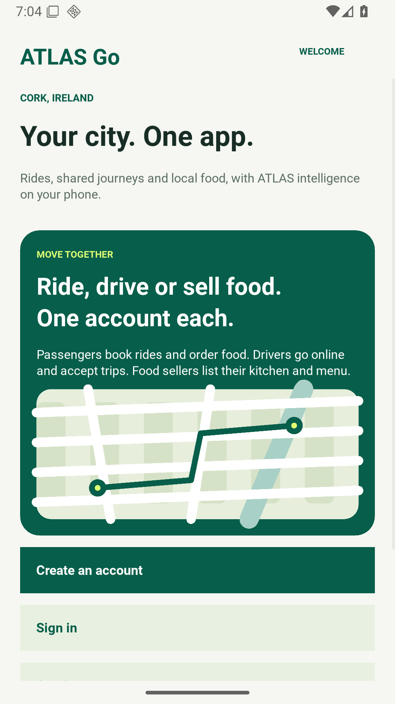
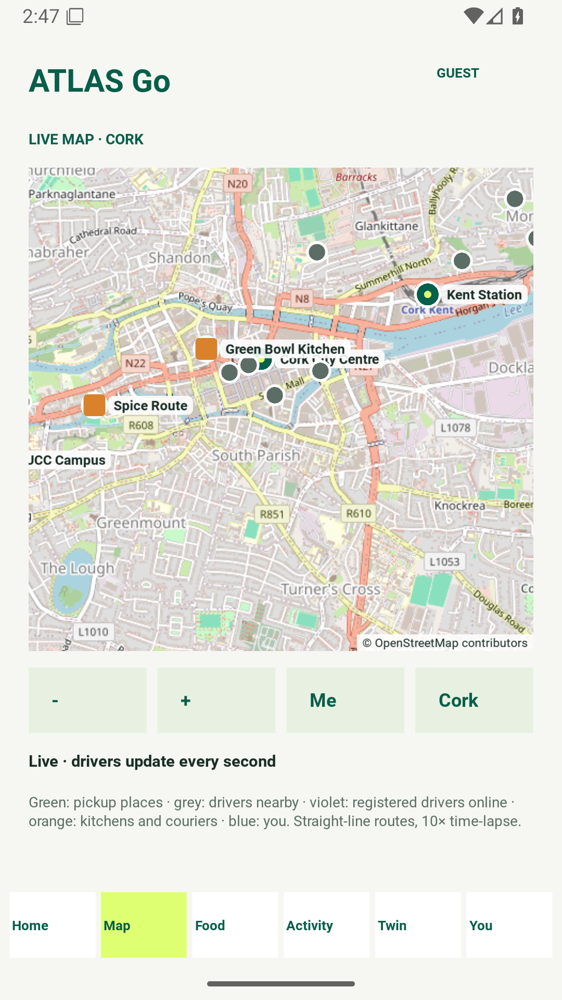
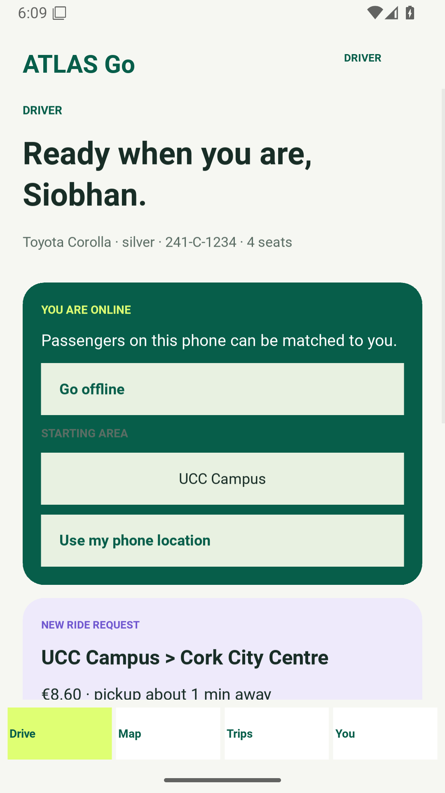
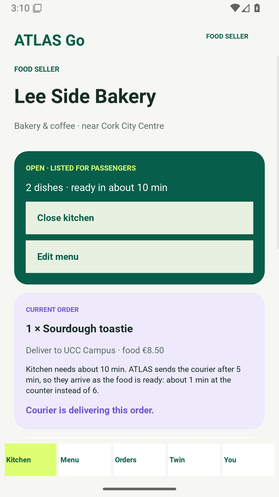

# ATLAS Go

<!-- ATLAS Go contents will be added here. -->

---

# ATLAS — Supplementary Code and Data

Code, data, trained models and raw results for the article

> **ATLAS: Learning to Rewire the Web — Predictive Architecture Transformation for Autonomous Cloud Systems**
> 
> Basker Palaniswamy and Paolo Palmieri, Dept. of C.S. & I.T., University College Cork (UCC), Ireland, European Union.
> 
> *Future Internet* (MDPI).

The repository reproduces every table and data-driven figure of the evaluation:
forecasting (LSTM, Bi-LSTM and statistical baselines), out-of-distribution and
cross-node tests, anomaly detection, the architecture comparison with
statistical tests, the forecaster-value and ablation studies, the load and
sensitivity sweeps, the connected-vehicle case study, recovery times and BIP
solve times, the process-level prototype measurements, and the
second-revision checks (exact vs. linearised optimisation, blast-radius and
availability assumptions, system-level value of the anomaly detector, and a
combined-factor stress test).

## Live architecture explorer

Explore the ride-hailing reference design, trace trip and driver events, and inspect the deployment layout.  

1) [Open the ATLAS Architecture Explorer](https://fullscipts.github.io/ATLAS/) · Teaching views: [Security](https://fullscipts.github.io/ATLAS/#security) · [Cryptography](https://fullscipts.github.io/ATLAS/#crypto) · [ML & Optimisation](https://fullscipts.github.io/ATLAS/#ml) · [Data Structures](https://fullscipts.github.io/ATLAS/#dsa)

2) [Source and server deployment guide](https://github.com/FUllSCIPTS/ATLAS/tree/architecture-explorer/architecture-explorer)

3) [Final handover and acceptance checks](https://github.com/FUllSCIPTS/ATLAS/blob/architecture-explorer/architecture-explorer/starter/docs/FINAL_HANDOVER.md) · [UML blueprint and class/function catalog](https://github.com/FUllSCIPTS/ATLAS/blob/architecture-explorer/architecture-explorer/starter/docs/UML_BLUEPRINT.md)

4) [ATLAS Go 1.2.0 Python Android app — passenger, driver and food-seller accounts, live map, rides, shared rides and food](android-app/README.md) · [Source code (MIT): browse](android-app/) or [download zip](https://github.com/FUllSCIPTS/ATLAS/releases/download/atlas-go-v1.2.0/atlas-go-1.2.0-source.zip) · [Screenshots and user guide](android-app/docs/USER_GUIDE.md) · [Google Play release guide](android-app/docs/GOOGLE_PLAY.md)

5) [▶ Watch the ATLAS Go demo video (4 min 52 s) — the app (ride booking, driver gets location, food order, shop-to-home delivery); how an RL agent learns who to dispatch and when to send the courier; two years of Cork's holidays and events, with the agent's experience log helping the LSTM predict surges hours ahead; then ATLAS rewiring itself as users scale up and down: monolith → hybrid → microservices → monolith](android-app/docs/video/atlas-go-demo.mp4)

## Learning path ways

1) [🎓 Teaching Method — Big-Picture Concept–Theory–Practice (BCTP): how every course here is taught: big picture → concept → what, why, how → proof → practice → create → reconnect](docs/teaching/TEACHING_METHOD.md) · [BCTP method (PDF)](docs/teaching/BCTP_Method.pdf) · [Lecture deck: Introduction to Data Structures taught with BCTP (PPT, 61 slides)](docs/teaching/Intro_Data_Structures_BCTP.pptx)

2) [🔐 Information Security in ATLAS — live Security view in the explorer](https://fullscipts.github.io/ATLAS/#security) · [Foundations: 19 standalone units with live labs](https://fullscipts.github.io/ATLAS/#security-learn) · [Teaching guide](docs/INFORMATION_SECURITY.md) · [Launch Colab lab](https://colab.research.google.com/github/FUllSCIPTS/ATLAS/blob/main/security_lab/Information_Security_Colab_Labs.ipynb) · [Lab manual](security_lab/README.md)

3) [🔑 Cryptography in ATLAS — live Cryptography view in the explorer](https://fullscipts.github.io/ATLAS/#crypto) · [Foundations: RSA, Diffie–Hellman, ECDSA, ML-KEM, ML-DSA, SLH-DSA with live labs](https://fullscipts.github.io/ATLAS/#crypto-learn) · [Teaching guide](docs/CRYPTOGRAPHY.md) · [Launch Colab lab](https://colab.research.google.com/github/FUllSCIPTS/ATLAS/blob/main/security_lab/Cryptography_Colab_Labs.ipynb) · [Lab manual](security_lab/README.md)

4) [📈 Machine learning and Optimisation in ATLAS — the paper's coupling optimiser and every learner, live in the explorer](https://fullscipts.github.io/ATLAS/#ml) · [Teaching guide](docs/MACHINE_LEARNING_OPTIMISATION.md) · [Lab manual — 40 experiments (20 ML + 20 optimisation)](ml_lab/README.md)

5) [📚 Data Structures and Algorithms — 24 illustrated lessons from O/Ω/Θ to graphs, incl. singly, doubly and circular linked lists; 30 Colab experiments with charts](docs/DATA_STRUCTURES_ALGORITHMS.md) · [Launch Colab lab](https://colab.research.google.com/github/FUllSCIPTS/ATLAS/blob/main/dsa_lab/DSA_Colab_Labs.ipynb) · [Lab manual](dsa_lab/README.md) · [Live Data Structures view in the explorer](https://fullscipts.github.io/ATLAS/#dsa)

6) [🐍 Python Programming — 20 illustrated beginner-to-intermediate lessons + 15 software-testing lessons + 12 real-app integration labs (button → API → database → screen) + 10 auto-graded app-building tickets (auth, roles, rate limiting, CSV export, migrations, outbox), every example runnable and linked to ATLAS Go code](docs/PYTHON_PROGRAMMING.md) · [Launch 20 Google Colab labs](https://colab.research.google.com/github/FUllSCIPTS/ATLAS/blob/main/python_lab/Python_Colab_Labs.ipynb) · [Lab manual](python_lab/README.md) · [ATLAS Go function catalogue](android-app/docs/ARCHITECTURE.md#complete-source-method-catalog)


7) [🌐 Web Technology — 23 illustrated lessons: HTTP, HTML, CSS, JavaScript, FastAPI, SQL, transactions, security, performance, testing and deployment](docs/WEB_TECHNOLOGY.md) · [Runnable full-stack lab](web_lab/README.md) · [20 Colab experiments (incl. real-browser runs)](https://colab.research.google.com/github/FUllSCIPTS/ATLAS/blob/main/web_lab/Web_Technology_Colab_Labs.ipynb) · [UML catalogue](https://github.com/FUllSCIPTS/ATLAS/blob/architecture-explorer/architecture-explorer/starter/docs/UML_BLUEPRINT.md) · [Continue with Web Technology 2 (Kivy front end)](docs/WEB_TECHNOLOGY_2.md) · [Web Technology 2 Colab lab](https://colab.research.google.com/github/FUllSCIPTS/ATLAS/blob/main/kivy_lab/Kivy_Colab_Labs.ipynb) · [Web Technology 2 lab manual](kivy_lab/README.md)

8) [📱 Web Technology 2 — Kivy Front End with ATLAS Go: 16 illustrated lessons on the Python/Kivy front end the Android app actually uses: app lifecycle, widgets and layouts, dp/sp, binding, events, forms, canvas drawing and charts, the Clock, touch, threads, screens as state, pyjnius, Buildozer packaging and UI testing](docs/WEB_TECHNOLOGY_2.md) · [Launch Colab lab — 16 Try-it programs + 11 experiments](https://colab.research.google.com/github/FUllSCIPTS/ATLAS/blob/main/kivy_lab/Kivy_Colab_Labs.ipynb) · [Lab manual](kivy_lab/README.md)

## ATLAS Go Android app

**Version 1.2.0** — a Python/Kivy Android app for Cork with **passenger, driver and food-seller registration**, a **live map** (OpenStreetMap tiles, device location, moving drivers and couriers, offline fallback), solo and shared rides, food ordering from built-in and seller kitchens, and **six on-device ML models** wired into the live flows (dispatch policy, per-driver acceptance model, surge outlook, supply agent, courier timing, learning lab). Accounts and bookings are stored on the phone; rides, deliveries and payments are simulated until an operator back end is connected.

| Open or download | Contents |
|---|---|
| [Installable Android APK 1.2.0 — request access](https://drive.google.com/file/d/1lX5DF9e8ierusJ1OCuVHkeqeCoBgqQfq/view) | **New version 1.2.0:** passenger, driver and food-seller registration, live map (OpenStreetMap, your location, moving drivers and couriers), and six on-device ML models in the live flows. Open the link, click **Request access**; once approved, download with your Google account. Uninstall 1.1.0 first (new signing key). SHA-256 `737c41ec935e4a87d849a04b1434fbe66fa47bdcb9420387e2a94f58400813cb` |
| **Source code** — [browse `android-app/`](android-app/) · [download atlas-go-1.2.0-source.zip](https://github.com/FUllSCIPTS/ATLAS/releases/download/atlas-go-v1.2.0/atlas-go-1.2.0-source.zip) | The complete app source is public under the [MIT licence](LICENSE): the `atlas_go` Python package, tests, model-training scripts, build configuration and docs. Build it yourself with the [build guide](android-app/docs/GOOGLE_PLAY.md). |
| [ATLAS Go 1.2.0 downloads](android-app/releases/1.2.0/README.md) | APK link (request access), `SHA256SUMS`, release notes, validation evidence and screenshots |
| [Changelog](android-app/CHANGELOG.md) | 1.2.0 changes and compatibility |
| [▶ Demo video — atlas-go-demo.mp4](android-app/docs/video/atlas-go-demo.mp4) | 4 min 52 s, recorded with 1.1.0: rides, food, how the RL agent learns, two years of Cork's calendar, and ATLAS rewiring itself as load changes |

| Welcome | Live map | Driver request | Seller kitchen |
|---|---|---|---|
|  |  |  |  |

**Verified (1.2.0):** 117 Python tests; 247 UI assertions in each of two screen configurations with 22 screenshots; model retraining reproduces the bundled models byte for byte; bundle validation, release manifest, 16 KB native alignment and APK v2/v3 signature checks pass ([evidence](android-app/releases/1.2.0/VALIDATION.md)). The Android 16 emulator run executes in GitHub Actions on push.

## Quick start

```bash
git clone https://github.com/FUllSCIPTS/ATLAS.git
cd ATLAS
python3 -m venv .venv && source .venv/bin/activate
pip install -r requirements.txt

# regenerate the figures from the included results (seconds)
python3 make_figures.py

# rerun all experiments from scratch (about 2–3 h on 2 CPU cores)
./run_all.sh
```

`run_all.sh` skips LSTM training when `results/forecast.json` is present;
delete it to retrain. All random seeds are fixed. The prototype needs
`openssl` on the `PATH`; it generates its own short-lived test certificates in
`prototype/certs/` (not committed).

## Reproducible Path

| Path | Purpose |
|---|---|
| `atlas_sim/traffic.py` | Synthetic workloads (one-year e-commerce trace with flash sales, connected-vehicle fleet trace) and telemetry/anomaly generators |
| `atlas_sim/forecast.py` | LSTM / Bi-LSTM forecaster (PyTorch), Ridge-AR, seasonal-naive and persistence baselines, metrics |
| `atlas_sim/cluster.py` | 1-s cluster simulator with continuous-time failure/recovery events; static monolith, static microservices, HANSEL-like, Predictive-Hybrid, XScale-like and ATLAS (BIP optimiser, state machine, self-healing); option `blast="process"` for the conservative whole-process blast radius |
| `prototype/` | Process-level prototype: a stateful module served in-process or over HTTPS with mutual TLS; switching and recovery protocols measured with real timestamps |
| `run_forecast.py` | Trains the LSTM (3 seeds), Bi-LSTM and baselines; vehicle-fleet LSTM |
| `run_ood.py` | Out-of-distribution and cross-node tests; online forecaster selector |
| `val_preds.py` | Forecasts on the validation period (used only for tuning) |
| `run_anomaly.py` | Isolation Forest: full metric set, contamination and severity sensitivity |
| `run_cluster.py` | Tuning, 30-run architecture comparison (Wilcoxon/Holm), forecaster value, ablation, offered-load sweep, sensitivity analysis |
| `run_vehicle.py` | Connected-vehicle case study (14 held-out test days) |
| `run_recovery_mc.py` | Event-level recovery time per crash class |
| `run_bip_timing.py` | Measured BIP solve times (enumeration, HiGHS branch-and-bound, LP + rounding) |
| `run_round2.py` | Second-revision experiments: exact vs. linearised optimisation (gap in the nonlinear objective), blast-radius and availability checks, system-level value of the anomaly detector (with an oracle detector), 2^4 combined-factor stress test, detector firing pattern |
| `export_datasets.py` | Writes `data/`; `--full` writes the complete 525,600-row trace |
| `make_figures.py` | Regenerates the data-driven figures into `figures/` (override with `ATLAS_FIG_DIR`) |
| `data/` | Anomaly dataset, failure schedule, simulation configuration, 7-day traffic excerpt |
| `results/` | Raw result files (JSON/NPZ) and trained model weights used in the paper |
| `figures/` | Figures as they appear in the paper |
| `run_all.sh` | Runs everything in order |
| `docs/INFORMATION_SECURITY.md` | Information-security teaching guide: password storage, authentication, identity management, RBAC, gateway auth, SSO, Kerberos, mTLS, secure deployment; 19 standalone units (S1–S13.6: what, why, how) adding STRIDE, MFA/TOTP/passkeys, access-control models, sessions/CSRF, API security, TLS 1.3, network security, OWASP Top 10, incident response, GDPR, governance and social engineering |
| `security_lab/README.md` | Index of the labs: categories, experiments, study paths and the gaps they expose |
| `security_lab/lab_a_password_storage.py` … `lab_d_integrity_lifecycle.py` | Information-security lab in four categories (A stored passwords 1–8, B registration and identity 9–11, C sign-in defences 12–15, D integrity and lifecycle 16–20), each runnable on its own |
| `security_lab/password_storage_demo.py` | Runner for all 20 experiments and the 5 study paths (shared code in `lab_common.py`) |
| `docs/CRYPTOGRAPHY.md` | Cryptography teaching guide: hashes and checksums, PKI and certificates, signatures, post-quantum cryptography; 19 standalone units (C1–C10.5: what, why, how) including AES/ChaCha20, RSA, Diffie–Hellman/X25519, ECDSA/Ed25519, ML-KEM, ML-DSA/FN-DSA, SLH-DSA/LMS/XMSS, HQC and post-quantum migration |
| `security_lab/crypto_a_hashing.py` … `crypto_e_post_quantum.py` | Cryptography lab in five categories (A hashing 1–7, B MACs/KDF/randomness 8–10, C PKI 11–14, D signatures 15–17, E post-quantum 18–20), each runnable on its own |
| `security_lab/crypto_lab.py` | Runner for all 20 crypto experiments and the 5 study paths; `--verify FILE` checks a download (shared code in `crypto_common.py`) |
| `docs/MACHINE_LEARNING_OPTIMISATION.md` | Machine-learning and optimisation teaching guide: the coupling BIP and its solvers, tuning, LSTM forecasting, Isolation Forest, reinforcement learning, evaluation |
| `docs/WEB_TECHNOLOGY_2.md` | Web Technology 2 — Kivy front-end teaching guide: how ATLAS Go's screens, map and Android integration are built, from `App` and layouts to the canvas, Clock, touch, threads, pyjnius and Buildozer |
| `kivy_lab/experiments.py` | 11 Kivy experiments (K01–K11) run against the real ATLAS Go widgets; `kivy_lab/README.md` is the lab manual |
| `kivy_lab/Kivy_Colab_Labs.ipynb` | Colab notebook for Web Technology 2: every lesson's Try-it program and all 11 labs on a virtual display |
| `ml_lab/ml_optimisation_lab.py` | Command-line lab that runs the paper's BIP, the three solvers, gradient descent vs Adam, Isolation Forest, REINFORCE and Q-learning |
| `ml_lab/README.md` | Index of the 40 ML and optimisation experiments, their ATLAS data sources and study paths |
| `ml_lab/machine_learning/ml01_*.py` … `ml20_*.py` | 20 machine-learning experiments, one file each: regression to reinforcement learning (`run_ml.py` runs them) |
| `ml_lab/optimisation/opt01_*.py` … `opt20_*.py` | 20 optimisation experiments, one file each: gradient methods, LP/MILP, graphs, DP, metaheuristics, evolutionary, Bayesian, multi-objective (`run_optimisation.py`) |

## Experiment → script → result file

| Paper content | Script | Result file |
|---|---|---|
| Forecast accuracy, surge lead times, seeds | `run_forecast.py` | `results/forecast.json` |
| Out-of-distribution and cross-node tests | `run_ood.py` | `results/ood.json` |
| Anomaly detection metrics and sensitivity | `run_anomaly.py` | `results/anomaly.json` |
| Architecture comparison, statistical tests, forecaster value, ablation, load sweep, sensitivity | `run_cluster.py` | `results/cluster.json` |
| Connected-vehicle case study | `run_vehicle.py` | `results/vehicle.json` |
| Recovery time per crash class | `run_recovery_mc.py` | `results/recovery_mc.json` |
| BIP solve times | `run_bip_timing.py` | `results/bip_timing.json` |
| Prototype: call costs, switching, recovery | `prototype/proto_run.py` | `results/prototype.json` |
| Exact vs. linearised formulation, blast radius/availability, anomaly-detector value, combined-factor stress test (second revision) | `run_round2.py` | `results/round2.json` |

## Requirements

Python ≥ 3.10 (results produced with Python 3.13), numpy, scipy (≥ 1.11, for
`milp`), scikit-learn, PyTorch (CPU is sufficient), matplotlib, and `openssl`
for the prototype. See `requirements.txt`.

## Scope of the evidence

All data are synthetic. The simulator encodes the modelling assumptions listed
in `data/simulation_config.json` and in the paper (Table "Data-generation and
simulation parameters"). The prototype runs both processes on one host, so it
measures protocol and process-level overheads, not container orchestration or
cross-node networking. The three published autoscalers are re-implementations
of their decision strategies based on the literature, not the original systems.

## Citation

Please cite the article (see `CITATION.cff`; GitHub shows a "Cite this
repository" button).

## License

MIT — see `LICENSE`.
