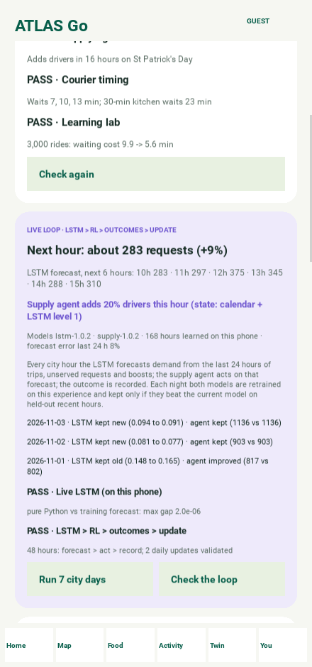
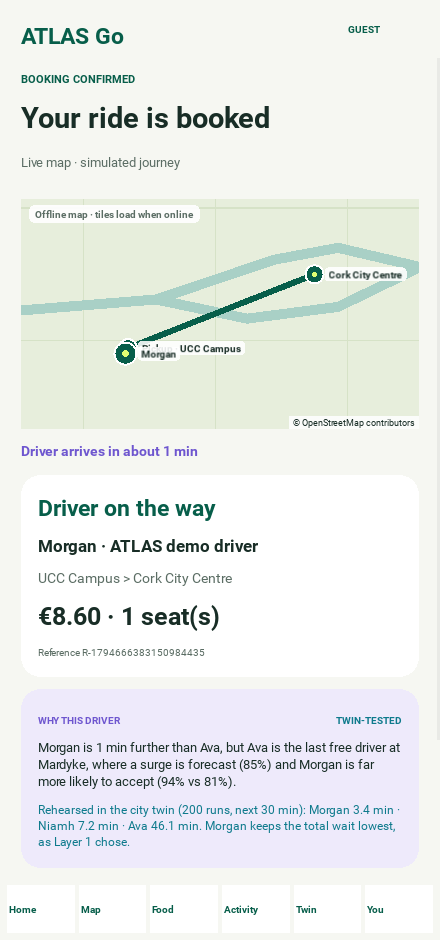
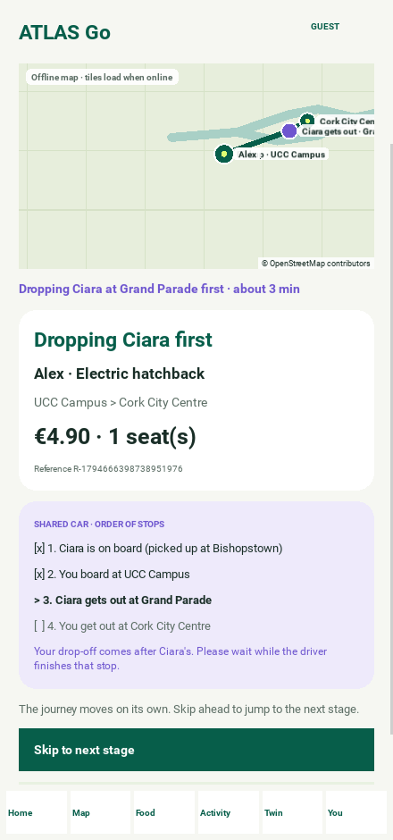
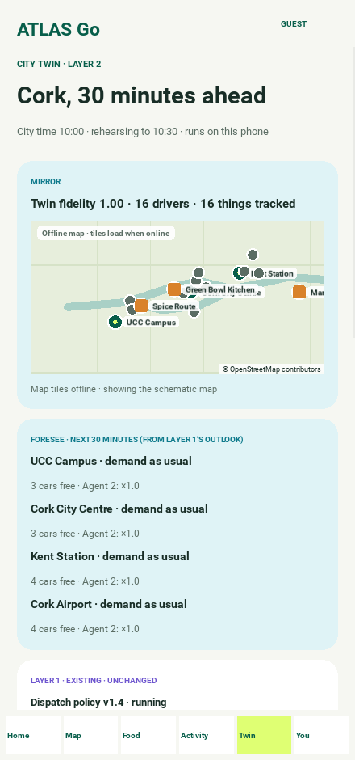
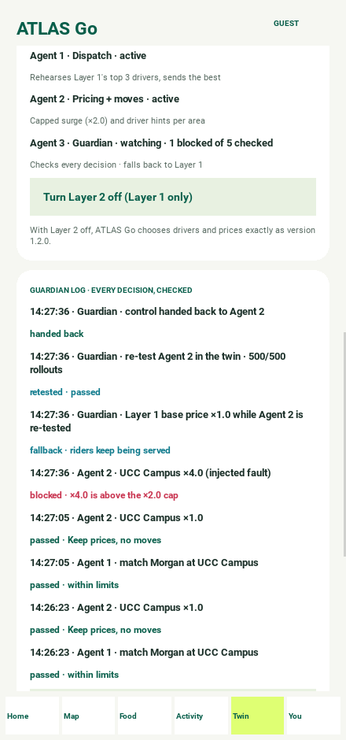
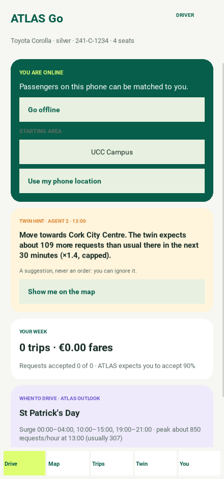

# ATLAS Go — Android app (version 1.4.0)

**README option 4:** a Python/Kivy Android app for Cork with three kinds of account — **passengers**, **drivers** and **food sellers** — a **live map**, solo and shared rides, food ordering, on-device ATLAS intelligence (Layer 1: learned dispatch, acceptance, surge outlook, supply boost, courier timing and a learning lab) a **live LSTM → RL loop** that forecasts, acts, records outcomes and retrains on the phone (new in 1.4.0), and **a digital twin of Cork with three agents on top (Layer 2, 1.3.0)**.

ATLAS Go 1.4.0 runs entirely on the phone. Accounts, rides, orders and kitchens are stored in private app storage. Several accounts can live on one phone, so a passenger can book a ride that a driver account on the same phone accepts, and order from a kitchen that a seller account on the same phone runs. Rides, deliveries and payments are simulated; no operator back end, payment provider or identity check is connected yet (see [What "production ready" covers](#what-production-ready-covers)).

- [Installable APK 1.4.0 — ATLAS Go downloads folder on Google Drive, request access](https://drive.google.com/drive/folders/1iio7hs5A7p5sM2GOh3rroG2XemnXw6KV): open the link, click **Request access**; the owner approves by email. Installs over 1.3.0 (same signing key); uninstall 1.2.0 first. SHA-256 `@@APK14_SHA@@`
- **Source code, open under the [MIT licence](../LICENSE):** browse it here in [`android-app/`](.) or [download atlas-go-1.4.0-source.zip](https://github.com/FUllSCIPTS/ATLAS/releases/download/atlas-go-v1.4.0/atlas-go-1.4.0-source.zip) (SHA-256 `@@SRC14_SHA@@`)
- [1.4.0 release page: SHA256SUMS, release notes and validation](releases/1.4.0/README.md) · earlier: [1.3.0](releases/1.3.0/README.md) · [1.2.0](releases/1.2.0/README.md)
- [User guide with screenshots of every screen](docs/USER_GUIDE.md)
- [What changed in 1.4.0](CHANGELOG.md)
- [Folder hierarchy, classes and integration blueprint](docs/ARCHITECTURE.md) · [UML blueprint catalogue](https://github.com/FUllSCIPTS/ATLAS/blob/architecture-explorer/architecture-explorer/starter/docs/UML_BLUEPRINT.md#android-app-atlas-go)
- [Privacy notice](docs/PRIVACY.md) · [Testing](docs/TESTING.md) · [Build, signing and Google Play](docs/GOOGLE_PLAY.md)
- [▶ Demo video with the digital twin and multi-agent layer (7 min 39 s)](docs/video/atlas-go-demo-v1.3-twin.mp4) · [demo of 1.1.0 (4 min 52 s)](docs/video/atlas-go-demo.mp4)

## What's new in 1.4.0 — the Layer 1 live loop

**LSTM predicts demand → RL agent chooses actions → actual outcomes are recorded → both models are periodically updated and validated** — now running on the phone (`atlas_go/loop.py`, pure Python).

| Component | 1.3.0 | 1.4.0 |
|---|---|---|
| LSTM training implementation | Present (`training/city_sim.py`) | Present; plus `training/export_lstm.py` for the on-device LSTM |
| RL agent training implementation | Present (`training/city_sim.py`, `training/rl_sim.py`) | Present; plus the forecast-aware supply agent |
| RL experience used to train the LSTM | Connected (simulation) | Connected, offline **and** on the phone |
| LSTM forecast feature in dispatch | Represented (fixed hourly tables) | **Live**: the LSTM's next-hour forecast is the dispatch surge feature |
| Live LSTM inference feeding the on-device RL agent | Not implemented | **Implemented**: every city hour, 24 h window → 6 h forecast → agent's state |
| Continuous online LSTM–RL retraining | Not implemented | **Implemented**: agent hourly (challenger), LSTM output layer nightly; champion/challenger validation on held-out hours |

Held-out simulation (Jul–Dec 2026): next-hour forecast error 9.3 %; supply cost −18 % against the 1.2 calendar agent. Intelligence → **Live loop** shows the forecast, the agent's decision, the model versions and each night's accept/reject; **Run 7 city days** runs a week of the loop.



## What's new in 1.3.0

| Area | What works |
|---|---|
| Two layers | **Layer 1** is the 1.2.0 intelligence, unchanged (`intelligence.py` and `learned.py` are byte-identical and a test checks it). **Layer 2** (`twin.py`) sits on top and only reads Layer 1's forecast, ranking and cost model. Switch Layer 2 off in the Twin tab and the app behaves exactly as 1.2.0. |
| Digital twin | Mirrors every driver, the active car and the courier with a fidelity score, and foresees the next 30 minutes per pickup place from Layer 1's surge outlook. |
| Agent 1 · Dispatch | Rehearses Layer 1's top three drivers 200 times each in the twin (rider wait, declines, riders left waiting if a busy area loses its last car) and sends the lowest total wait. Riders see *Rehearsed in the city twin* and *Twin-tested*. |
| Agent 2 · Pricing + moves | Rehearses three plans per area every five minutes; capped surge (never above ×2.0, ×1.0 at ordinary times). Drivers get a *Twin hint* (move, stay or no move needed); kitchens get the courier's twin ETA and when to start cooking. |
| Agent 3 · Guardian | Checks every decision against hard limits and a 250 ms budget, blocks anything unsafe (e.g. a ×4 price), falls back to Layer 1, re-tests the agent 500 times in the twin and hands control back. **Twin tab:** mirror, foresight, both layers, Guardian log, *Run Guardian fault drill*, *Check Layer 2*. |
| Shared rides | Each shared car already has a rider on board. The new rider waits while the driver comes with that rider, boards, and is **dropped only after the earlier rider's drop-off** — shown as a stop checklist and on the map, and enforced by the app. Seats are released on arrival as well as on cancel. |

| Twin-tested ride | Shared car: earlier rider first | Twin tab | Guardian log | Driver twin hint |
|---|---|---|---|---|
|  |  |  |  |  |

## What's new in 1.2.0

| Area | What works |
|---|---|
| Accounts | Welcome screen with **Create an account**, **Sign in** and **Continue as a guest passenger**. Passwords are stored only as salted PBKDF2-HMAC-SHA256 hashes (200,000 iterations); five wrong passwords lock sign-in for 60 seconds. Email, Irish/international mobile numbers (normalised to E.164) and password strength are validated. **Delete my account** (password confirmation) and **Erase all data** are in You. |
| Passenger registration | Name, email, mobile and password. History, rides and orders belong to the signed-in passenger. |
| Driver registration | Vehicle, Irish registration (e.g. `241-C-1234`), SPSV driver licence number, seats and usual starting area. Drivers go online/offline, use their phone location, receive ride requests from ATLAS dispatch, accept or decline, then mark *arrived*, *start trip* and *complete trip*. Trips, fares and acceptance rate are tracked. |
| Food seller registration | Kitchen name, cuisine, food business registration number, location and preparation time. Sellers add and remove dishes (prices in euro, stored as cents), open or close the kitchen, accept orders and mark food ready for the courier. Orders and sales are tracked. Open kitchens with dishes appear in Food for passengers. |
| Live map | OpenStreetMap tiles with pan (drag), zoom (+/−, double tap) and an on-device tile cache; a schematic Cork map takes over automatically when offline. Shows pickup places, nearby drivers moving in real time, registered drivers who are online, kitchens, the active ride's car and route, the courier, and **your location** (blue dot with accuracy) after you allow it. |
| Live journeys | Rides and deliveries now move on their own in a 10× time-lapse: the car drives to the pickup, waits, then drives to the destination; the courier waits for the kitchen, then rides to you. The ride and order screens embed the live map with an ETA. *Skip to next stage* still jumps ahead. |
| ATLAS intelligence | All six models are wired into the live flows and can be checked on the phone (**How ATLAS learns → Check all models**). Registered drivers compete with the simulated fleet in the dispatch policy, using their real distance to the pickup, a per-driver acceptance model that learns from their accept/decline history, and the surge forecast for the current hour. Courier timing uses each seller's own preparation time. |

### Models in the app

| Model | Method | Used for |
|---|---|---|
| Dispatch policy v1.4 | REINFORCE softmax over four driver features, 30,000 simulated rides | Choosing and explaining the driver for every solo ride, including registered drivers |
| Acceptance model | Beta(9, 1) prior updated with each registered driver's accept/decline history | The *likely to accept* feature for registered drivers |
| Surge outlook | Hourly demand learned from two simulated years of Cork with Ireland's public holidays | Intelligence screen, home and driver cards, the *area surge* dispatch feature, busy-period notice on fares |
| Supply agent | Learned extra-driver boost per calendar context and hour | Violet marks on the outlook; *when to drive* advice for drivers |
| Courier timing | Q-learning table from kitchen slack to dispatch delay (extrapolated beyond the trained range for slow kitchens) | Basket, order and seller screens; saved with each order |
| Learning lab | On-device REINFORCE retraining from zero (sandbox) | Intelligence screen; never dispatches |

`python training/export_lstm.py` (development only, needs numpy) trains the on-device LSTM and the forecast-aware supply agent and rewrites `atlas_go/lstm_weights.py` (reproducible byte for byte). `python training/export_learned.py` (development only, needs numpy) retrains the dispatch and courier policies and the two-year city simulation and rewrites `atlas_go/learned.py`. For 1.2.0 this was re-run and reproduced the bundled file byte for byte. The training data is synthetic; the models are illustrative, not measurements of real riders, drivers or kitchens.

## Try the three roles on one phone

1. **Create an account → Driver.** Choose *UCC Campus* as the starting area, create the account and tap **Go online**. Sign out (You → Sign out); the driver stays online for dispatch.
2. **Create an account → Food seller.** Register a kitchen, open **Menu** and add a dish. Sign out.
3. **Create an account → Passenger.** Book a ride from UCC Campus: ATLAS picks your registered driver (nearest, likely to accept). Then order the seller's dish from **Food**. Sign out.
4. **Sign in as the driver** to accept the request and drive the trip. **Sign in as the seller** to accept the order and mark it ready. **Sign in as the passenger** to follow the courier on the live map until delivery.

## What "production ready" covers

Done in this release: input validation on every form, hashed passwords with lockout, crash-safe atomic storage with validation and quarantine of damaged files, rollback when a write fails, migration of 1.1.0 data, runtime location permission (foreground only), a non-debuggable release build signed with APK Signature Scheme v2/v3, 16 KB native alignment for Android 15+, privacy notice and account deletion, and 117 unit tests plus 247 UI assertions in two screen configurations.

Still needed before carrying real passengers or food — these are business and infrastructure steps, not app code:

- **Operator back end.** Accounts and bookings are per phone. Real matching between different phones needs the ATLAS server (the [`architecture-explorer` starter](https://github.com/FUllSCIPTS/ATLAS/tree/architecture-explorer/architecture-explorer/starter) has trip, dispatch and model services; food and accounts APIs are proposed in the UML blueprint).
- **Verification.** SPSV licences, vehicle registrations and food business registrations are format-checked only. A real launch needs NTA licence checks, insurance, and food-business registration with the competent authority.
- **Payments.** All fares and totals are simulated. A payment provider (PSD2/SCA) is required.
- **Map tiles.** The default tile server is OpenStreetMap's community server, which suits light use only. A production launch should use a commercial tile provider (`ATLAS_TILE_URL` changes the source).
- **Store review and physical-device testing.** See [Testing](docs/TESTING.md) and [Google Play](docs/GOOGLE_PLAY.md).

## Run from source

Desktop preview needs Python 3.12+; Android packaging uses Buildozer and python-for-android on Linux/WSL.

```bash
cd android-app
python -m venv .venv && source .venv/bin/activate
pip install -r requirements-dev.txt
python -m pytest tests                       # 173 tests (one needs a display: xvfb-run)
python main.py                               # desktop preview
ATLAS_FAKE_GPS=51.8990,-8.4700 python main.py  # preview with a simulated location
ATLAS_CLOCK=2027-03-17T13:00 python main.py     # preview the twin at a busy time (St Patrick's Day)
# Android packages (Linux, after installing build prerequisites):
buildozer android debug
buildozer android release
```

Pushing to `main` runs the [Android workflow](../.github/workflows/atlas-android.yml): unit tests, two desktop UI acceptance runs, Buildozer APK/AAB builds, bundle validation and the Android 16 emulator click-through with screenshots. When the upload-key secrets are configured, the release workflow signs the AAB with the owner's upload key.

## Validation

| Check | Result (1.3.0) |
|---|---|
| Python unit tests | 158 (157 passed + 1 display-only test skipped in CI; all 158 pass under `xvfb-run`) |
| Desktop UI acceptance, 440 × 940 | 305 assertions, 28 screenshots |
| Desktop UI acceptance, 360 × 780 at font scale 1.2 | 305 assertions, 28 screenshots |
| **Android 16 emulator (CI)** | 362 assertions, 28 OS screenshots, no crash; the non-debuggable release build launches |
| Layer 1 | `intelligence.py` and `learned.py` byte-identical to 1.2.0; six-model self-test passes |
| Layer 2 | Four self-checks pass on the phone; Guardian fault drill blocks, falls back, re-tests 500/500 and hands back |
| Release bundle | bundletool validation, manifest check (version 1.3.0 / code 4, not debuggable, backup off, foreground-only permissions), 232 native libraries aligned to 16 KB |
| APK signature | APK Signature Scheme v2 and v3 |

Details: [releases/1.3.0/VALIDATION.md](releases/1.3.0/VALIDATION.md).
