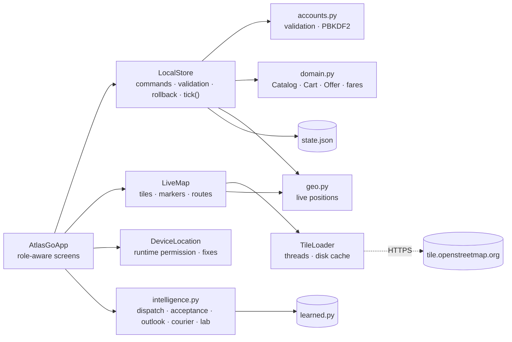

# Python Android implementation blueprint (1.2.0)

ATLAS Go uses Python for every application screen, rule, storage operation and test. Kivy provides the UI; Buildozer/python-for-android package it for Android. Version 1.2.0 adds passenger, driver and food-seller accounts, a live map with device location, time-lapse live journeys, and wires all six on-device models into those flows. The app still has no operator back end: accounts and bookings exist on one phone. The only network traffic is map-tile downloads.

The full UML blueprint for the app, the web front end, the back end and the databases is in the [UML blueprint catalogue](https://github.com/FUllSCIPTS/ATLAS/blob/architecture-explorer/architecture-explorer/starter/docs/UML_BLUEPRINT.md#android-app-atlas-go).

## Folder hierarchy

```text
android-app/
  main.py                         Python application entry point
  buildozer.spec                  Android API, ABIs, permissions and packaging (1.2.0, versionCode 3)
  requirements.txt                Desktop runtime dependencies
  requirements-dev.txt            Testing dependencies
  CHANGELOG.md                    Release history
  atlas_go/
    __init__.py                   Application version
    accounts.py                   Roles, validation, PBKDF2 password hashing                (1.2.0)
    domain.py                     Places, fares, offers, menu, Kitchen, Catalog and basket
    geo.py                        Cork coordinates, Web-Mercator tiles, live journey positions (1.2.0)
    store.py                      Atomic JSON persistence: accounts, rides, orders, kitchens, live progress
    intelligence.py               Calendar, surge outlook, dispatch, acceptance, courier timing, lab, self-test
    learned.py                    Learned constants exported from the simulations (generated)
    livemap.py                    LiveMap widget and TileLoader (OSM tiles, cache, offline layer) (1.2.0)
    location.py                   DeviceLocation: Android LocationManager via pyjnius         (1.2.0)
    app.py                        Python/Kivy screens for passengers, drivers and sellers
    acceptance.py                 Debug-only UI click-through and screenshots
  assets/                         Original icon and launch graphic
  tests/
    test_domain.py                Domain and repository regression tests
    test_intelligence.py          Calendar, outlook, policy, courier timing and lab tests
    test_accounts_geo.py          Validation, hashing, maps, live positions, new model features (1.2.0)
    test_roles.py                 Registration, sign-in, driver/seller lifecycles, deletion, migration (1.2.0)
  training/                       Development-only simulations and exporter (numpy; not packaged)
    rl_sim.py                     Ride dispatch (REINFORCE) and courier timing (Q-learning)
    city_sim.py                   Two simulated years of Cork demand, holidays, supply agent, LSTM
    export_learned.py             Writes atlas_go/learned.py
  scripts/                        Emulator acceptance, signing, manifest and alignment checks
  docs/                           User guide, architecture, privacy, Play handover, screenshots, video
  releases/                       Downloads, checksums and validation evidence (1.2.0/ for this release)
```

## Layers



The UI never edits state directly except through `LocalStore` commands, which validate, mutate, save atomically and roll back in memory if the write fails. Once a second, `AtlasGoApp.live_tick` calls `LocalStore.tick()`, which advances simulated journeys whose time-lapse leg has finished; journeys driven by a registered driver or seller only move when that account acts. The UI asks `intelligence.py` which driver to offer (passing registered online drivers as extra candidates) and when to send the courier, and passes the answers to the store as plain values.

## UML relationships

```mermaid
classDiagram
    AtlasGoApp --> LocalStore : commands and state
    AtlasGoApp --> LiveMap : live layers
    AtlasGoApp --> DeviceLocation : fixes
    AtlasGoApp --> intelligence : dispatch, outlook, courier plan, self_test
    AtlasGoApp --> LearningLab : sandbox training
    LiveMap --> TileLoader : textures
    LocalStore --> accounts : validate, hash, verify
    LocalStore --> Catalog : kitchens and dishes
    LocalStore --> Cart : basket
    LocalStore --> Offer : seat reservations
    LocalStore --> geo : live positions
    Catalog --> Kitchen
    Catalog --> Dish
    Cart --> Catalog : prices
    intelligence --> learned : bundled constants
    Acceptance --> AtlasGoApp : control events
    class LocalStore {
        register(role, name, email, phone, password, ...)
        login(email, password)
        logout()
        continue_as_guest()
        delete_account(password)
        set_online(online, base)
        update_location(point)
        online_drivers()
        book(pickup, destination, comfort, offer_id, party, driver, why, driver_id, start)
        driver_respond(accept, fallback)
        driver_advance()
        advance_ride(cancel)
        add_dish(name, detail, price)
        archive_dish(dish_id)
        update_kitchen(open_, prep)
        update_cart(operation, item)
        checkout(address, courier)
        seller_accept()
        seller_ready()
        advance_order()
        tick(now)
        my_history()
    }
    class Catalog {
        kitchens
        dishes
        name(kitchen)
        menu(kitchen)
        listed()
    }
    class LiveMap {
        set_view(center, zoom)
        zoom_by(step)
        fit(points)
        set_layers(markers, routes, accuracy)
        to_screen(point)
        to_point(x, y)
    }
    class TileLoader {
        texture(key)
        offline
    }
    class DeviceLocation {
        start()
        stop()
        point
        accuracy
    }
```



## Complete source method catalog

Generated from the Python AST of `atlas_go/` for 1.2.0. Dataclass constructors and equality/representation methods are generated by Python; their field declarations are the constructor contract.

| File / class | Declared functions and methods |
|---|---|
| `acceptance.py` module | `ai_rank` |
| `acceptance.py` / `Acceptance` | `__init__`, `check`, `click`, `capture`, `shared_reserved`, `insets_ready`, `lab_finished`, `fill`, `until`, `live_on`, `live_off`, `account`, `start`, `next_step`, `finish` |
| `accounts.py` module | `hash_password`, `verify_password`, `clean_name`, `clean_email`, `clean_phone`, `check_password`, `clean_plate`, `clean_licence`, `clean_business`, `parse_int`, `parse_price`, `public_view` |
| `app.py` module | `_text`, `dashed` |
| `app.py` / `Panel` | `__init__`, `_redraw` |
| `app.py` / `RouteMap` | `__init__`, `draw` |
| `app.py` / `OutlookChart` | `__init__`, `draw` |
| `app.py` / `Bar` | `__init__`, `draw` |
| `app.py` / `LearningCurve` | `__init__`, `update`, `draw` |
| `app.py` / `AtlasGoApp` | `build`, `on_start`, `configure_system_bars`, `apply_system_insets`, `on_resume`, `save_ui`, `today`, `on_pause`, `on_stop`, `home_screen`, `on_keyboard`, `box`, `label`, `gap`, `button`, `row`, `field`, `safe`, `message`, `title_block`, `go`, `nav_items`, `render`, `live_tick`, `refresh_live`, `live_text`, `map_layers`, `add_map`, `on_location`, `on_location_status`, `locate`, `welcome`, `guest`, `login`, `submit_login`, `set_reg_role`, `register`, `toggle_agree`, `submit_register`, `logout`, `delete_account`, `home`, `select`, `update_selection`, `map_screen`, `ride`, `pickup_here`, `registered_candidates`, `pick_driver`, `dispatch_card`, `book_solo`, `book_shared`, `active_ride`, `redispatch`, `next_ride`, `cancel_ride`, `driver`, `job_accept`, `job_decline`, `job_next`, `seller`, `seller_menu`, `add_dish`, `food`, `open_menu`, `menu`, `add_food`, `remove_food`, `clear_cart`, `cart`, `checkout`, `active_order`, `next_order`, `activity`, `profile`, `reset`, `privacy`, `shift_outlook`, `check_models`, `intelligence`, `lab_refresh`, `lab_train`, `lab_step` |
| `domain.py` module | `distance`, `fare`, `money` |
| `domain.py` / `Dish` | Dataclass fields: `id`, `name`, `detail`, `restaurant`, `price` |
| `domain.py` / `Offer` | `matches`, `reserve`, `release` |
| `domain.py` / `Kitchen` | Dataclass fields: `id`, `name`, `cuisine`, `place`, `prep`, `owner`, `open` |
| `domain.py` / `Catalog` | `__init__`, `name`, `menu`, `listed` |
| `domain.py` / `Cart` | `__init__`, `restaurant`, `add`, `remove`, `count`, `subtotal`, `total`, `clear` |
| `geo.py` module | `haversine_km`, `eta_minutes`, `leg_seconds`, `lerp`, `nearest_place`, `valid_point`, `zone_drift`, `world_px`, `from_world_px`, `tile_range`, `fit_zoom`, `ride_legs`, `ride_position`, `ride_eta_text`, `order_position` |
| `intelligence.py` module | `easter_sunday`, `first_monday`, `last_monday`, `public_holidays`, `jazz_weekend`, `event_kind`, `agent_tag`, `weektype`, `outlook`, `windows`, `clock`, `span`, `ratio_text`, `day_title`, `day_summary`, `upcoming`, `score`, `rank`, `choose`, `surge_level`, `acceptance`, `registered_candidate`, `explain`, `courier_plan`, `courier_text`, `_candidates`, `expected_cost`, `self_test` |
| `intelligence.py` / `Hour` | `ratio`, `surge` |
| `intelligence.py` / `Candidate` | `features` |
| `intelligence.py` / `LearningLab` | `__init__`, `reset`, `done`, `_eval`, `_eval_policy`, `train`, `result` |
| `livemap.py` module | `loader`, `text_texture` |
| `livemap.py` / `TileLoader` | `__init__`, `offline`, `texture`, `_path`, `_fetch`, `_work`, `_deliver` |
| `livemap.py` / `LiveMap` | `__init__`, `set_view`, `zoom_by`, `fit`, `set_layers`, `detach`, `_scale`, `to_screen`, `to_point`, `on_touch_down`, `on_touch_move`, `on_touch_up`, `_schedule`, `visible_tiles`, `draw`, `_schematic`, `_route`, `_marker` |
| `location.py` / `DeviceLocation` | `__init__`, `available`, `start`, `stop`, `_fix`, `_android_start`, `_android_listen` |
| `store.py` module | `_is_point` |
| `store.py` / `LocalStore` | `__init__`, `reset`, `load`, `validate`, `save`, `snapshot`, `commit`, `_refresh_catalog`, `account`, `user`, `role`, `signed_in`, `register`, `_place`, `login`, `continue_as_guest`, `logout`, `delete_account`, `online_drivers`, `driver_position`, `set_online`, `update_location`, `driver_job`, `driver_respond`, `driver_advance`, `book`, `_advance_ride`, `advance_ride`, `kitchen_of`, `kitchen_prep`, `_my_kitchen`, `add_dish`, `archive_dish`, `update_kitchen`, `update_cart`, `checkout`, `seller_order`, `seller_accept`, `seller_ready`, `_advance_order`, `advance_order`, `tick`, `my_history` |

## Persistence and state rules

`state.json` lives in the app-private data directory. A temporary JSON file is flushed and atomically replaced on each save. Its fields are `accounts`, `session`, `guest`, `kitchens`, `cart`, `history`, `ride`, `order`, `seats` and `ui`. `LocalStore.validate` checks every field (roles, unique emails and ids, hash fields, driver counters and locations, kitchen ids and dish prices, record stages and live data) before any screen reads it; damaged files are preserved as `state.invalid.json` and a clean state is created. A 1.1.0 file (without the new fields) loads unchanged. Map tiles are cached under `tiles/` next to the state file.

Money is integer cents. One active ride and one active food order exist per phone. A ride booked with a registered driver is `pending` until that driver accepts; declining hands it to the next-best driver. A seller-kitchen order is `pending` until the seller accepts, and stays in the cooking stage until the seller marks it ready. Completed, cancelled and delivered records go into history with the passenger's account id (or none for guests); deleting an account anonymises its records. Only passengers (or guests) book and order; only drivers go online; only sellers edit menus.

Ride: driver on the way → at pickup → on your way → completed (or cancelled). Food: preparing → courier on the way → arriving → delivered. Live positions are straight-line interpolations at 25 km/h shown in a 10× time-lapse (`geo.py`).

## On-device intelligence

| Model | Implementation | Inputs in 1.2.0 |
|---|---|---|
| Dispatch policy v1.4 | `intelligence.rank/choose/explain`, weights `RIDE_WEIGHTS` | Simulated pool for the pickup plus every registered online driver |
| Acceptance model | `intelligence.acceptance(offered, accepted)` — Beta(9, 1) posterior mean | Each registered driver's accept/decline counts |
| Surge outlook | `outlook`, `day_summary`, `surge_level` | Calendar context and hour; current-hour surge is a dispatch feature |
| Supply agent | `BOOST` in `outlook` | Calendar context, weekday type, hour |
| Courier timing | `courier_plan(restaurant, prep)` | Kitchen preparation time (seller-defined for seller kitchens) |
| Learning lab | `LearningLab` (REINFORCE) | Simulated rides on the phone; sandbox only |

`intelligence.self_test()` runs each model on known inputs; the Intelligence screen exposes it as *Check all models* and the unit tests require all six to pass. `training/export_learned.py` regenerates `learned.py`; for 1.2.0 the output was identical to the bundled file.

## Integration contract for a live service

Do not turn simulated confirmations into real bookings without replacing `LocalStore` commands with authenticated server transactions. The FastAPI starter on the `architecture-explorer` branch is a development reference, not a production transport/food platform.

| Capability | Required live implementation |
|---|---|
| Identity | Server accounts for the three roles, email/phone verification, password reset, session tokens in Android Keystore, consent and deletion. 1.2.0's local accounts define the fields and validation rules. |
| Driver onboarding | NTA SPSV licence and vehicle checks, insurance, background checks; activation by an operator |
| Seller onboarding | Food business registration with the competent authority, allergen information, opening hours |
| Solo ride | Authoritative quote/expiry, idempotent booking, dispatch across phones, status stream |
| Shared ride | Route overlap and detour limits, atomic capacity transaction, rider safety and cancellation rules |
| Food | Merchant inventory, order acceptance, courier dispatch, cancellation/refund handling |
| Payments | Certified payment provider tokenisation (PSD2/SCA), webhook verification and reconciliation |
| Maps | Commercial tile/routing provider with an API key held server-side or restricted; real routes and ETAs |
| Location | Driver location streamed to the server only while online, with purpose-specific consent |
| Kafka | Back-end outbox and event schemas; never connect phones directly to Kafka |
| LSTM/discrete ML | Server inference endpoints with model version and fallback; the bundled models stay as offline fallback |
| Continuous-learning RL | Offline evaluation, monitored safety constraints and approved deployment; the on-device learning lab stays a sandbox |
| Operations | Audit logs, retries/timeouts, abuse controls, accessibility review, load/device testing and incident response |

Introduce a repository interface with asynchronous methods, keep `LocalStore` as the offline implementation, add a remote repository with TLS and secure token storage, move money/capacity/matching rules to the server, and write end-to-end tests against a staging service.
