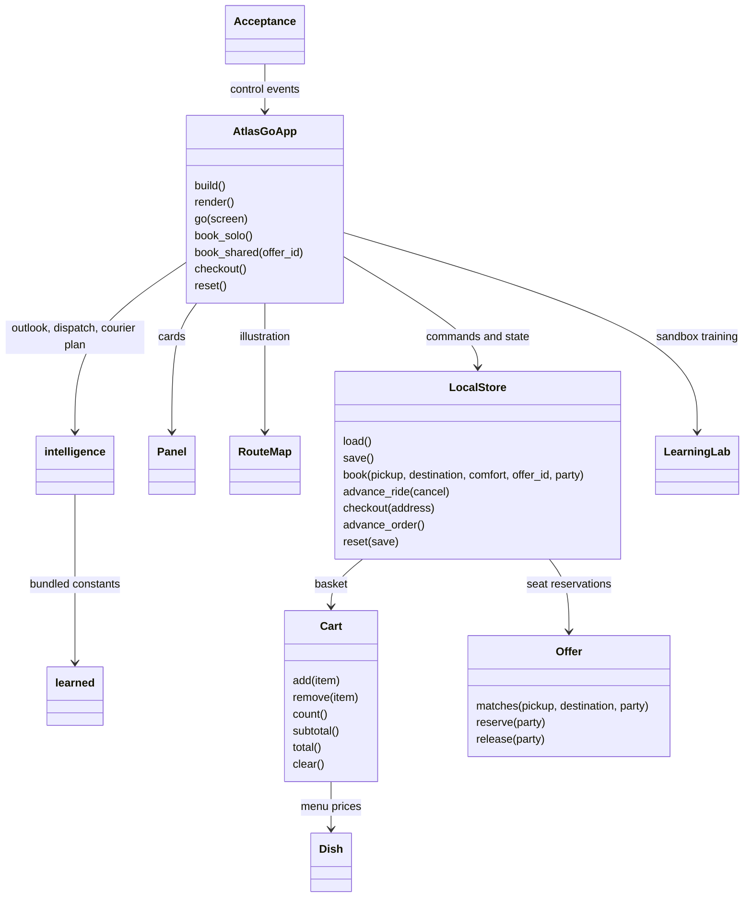

# Python Android implementation blueprint

ATLAS Go uses Python for every application screen, rule, storage operation and test. Kivy provides the UI; Buildozer/python-for-android package it for Android. Generated platform scaffolding and third-party native runtimes are build dependencies. The Android app is independent of the research simulation and server reference starter; it performs no API calls or ML inference.

## Folder hierarchy

```text
android-app/
  main.py                         Python application entry point
  buildozer.spec                  Android API, ABIs, permissions and packaging
  requirements.txt                Desktop runtime dependencies
  requirements-dev.txt            Testing dependencies
  atlas_go/
    __init__.py                   Application version
    domain.py                     Places, fares, offers, menu and basket
    store.py                      Atomic local JSON persistence and booking state
    app.py                        Python/Kivy screens, controls and navigation
    intelligence.py               Holiday calendar, surge outlook, dispatch policy, courier timing, learning lab
    learned.py                    Learned constants exported from the simulations (generated)
    acceptance.py                 Debug-only UI click-through and screenshots
  assets/                         Original icon and launch graphic
  tests/test_domain.py            Domain and repository regression tests
  tests/test_intelligence.py      Calendar, outlook, policy, courier timing and lab tests
  training/                       Development-only simulations and exporter (numpy; not packaged)
    rl_sim.py                     Ride dispatch (REINFORCE) and courier timing (Q-learning)
    city_sim.py                   Two simulated years of Cork demand, holidays, supply agent, LSTM
    export_learned.py             Writes atlas_go/learned.py
  scripts/
    emulator-acceptance.py        Android test installation and screenshot extraction
    verify-acceptance.py          UI result and screenshot assertions
    sign-release.py               Private local AAB signing
  docs/
    USER_GUIDE.md                  Screen-by-screen usage
    GOOGLE_PLAY.md                 Packaging and Play submission handover
    PRIVACY.md                    Policy for this offline build
    ARCHITECTURE.md                This implementation map
    play-assets/                  Listing icon and feature graphic
    screenshots/                  Actual running-app captures
  releases/                       Downloads and validation evidence
```

## UML relationships



## Complete source method catalog

This table is generated from the actual Python AST. Dataclass constructors and equality/representation methods are generated by Python; their field declarations are the constructor contract in source.

| File / class | Declared functions and methods |
|---|---|
| `acceptance.py` / `Acceptance` | `__init__`, `check`, `click`, `capture`, `shared_reserved`, `start`, `next_step`, `finish` |
| `app.py` / `Panel` | `__init__`, `_redraw` |
| `app.py` / `RouteMap` | `__init__`, `draw` |
| `app.py` / `AtlasGoApp` | `build`, `on_start`, `configure_system_bars`, `apply_system_insets`, `on_resume`, `save_ui`, `on_pause`, `on_stop`, `on_keyboard`, `box`, `label`, `gap`, `button`, `safe`, `message`, `title_block`, `go`, `render`, `home`, `select`, `update_selection`, `ride`, `book_solo`, `book_shared`, `active_ride`, `next_ride`, `cancel_ride`, `food`, `open_menu`, `menu`, `add_food`, `remove_food`, `clear_cart`, `cart`, `checkout`, `active_order`, `next_order`, `activity`, `profile`, `reset`, `privacy` |
| `app.py` / `OutlookChart`, `Bar`, `LearningCurve` | `__init__`, `draw` (`LearningCurve.update`) |
| `app.py` / `AtlasGoApp` (intelligence) | `today`, `dispatch_card`, `shift_outlook`, `intelligence`, `lab_refresh`, `lab_train`, `lab_step` |
| `intelligence.py` module | `easter_sunday`, `first_monday`, `last_monday`, `public_holidays`, `jazz_weekend`, `event_kind`, `agent_tag`, `weektype`, `outlook`, `windows`, `clock`, `span`, `ratio_text`, `day_title`, `day_summary`, `upcoming`, `score`, `rank`, `choose`, `explain`, `courier_plan`, `courier_text`, `expected_cost` |
| `intelligence.py` / `Hour`, `Candidate` | Dataclasses; `Hour.ratio`, `Hour.surge`, `Candidate.features` |
| `intelligence.py` / `LearningLab` | `__init__`, `reset`, `done`, `train`, `result` |
| `domain.py` module | `distance`, `fare`, `money` |
| `domain.py` / `Dish` | Dataclass fields: `id`, `name`, `detail`, `restaurant`, `price` |
| `domain.py` / `Offer` | `matches`, `reserve`, `release` |
| `domain.py` / `Cart` | `__init__`, `restaurant`, `add`, `remove`, `count`, `subtotal`, `total`, `clear` |
| `store.py` / `LocalStore` | `__init__`, `reset`, `load`, `validate`, `save`, `snapshot`, `commit`, `update_cart`, `book`, `advance_ride`, `checkout`, `advance_order` |

## Persistence and state rules

`state.json` lives in the app-private data directory. A temporary JSON file is flushed and atomically replaced on each save. Its fields are `cart`, `history`, `ride`, `order`, `seats` and `ui`. Malformed JSON is preserved as `state.invalid.json` before a clean demo state is created. Reset removes that recovery file too. Booking, cancellation, checkout and basket mutations roll back in memory if atomic persistence fails. All UI commands execute on Kivy's main thread. Android system-bar insets and light-bar appearance are queried on Android's UI thread and applied to the Kivy layout, keeping the header and navigation clear of system controls.

Money is integer cents. One active ride and one active food order are allowed. Shared offers match both saved route endpoints and seat count. Cancellation releases reserved seats. Completed/cancelled records go into history. The basket is restricted to one restaurant and ten of each item. Navigation/form state is saved for restart. Reset deletes demo history and reseeds offers.

Ride: driver confirmed → at pickup → on your way → completed. A ride can be cancelled. Food: preparing → courier on the way → arriving → delivered. All stages advance only on explicit simulation-button presses.

## On-device intelligence (offline)

The reinforcement-learning features shown in the demo video run locally, in pure Python, from constants in `learned.py`:

- **Dispatch policy v1.4** — a softmax policy over four driver features (closer ETA, likelihood to accept, keeping the last car in an area about to surge, avoiding surging areas), trained with REINFORCE on delayed rewards (pickup time, cancellations, shortage caused elsewhere). Solo bookings take its top choice and store a plain-language explanation with the ride.
- **Courier timing** — a Q-learning table from kitchen slack (prep estimate minus courier travel) to minutes to wait before dispatch. The plan is stored with the order.
- **Surge outlook** — hourly demand ratios per calendar context, learned from two simulated years of Cork demand over Ireland's 2025–2026 public holidays, plus the hours in which the supply agent learned to add drivers. Holiday dates are computed for any year.
- **Learning lab** — retrains a dispatch policy from zero on the device and evaluates it against the nearest-driver rule and the approved policy. It is a sandbox; its candidates never dispatch rides.

In the full simulation (`training/city_sim.py`) the agent's experience log — requests it could not serve and the drivers it added — is also an input to the LSTM forecaster, which uncovers demand that completed trips hide. The app ships the distilled hourly profiles rather than running the LSTM, because it has no live demand history. All data is synthetic.

## Integration contract for a live service

Do not turn simulated confirmations into real bookings without replacing `LocalStore` commands with authenticated server transactions. The existing FastAPI starter is a development reference, not a production transport/food platform.

| Capability | Required live implementation |
|---|---|
| Identity | authenticated passenger/driver roles, account recovery, consent and deletion |
| Solo ride | authoritative quote/expiry, idempotent booking, driver dispatch and status stream |
| Shared ride | route overlap and detour limits, atomic capacity transaction, rider safety and cancellation rules |
| Food | real merchant inventory, order acceptance, courier dispatch, cancellation/refund handling |
| Payments | certified payment provider tokenization, server webhook verification and reconciliation |
| Maps | licensed map/routing provider, location permissions and purpose-specific consent |
| Kafka | backend outbox and event schemas; never connect mobile devices directly to Kafka |
| LSTM/discrete ML | server inference endpoints with model version and fallback; no client authority for price or safety decisions |
| Continuous-learning RL | offline evaluation, monitored safety constraints and approved deployment; no uncontrolled client training loop (the on-device learning lab is a sandbox that never dispatches) |
| Operations | audit logs, retries/timeouts, abuse controls, accessible UI review, load/device testing and incident response |

The next implementation should introduce an interface with asynchronous repository methods rather than blocking HTTP in `AtlasGoApp`. Retain `LocalStore` as a demo implementation, add a remote repository with TLS and secure token storage, move authoritative money/capacity rules to the server, and write end-to-end tests against a staging service. No document can guarantee that an arbitrary future GPT will build an accurate production application without those service requirements and validation.
