# ATLAS Go user guide (1.2.0)

The screenshots are captured from the running Python/Kivy app by the automated acceptance run (desktop preview at 440 × 940; the Android workflow replaces them with Android 16 emulator captures of the same screens). They show illustrative Cork data and test accounts, not real customers, drivers or kitchens.

## 1. Welcome and accounts

A fresh install opens the welcome screen. Choose **Create an account**, **Sign in**, or **Continue as a guest passenger** (no account; activity is kept on the phone under *guest*). The badge at the top right shows who is signed in.

Registration has three tabs — **Passenger**, **Driver**, **Food seller**. Everyone gives a name, email, mobile number and a password of at least 8 characters with a letter and a number. Tick *I have read the privacy notice* and create the account. If something is wrong (for example an invalid email) a message explains it and everything you typed stays in the form.

| Welcome | Driver registration | Seller registration |
|---|---|---|
| 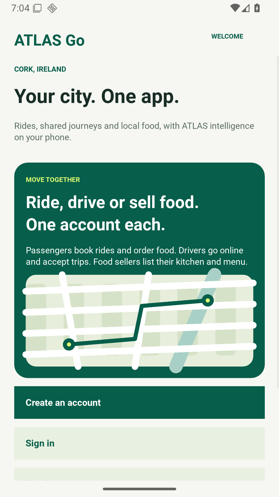 | 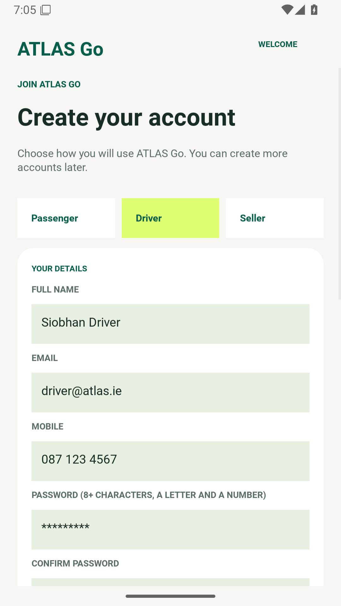 | 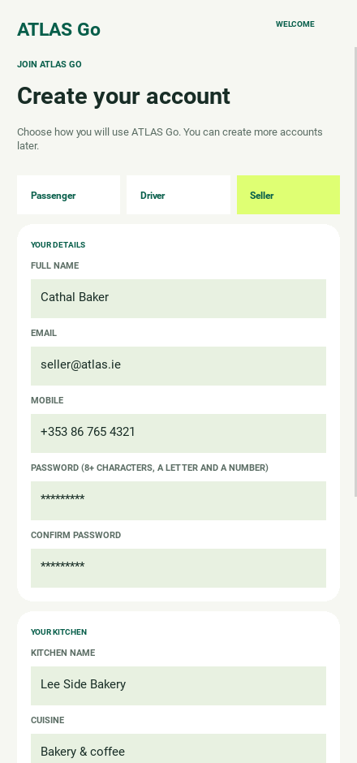 |

Drivers also enter the vehicle, an Irish registration such as `241-C-1234`, their SPSV driver licence number, seats and usual starting area. Sellers enter the kitchen name, cuisine, food business registration number, typical preparation time and location. These numbers are checked for format only.

Several accounts can exist on one phone. Use **You → Sign out** to switch. Five wrong passwords lock sign-in for that email for 60 seconds.

## 2. Passenger home

Home offers **Ride**, **Share ride** and **Food**, the **Live map**, and today's ATLAS outlook for Cork. The bottom bar opens Home, Map, Food, Activity and You.

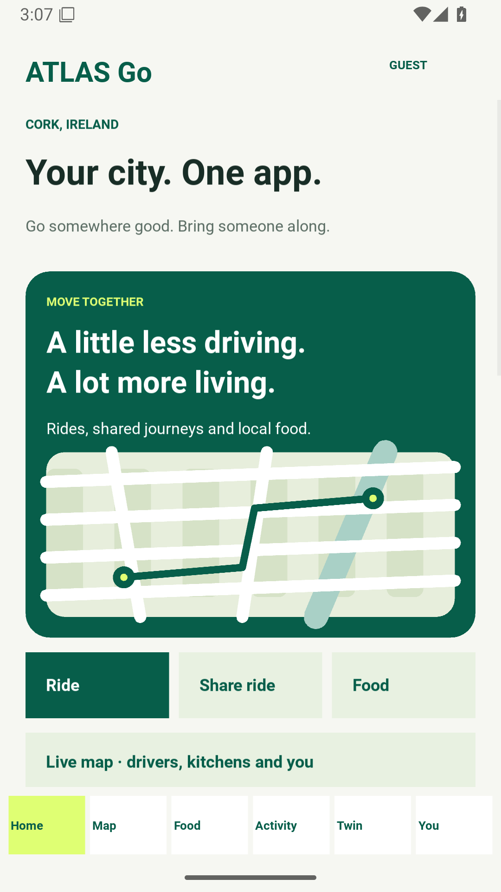

## 3. Book a ride

Choose pickup and destination from four Cork places (or tap **Pick up near my location** on a phone), choose ATLAS Go or Comfort and see the fare. The **ATLAS picks your driver** card ranks the nearest drivers with their distance, chance of accepting and area surge, and explains the choice. Registered drivers who are online on this phone appear in the same list.

After **Book ride**, the live map shows the car driving to you (violet dashed line) and then along the route (green), with an ETA. The journey moves on its own in a 10× time-lapse; **Skip to next stage** jumps ahead and **Cancel ride** asks for confirmation.

| Booking | Live ride |
|---|---|
| 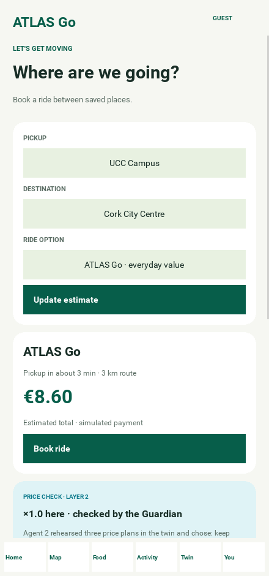 | 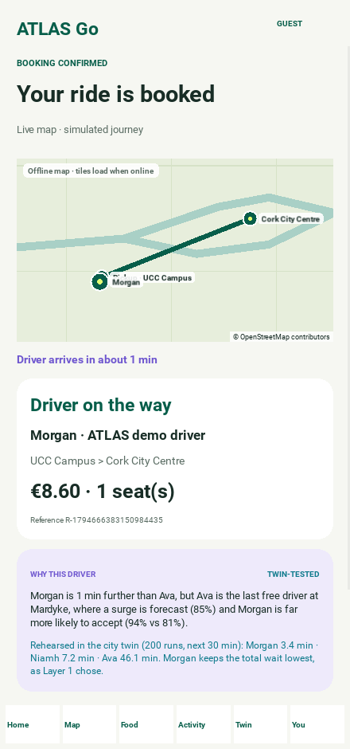 |

When ATLAS picks a registered driver, the ride waits for that driver to accept. Sign in as the driver to accept, or tap **Choose another driver**.

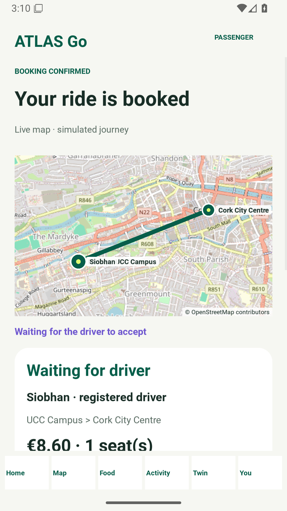

## 4. Shared rides

From Home choose **Share ride**. Use UCC Campus → Cork City Centre (or another seeded route), choose one or two seats and join. Seats are reserved immediately and released if you cancel.

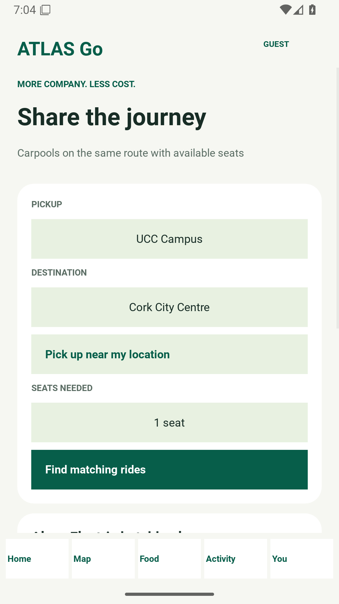

## 5. Food

Food lists the three built-in kitchens and every open seller kitchen with at least one dish. Add up to ten of each item; a basket holds one kitchen at a time. The basket shows the learned courier timing: when ATLAS sends the courier so they arrive as the food is ready. **Place order** opens live tracking: the kitchen prepares, then the courier rides to you on the map.

| Kitchens | Menu | Basket | Tracking |
|---|---|---|---|
| 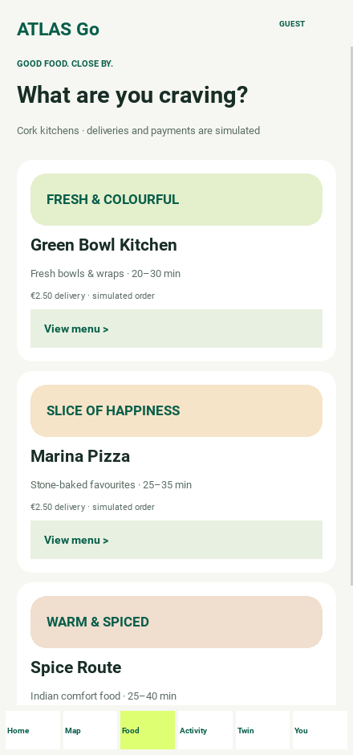 |  |  |  |

Orders from a seller kitchen wait until the seller accepts them and marks the food ready.

## 6. Live map

Drag to move, **+**/**−** or double tap to zoom, **Cork** to recentre and **Me** to show your position (Android asks for permission the first time). Green: pickup places · grey: drivers nearby, moving · violet: registered drivers online · orange: kitchens and couriers · blue: you. Map tiles come from OpenStreetMap and are cached; without a connection the app draws a schematic map of Cork so everything else keeps working.

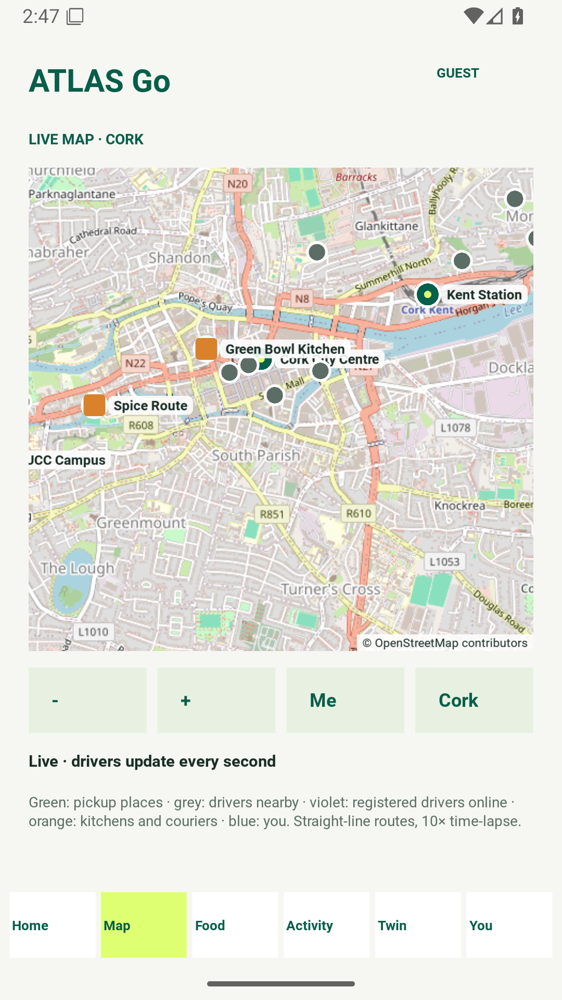

## 7. Activity and You

Activity lists the signed-in account's own rides and orders (a driver sees their trips, a seller their kitchen's orders). You shows the account, **Sign out**, **How ATLAS learns**, the privacy notice, **Delete my account** (asks for the password) and **Erase all data on this phone**.

| Activity | You | Privacy |
|---|---|---|
| 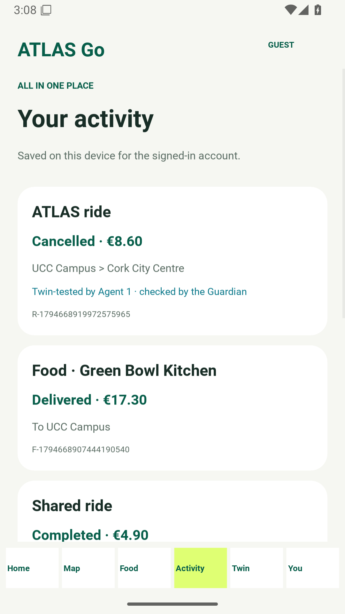 | 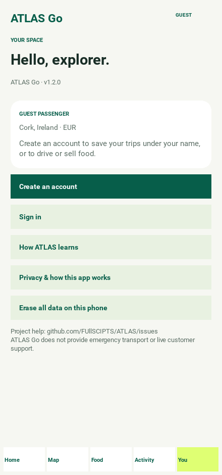 | 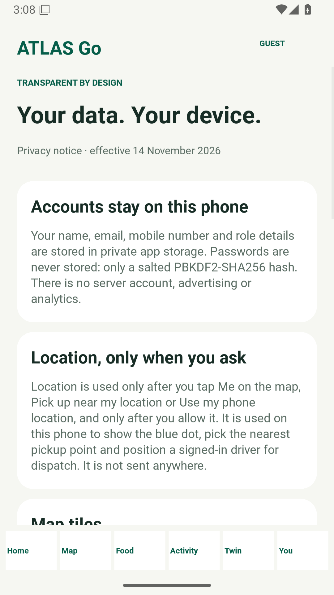 |

## 8. Driver

**Go online** to receive requests from ATLAS dispatch on this phone; set your starting area or **Use my phone location**. A request shows the route, fare, pickup distance and why ATLAS chose you; **Accept** or **Decline** (the next-best driver gets it). During the trip the live map shows your route; tap **I have arrived at pickup**, **Start trip** and **Complete trip**. *Your week* counts trips, fares and accepted requests; ATLAS uses your acceptance history when choosing drivers. *When to drive* shows today's surge outlook and where the supply agent adds drivers.

| Online | Ride request |
|---|---|
| 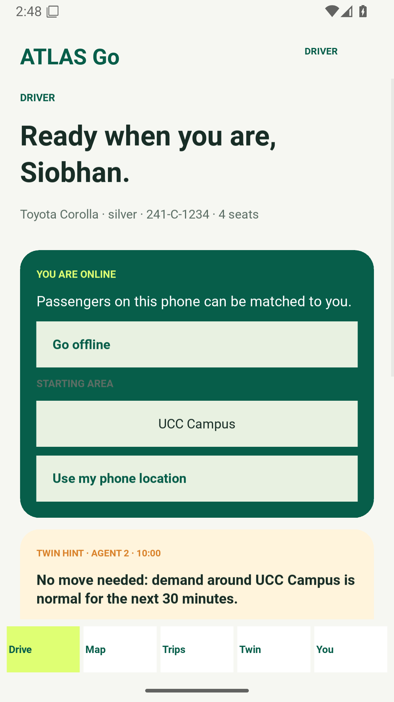 | 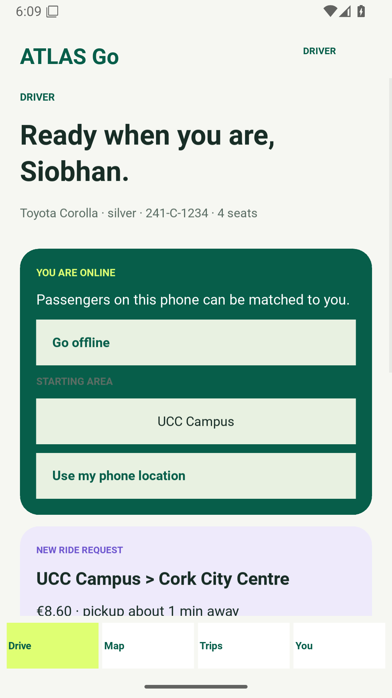 |

## 9. Food seller

The Kitchen tab opens or closes the kitchen, sets the preparation time (courier timing follows it), and shows the current order: **Accept and start cooking**, then **Food is ready for the courier**. The Menu tab adds dishes (name, short description, price such as `8.50`) and removes them. Orders and sales are counted when food is delivered.

| Menu | Current order |
|---|---|
| 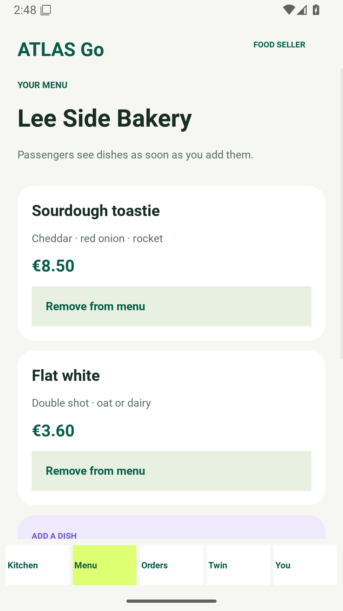 | 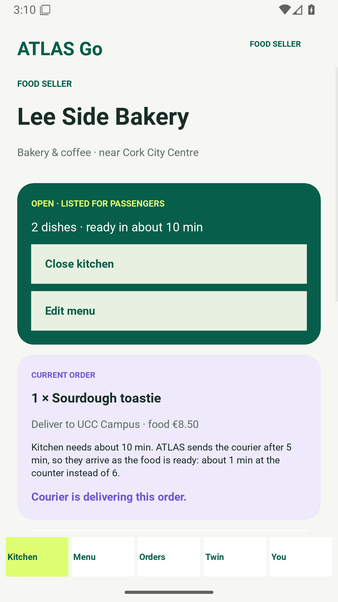 |

## 10. How ATLAS learns

**Models in this app** lists the six models; **Check all models** runs each on known inputs on the phone and shows PASS or FAIL with a short result. Below are the surge outlook for any day (arrows move between days), upcoming Irish holidays and Cork events, the dispatch policy's weights, courier timing per kitchen, and the learning lab, which trains a new dispatch policy from zero on the phone and compares it with the nearest-driver rule and the approved policy.

| Models and outlook | Learning lab |
|---|---|
| 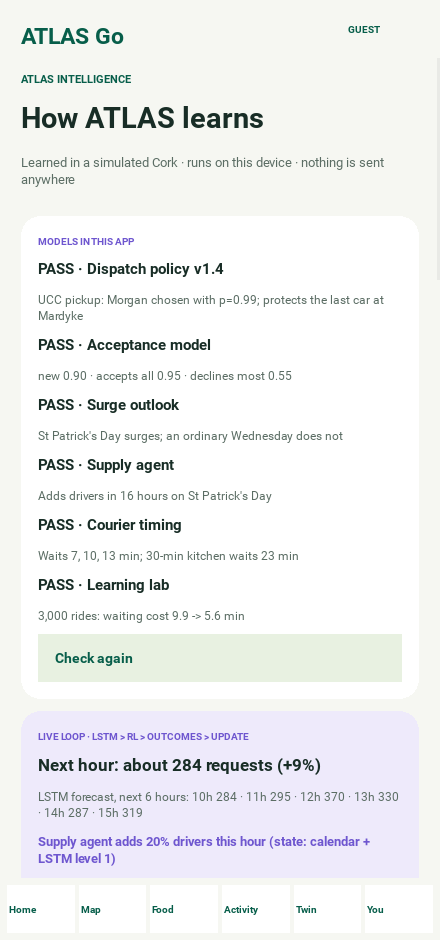 | 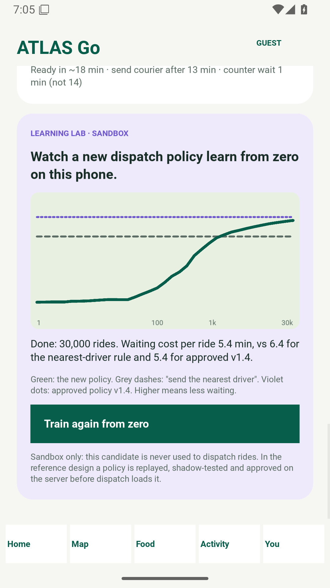 |

## Limits

Rides, deliveries and payments are simulated, and accounts exist only on the phone where they were created. Routes are straight lines at a constant speed. ATLAS Go does not provide emergency transport or live customer support.
