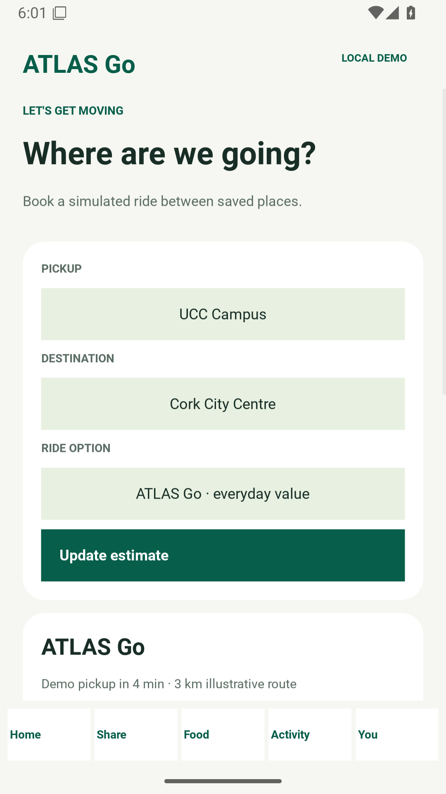
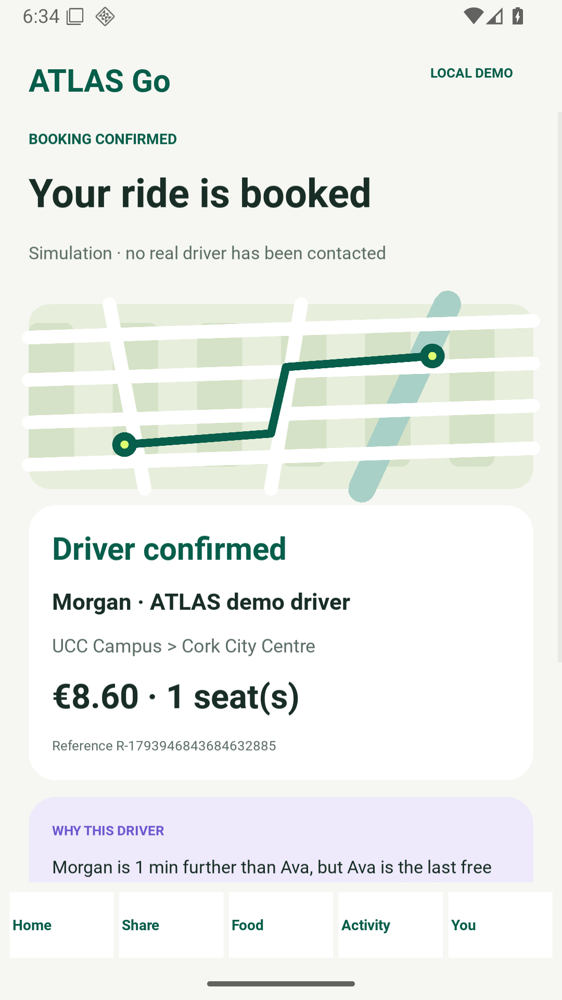
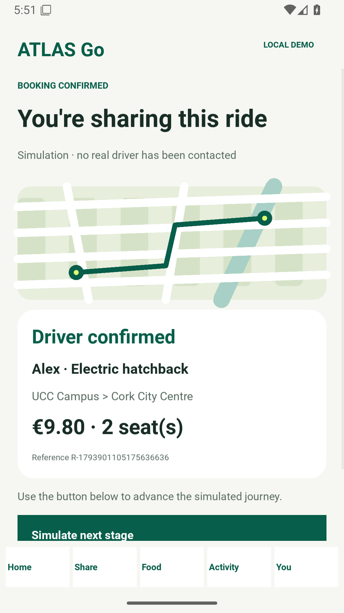
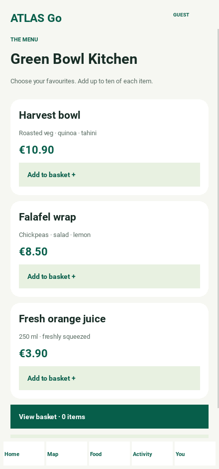
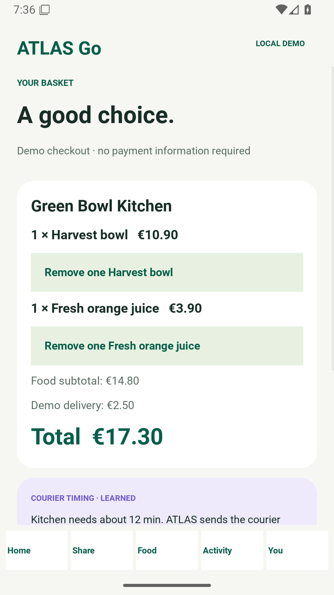
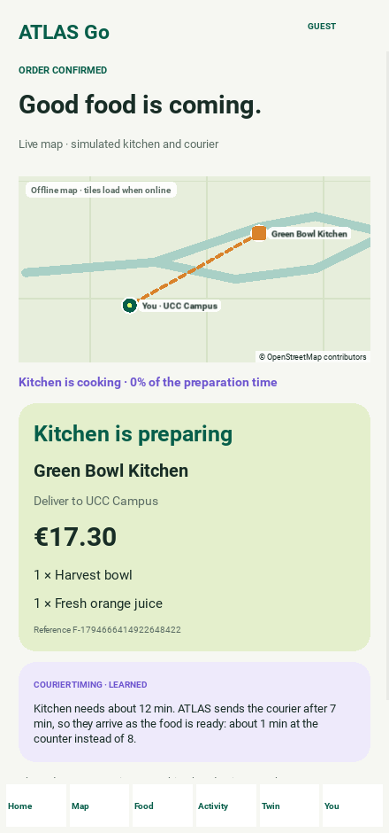
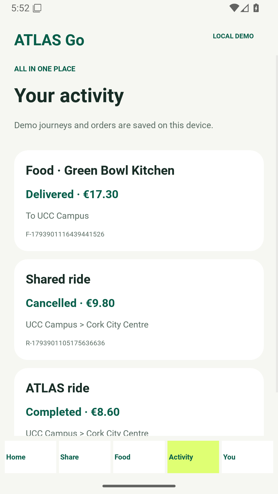
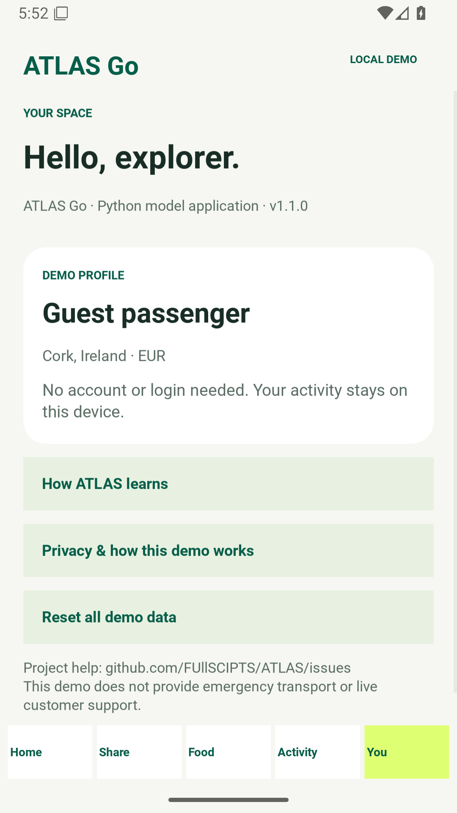
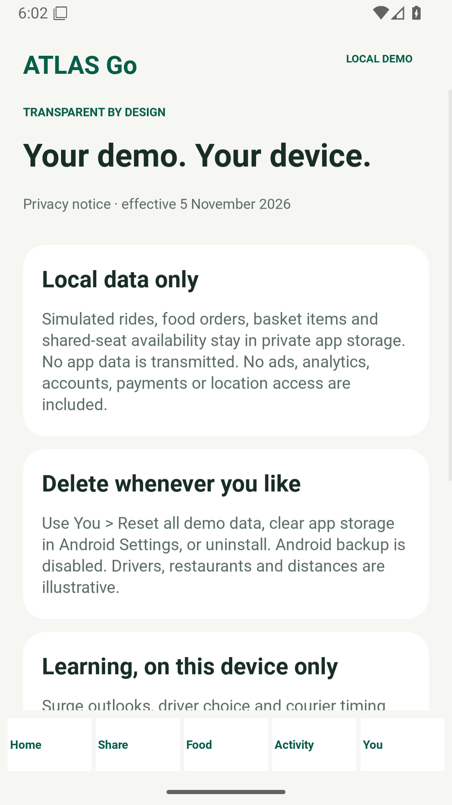

# ATLAS Go user guide

All screenshots below are captured from the running Python/Kivy Android application on an emulator. They show illustrative Cork data, not real customers, orders or drivers.

## 1. Home and navigation

Open ATLAS Go. The dashboard exposes **Ride**, **Share ride**, and **Food**. The bottom bar opens Home, Share, Food, Activity and You. The LOCAL DEMO badge stays visible throughout the app.

## 2. Book a solo ride

Choose Ride. Select pickup and destination from four saved Cork locations. Select ATLAS Go or Comfort, then tap Update estimate. Book demo ride creates a local reservation. The route graphic is illustrative, not live navigation. Simulate next stage progresses driver confirmed → at pickup → on your way. Complete demo ride moves it into Activity. Cancel demo ride asks for confirmation.

| Booking | Confirmation |
|---|---|
|  |  |

## 3. Join a shared ride

Choose Share. For the seeded offers, use UCC Campus → Cork City Centre. Choose one or two seats and tap Find matching rides. Only offers matching both endpoints with sufficient seats appear. The price per seat and party total appear before Join shared ride. Seats are reserved immediately and survive an app restart; cancelling releases them. Finish an existing ride before creating another. An unmatched route shows an empty state.

| Matching offers | Shared reservation |
|---|---|
|  |  |

## 4. Browse and buy food in demo mode

Choose Food and open a restaurant. Add menu items to the basket; repeat Add for extra quantities, up to ten. A basket holds items from one restaurant at a time. Clear it before switching restaurants. No real restaurant receives these selections.

| Restaurants | Menu |
|---|---|
|  |  |

## 5. Checkout and track

View basket shows item quantities, subtotal, a €2.50 illustrative delivery fee and total. Remove one adjusts the quantity. Choose a delivery place and Place demo order. No card, cash or payment gateway is used. Advance through preparing → courier on the way → arriving; Mark demo order delivered saves the result in Activity. Only one food order can be active at once.

| Basket | Order tracking |
|---|---|
|  |  |

## 6. History, profile and privacy

Activity includes active bookings and completed/cancelled history. You opens the guest profile, privacy notice and Reset all demo data. Reset deletes all local history, active bookings and basket and restores seeded shared seats. Android Settings → Apps → ATLAS Go → Storage → Clear storage also deletes local data.

| Activity | Profile | Privacy |
|---|---|---|
|  |  |  |

## 7. ATLAS intelligence

Open **How ATLAS learns** from the Home card or from You. Everything on this screen runs on the phone from small policies learned in a simulated Cork; nothing is sent anywhere.

- **Surge outlook** — expected ride requests for each hour of the chosen day. Orange bars are surge hours, grey ticks show an ordinary day of the same weekday, and violet marks are the extra drivers the agent learned to send ahead. Use Previous/Next day to browse; Ireland's public holidays are computed for any year, and Cork events such as the Jazz weekend follow the calendar.
- **Coming up** — the next holidays and events the agent treats differently, with their expected peak.
- **Who gets your ride** — what the dispatch policy learned to weigh. When you book a solo ride, the ride screen lists the four nearby drivers and explains the choice; the explanation is kept on the active ride.
- **When to send the courier** — per kitchen, how long ATLAS waits before dispatching the courier so they arrive as the food is ready. The basket and order screens show the same plan.
- **Learning lab** — tap *Train 30,000 simulated rides* to watch a new policy learn from zero. The chart compares it with "send the nearest driver" and the approved policy. The lab is a sandbox: its result is never used to dispatch rides.

Matches, storms and other unscheduled events are not on the calendar; in the reference design they come from the live forecaster.

## Troubleshooting

- Same pickup and destination: choose two different saved locations.
- Not enough shared seats: choose fewer seats or another matching offer.
- Active ride/order: finish or cancel the current one before another of that type.
- Basket belongs to another kitchen: clear the basket, then choose the new restaurant.
- Older test APK cannot update: uninstall the old debug build before installing the signed release APK; this deletes local demo history.
- No live map, login or payment screen: this release intentionally demonstrates local booking flows. See the integration blueprint for the live-service work.
