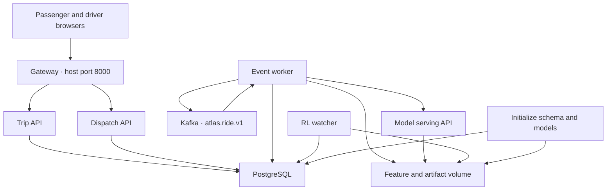
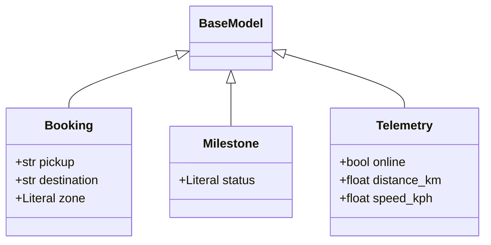
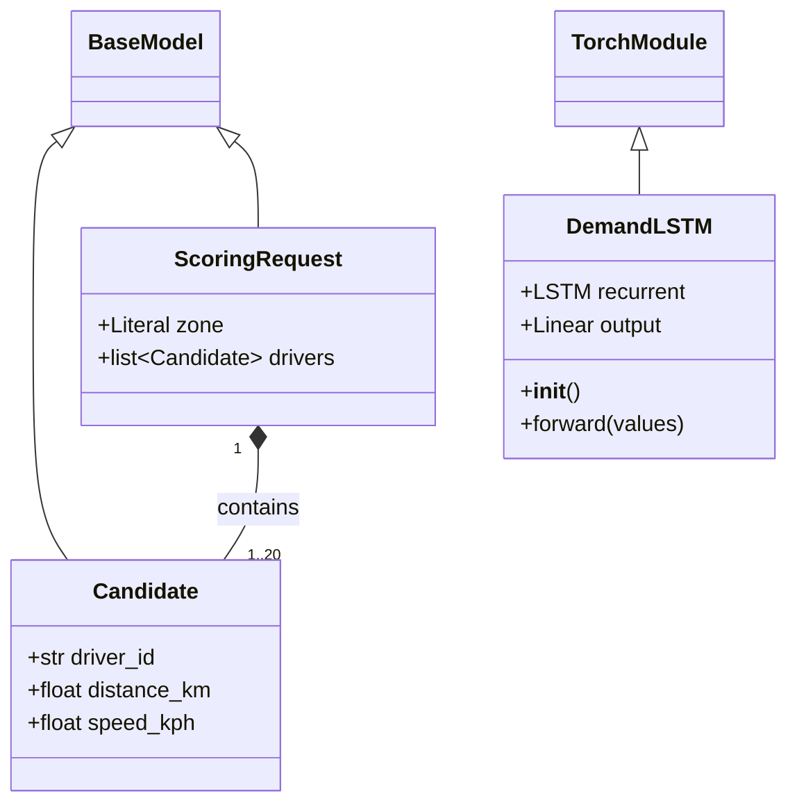
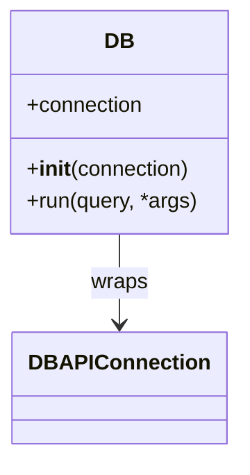
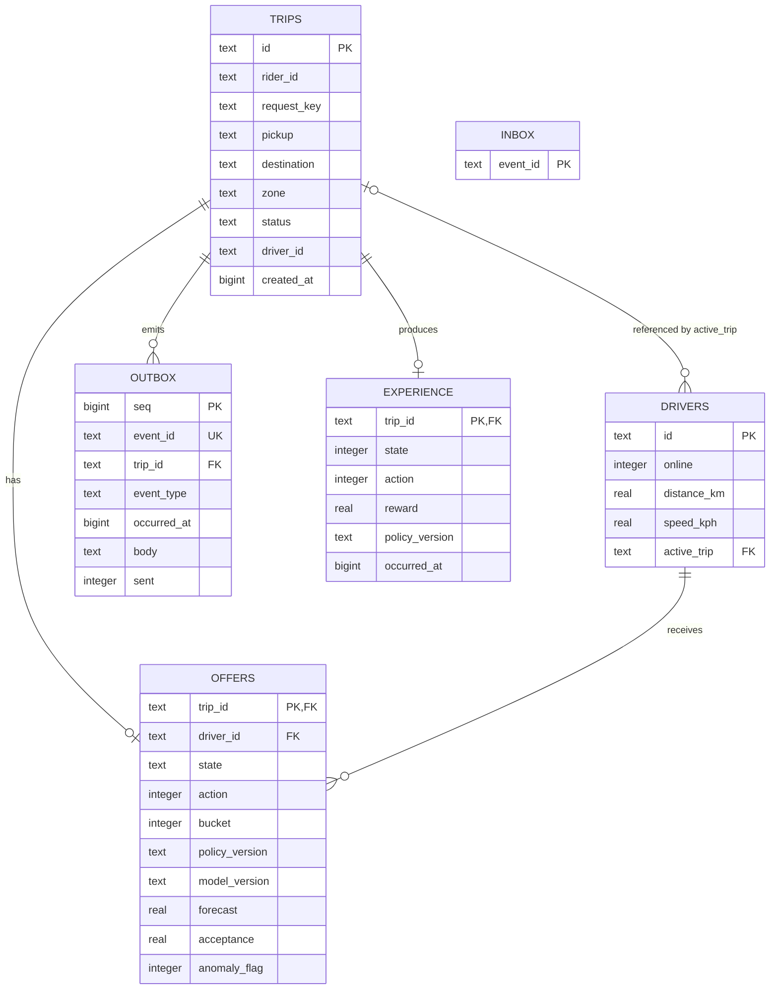
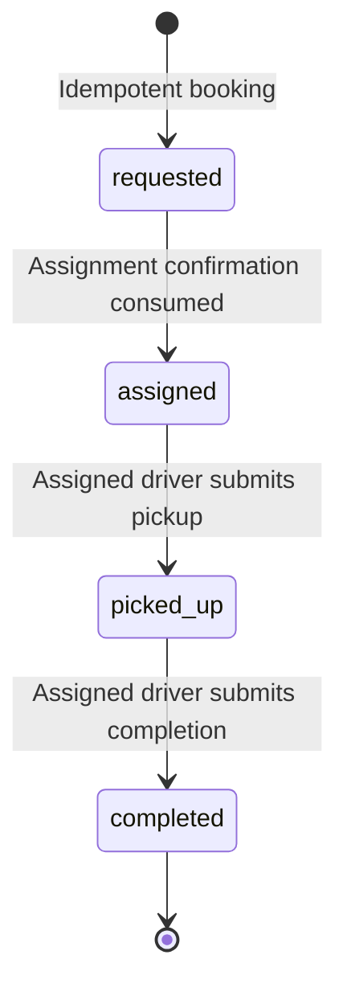
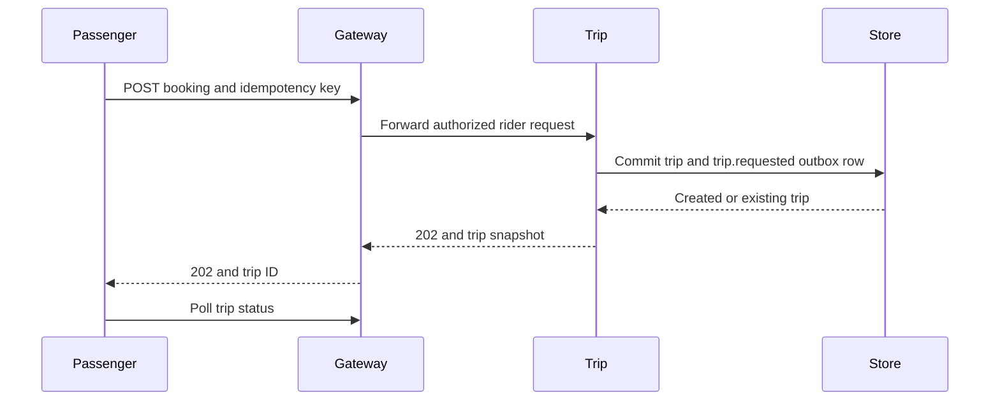
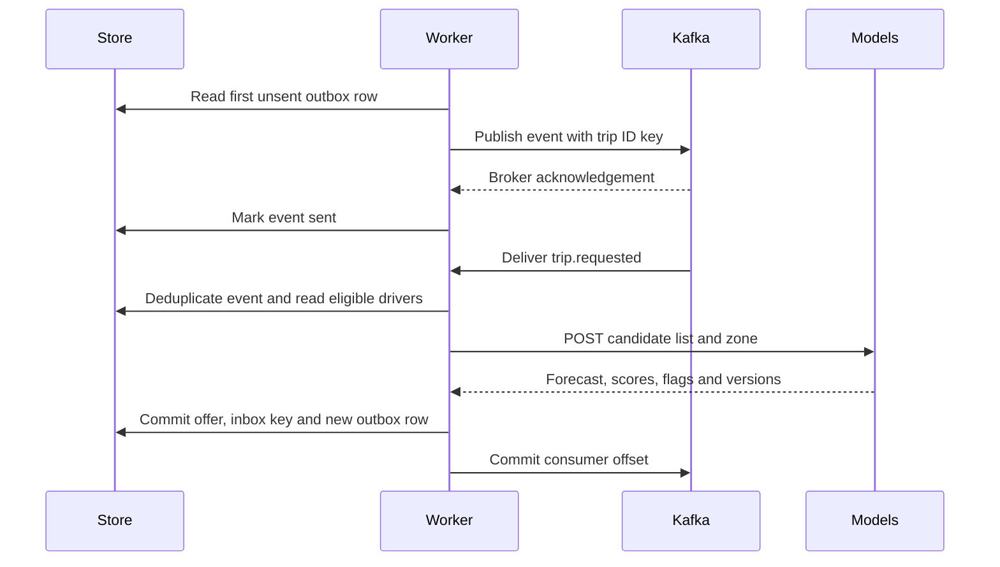
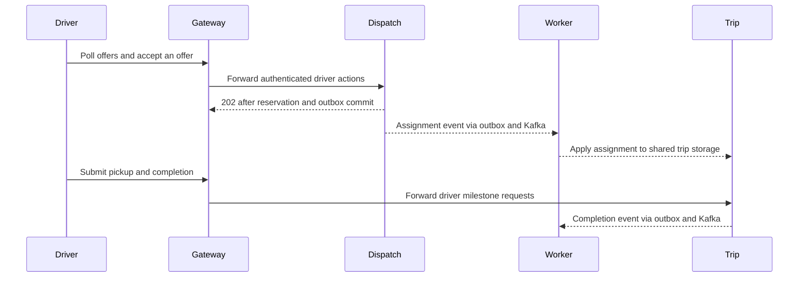
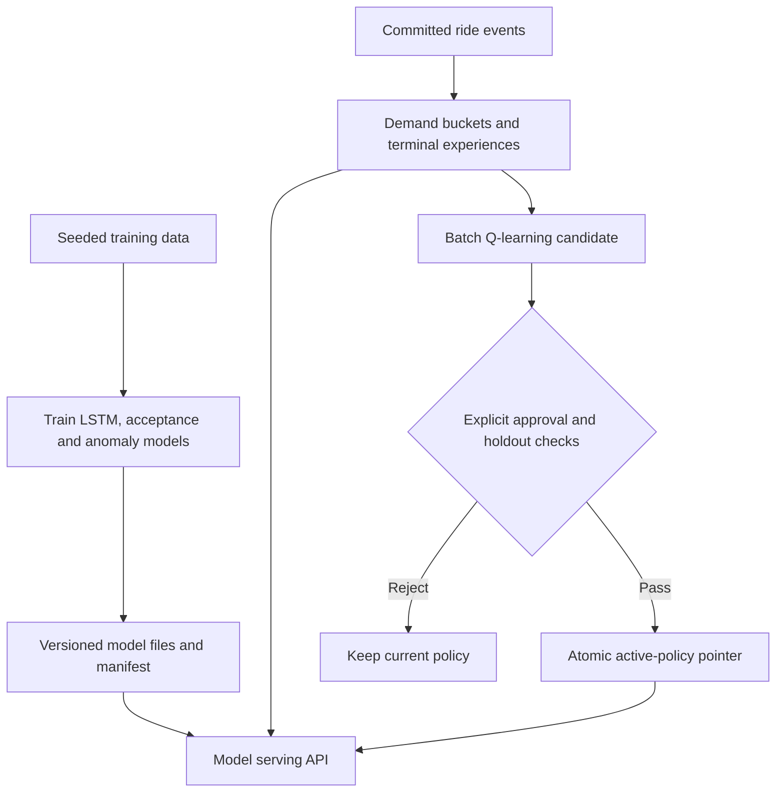

# ATLAS ride-hailing UML blueprint

Use this blueprint to reproduce or extend the runnable ATLAS starter on the `architecture-explorer` branch. It covers the passenger and driver apps, FastAPI services, event worker, database, ML training and serving, policy training, and verification scripts.

[Final handover and runbook](FINAL_HANDOVER.md) · [Runnable starter](../README.md) · [Machine-readable symbol inventory](uml-blueprint.json) · [Build specification](../../dist/build-spec.json) · [Kafka event contract](../packages/ride-event.schema.json)

## Start from the implementation

Clone the branch and run the unmodified starter before changing contracts or behavior.

```bash
git clone --branch architecture-explorer --single-branch https://github.com/FUllSCIPTS/ATLAS.git
cd ATLAS/architecture-explorer/starter
docker compose up -d --build
docker compose exec -T gateway python -m tests.smoke
docker compose exec -T gateway python -m tests.policy
docker compose exec -T -e KAFKA_BOOTSTRAP=kafka:9092 gateway python -m tests.replay
```

The [local SQLite quickstart](../README.md#start-locally-without-docker) runs the same business handlers without a broker. The full Compose run is the acceptance check for the PostgreSQL and Kafka deployment.

## Folder hierarchy

All checked-in files under `architecture-explorer/`, including the runnable starter, the published explorer assets and the self-host server. Runtime data, trained artifacts and virtual environments are excluded from the source inventory. The research materials at the repository root are separate from this application.

<!-- BEGIN GENERATED TREE -->

```text
architecture-explorer/
├── deploy/
│   └── atlas-explorer.service
├── dist/
│   ├── atlas.js
│   ├── atlas.svg
│   ├── build-spec.json
│   ├── build.html
│   ├── build.js
│   ├── explorer.js
│   ├── index.html
│   ├── ride-event.schema.json
│   └── styles.css
├── starter/
│   ├── apps/
│   │   ├── driver/
│   │   │   └── index.html
│   │   ├── passenger/
│   │   │   └── index.html
│   │   └── shared/
│   │       ├── client.js
│   │       └── demo.css
│   ├── docs/
│   │   ├── FINAL_HANDOVER.md
│   │   ├── UML_BLUEPRINT.md
│   │   └── uml-blueprint.json
│   ├── infra/
│   │   └── schema.sql
│   ├── ml/
│   │   ├── discrete.py
│   │   ├── forecast.py
│   │   ├── registry.py
│   │   ├── rl.py
│   │   ├── serve.py
│   │   └── train.py
│   ├── packages/
│   │   ├── config.py
│   │   ├── db.py
│   │   └── ride-event.schema.json
│   ├── scripts/
│   │   ├── generate_blueprint.py
│   │   ├── initialize.sh
│   │   └── local.sh
│   ├── services/
│   │   ├── dispatch.py
│   │   ├── gateway.py
│   │   └── trips.py
│   ├── tests/
│   │   ├── policy.py
│   │   ├── replay.py
│   │   └── smoke.py
│   ├── workers/
│   │   └── events.py
│   ├── .dockerignore
│   ├── .gitignore
│   ├── Dockerfile
│   ├── README.md
│   ├── compose.yaml
│   └── requirements.txt
├── README.md
└── server.mjs
```

<!-- END GENERATED TREE -->

## Component and deployment boundaries

Only the gateway is published on the host loopback interface in the starter. The trip, dispatch and model APIs run on the internal network. The same event worker performs outbox relay and event consumption in this demo.



| Owner | Responsibility | Code |
| --- | --- | --- |
| Gateway | Serve browser pages, verify demo bearer keys, forward only allowlisted routes, attach internal identity | [services/gateway.py](../services/gateway.py) |
| Trip API | Create and read rider trips, validate driver milestones, update trip state | [services/trips.py](../services/trips.py) |
| Dispatch API | Track availability and offers, reserve a driver atomically on acceptance | [services/dispatch.py](../services/dispatch.py) |
| Event worker | Publish acknowledged outbox events, deduplicate consumption, create offers, apply assignment and collect learning features | [workers/events.py](../workers/events.py) |
| Model API | Load versioned artifacts and score candidates with demand, acceptance, anomaly and policy signals | [ml/serve.py](../ml/serve.py) |
| RL watcher | Train candidates from completed rides. Review and approval run as separate commands. | [ml/rl.py](../ml/rl.py) |

## Class diagrams

The diagrams show classes declared by the starter. Inherited library methods are supplied by their base classes. Full type annotations, defaults, decorators and source lines are in the [generated symbol catalog](#generated-symbol-catalog).

### Booking and dispatch types



### Scoring types and LSTM



### Database adapter



`TorchModule` and `DBAPIConnection` represent external dependencies. The connection is either `sqlite3.Connection` or a Psycopg connection. The starter's service modules use functions and route decorators. Their signatures appear in the catalog.

## Persistence model

Cardinalities and key markers reflect the actual database constraints in [infra/schema.sql](../infra/schema.sql). `trips.driver_id` is a nullable text field. The assignment handler supplies its value.



The compound unique key `trips(rider_id, request_key)` makes booking retries idempotent. The inbox primary key prevents duplicate event side effects. One offer and one learning record are stored per trip. The `pending_outbox(sent, seq)` index supports the relay.

## Trip state machine



| Transition or action | Durable effect |
| --- | --- |
| Create booking | Insert trip and `trip.requested` outbox row in one transaction. Same key and body returns the existing trip. Different body with the same key yields `409`. |
| Create offer | Score online, unreserved drivers. Insert one offer and `dispatch.offer.created`. |
| Accept offer | Check driver ownership and availability. Update the offer, reserve the driver, and insert `dispatch.assignment.confirmed` in one transaction. |
| Apply assignment | Conditionally move `requested` to `assigned` and emit `trip.assigned`. |
| Pick up | Check driver and prior state. Move `assigned` to `picked_up` and emit `trip.picked_up`. |
| Complete | Move `picked_up` to `completed`, release the driver's reservation, and emit `trip.completed`. |
| Process completion | Join the offer's original state, action and policy version to the terminal reward. Insert one experience row. |

## Sequence diagrams

### Passenger booking



### Event delivery and offer creation



If a relay crashes after the broker acknowledgement and before marking the event sent, the next attempt can publish the same event again. The inbox deduplication is in the same transaction as the event's database effects. The SQLite profile drives these handlers directly from the outbox.

### Driver acceptance and completion



The worker applies assignment in the shared database. The diagram's dashed message to Trip represents that logical ownership boundary. There is no worker-to-Trip HTTP request.

### Training, serving and approval



The LSTM reads 12 five-minute counts. Logistic regression and Isolation Forest read distance and speed. The RL state is forecast bucket `0` below 8 or `1` at least 8. Action `0` ranks by distance and action `1` ranks by acceptance probability. The policy watcher creates candidates after at least 80 completed outcomes. Training does not activate candidates. Inference uses an approved strategy only when `ATLAS_POLICY_ENABLED=1`. Rollback restores the nearest-driver baseline.

## Rebuild checklist

1. Run the [starter smoke and policy checks](../README.md#start-with-postgresql-and-kafka) against the existing code. Use the request paths and payloads in the [API contract](../README.md#api-and-data-contracts) as the compatibility baseline.
2. Implement changes through existing boundaries. Preserve rider and driver ownership, transactional state and outbox writes, deduplication, the state machine, model versions and explicit policy approval.
3. Test one complete ride, a booking retry with the same key, a forbidden offer acceptance, an invalid state transition, model outputs and one terminal experience. Run `tests.replay` against the configured Kafka broker before claiming deployment readiness.
4. Treat GPS, routing, offer expiry and re-matching, cancellations, payments, production identity and representative training data as separately scoped extensions.
5. Regenerate the blueprint after changing code. Commit the updated generated sections and JSON with the source changes.

From `starter/`, use Python 3.12 and Node.js with npm. The generator uses the Python standard library and the pinned Acorn parser for JavaScript.

```bash
python scripts/generate_blueprint.py
python scripts/generate_blueprint.py --check
```

The JSON includes relative paths, source hashes, imports, class bases, attributes, method signatures, module functions, nested functions, callbacks, decorators and source lines. The application catalog covers the starter and its tests. The supporting catalog covers the explorer, Node static server and blueprint generator. The [handover runbook](FINAL_HANDOVER.md) specifies exact API responses, environment variables, model artifacts and acceptance steps.

## Generated symbol catalog

<!-- BEGIN GENERATED CATALOG -->

### `apps/shared/client.js`

[Open source](../apps/shared/client.js)

| Kind | Signature | Decorators | Source |
| --- | --- | --- | --- |
| Function | `async request(path, method = "GET", data, idempotencyKey)` | — | [L8](../apps/shared/client.js#L8) |
| Function | `async refresh()` | — | [L20](../apps/shared/client.js#L20) |
| Function | `refresh.<callback: offers.map>(offer)` | — | [L31](../apps/shared/client.js#L31) |
| Function | `async refresh.<callback: offers.map>.button.onclick()` | — | [L43](../apps/shared/client.js#L43) |
| Function | `async <callback: document.getElementById("booking")?.addEventListener, "submit">(event)` | — | [L59](../apps/shared/client.js#L59) |
| Function | `async <callback: document.getElementById("telemetry")?.addEventListener, "submit">(event)` | — | [L72](../apps/shared/client.js#L72) |

### `ml/discrete.py`

[Open source](../ml/discrete.py)

| Kind | Signature | Decorators | Source |
| --- | --- | --- | --- |
| Function | `train(directory)` | — | [L8](../ml/discrete.py#L8) |

### `ml/forecast.py`

[Open source](../ml/forecast.py)

**Class `DemandLSTM`** · bases `nn.Module` · [L9](../ml/forecast.py#L9)

- Instance attribute `self.recurrent = nn.LSTM(1, 12, batch_first=True)`
- Instance attribute `self.output = nn.Linear(12, 1)`

| Kind | Signature | Decorators | Source |
| --- | --- | --- | --- |
| Function | `train(directory)` | — | [L20](../ml/forecast.py#L20) |
| Function | `load(directory)` | — | [L44](../ml/forecast.py#L44) |
| Function | `predict(model, counts)` | — | [L51](../ml/forecast.py#L51) |
| Method | `DemandLSTM.__init__(self)` | — | [L10](../ml/forecast.py#L10) |
| Method | `DemandLSTM.forward(self, values)` | — | [L15](../ml/forecast.py#L15) |

### `ml/registry.py`

[Open source](../ml/registry.py)

| Kind | Signature | Decorators | Source |
| --- | --- | --- | --- |
| Function | `read_json(path, default=None)` | — | [L10](../ml/registry.py#L10) |
| Function | `write_json(path, value)` | — | [L17](../ml/registry.py#L17) |

### `ml/rl.py`

[Open source](../ml/rl.py)

| Kind | Signature | Decorators | Source |
| --- | --- | --- | --- |
| Function | `current_policy()` | — | [L15](../ml/rl.py#L15) |
| Function | `fixture()` | — | [L19](../ml/rl.py#L19) |
| Function | `experiences()` | — | [L25](../ml/rl.py#L25) |
| Function | `fit(samples, source)` | — | [L32](../ml/rl.py#L32) |
| Function | `fit.<lambda@39:40>(action)` | — | [L39](../ml/rl.py#L39) |
| Function | `approve(version, allow_demo=False)` | — | [L51](../ml/rl.py#L51) |
| Function | `watch(seconds)` | — | [L70](../ml/rl.py#L70) |
| Function | `main()` | — | [L81](../ml/rl.py#L81) |

### `ml/serve.py`

[Open source](../ml/serve.py)

**Class `Candidate`** · bases `BaseModel` · [L16](../ml/serve.py#L16)

- Declared field `driver_id: str`
- Declared field `distance_km: float = Field(ge=0, le=50)`
- Declared field `speed_kph: float = Field(ge=0, le=250)`

This class uses inherited methods.

**Class `ScoringRequest`** · bases `BaseModel` · [L22](../ml/serve.py#L22)

- Declared field `zone: Literal['cork-centre', 'cork-north']`
- Declared field `drivers: list[Candidate] = Field(min_length=1, max_length=20)`

This class uses inherited methods.

| Kind | Signature | Decorators | Source |
| --- | --- | --- | --- |
| Function | `models(version)` | `lru_cache(maxsize=2)` | [L28](../ml/serve.py#L28) |
| Function | `active()` | — | [L33](../ml/serve.py#L33) |
| Function | `health()` | `app.get('/healthz')` | [L41](../ml/serve.py#L41) |
| Function | `score(payload: ScoringRequest)` | `app.post('/internal/v1/score')` | [L48](../ml/serve.py#L48) |

### `ml/train.py`

[Open source](../ml/train.py)

| Kind | Signature | Decorators | Source |
| --- | --- | --- | --- |
| Function | `train()` | — | [L8](../ml/train.py#L8) |

### `packages/config.py`

[Open source](../packages/config.py)

| Kind | Signature | Decorators | Source |
| --- | --- | --- | --- |
| Function | `equal(left, right)` | — | [L20](../packages/config.py#L20) |
| Function | `internal_actor(request: Request, role: str) -> str` | — | [L24](../packages/config.py#L24) |

### `packages/db.py`

[Open source](../packages/db.py)

**Class `DB`** · bases none · [L14](../packages/db.py#L14)

- Instance attribute `self.connection = connection`

| Kind | Signature | Decorators | Source |
| --- | --- | --- | --- |
| Function | `database()` | `contextmanager` | [L23](../packages/db.py#L23) |
| Function | `migrate()` | — | [L45](../packages/db.py#L45) |
| Function | `emit(db, trip_id, event_type, **body)` | — | [L57](../packages/db.py#L57) |
| Function | `envelope(row)` | — | [L62](../packages/db.py#L62) |
| Method | `DB.__init__(self, connection)` | — | [L15](../packages/db.py#L15) |
| Method | `DB.run(self, query, *args)` | — | [L18](../packages/db.py#L18) |

### `scripts/initialize.sh`

[Open source](../scripts/initialize.sh)

This file declares no functions.

### `scripts/local.sh`

[Open source](../scripts/local.sh)

| Kind | Signature | Decorators | Source |
| --- | --- | --- | --- |
| Function | `start()` | — | [L13](../scripts/local.sh#L13) |
| Function | `cleanup()` | — | [L17](../scripts/local.sh#L17) |

### `services/dispatch.py`

[Open source](../services/dispatch.py)

**Class `Telemetry`** · bases `BaseModel` · [L12](../services/dispatch.py#L12)

- Declared field `online: bool`
- Declared field `distance_km: float = Field(ge=0, le=50)`
- Declared field `speed_kph: float = Field(ge=0, le=250)`

This class uses inherited methods.

| Kind | Signature | Decorators | Source |
| --- | --- | --- | --- |
| Function | `health()` | `app.get('/healthz')` | [L19](../services/dispatch.py#L19) |
| Function | `availability(request: Request, payload: Telemetry)` | `app.put('/v1/driver/availability')` | [L26](../services/dispatch.py#L26) |
| Function | `offers(request: Request)` | `app.get('/v1/driver/offers')` | [L35](../services/dispatch.py#L35) |
| Function | `accept(request: Request, trip_id: UUID)` | `app.post('/v1/driver/offers/{trip_id}/accept', status_code=202)` | [L47](../services/dispatch.py#L47) |

### `services/gateway.py`

[Open source](../services/gateway.py)

| Kind | Signature | Decorators | Source |
| --- | --- | --- | --- |
| Function | `health()` | `app.get('/healthz')` | [L26](../services/gateway.py#L26) |
| Function | `passenger()` | `app.get('/')`, `app.get('/passenger')` | [L37](../services/gateway.py#L37) |
| Function | `driver()` | `app.get('/driver')` | [L42](../services/gateway.py#L42) |
| Function | `async proxy(request: Request, role: str, path: str)` | `app.api_route('/v1/{role}/{path:path}', methods=['GET', 'POST', 'PUT'])` | [L47](../services/gateway.py#L47) |

### `services/trips.py`

[Open source](../services/trips.py)

**Class `Booking`** · bases `BaseModel` · [L14](../services/trips.py#L14)

- Declared field `pickup: str = Field(min_length=1, max_length=120, pattern='\\S')`
- Declared field `destination: str = Field(min_length=1, max_length=120, pattern='\\S')`
- Declared field `zone: Literal['cork-centre', 'cork-north']`

This class uses inherited methods.

**Class `Milestone`** · bases `BaseModel` · [L20](../services/trips.py#L20)

- Declared field `status: Literal['picked_up', 'completed']`

This class uses inherited methods.

| Kind | Signature | Decorators | Source |
| --- | --- | --- | --- |
| Function | `health()` | `app.get('/healthz')` | [L25](../services/trips.py#L25) |
| Function | `book(request: Request, payload: Booking, idempotency_key: Annotated[str, Header(min_length=1, max_length=128)])` | `app.post('/v1/rider/trips', status_code=202)` | [L32](../services/trips.py#L32) |
| Function | `public_trip(row)` | — | [L48](../services/trips.py#L48) |
| Function | `status(request: Request, trip_id: UUID)` | `app.get('/v1/rider/trips/{trip_id}')` | [L53](../services/trips.py#L53) |
| Function | `milestone(request: Request, trip_id: UUID, payload: Milestone)` | `app.post('/v1/driver/trips/{trip_id}/milestones')` | [L63](../services/trips.py#L63) |

### `tests/policy.py`

[Open source](../tests/policy.py)

| Kind | Signature | Decorators | Source |
| --- | --- | --- | --- |
| Function | `reject(action, expected)` | — | [L9](../tests/policy.py#L9) |
| Function | `<lambda@21:12>()` | — | [L21](../tests/policy.py#L21) |
| Function | `<lambda@28:12>()` | — | [L28](../tests/policy.py#L28) |

### `tests/replay.py`

[Open source](../tests/replay.py)

| Kind | Signature | Decorators | Source |
| --- | --- | --- | --- |
| Function | `completed_event(trip_id)` | — | [L13](../tests/replay.py#L13) |
| Function | `snapshot(trip_id, event_id)` | — | [L20](../tests/replay.py#L20) |
| Function | `replay_over_kafka(event, bootstrap)` | — | [L31](../tests/replay.py#L31) |
| Function | `replay_over_kafka.<lambda@38:34>(error, message)` | — | [L38](../tests/replay.py#L38) |
| Function | `main()` | — | [L58](../tests/replay.py#L58) |

### `tests/smoke.py`

[Open source](../tests/smoke.py)

| Kind | Signature | Decorators | Source |
| --- | --- | --- | --- |
| Function | `until(check, label, timeout=45)` | — | [L16](../tests/smoke.py#L16) |
| Function | `api(method, path, actor='rider-a', *, expected=200, key=None, body=None)` | — | [L28](../tests/smoke.py#L28) |
| Function | `check()` | — | [L37](../tests/smoke.py#L37) |
| Function | `check.<lambda@38:11>()` | — | [L38](../tests/smoke.py#L38) |
| Function | `check.<lambda@39:11>()` | — | [L39](../tests/smoke.py#L39) |
| Function | `check.offer_for_trip()` | — | [L49](../tests/smoke.py#L49) |
| Function | `check.<lambda@64:11>()` | — | [L64](../tests/smoke.py#L64) |
| Function | `check.learned()` | — | [L71](../tests/smoke.py#L71) |

### `workers/events.py`

[Open source](../workers/events.py)

| Kind | Signature | Decorators | Source |
| --- | --- | --- | --- |
| Function | `choose(candidates, zone)` | — | [L17](../workers/events.py#L17) |
| Function | `choose.<lambda@33:38>(d)` | — | [L33](../workers/events.py#L33) |
| Function | `choose.<lambda@36:38>(d)` | — | [L36](../workers/events.py#L36) |
| Function | `apply(event)` | — | [L41](../workers/events.py#L41) |
| Function | `update_features()` | — | [L76](../workers/events.py#L76) |
| Function | `next_event()` | — | [L90](../workers/events.py#L90) |
| Function | `mark_sent(event)` | — | [L96](../workers/events.py#L96) |
| Function | `local_tick()` | — | [L101](../workers/events.py#L101) |
| Function | `kafka_loop()` | — | [L111](../workers/events.py#L111) |
| Function | `kafka_loop.<lambda@122:46>(error, _)` | — | [L122](../workers/events.py#L122) |

<!-- END GENERATED CATALOG -->


## Generated supporting source catalog

These are the explorer, Node static server and blueprint generator symbols. GitHub Pages publishes the same static explorer assets without the Node process. The ride-hailing starter runs separately.

<!-- BEGIN GENERATED SUPPORT -->

### `dist/atlas.js`

[Open source](../../dist/atlas.js)

This file declares no functions.

### `dist/build.js`

[Open source](../../dist/build.js)

| Kind | Signature | Decorators | Source |
| --- | --- | --- | --- |
| Function | `async <callback: copy.addEventListener, "click">()` | — | [L5](../../dist/build.js#L5) |

### `dist/explorer.js`

[Open source](../../dist/explorer.js)

| Kind | Signature | Decorators | Source |
| --- | --- | --- | --- |
| Function | `$(id)` | — | [L29](../../dist/explorer.js#L29) |
| Function | `icon(name, size = 18)` | — | [L30](../../dist/explorer.js#L30) |
| Function | `<callback: links.map>(link)` | — | [L31](../../dist/explorer.js#L31) |
| Function | `<callback: folders.flatMap>(group)` | — | [L33](../../dist/explorer.js#L33) |
| Function | `<callback: folders.flatMap>.<callback: group.children.map>(entry)` | — | [L33](../../dist/explorer.js#L33) |
| Function | `<callback: document.querySelectorAll("[data-icon]").forEach>(element)` | — | [L36](../../dist/explorer.js#L36) |
| Function | `announce(message)` | — | [L38](../../dist/explorer.js#L38) |
| Function | `componentColor(id)` | — | [L42](../../dist/explorer.js#L42) |
| Function | `componentMark(id, size = 19)` | — | [L46](../../dist/explorer.js#L46) |
| Function | `viewHeading(kicker, title, detail, badge = "")` | — | [L50](../../dist/explorer.js#L50) |
| Function | `updateControls()` | — | [L54](../../dist/explorer.js#L54) |
| Function | `updateControls.<callback: Object.entries(scenarios).map>([id, trace])` | — | [L56](../../dist/explorer.js#L56) |
| Function | `architectureView()` | — | [L66](../../dist/explorer.js#L66) |
| Function | `architectureView.<callback: links.filter>({ from, to })` | — | [L69](../../dist/explorer.js#L69) |
| Function | `architectureView.<callback: trace?.steps.map>([id])` | — | [L70](../../dist/explorer.js#L70) |
| Function | `architectureView.<callback: [...visibleLinks].flatMap>({ from, to })` | — | [L72](../../dist/explorer.js#L72) |
| Function | `architectureView.<callback: Object.keys(kindLabels).flatMap>(kind)` | — | [L73](../../dist/explorer.js#L73) |
| Function | `architectureView.<callback: Object.keys(kindLabels).flatMap>.<callback: ["base", "active"].map>(tone)` | — | [L73](../../dist/explorer.js#L73) |
| Function | `architectureView.<callback: [...links].sort>(a, b)` | — | [L75](../../dist/explorer.js#L75) |
| Function | `architectureView.<callback: orderedLinks.map>(link)` | — | [L76](../../dist/explorer.js#L76) |
| Function | `architectureView.<callback: Object.values(groups).map>(group, index)` | — | [L81](../../dist/explorer.js#L81) |
| Function | `architectureView.<callback: Object.entries(components).map>([id, component])` | — | [L82](../../dist/explorer.js#L82) |
| Function | `architectureView.<callback: Object.entries(kindLabels).map>([kind, label])` | — | [L99](../../dist/explorer.js#L99) |
| Function | `cardsMarkup()` | — | [L102](../../dist/explorer.js#L102) |
| Function | `cardsMarkup.<callback: Object.entries(components).filter>([, component])` | — | [L104](../../dist/explorer.js#L104) |
| Function | `cardsMarkup.<callback: Object.entries(components).filter>.<callback: [component.title, component.tech, component.summary].some>(item)` | — | [L105](../../dist/explorer.js#L105) |
| Function | `cardsMarkup.<callback: matches.map>([id, component])` | — | [L106](../../dist/explorer.js#L106) |
| Function | `componentsView()` | — | [L111](../../dist/explorer.js#L111) |
| Function | `componentsView.<callback: Object.entries(groups).map>([id, group])` | — | [L114](../../dist/explorer.js#L114) |
| Function | `deploymentView()` | — | [L118](../../dist/explorer.js#L118) |
| Function | `deploymentView.<callback: zones.map>(zone, index)` | — | [L120](../../dist/explorer.js#L120) |
| Function | `deploymentView.<callback: zones.map>.<callback: zone.nodes.map>(id)` | — | [L120](../../dist/explorer.js#L120) |
| Function | `foldersView()` | — | [L124](../../dist/explorer.js#L124) |
| Function | `foldersView.<callback: folders.map>(group)` | — | [L127](../../dist/explorer.js#L127) |
| Function | `foldersView.<callback: folders.map>.<callback: group.children.some>(entry)` | — | [L127](../../dist/explorer.js#L127) |
| Function | `foldersView.<callback: folders.map>.<callback: group.children.map>(entry)` | — | [L127](../../dist/explorer.js#L127) |
| Function | `foldersView.<callback: selected.example.map>(file)` | — | [L128](../../dist/explorer.js#L128) |
| Function | `inspectorMarkup()` | — | [L131](../../dist/explorer.js#L131) |
| Function | `inspectorMarkup.<callback: links.filter>({ to })` | — | [L137](../../dist/explorer.js#L137) |
| Function | `inspectorMarkup.<callback: links.filter>({ from })` | — | [L138](../../dist/explorer.js#L138) |
| Function | `inspectorMarkup.<callback: neighbors.filter>({ rows })` | — | [L144](../../dist/explorer.js#L144) |
| Function | `inspectorMarkup.<callback: neighbors.filter(({ rows }) => rows.length).map>({ heading, rows, target })` | — | [L144](../../dist/explorer.js#L144) |
| Function | `inspectorMarkup.<callback: neighbors.filter(({ rows }) => rows.length).map>.<callback: rows.map>(link)` | — | [L144](../../dist/explorer.js#L144) |
| Function | `render()` | — | [L152](../../dist/explorer.js#L152) |
| Function | `stopPlayback()` | — | [L177](../../dist/explorer.js#L177) |
| Function | `switchView(view)` | — | [L182](../../dist/explorer.js#L182) |
| Function | `applyStep(step)` | — | [L188](../../dist/explorer.js#L188) |
| Function | `setScenario(id)` | — | [L207](../../dist/explorer.js#L207) |
| Function | `playTrace()` | — | [L220](../../dist/explorer.js#L220) |
| Function | `playTrace.<callback: setInterval>()` | — | [L227](../../dist/explorer.js#L227) |
| Function | `<callback: document.addEventListener, "click">(event)` | — | [L236](../../dist/explorer.js#L236) |
| Function | `<callback: document.querySelector('[role="tablist"]').addEventListener, "keydown">(event)` | — | [L273](../../dist/explorer.js#L273) |
| Function | `<callback: $("view-content").addEventListener, "input">(event)` | — | [L285](../../dist/explorer.js#L285) |
| Function | `<callback: $("view-content").addEventListener, "toggle">(event)` | — | [L292](../../dist/explorer.js#L292) |

### `server.mjs`

[Open source](../../server.mjs)

| Kind | Signature | Decorators | Source |
| --- | --- | --- | --- |
| Function | `async <callback: Object.entries(contentTypes).map>([file, type])` | — | [L22](../../server.mjs#L22) |
| Function | `reply(request, response, status, type, body, headers = {})` | — | [L36](../../server.mjs#L36) |
| Function | `<callback: createServer>(request, response)` | — | [L46](../../server.mjs#L46) |
| Function | `<callback: createServer((request, response) => {
  if (request.method !== "GET" && request.method !== "HEAD") {
    return reply(request, response, 405, textType, "Method not allowed\n", { Allow: "GET, HEAD" });
  }

  const path = request.url.split("?", 1)[0];
  if (path === "/healthz") {
    return reply(request, response, 200, textType, "ok\n");
  }

  const asset = assets.get(path === "/" ? "/index.html" : path);
  if (!asset) {
    return reply(request, response, 404, textType, "Not found\n");
  }

  reply(request, response, 200, asset.type, asset.body);
}).listen>()` | — | [L62](../../server.mjs#L62) |

### `starter/scripts/generate_blueprint.py`

[Open source](../../starter/scripts/generate_blueprint.py)

| Kind | Signature | Decorators | Source |
| --- | --- | --- | --- |
| Function | `attr(node)` | — | [L20](../../starter/scripts/generate_blueprint.py#L20) |
| Function | `instance_attrs(node)` | — | [L29](../../starter/scripts/generate_blueprint.py#L29) |
| Function | `python_inventory(source)` | — | [L47](../../starter/scripts/generate_blueprint.py#L47) |
| Function | `python_inventory.walk(node, owner='', parent_class=None)` | — | [L51](../../starter/scripts/generate_blueprint.py#L51) |
| Function | `javascript_inventory(path)` | — | [L92](../../starter/scripts/generate_blueprint.py#L92) |
| Function | `javascript_inventory.segment(node)` | — | [L101](../../starter/scripts/generate_blueprint.py#L101) |
| Function | `javascript_inventory.callable_name(node, parent)` | — | [L104](../../starter/scripts/generate_blueprint.py#L104) |
| Function | `javascript_inventory.walk(node, owner='', parent=None, parent_class=None)` | — | [L121](../../starter/scripts/generate_blueprint.py#L121) |
| Function | `shell_inventory(source)` | — | [L161](../../starter/scripts/generate_blueprint.py#L161) |
| Function | `files(root)` | — | [L170](../../starter/scripts/generate_blueprint.py#L170) |
| Function | `folder_tree(paths, root_name)` | — | [L182](../../starter/scripts/generate_blueprint.py#L182) |
| Function | `folder_tree.visit(directory, prefix)` | — | [L192](../../starter/scripts/generate_blueprint.py#L192) |
| Function | `folder_tree.visit.<lambda@193:49>(item)` | — | [L193](../../starter/scripts/generate_blueprint.py#L193) |
| Function | `inventory(root, paths)` | — | [L204](../../starter/scripts/generate_blueprint.py#L204) |
| Function | `blueprint()` | — | [L220](../../starter/scripts/generate_blueprint.py#L220) |
| Function | `code(value)` | — | [L241](../../starter/scripts/generate_blueprint.py#L241) |
| Function | `symbol_rows(symbols, link, kind)` | — | [L245](../../starter/scripts/generate_blueprint.py#L245) |
| Function | `catalog_text(modules, relative)` | — | [L252](../../starter/scripts/generate_blueprint.py#L252) |
| Function | `replace_block(document, name, content)` | — | [L280](../../starter/scripts/generate_blueprint.py#L280) |
| Function | `main()` | — | [L289](../../starter/scripts/generate_blueprint.py#L289) |

<!-- END GENERATED SUPPORT -->
