# ATLAS ride-hailing UML blueprint

Use this blueprint to reproduce or extend ATLAS end to end. It covers four layers:

- **Android app** — ATLAS Go 1.2.0, the Python/Kivy app on the `main` branch ([`android-app/`](https://github.com/FUllSCIPTS/ATLAS/tree/main/android-app)): passenger, driver and food-seller accounts, a live map with device location, solo and shared rides, food ordering from built-in and seller kitchens, stored on the device, plus six on-device models (dispatch policy, acceptance, surge outlook, supply agent, courier timing, learning lab).
- **Web front end** — the passenger and driver browser pages served by the gateway in this starter.
- **Back end** — the FastAPI gateway, trip, dispatch and model services, the event worker, Kafka, and ML training and serving.
- **Databases** — the device's `state.json` (accounts, kitchens, rides, orders) and map-tile cache, the starter's PostgreSQL (or local SQLite) schema, the Kafka event log and the model artifact volume.

The Android app has no back end today; its only network use is map tiles. Its learned policies are small constants bundled with the app, produced offline by simulations on the `main` branch; see [On-device intelligence](#on-device-intelligence-120). [Connecting the Android app to the back end](#connecting-the-android-app-to-the-back-end) maps each on-device command to the starter API, and labels the accounts, food, seller and shared-ride parts the back end does not yet implement.

[Final handover and runbook](FINAL_HANDOVER.md) · [Security and cryptography catalogue](#security-and-cryptography-catalogue) · [Machine learning and optimisation catalogue](#machine-learning-and-optimisation-catalogue) · [Runnable starter](../README.md) · [Android app source](https://github.com/FUllSCIPTS/ATLAS/tree/main/android-app) · [Android app architecture](https://github.com/FUllSCIPTS/ATLAS/blob/main/android-app/docs/ARCHITECTURE.md) · [Machine-readable symbol inventory](uml-blueprint.json) · [Build specification](../../dist/build-spec.json) · [Kafka event contract](../packages/ride-event.schema.json)

## Start from the implementation

Clone the branch and run the unmodified starter before changing contracts or behavior.

```bash
git clone --branch architecture-explorer --single-branch https://github.com/FUllSCIPTS/ATLAS.git
cd ATLAS/architecture-explorer/starter
docker compose up -d --build
docker compose exec -T gateway python -m tests.smoke
docker compose exec -T gateway python -m tests.policy
docker compose exec -T -e KAFKA_BOOTSTRAP=kafka:9092 gateway python -m tests.replay
```

The [local SQLite quickstart](../README.md#start-locally-without-docker) runs the same business handlers without a broker. The full Compose run is the acceptance check for the PostgreSQL and Kafka deployment.

## System overview: apps, front end, back end and databases

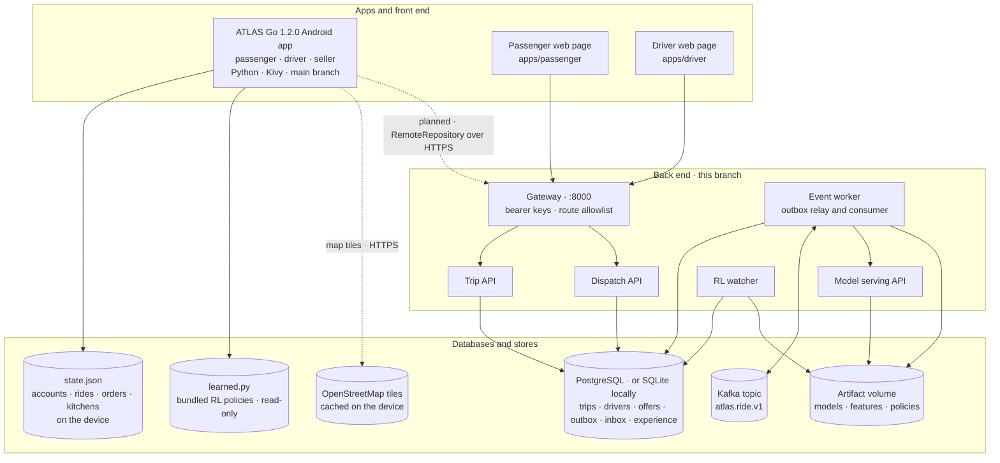

| Layer | Component | Technology | Stores data in | Status |
| --- | --- | --- | --- | --- |
| App | ATLAS Go Android app 1.2.0 (versionCode 3) | Python 3.14 on device, Kivy 2.3.1, pyjnius, requests, Buildozer / python-for-android, API 36, min API 26 | `state.json` in app-private storage (accounts with PBKDF2 hashes, kitchens, rides, orders); tile cache; learned constants in `learned.py` | Accounts, rides and orders on one phone; payments and journeys simulated; live map online with offline fallback; [1.2.0 downloads](https://github.com/FUllSCIPTS/ATLAS/blob/main/android-app/releases/1.2.0/README.md) |
| Front end | Passenger page | HTML + [`apps/shared/client.js`](../apps/shared/client.js) | Browser memory only | Runs against the gateway |
| Front end | Driver page | HTML + the same client script | Browser memory only | Runs against the gateway |
| Back end | Gateway | FastAPI, httpx | None | Runs |
| Back end | Trip and Dispatch APIs | FastAPI, Pydantic | PostgreSQL / SQLite | Runs; ride hailing only |
| Back end | Event worker | Python, Kafka client | PostgreSQL, Kafka, artifact volume | Runs |
| Back end | Model API and RL watcher | PyTorch LSTM, scikit-learn, batch Q-learning | Artifact volume, PostgreSQL | Runs |
| Back end | Accounts, food, seller and shared-ride services | — | — | Not implemented; [proposed contract](#proposed-back-end-extensions-for-the-android-app) |

## Folder hierarchy

All checked-in files under `architecture-explorer/`, including the runnable starter, the published explorer assets and the self-host server. Runtime data, trained artifacts and virtual environments are excluded from the source inventory. The research materials at the repository root are separate from this application.

<!-- BEGIN GENERATED TREE -->

```text
architecture-explorer/
├── deploy/
│   └── atlas-explorer.service
├── dist/
│   ├── atlas-go.js
│   ├── atlas.js
│   ├── atlas.svg
│   ├── build-spec.json
│   ├── build.html
│   ├── build.js
│   ├── crypto.js
│   ├── explorer.js
│   ├── index.html
│   ├── ml.js
│   ├── ride-event.schema.json
│   ├── security.js
│   ├── styles.css
│   └── uml-catalog.js
├── starter/
│   ├── apps/
│   │   ├── driver/
│   │   │   └── index.html
│   │   ├── passenger/
│   │   │   └── index.html
│   │   └── shared/
│   │       ├── client.js
│   │       └── demo.css
│   ├── docs/
│   │   ├── FINAL_HANDOVER.md
│   │   ├── UML_BLUEPRINT.md
│   │   └── uml-blueprint.json
│   ├── infra/
│   │   └── schema.sql
│   ├── ml/
│   │   ├── discrete.py
│   │   ├── forecast.py
│   │   ├── registry.py
│   │   ├── rl.py
│   │   ├── serve.py
│   │   └── train.py
│   ├── packages/
│   │   ├── config.py
│   │   ├── db.py
│   │   └── ride-event.schema.json
│   ├── scripts/
│   │   ├── generate_blueprint.py
│   │   ├── initialize.sh
│   │   ├── local.sh
│   │   └── security_catalog.py
│   ├── services/
│   │   ├── dispatch.py
│   │   ├── gateway.py
│   │   └── trips.py
│   ├── tests/
│   │   ├── policy.py
│   │   ├── replay.py
│   │   └── smoke.py
│   ├── workers/
│   │   └── events.py
│   ├── .dockerignore
│   ├── .gitignore
│   ├── Dockerfile
│   ├── README.md
│   ├── compose.yaml
│   └── requirements.txt
├── README.md
└── server.mjs
```

<!-- END GENERATED TREE -->

## Android app (ATLAS Go)

The Android app lives on the `main` branch at [`android-app/`](https://github.com/FUllSCIPTS/ATLAS/tree/main/android-app). This section describes version **1.2.0** (versionCode 3), which adds passenger, driver and food-seller accounts, a live map with device location, time-lapse live journeys, and connects all six on-device models to those flows. Every screen, rule, storage operation and test is Python. Accounts and bookings live on one phone; the only network traffic is map tiles from OpenStreetMap. [1.2.0 changelog](https://github.com/FUllSCIPTS/ATLAS/blob/main/android-app/CHANGELOG.md) · [app architecture](https://github.com/FUllSCIPTS/ATLAS/blob/main/android-app/docs/ARCHITECTURE.md) · [downloads and SHA256SUMS](https://github.com/FUllSCIPTS/ATLAS/blob/main/android-app/releases/1.2.0/README.md).

```text
android-app/
├── main.py                 Entry point; sets the desktop preview size, starts AtlasGoApp
├── buildozer.spec          1.2.0 / versionCode 3; API 36, min API 26; arm64-v8a + x86_64;
│                           INTERNET, ACCESS_NETWORK_STATE, ACCESS_FINE/COARSE_LOCATION (foreground)
├── CHANGELOG.md
├── atlas_go/
│   ├── __init__.py         Version (1.2.0)
│   ├── accounts.py         Roles, field validation, PBKDF2-HMAC-SHA256 hashing          (new)
│   ├── domain.py           Places, fares, Dish, Offer, Kitchen, Catalog, Cart
│   ├── geo.py              Cork coordinates, Web-Mercator tiles, live journey positions  (new)
│   ├── store.py            LocalStore: accounts, sessions, rides, orders, kitchens, tick()
│   ├── intelligence.py     Calendar, outlook, dispatch, acceptance, courier, LearningLab, self_test
│   ├── learned.py          Learned constants exported from the simulations (generated, read-only)
│   ├── livemap.py          LiveMap widget, TileLoader (threads, disk cache, offline layer) (new)
│   ├── location.py         DeviceLocation: runtime permission, LocationManager via pyjnius (new)
│   ├── app.py              AtlasGoApp and widgets: role-aware Kivy screens
│   └── acceptance.py       Debug-only UI click-through and screenshot capture
├── tests/                  117 tests: domain, intelligence, accounts/geo, roles
├── training/               Development-only simulations and exporter (numpy; excluded from the APK)
├── scripts/                Emulator acceptance, signing, manifest and alignment checks
├── docs/                   User guide, architecture, privacy, Play handover, 22 screenshots, video
└── releases/1.2.0/         APK, unsigned AAB, SHA256SUMS, release notes, validation
```

### App layers

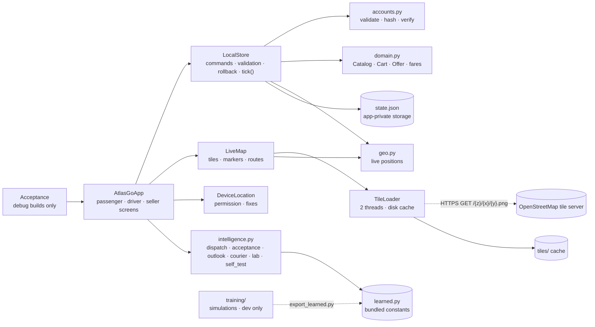

The UI changes state only through `LocalStore` commands; each validates, mutates, writes the file atomically and restores the previous in-memory state if the write fails. Once a second `AtlasGoApp.live_tick` calls `LocalStore.tick(now)`, which advances simulated journeys whose time-lapse leg has finished and refreshes the map layers. Journeys handled by a registered driver or seller move only when that account acts. `intelligence.py` and `geo.py` are pure Python without I/O.

### App class diagram


Module functions: `accounts` — `hash_password`, `verify_password`, `clean_name`, `clean_email`, `clean_phone`, `check_password`, `clean_plate`, `clean_licence`, `clean_business`, `parse_int`, `parse_price`, `public_view`. `geo` — `haversine_km`, `eta_minutes`, `leg_seconds`, `lerp`, `nearest_place`, `valid_point`, `zone_drift`, `world_px`, `from_world_px`, `tile_range`, `fit_zoom`, `ride_legs`, `ride_position`, `ride_eta_text`, `order_position`. `intelligence` (new in 1.2.0) — `surge_level`, `acceptance`, `registered_candidate`, `self_test`; `rank`/`choose` take `extra` candidates and `exclude` account ids; `courier_plan` takes a `prep` time. The full generated list is in [ARCHITECTURE.md](https://github.com/FUllSCIPTS/ATLAS/blob/main/android-app/docs/ARCHITECTURE.md#complete-source-method-catalog).

### Screen navigation

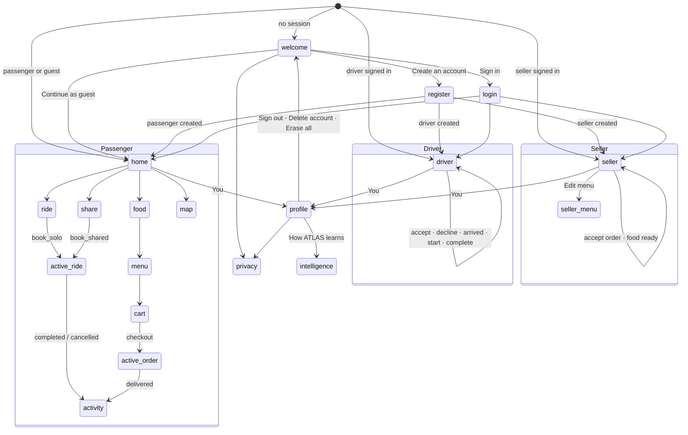

Bottom bar by role — passenger/guest: Home · Map · Food · Activity · You; driver: Drive · Map · Trips · You; seller: Kitchen · Menu · Orders · You. `render()` redirects a role away from screens it may not use.

### On-device ride and order lifecycles

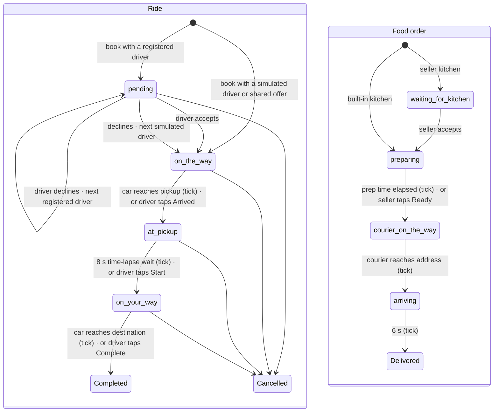

`stage` stays 0..2 as in 1.1.0; `pending` marks the waiting states. Legs are straight lines at 25 km/h played 10× faster (`geo.leg_seconds`). *Skip to next stage* still advances simulated journeys by hand. On completion a registered driver's `earnings` and `trips` increase; on delivery a seller kitchen's `orders` and `sales` (food total without the €2.50 delivery fee) increase.

### On-device data model (`state.json`)

One JSON document in app-private storage, saved via `state.tmp` + `fsync` + atomic replace. `LocalStore.validate` checks every field before a screen reads it; damaged files are kept as `state.invalid.json`. All 1.2.0 fields are optional, so a 1.1.0 file loads unchanged. Map tiles are cached separately under `tiles/{z}/{x}/{y}.png`.

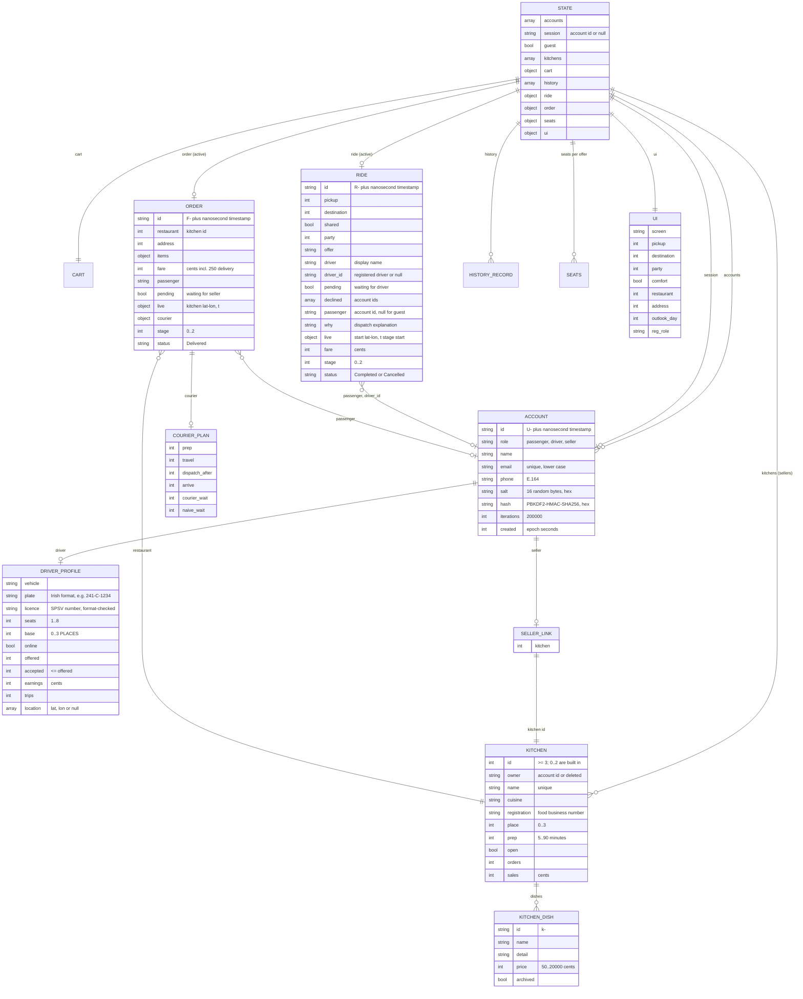

Account deletion removes the account, replaces its id in history with `deleted`, and closes the seller's kitchen (owner `deleted`, registration removed) so past orders keep a name. Sign-in failures are counted in memory only (five failures → 60-second lock).

### Registration and sign-in

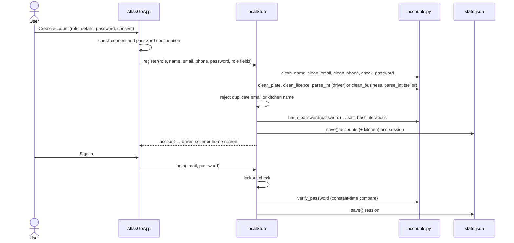

### Ride with a registered driver on the same phone

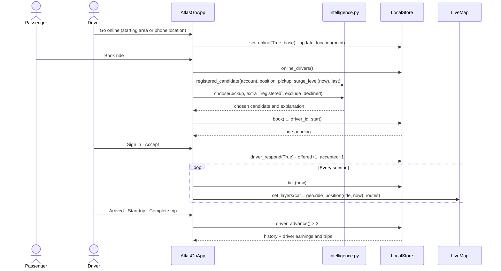

If the driver declines, `job_decline` asks `choose` again with that driver excluded and passes the result to `driver_respond(False, fallback)`.

### Food order from a seller kitchen

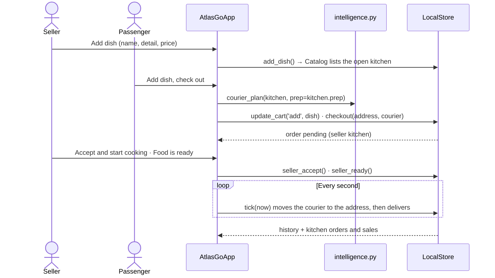

### Live map and location

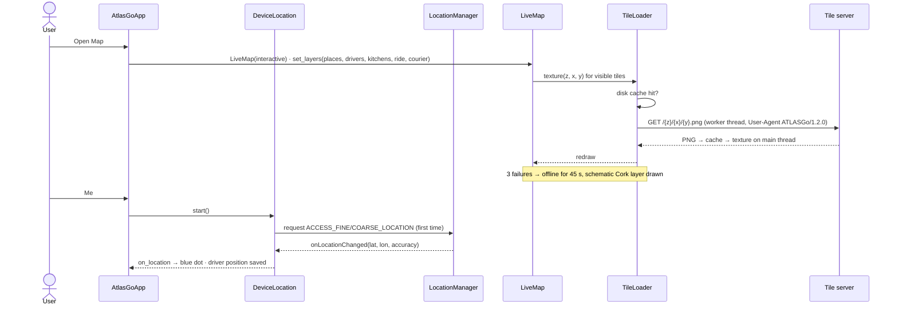

### On-device intelligence (1.2.0)

The models run on the phone in pure Python from constants that simulations produced offline; no numpy or model files are packaged. All training data is synthetic; holiday dates follow Ireland's real public-holiday rules. `training/export_learned.py` reproduced the bundled `learned.py` byte for byte for 1.2.0.

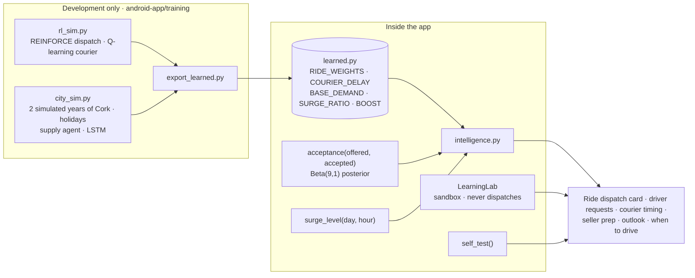

| Model | Learned by | Constant / function | Used on |
| --- | --- | --- | --- |
| Dispatch policy v1.4 | REINFORCE over four features (closer ETA, likely to accept, keep the last car in a surging area, avoid surging areas); delayed reward | `RIDE_WEIGHTS`, `rank`, `choose`, `explain` | Ride screen; `book_solo` and `redispatch`; driver decline hand-over. Registered online drivers join the simulated pool |
| Acceptance model | Beta(9, 1) prior updated by each registered driver's accept/decline counts | `acceptance` | `accept` feature of registered drivers; driver *Your week* card |
| Surge outlook | Demand ratio per calendar context and hour from two simulated years | `BASE_DEMAND`, `SURGE_RATIO`, `outlook`, `day_summary`, `surge_level` | Intelligence, home and driver cards; current-hour `surge` feature for registered drivers; busy-period notice on fares |
| Supply agent | Learned extra-driver boost per context, weekday type and hour | `BOOST` | Violet outlook marks; *when to drive* |
| Courier timing | Q-learning from kitchen slack to dispatch delay; margin extrapolated beyond the table | `COURIER_DELAY`, `courier_plan(kitchen, prep)` | Basket, order and seller screens; stored as `order.courier` |
| Learning lab | Retrains a dispatch policy from zero (30,000 simulated rides) | `LearningLab` | Intelligence screen; compared with the nearest-driver rule and v1.4 |

`self_test()` runs each model on known inputs (for example: UCC pickup chooses Morgan to protect Mardyke's last car; St Patrick's Day surges and an ordinary Wednesday does not; the lab improves after 3,000 rides). The Intelligence screen's **Check all models** shows the results; the unit tests require all six to pass.

These roles mirror the back-end ML: the dispatch policy corresponds to the RL agent and approved policy in [`ml/rl.py`](../ml/rl.py) and [`ml/registry.py`](../ml/registry.py), the outlook to the LSTM in [`ml/forecast.py`](../ml/forecast.py), and the acceptance model to the discrete model in [`ml/discrete.py`](../ml/discrete.py). When the app is connected, server-approved policies should replace the bundled constants, which remain the offline fallback.

## Component and deployment boundaries

Only the gateway is published on the host loopback interface in the starter. The trip, dispatch and model APIs run on the internal network. The same event worker performs outbox relay and event consumption in this demo.

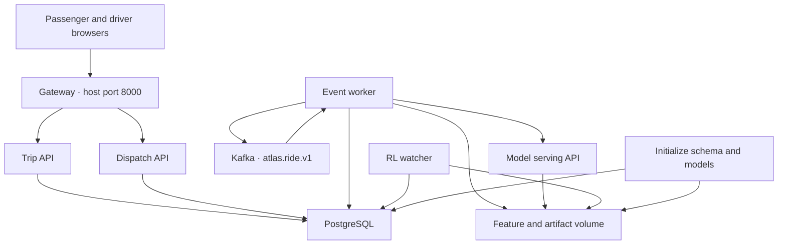

| Owner | Responsibility | Code |
| --- | --- | --- |
| Gateway | Serve browser pages, verify demo bearer keys, forward only allowlisted routes, attach internal identity | [services/gateway.py](../services/gateway.py) |
| Trip API | Create and read rider trips, validate driver milestones, update trip state | [services/trips.py](../services/trips.py) |
| Dispatch API | Track availability and offers, reserve a driver atomically on acceptance | [services/dispatch.py](../services/dispatch.py) |
| Event worker | Publish acknowledged outbox events, deduplicate consumption, create offers, apply assignment and collect learning features | [workers/events.py](../workers/events.py) |
| Model API | Load versioned artifacts and score candidates with demand, acceptance, anomaly and policy signals | [ml/serve.py](../ml/serve.py) |
| RL watcher | Train candidates from completed rides. Review and approval run as separate commands. | [ml/rl.py](../ml/rl.py) |

### Web front end

The gateway serves two static pages and one shared script. Both pages call the gateway only; the browser never reaches the internal services.

| Page | Route | Uses |
| --- | --- | --- |
| Passenger | `/` and `/passenger` → [`apps/passenger/index.html`](../apps/passenger/index.html) | `POST /v1/rider/trips` with an `Idempotency-Key`, then polls `GET /v1/rider/trips/{id}` |
| Driver | `/driver` → [`apps/driver/index.html`](../apps/driver/index.html) | `PUT /v1/driver/availability`, `GET /v1/driver/offers`, `POST /v1/driver/offers/{id}/accept`, `POST /v1/driver/trips/{id}/milestones` |
| Shared | `/assets/client.js` → [`apps/shared/client.js`](../apps/shared/client.js) | `request()` adds the role's demo bearer key; `refresh()` polls and renders; form handlers for booking and telemetry |

The Android app plays the same role as the passenger page. When connected, it must use the same `/v1/rider/...` routes through the gateway (see below).

## Class diagrams

The diagrams show classes declared by the starter. Inherited library methods are supplied by their base classes. Full type annotations, defaults, decorators and source lines are in the [generated symbol catalog](#generated-symbol-catalog).

### Booking and dispatch types

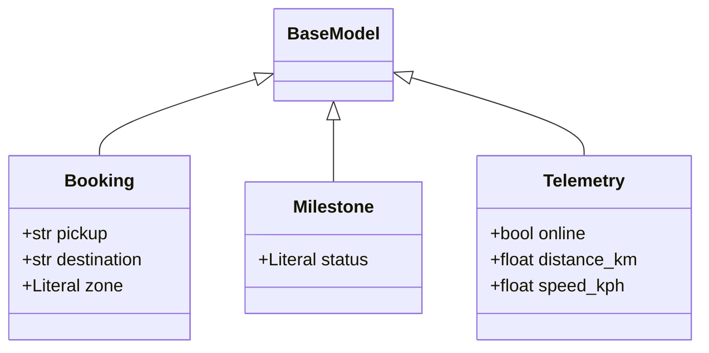

### Scoring types and LSTM

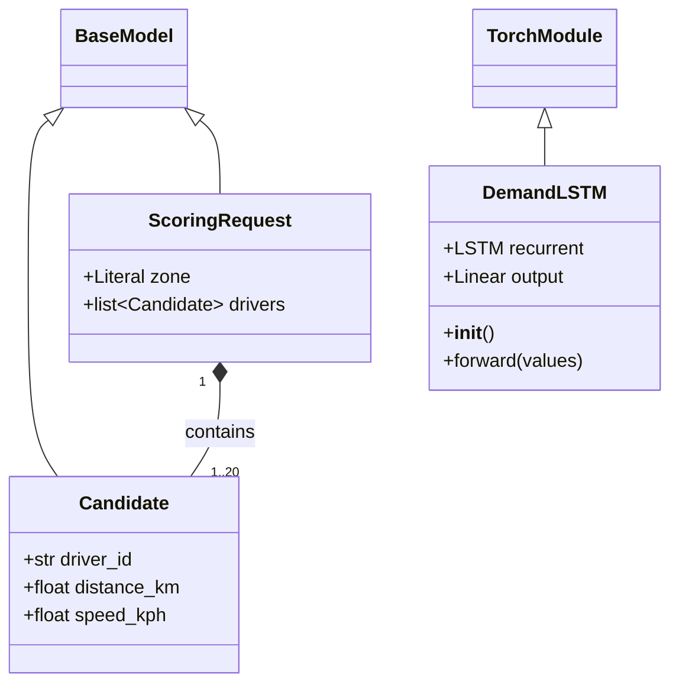

### Database adapter

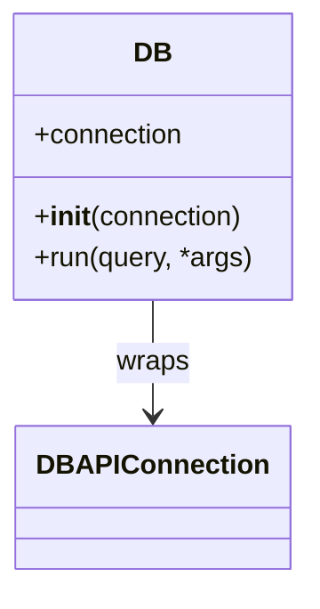

`TorchModule` and `DBAPIConnection` represent external dependencies. The connection is either `sqlite3.Connection` or a Psycopg connection. The starter's service modules use functions and route decorators. Their signatures appear in the catalog.

## Persistence model

Cardinalities and key markers reflect the actual database constraints in [infra/schema.sql](../infra/schema.sql). `trips.driver_id` is a nullable text field. The assignment handler supplies its value.

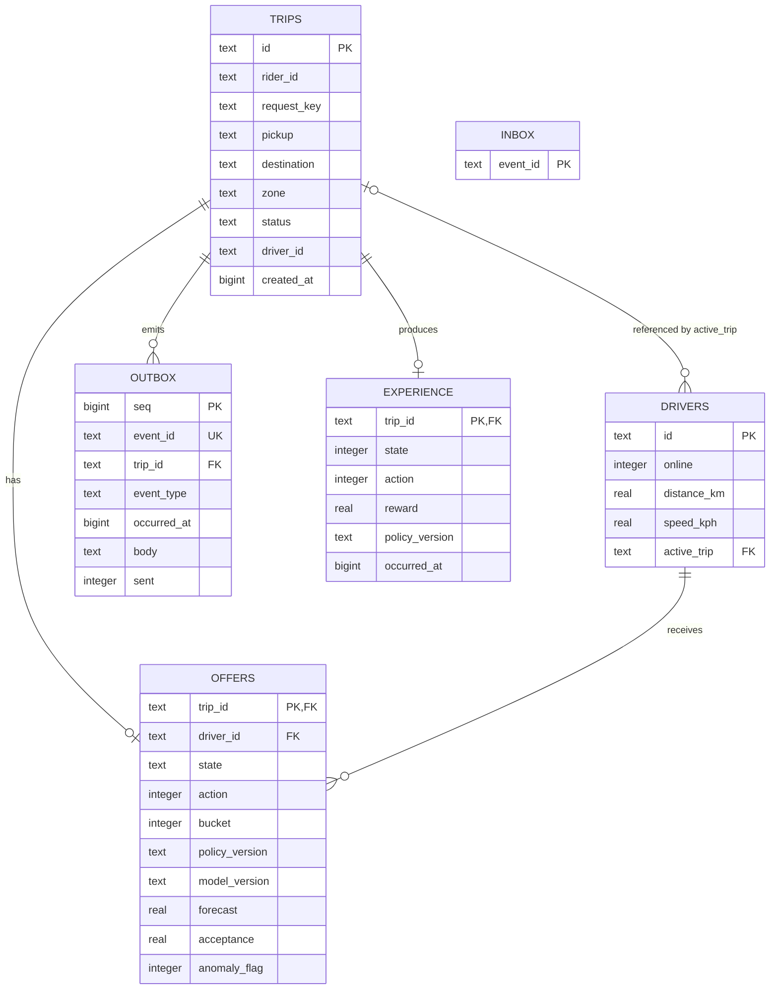

The compound unique key `trips(rider_id, request_key)` makes booking retries idempotent. The inbox primary key prevents duplicate event side effects. One offer and one learning record are stored per trip. The `pending_outbox(sent, seq)` index supports the relay.

### Databases at a glance

| Store | Owner | Engine | Holds | Durability |
| --- | --- | --- | --- | --- |
| `state.json` | Android app | JSON file, atomic replace | Basket, active ride and order (with dispatch explanation and courier plan), history, shared-seat counts, screen state | On the device only; deleted by Reset or uninstall |
| `learned.py` | Android app (generated by `training/export_learned.py`) | Python constants inside the APK | Dispatch weights, courier-delay table, hourly demand and surge profiles, supply boosts | Read-only; changes only with a new app version |
| `atlas` database | Trip, Dispatch, event worker, RL watcher | PostgreSQL in Compose; SQLite in the local quickstart | `trips`, `drivers`, `offers`, `outbox`, `inbox`, `experience` ([schema](../infra/schema.sql)) | Transactional; outbox and inbox give at-least-once delivery without duplicate effects |
| `atlas.ride.v1` | Event worker | Kafka | Ride events keyed by trip ID ([schema](../packages/ride-event.schema.json)) | Broker log; consumer offsets committed after database effects |
| Artifact volume | Model API, worker, RL watcher | Files | Versioned models, manifest, demand features, candidate and active policies | Atomic active-policy pointer |

The device file and the server database share no schema today. The server is the future source of truth; the device would keep only a cache and screen state.

## Trip state machine

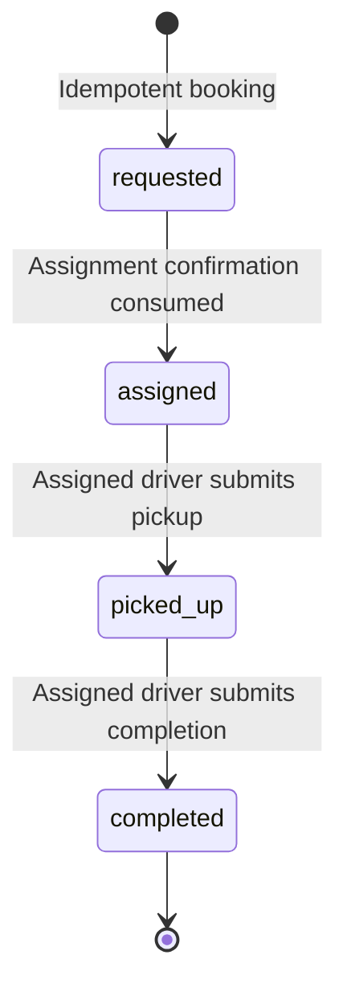

| Transition or action | Durable effect |
| --- | --- |
| Create booking | Insert trip and `trip.requested` outbox row in one transaction. Same key and body returns the existing trip. Different body with the same key yields `409`. |
| Create offer | Score online, unreserved drivers. Insert one offer and `dispatch.offer.created`. |
| Accept offer | Check driver ownership and availability. Update the offer, reserve the driver, and insert `dispatch.assignment.confirmed` in one transaction. |
| Apply assignment | Conditionally move `requested` to `assigned` and emit `trip.assigned`. |
| Pick up | Check driver and prior state. Move `assigned` to `picked_up` and emit `trip.picked_up`. |
| Complete | Move `picked_up` to `completed`, release the driver's reservation, and emit `trip.completed`. |
| Process completion | Join the offer's original state, action and policy version to the terminal reward. Insert one experience row. |

## Sequence diagrams

### Passenger booking

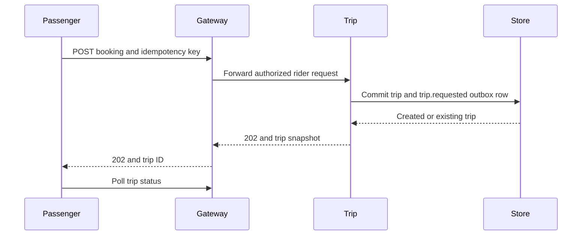

### Event delivery and offer creation

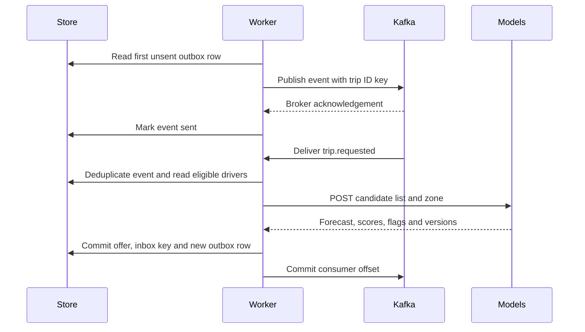

If a relay crashes after the broker acknowledgement and before marking the event sent, the next attempt can publish the same event again. The inbox deduplication is in the same transaction as the event's database effects. The SQLite profile drives these handlers directly from the outbox.

### Driver acceptance and completion

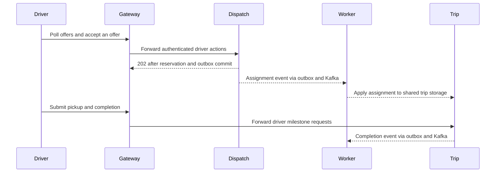

The worker applies assignment in the shared database. The diagram's dashed message to Trip represents that logical ownership boundary. There is no worker-to-Trip HTTP request.

### Training, serving and approval

```mermaid
flowchart TD
    S["Seeded training data"] --> T["Train LSTM, acceptance and anomaly models"]
    T --> M["Versioned model files and manifest"]
    M --> I["Model serving API"]
    E["Committed ride events"] --> F["Demand buckets and terminal experiences"]
    F --> I
    F --> Q["Batch Q-learning candidate"]
    Q --> G{"Explicit approval and holdout checks"}
    G -->|Pass| P["Atomic active-policy pointer"]
    P --> I
    G -->|Reject| B["Keep current policy"]
```

The LSTM reads 12 five-minute counts. Logistic regression and Isolation Forest read distance and speed. The RL state is forecast bucket `0` below 8 or `1` at least 8. Action `0` ranks by distance and action `1` ranks by acceptance probability. The policy watcher creates candidates after at least 80 completed outcomes. Training does not activate candidates. Inference uses an approved strategy only when `ATLAS_POLICY_ENABLED=1`. Rollback restores the nearest-driver baseline.

## Connecting the Android app to the back end

This section is a design for the next step. None of it is implemented yet: in 1.2.0 the Android app's only network calls are map-tile downloads.

### Repository boundary

Introduce a repository interface in the app. Keep `LocalStore` as the offline demo implementation and add a `RemoteRepository` that calls the gateway over HTTPS. Run network calls off Kivy's main thread and apply results back on it.

```mermaid
classDiagram
    class PassengerRepository {
        <<interface>>
        +book(pickup, destination, comfort, offer_id, party)
        +ride_status(trip_id)
        +cancel_ride(trip_id)
        +shared_offers(pickup, destination, party)
        +restaurants()
        +menu(restaurant_id)
        +checkout(basket, address)
        +order_status(order_id)
        +history()
        +register(role, profile, password)
        +login(email, password)
        +delete_account(password)
    }
    class DriverRepository {
        <<interface>>
        +set_online(online, location)
        +offers()
        +respond(trip_id, accept)
        +advance(trip_id)
    }
    class SellerRepository {
        <<interface>>
        +kitchen()
        +add_dish(name, detail, price)
        +archive_dish(dish_id)
        +update_kitchen(open, prep)
        +accept_order(order_id)
        +ready(order_id)
    }
    class LocalStore {
        offline demo · state.json
    }
    class RemoteRepository {
        +str base_url
        +TokenStore tokens
        +HttpClient http
    }
    class TokenStore {
        Android Keystore-backed
    }
    class AtlasGoApp
    PassengerRepository <|.. LocalStore
    PassengerRepository <|.. RemoteRepository
    DriverRepository <|.. LocalStore
    DriverRepository <|.. RemoteRepository
    SellerRepository <|.. LocalStore
    SellerRepository <|.. RemoteRepository
    AtlasGoApp --> PassengerRepository
    RemoteRepository --> TokenStore
```

### Command-to-API map

| App action | `LocalStore` today | Back end today | Gap to close |
| --- | --- | --- | --- |
| Book a solo ride | `book(pickup, destination, comfort)` | `POST /v1/rider/trips` with `Idempotency-Key`; body `pickup`, `destination`, `zone` | Map place indexes to place names and a zone (`cork-centre` or `cork-north`); add fare quote and comfort option on the server |
| Watch a ride | `advance_ride()` on button press | `GET /v1/rider/trips/{id}` polling | Map server status to app stages: `requested` → finding a driver, `assigned` → driver confirmed, `picked_up` → on your way, `completed` → completed. The server has no separate "at pickup" status |
| Driver gets the pickup location | Simulated driver name | Worker creates an offer; driver page polls `GET /v1/driver/offers` and accepts | Driver app shows pickup text only; add GPS coordinates and routing as a separate extension |
| Cancel a ride | `advance_ride(cancel=True)` | Not available | Add a cancel route and a `cancelled` trip status |
| Shared ride | `Offer.matches`, `reserve`, `release` | Not available | [Proposed shared-ride API](#proposed-back-end-extensions-for-the-android-app) |
| Food menu, basket, checkout, tracking | `Cart`, `checkout`, `advance_order` | Not available | [Proposed food API](#proposed-back-end-extensions-for-the-android-app) |
| Activity | `history` in `state.json` | Not available | Add `GET /v1/rider/history` |
| Identity | `register`, `login`, `logout`, `delete_account`; PBKDF2 hashes on the phone; guest mode | Demo bearer keys per role | Server accounts for passenger, driver and seller roles; email/phone verification; tokens in Android Keystore; hashing moves to the server (Argon2id or PBKDF2) |
| Driver online and location | `set_online`, `update_location` (local) | Driver page polls offers | `POST /v1/driver/availability` with location while online |
| Driver accepts and drives | `driver_respond`, `driver_advance` | `POST /v1/driver/offers/{id}/accept`, completion routes | Add decline (re-match), arrived and start-trip milestones |
| Seller kitchen and menu | `add_dish`, `archive_dish`, `update_kitchen` | Not available | [Proposed seller API](#proposed-back-end-extensions-for-the-android-app) |
| Seller order handling | `seller_accept`, `seller_ready` | Not available | Proposed seller API; emits `food.order.accepted`, `food.order.ready` |
| Live positions | `geo.ride_position`, `geo.order_position` (time-lapse) | Not available | Server-sent driver/courier positions; routing provider for real routes and ETAs |
| Driver choice and explanation | `intelligence.choose(pickup, extra, exclude)` with bundled `RIDE_WEIGHTS`; registered drivers scored with `acceptance` and `surge_level` | Dispatch ranks candidates with model scores and the approved RL policy | Return the ranked candidates and a reason with the assignment, pinned to the policy version |
| Surge outlook | `intelligence.day_summary(day)` from bundled profiles | LSTM demand forecast in the model API | Add a read-only `GET /v1/rider/outlook?date=` backed by the forecaster |
| Courier timing | `intelligence.courier_plan(kitchen, prep)` | Not available | Part of the proposed food API: courier dispatch time decided by the server |
| Learning lab | `LearningLab` on the device | Not applicable | Stays a local sandbox; never sends results or dispatches |

### Connected booking sequence

```mermaid
sequenceDiagram
    actor Passenger
    participant App as AtlasGoApp
    participant Repo as RemoteRepository
    participant Gateway
    participant Trip
    participant DB as PostgreSQL
    Passenger->>App: Book ride
    App->>Repo: book(...) on a background thread
    Repo->>Gateway: POST /v1/rider/trips · Bearer token · Idempotency-Key
    Gateway->>Trip: Forward with internal rider identity
    Trip->>DB: Insert trip and trip.requested outbox row
    Trip-->>Gateway: 202 trip snapshot
    Gateway-->>Repo: 202 trip ID
    Repo-->>App: Show "requested" on the main thread
    loop Until completed
        Repo->>Gateway: GET /v1/rider/trips/{id}
        Gateway-->>Repo: status and driver_id
        Repo-->>App: Update stage
    end
```

Retries must reuse the same idempotency key, so a lost response never books twice. The phone never connects to Kafka, the database or the model API directly.

### Proposed back-end extensions for the Android app

These tables and routes are a proposal to support the app's accounts, driver, seller, food and shared-ride features (the fields mirror 1.2.0's `state.json`). They are not in [`infra/schema.sql`](../infra/schema.sql) and no service implements them.

```mermaid
erDiagram
    ACCOUNTS ||--o| DRIVER_PROFILES : "driver role"
    ACCOUNTS ||--o| RESTAURANTS : "seller owns"
    ACCOUNTS {
        text id PK
        text role "passenger, driver, seller"
        text email UK
        text phone
        text password_hash
        integer verified
        bigint created_at
    }
    DRIVER_PROFILES {
        text account_id PK, FK
        text vehicle
        text plate
        text spsv_licence
        integer seats
        integer verified "operator checked"
        integer online
        double lat
        double lon
        integer offered
        integer accepted
    }
    RESTAURANTS ||--o{ MENU_ITEMS : offers
    RESTAURANTS ||--o{ FOOD_ORDERS : receives
    FOOD_ORDERS ||--|{ ORDER_ITEMS : contains
    MENU_ITEMS ||--o{ ORDER_ITEMS : "ordered as"
    FOOD_ORDERS ||--o{ OUTBOX : emits
    SHARED_OFFERS ||--o{ SEAT_RESERVATIONS : holds
    TRIPS ||--o| SEAT_RESERVATIONS : "shared trip"
    RESTAURANTS {
        text id PK
        text owner_id FK "seller account; null for partner kitchens"
        text registration "food business number"
        integer prep_minutes
        text name
        text place
        integer delivery_fee_cents
        integer open
    }
    MENU_ITEMS {
        text id PK
        text restaurant_id FK
        text name
        text detail
        integer price_cents
        integer available
    }
    FOOD_ORDERS {
        text id PK
        text rider_id
        text request_key
        text restaurant_id FK
        text address
        text status "placed, preparing, collected, delivered, cancelled"
        text courier_id
        integer total_cents
        bigint created_at
    }
    ORDER_ITEMS {
        text order_id PK, FK
        text item_id PK, FK
        integer quantity "1 to 10"
        integer unit_price_cents
    }
    SHARED_OFFERS {
        text id PK
        text driver_id FK
        text pickup
        text destination
        integer capacity
        integer seats_left
        integer price_cents
        bigint departs_at
    }
    SEAT_RESERVATIONS {
        text offer_id PK, FK
        text trip_id PK, FK
        integer party "1 or 2"
    }
```

Rules carried over from the app: `UNIQUE (rider_id, request_key)` on `food_orders`; one restaurant per order; at most ten of each item; prices copied into `order_items` at checkout; seat reservation as one conditional update (`seats_left = seats_left - party WHERE seats_left >= party`) in the same transaction as its outbox row; cancellation returns seats. Totals and seat counts are decided by the server, never by the phone.

| Proposed route | Purpose |
| --- | --- |
| `GET /v1/rider/restaurants` · `GET /v1/rider/restaurants/{id}/menu` | Restaurant list and menu with server prices |
| `POST /v1/rider/orders` (`Idempotency-Key`) · `GET /v1/rider/orders/{id}` | Checkout and order tracking (`food.order.placed` … `food.order.delivered` events) |
| `POST /v1/courier/orders/{id}/milestones` | Courier collects at the restaurant and delivers to the address |
| `GET /v1/rider/shared-offers?pickup=&destination=&party=` · `POST /v1/rider/shared-offers/{id}/reserve` | Shared-ride search and atomic seat reservation |
| `POST /v1/rider/trips/{id}/cancel` | Ride cancellation; releases driver and seats |
| `GET /v1/rider/history` | Activity screen |
| `POST /v1/accounts` · `POST /v1/sessions` · `DELETE /v1/accounts/me` | Registration for the three roles, sign-in, account deletion |
| `POST /v1/driver/availability` · `POST /v1/driver/offers/{id}/decline` · `POST /v1/driver/trips/{id}/milestones` | Online/offline with location; decline and re-match; arrived, started, completed |
| `GET/PUT /v1/seller/kitchen` · `POST /v1/seller/menu-items` · `DELETE /v1/seller/menu-items/{id}` | Kitchen profile, open/closed, preparation time, menu |
| `POST /v1/seller/orders/{id}/accept` · `POST /v1/seller/orders/{id}/ready` | Seller order handling; the server then schedules the courier from the courier-timing policy |

Each new route must be added to the gateway's `ROUTES` allowlist with its role.

## Rebuild checklist

1. Run the [starter smoke and policy checks](../README.md#start-with-postgresql-and-kafka) against the existing code. Use the request paths and payloads in the [API contract](../README.md#api-and-data-contracts) as the compatibility baseline.
2. Implement changes through existing boundaries. Preserve rider and driver ownership, transactional state and outbox writes, deduplication, the state machine, model versions and explicit policy approval.
3. Test one complete ride, a booking retry with the same key, a forbidden offer acceptance, an invalid state transition, model outputs and one terminal experience. Run `tests.replay` against the configured Kafka broker before claiming deployment readiness.
4. Treat GPS, routing, offer expiry and re-matching, cancellations, payments, production identity and representative training data as separately scoped extensions.
5. For the Android app, run `python -m pytest tests` in `android-app/` on the `main` branch (117 cases in 1.2.0), the desktop acceptance run (247 assertions, 22 screenshots) and the emulator acceptance workflow before and after changes. After changing a simulation in `training/`, run `python training/export_learned.py` and commit the regenerated `atlas_go/learned.py`. When connecting it to the back end, add the repository interface first, keep `LocalStore` passing its tests, and test `RemoteRepository` against a staging gateway.
6. Regenerate the blueprint after changing code. Commit the updated generated sections and JSON with the source changes.

From `starter/`, use Python 3.12 and Node.js with npm. The generator uses the Python standard library and the pinned Acorn parser for JavaScript.

```bash
python scripts/generate_blueprint.py
python scripts/generate_blueprint.py --check
```

The JSON includes relative paths, source hashes, imports, class bases, attributes, method signatures, module functions, nested functions, callbacks, decorators and source lines. The application catalog covers the starter and its tests. The supporting catalog covers the explorer, Node static server and blueprint generator. The [handover runbook](FINAL_HANDOVER.md) specifies exact API responses, environment variables, model artifacts and acceptance steps.

## Security and cryptography catalogue

<!-- BEGIN SECURITY CATALOG -->

Every concept in the Architecture Explorer's **Security** and **Cryptography** tabs, linked to the
function, constant or file that implements it. Each row has a stable anchor that the explorer links to.
Status: **Implemented** (in the code), **Demo-grade** (implemented with deliberately simple choices),
**Teaching extension** (not in ATLAS; shows where a standard protocol would attach) or **Explorer / lab**
(teaching code in the explorer or `security_lab/`). Generated by `scripts/security_catalog.py`.

<a name="uml-security-passwords"></a>

### Security → Password storage

[Open in the explorer ↗](https://fullscipts.github.io/ATLAS/#security-passwords)

| Concept | Function / symbol | Location | Status |
| --- | --- | --- | --- |
| <a name="sec-pw-params"></a>Work factor and lockout limits | `PBKDF2_ITERATIONS` | [android-app/atlas_go/accounts.py L16](https://github.com/FUllSCIPTS/ATLAS/blob/main/android-app/atlas_go/accounts.py#L16) | Implemented |
| <a name="sec-pw-hash"></a>Hash a password (salt + PBKDF2-HMAC-SHA256) | `hash_password` | [android-app/atlas_go/accounts.py L27](https://github.com/FUllSCIPTS/ATLAS/blob/main/android-app/atlas_go/accounts.py#L27) | Implemented |
| <a name="sec-pw-verify"></a>Verify a password (constant-time compare) | `verify_password` | [android-app/atlas_go/accounts.py L33](https://github.com/FUllSCIPTS/ATLAS/blob/main/android-app/atlas_go/accounts.py#L33) | Implemented |
| <a name="sec-pw-policy"></a>Password policy (8–128, letter + digit) | `check_password` | [android-app/atlas_go/accounts.py L72](https://github.com/FUllSCIPTS/ATLAS/blob/main/android-app/atlas_go/accounts.py#L72) | Implemented |
| <a name="sec-pw-public"></a>Strip salt and hash before display | `public_view` | [android-app/atlas_go/accounts.py L124](https://github.com/FUllSCIPTS/ATLAS/blob/main/android-app/atlas_go/accounts.py#L124) | Implemented |
| <a name="sec-pw-register"></a>Store only {salt, hash, iterations} at registration | `LocalStore.register` | [android-app/atlas_go/store.py L260](https://github.com/FUllSCIPTS/ATLAS/blob/main/android-app/atlas_go/store.py#L260) | Implemented |
| <a name="sec-pw-test"></a>Test: same password, different salts and hashes | `test_password_hash_roundtrip_and_salt` | [android-app/tests/test_accounts_geo.py L9](https://github.com/FUllSCIPTS/ATLAS/blob/main/android-app/tests/test_accounts_geo.py#L9) | Implemented |
| <a name="sec-pw-lab"></a>Explorer lab: PBKDF2 with the app's parameters | `secPwHash` | [architecture-explorer/dist/security.js L204](../../dist/security.js#L204) | Explorer / lab |
| <a name="sec-pw-lab-verify"></a>Explorer lab: verify_password replica | `secPwVerify` | [architecture-explorer/dist/security.js L223](../../dist/security.js#L223) | Explorer / lab |
| <a name="sec-pw-cli"></a>Command-line lab runner: all 20 experiments and 5 study paths | `if __name__ == '__main__':` | [security_lab/password_storage_demo.py L37](https://github.com/FUllSCIPTS/ATLAS/blob/main/security_lab/password_storage_demo.py#L37) | Explorer / lab |
| <a name="sec-pw-cli-a"></a>Lab A: what the app stores (experiments 1-8) | `exp_record` | [security_lab/lab_a_password_storage.py L38](https://github.com/FUllSCIPTS/ATLAS/blob/main/security_lab/lab_a_password_storage.py#L38) | Explorer / lab |
| <a name="sec-pw-cli-common"></a>Lab helpers, experiment registry and command line | `main` | [security_lab/lab_common.py L144](https://github.com/FUllSCIPTS/ATLAS/blob/main/security_lab/lab_common.py#L144) | Explorer / lab |

<a name="uml-security-login"></a>

### Security → Login & lockout

[Open in the explorer ↗](https://fullscipts.github.io/ATLAS/#security-login)

| Concept | Function / symbol | Location | Status |
| --- | --- | --- | --- |
| <a name="sec-login"></a>Sign in, 5 failures → 60 s lockout, generic error | `LocalStore.login` | [android-app/atlas_go/store.py L304](https://github.com/FUllSCIPTS/ATLAS/blob/main/android-app/atlas_go/store.py#L304) | Implemented |
| <a name="sec-login-failures"></a>Failure counter kept in memory only | `self.failures = {}          # email -> [count, locked_until]; memory ...` | [android-app/atlas_go/store.py L33](https://github.com/FUllSCIPTS/ATLAS/blob/main/android-app/atlas_go/store.py#L33) | Implemented |
| <a name="sec-login-session"></a>Session validated on load (must name an account) | `LocalStore.validate` | [android-app/atlas_go/store.py L86](https://github.com/FUllSCIPTS/ATLAS/blob/main/android-app/atlas_go/store.py#L86) | Implemented |
| <a name="sec-login-guest"></a>Guest mode (no identity, least privilege) | `LocalStore.continue_as_guest` | [android-app/atlas_go/store.py L321](https://github.com/FUllSCIPTS/ATLAS/blob/main/android-app/atlas_go/store.py#L321) | Implemented |
| <a name="sec-login-logout"></a>Sign out | `LocalStore.logout` | [android-app/atlas_go/store.py L326](https://github.com/FUllSCIPTS/ATLAS/blob/main/android-app/atlas_go/store.py#L326) | Implemented |
| <a name="sec-login-clear"></a>Clear the password field after submit | `AtlasGoApp.submit_login` | [android-app/atlas_go/app.py L613](https://github.com/FUllSCIPTS/ATLAS/blob/main/android-app/atlas_go/app.py#L613) | Implemented |
| Verify a password (constant-time compare) | `verify_password` | [android-app/atlas_go/accounts.py L33](https://github.com/FUllSCIPTS/ATLAS/blob/main/android-app/atlas_go/accounts.py#L33) | Implemented |
| <a name="sec-login-lab"></a>Explorer lab: LocalStore.login replica | `secLoginAttempt` | [architecture-explorer/dist/security.js L267](../../dist/security.js#L267) | Explorer / lab |
| <a name="sec-pw-cli-c"></a>Lab C: sign-in defences (experiments 12-15) | `exp_lockout` | [security_lab/lab_c_signin_defences.py L28](https://github.com/FUllSCIPTS/ATLAS/blob/main/security_lab/lab_c_signin_defences.py#L28) | Explorer / lab |
| <a name="sec-pw-cli-d"></a>Lab D: integrity, sessions and lifecycle (experiments 16-20) | `exp_sessions` | [security_lab/lab_d_integrity_lifecycle.py L34](https://github.com/FUllSCIPTS/ATLAS/blob/main/security_lab/lab_d_integrity_lifecycle.py#L34) | Explorer / lab |

<a name="uml-security-identity"></a>

### Security → Identity & roles

[Open in the explorer ↗](https://fullscipts.github.io/ATLAS/#security-identity)

| Concept | Function / symbol | Location | Status |
| --- | --- | --- | --- |
| Store only {salt, hash, iterations} at registration | `LocalStore.register` | [android-app/atlas_go/store.py L260](https://github.com/FUllSCIPTS/ATLAS/blob/main/android-app/atlas_go/store.py#L260) | Implemented |
| <a name="sec-id-email"></a>Identity proofing: email format | `clean_email` | [android-app/atlas_go/accounts.py L53](https://github.com/FUllSCIPTS/ATLAS/blob/main/android-app/atlas_go/accounts.py#L53) | Implemented |
| <a name="sec-id-phone"></a>Identity proofing: phone normalised to E.164 | `clean_phone` | [android-app/atlas_go/accounts.py L60](https://github.com/FUllSCIPTS/ATLAS/blob/main/android-app/atlas_go/accounts.py#L60) | Implemented |
| <a name="sec-id-licence"></a>Driver licence number (self-declared) | `clean_licence` | [android-app/atlas_go/accounts.py L88](https://github.com/FUllSCIPTS/ATLAS/blob/main/android-app/atlas_go/accounts.py#L88) | Implemented |
| <a name="sec-id-business"></a>Food-business number (self-declared) | `clean_business` | [android-app/atlas_go/accounts.py L95](https://github.com/FUllSCIPTS/ATLAS/blob/main/android-app/atlas_go/accounts.py#L95) | Implemented |
| <a name="sec-id-delete"></a>De-provision with re-authentication, anonymise history | `LocalStore.delete_account` | [android-app/atlas_go/store.py L333](https://github.com/FUllSCIPTS/ATLAS/blob/main/android-app/atlas_go/store.py#L333) | Implemented |
| <a name="sec-rbac-screens"></a>RBAC layer 1: screen allow-list per role | `AtlasGoApp.render` | [android-app/atlas_go/app.py L422](https://github.com/FUllSCIPTS/ATLAS/blob/main/android-app/atlas_go/app.py#L422) | Implemented |
| <a name="sec-rbac-online"></a>RBAC layer 2: only drivers go online | `LocalStore.set_online` | [android-app/atlas_go/store.py L367](https://github.com/FUllSCIPTS/ATLAS/blob/main/android-app/atlas_go/store.py#L367) | Implemented |
| <a name="sec-rbac-location"></a>RBAC layer 2: only drivers share location | `LocalStore.update_location` | [android-app/atlas_go/store.py L377](https://github.com/FUllSCIPTS/ATLAS/blob/main/android-app/atlas_go/store.py#L377) | Implemented |
| <a name="sec-rbac-respond"></a>RBAC layer 2: a driver answers only their own job | `LocalStore.driver_respond` | [android-app/atlas_go/store.py L392](https://github.com/FUllSCIPTS/ATLAS/blob/main/android-app/atlas_go/store.py#L392) | Implemented |
| <a name="sec-rbac-book"></a>RBAC layer 2: only passengers or guests book | `LocalStore.book` | [android-app/atlas_go/store.py L422](https://github.com/FUllSCIPTS/ATLAS/blob/main/android-app/atlas_go/store.py#L422) | Implemented |
| <a name="sec-rbac-checkout"></a>RBAC layer 2: only passengers or guests order food | `LocalStore.checkout` | [android-app/atlas_go/store.py L557](https://github.com/FUllSCIPTS/ATLAS/blob/main/android-app/atlas_go/store.py#L557) | Implemented |
| <a name="sec-rbac-kitchen"></a>RBAC layer 2: a seller edits only their own kitchen | `LocalStore._my_kitchen` | [android-app/atlas_go/store.py L496](https://github.com/FUllSCIPTS/ATLAS/blob/main/android-app/atlas_go/store.py#L496) | Implemented |
| <a name="sec-pw-cli-b"></a>Lab B: registration and identity (experiments 9-11) | `exp_validation` | [security_lab/lab_b_registration_identity.py L28](https://github.com/FUllSCIPTS/ATLAS/blob/main/security_lab/lab_b_registration_identity.py#L28) | Explorer / lab |
| Lab D: integrity, sessions and lifecycle (experiments 16-20) | `exp_sessions` | [security_lab/lab_d_integrity_lifecycle.py L34](https://github.com/FUllSCIPTS/ATLAS/blob/main/security_lab/lab_d_integrity_lifecycle.py#L34) | Explorer / lab |

<a name="uml-security-gateway"></a>

### Security → Gateway auth

[Open in the explorer ↗](https://fullscipts.github.io/ATLAS/#security-gateway)

| Concept | Function / symbol | Location | Status |
| --- | --- | --- | --- |
| <a name="sec-gw-routes"></a>Route allow-list (method, role, regex) | `ROUTES` | [architecture-explorer/starter/services/gateway.py L15](../services/gateway.py#L15) | Demo-grade |
| <a name="sec-gw-proxy"></a>Authenticate, check role, assert identity, forward | `proxy` | [architecture-explorer/starter/services/gateway.py L47](../services/gateway.py#L47) | Demo-grade |
| <a name="sec-gw-keys"></a>Bearer keys per actor (demo defaults) | `KEYS` | [architecture-explorer/starter/packages/config.py L13](../packages/config.py#L13) | Demo-grade |
| <a name="sec-gw-equal"></a>Timing-safe comparison (hmac.compare_digest) | `equal` | [architecture-explorer/starter/packages/config.py L20](../packages/config.py#L20) | Demo-grade |
| <a name="sec-gw-internal"></a>Service re-check: internal token and actor role | `internal_actor` | [architecture-explorer/starter/packages/config.py L24](../packages/config.py#L24) | Demo-grade |
| <a name="sec-gw-trips"></a>Trip Service accepts only gateway-asserted riders | `book` | [architecture-explorer/starter/services/trips.py L32](../services/trips.py#L32) | Demo-grade |
| <a name="sec-gw-dispatch"></a>Dispatch Service accepts only gateway-asserted drivers | `offers` | [architecture-explorer/starter/services/dispatch.py L35](../services/dispatch.py#L35) | Demo-grade |
| <a name="sec-gw-lab"></a>Explorer lab: gateway checks step by step | `secGatewayRun` | [architecture-explorer/dist/security.js L367](../../dist/security.js#L367) | Explorer / lab |

<a name="uml-security-sso"></a>

### Security → Single sign-on

[Open in the explorer ↗](https://fullscipts.github.io/ATLAS/#security-sso)

| Concept | Function / symbol | Location | Status |
| --- | --- | --- | --- |
| <a name="sec-sso-target"></a>Where JWT validation would replace bearer keys | `proxy` | [architecture-explorer/starter/services/gateway.py L47](../services/gateway.py#L47) | Teaching extension |
| Bearer keys per actor (demo defaults) | `KEYS` | [architecture-explorer/starter/packages/config.py L13](../packages/config.py#L13) | Demo-grade |
| <a name="sec-sso-lab"></a>OIDC + PKCE flow with ES256 tokens | `secSsoNext` | [architecture-explorer/dist/security.js L420](../../dist/security.js#L420) | Explorer / lab |

<a name="uml-security-kerberos"></a>

### Security → Kerberos

[Open in the explorer ↗](https://fullscipts.github.io/ATLAS/#security-kerberos)

| Concept | Function / symbol | Location | Status |
| --- | --- | --- | --- |
| <a name="sec-krb-target"></a>What a Kerberos AP-REQ would replace in Dispatch | `internal_actor` | [architecture-explorer/starter/packages/config.py L24](../packages/config.py#L24) | Teaching extension |
| <a name="sec-krb-setup"></a>KDC database and string-to-key (PBKDF2) | `secKrbSetup` | [architecture-explorer/dist/security.js L500](../../dist/security.js#L500) | Explorer / lab |
| <a name="sec-krb-messages"></a>The six messages AS-REQ … AP-REP | `secKrbNext` | [architecture-explorer/dist/security.js L510](../../dist/security.js#L510) | Explorer / lab |
| <a name="sec-krb-ap"></a>Service checks: integrity, expiry, skew, replay cache | `secKrbVerifyAp` | [architecture-explorer/dist/security.js L583](../../dist/security.js#L583) | Explorer / lab |
| <a name="sec-krb-seal"></a>AES-256-GCM seal used for tickets | `secSeal` | [architecture-explorer/dist/security.js L82](../../dist/security.js#L82) | Explorer / lab |

<a name="uml-security-transport"></a>

### Security → mTLS & deployment

[Open in the explorer ↗](https://fullscipts.github.io/ATLAS/#security-transport)

| Concept | Function / symbol | Location | Status |
| --- | --- | --- | --- |
| <a name="sec-tls-ca"></a>Private CA, serverAuth and clientAuth certificates | `make_certs` | [prototype.zip → prototype/proto_run.py L28](https://github.com/FUllSCIPTS/ATLAS/blob/main/prototype.zip) | Implemented |
| <a name="sec-tls-client"></a>Client presents its certificate, verifies the server | `client_ctx` | [prototype.zip → prototype/proto_run.py L45](https://github.com/FUllSCIPTS/ATLAS/blob/main/prototype.zip) | Implemented |
| <a name="sec-tls-server"></a>Server requires a client certificate (CERT_REQUIRED) | `ctx.load_verify_locations(f"{certdir}/ca.crt"); ctx.verify_mode = ssl...` | [prototype.zip → prototype/module_server.py L84](https://github.com/FUllSCIPTS/ATLAS/blob/main/prototype.zip) | Implemented |
| <a name="sec-dep-headers"></a>Security headers and CSP | `securityHeaders` | [architecture-explorer/server.mjs L33](../../server.mjs#L33) | Implemented |
| <a name="sec-dep-reply"></a>Every response carries the headers | `reply` | [architecture-explorer/server.mjs L41](../../server.mjs#L41) | Implemented |
| <a name="sec-dep-loopback"></a>Listen on 127.0.0.1 only | `}).listen(port, host, () => console.log('ATLAS listening on http://${...` | [architecture-explorer/server.mjs L67](../../server.mjs#L67) | Implemented |
| <a name="sec-dep-systemd"></a>systemd sandbox (DynamicUser, ProtectSystem) | `DynamicUser=yes` | [architecture-explorer/deploy/atlas-explorer.service L10](../../deploy/atlas-explorer.service#L10) | Implemented |
| <a name="cr-sig-sign"></a>Sign the bundle: jarsigner SHA256withRSA, then verify | `main` | [android-app/scripts/sign-release.py L8](https://github.com/FUllSCIPTS/ATLAS/blob/main/android-app/scripts/sign-release.py#L8) | Implemented |

<a name="uml-security-gaps"></a>

### Security → Gaps & exercises

[Open in the explorer ↗](https://fullscipts.github.io/ATLAS/#security-gaps)

| Concept | Function / symbol | Location | Status |
| --- | --- | --- | --- |
| Work factor and lockout limits | `PBKDF2_ITERATIONS` | [android-app/atlas_go/accounts.py L16](https://github.com/FUllSCIPTS/ATLAS/blob/main/android-app/atlas_go/accounts.py#L16) | Implemented |
| Failure counter kept in memory only | `self.failures = {}          # email -> [count, locked_until]; memory ...` | [android-app/atlas_go/store.py L33](https://github.com/FUllSCIPTS/ATLAS/blob/main/android-app/atlas_go/store.py#L33) | Implemented |
| Bearer keys per actor (demo defaults) | `KEYS` | [architecture-explorer/starter/packages/config.py L13](../packages/config.py#L13) | Demo-grade |
| Service re-check: internal token and actor role | `internal_actor` | [architecture-explorer/starter/packages/config.py L24](../packages/config.py#L24) | Demo-grade |
| Driver licence number (self-declared) | `clean_licence` | [android-app/atlas_go/accounts.py L88](https://github.com/FUllSCIPTS/ATLAS/blob/main/android-app/atlas_go/accounts.py#L88) | Implemented |
| Authenticate, check role, assert identity, forward | `proxy` | [architecture-explorer/starter/services/gateway.py L47](../services/gateway.py#L47) | Demo-grade |

<a name="uml-crypto-hashes"></a>

### Cryptography → Hashes & checksums

[Open in the explorer ↗](https://fullscipts.github.io/ATLAS/#crypto-hashes)

| Concept | Function / symbol | Location | Status |
| --- | --- | --- | --- |
| <a name="cr-hash-sums"></a>Release SHA256SUMS written by CI | `sha256sum release/*.apk release/*.aab > release/SHA256SUMS` | [.github/workflows/atlas-android.yml L100](https://github.com/FUllSCIPTS/ATLAS/blob/main/.github/workflows/atlas-android.yml#L100) | Implemented |
| <a name="cr-hash-handover"></a>Release SHA256SUMS for hand-over | `digest=hashlib.sha256((artifact/'release'/name).read_bytes()).hexdige...` | [android-app/scripts/finalize-handover.py L37](https://github.com/FUllSCIPTS/ATLAS/blob/main/android-app/scripts/finalize-handover.py#L37) | Implemented |
| <a name="cr-hash-pin-tool"></a>Pinned build tool (bundletool SHA-256) | `echo 'a099cfa1543f55593bc2ed16a70a7c67fe54b1747bb7301f37fdfd6d91028e2...` | [.github/workflows/atlas-android.yml L66](https://github.com/FUllSCIPTS/ATLAS/blob/main/.github/workflows/atlas-android.yml#L66) | Implemented |
| <a name="cr-hash-record"></a>Signed bundle must equal the recorded SHA-256 | `assert actual == record['sha256'], 'Signed bundle does not match sign...` | [.github/workflows/publish-signed-android.yml L55](https://github.com/FUllSCIPTS/ATLAS/blob/main/.github/workflows/publish-signed-android.yml#L55) | Implemented |
| <a name="cr-hash-restore"></a>Restore signed bundle; both hashes must match | `restore` | [android-app/releases/restore-signed-bundle.py L22](https://github.com/FUllSCIPTS/ATLAS/blob/main/android-app/releases/restore-signed-bundle.py#L22) | Implemented |
| <a name="cr-hash-inventory"></a>SHA-256 of every source file in the blueprint | `inventory` | [architecture-explorer/starter/scripts/generate_blueprint.py L204](../scripts/generate_blueprint.py#L204) | Implemented |
| <a name="cr-hash-checksum"></a>Non-cryptographic state checksum | `PaymentModule.checksum` | [prototype.zip → prototype/module_server.py L36](https://github.com/FUllSCIPTS/ATLAS/blob/main/prototype.zip) | Implemented |
| <a name="cr-hash-c3"></a>Recovery class C3: checksum mismatch → restore | `elif cls == "C3":     # checksum mismatch -> Tier-2 (p=.8) or Tier-3 ...` | [run_recovery_mc.py L31](https://github.com/FUllSCIPTS/ATLAS/blob/main/run_recovery_mc.py#L31) | Implemented |
| <a name="cr-hash-lab-avalanche"></a>Explorer lab: avalanche effect | `crUpdateAvalanche` | [architecture-explorer/dist/crypto.js L105](../../dist/crypto.js#L105) | Explorer / lab |
| <a name="cr-hash-lab-file"></a>Explorer lab: hash a download, compare with SHA256SUMS | `crHashFile` | [architecture-explorer/dist/crypto.js L98](../../dist/crypto.js#L98) | Explorer / lab |
| <a name="cr-hash-lab-checksum"></a>Explorer lab: checksum vs SHA-256 | `crChecksum` | [architecture-explorer/dist/crypto.js L118](../../dist/crypto.js#L118) | Explorer / lab |
| <a name="cr-hash-cli"></a>Command-line lab: checksum collision | `section_checksum` | [security_lab/crypto_lab.py L55](https://github.com/FUllSCIPTS/ATLAS/blob/main/security_lab/crypto_lab.py#L55) | Explorer / lab |

<a name="uml-crypto-pki"></a>

### Cryptography → PKI & certificates

[Open in the explorer ↗](https://fullscipts.github.io/ATLAS/#crypto-pki)

| Concept | Function / symbol | Location | Status |
| --- | --- | --- | --- |
| <a name="cr-pki-ca"></a>Private CA for mutual TLS | `make_certs` | [prototype.zip → prototype/proto_run.py L28](https://github.com/FUllSCIPTS/ATLAS/blob/main/prototype.zip) | Implemented |
| <a name="cr-pki-client"></a>Client context: trust anchor + client certificate | `client_ctx` | [prototype.zip → prototype/proto_run.py L45](https://github.com/FUllSCIPTS/ATLAS/blob/main/prototype.zip) | Implemented |
| <a name="cr-pki-server"></a>Server: CERT_REQUIRED against ca.crt | `ctx.load_verify_locations(f"{certdir}/ca.crt"); ctx.verify_mode = ssl...` | [prototype.zip → prototype/module_server.py L84](https://github.com/FUllSCIPTS/ATLAS/blob/main/prototype.zip) | Implemented |
| <a name="cr-pki-webpki"></a>Web PKI: HTTPS tile download verified with certifi | `TileLoader._fetch` | [android-app/atlas_go/livemap.py L80](https://github.com/FUllSCIPTS/ATLAS/blob/main/android-app/atlas_go/livemap.py#L80) | Implemented |
| <a name="cr-pki-cert"></a>Upload certificate (RSA-4096, self-signed) | — | [android-app/releases/upload-certificate.pem L1](https://github.com/FUllSCIPTS/ATLAS/blob/main/android-app/releases/upload-certificate.pem#L1) | Implemented |
| <a name="cr-pki-pin"></a>Certificate pinning: SHA-256 of the DER certificate | `certificate_sha256` | [android-app/scripts/ci-sign-bundle.py L29](https://github.com/FUllSCIPTS/ATLAS/blob/main/android-app/scripts/ci-sign-bundle.py#L29) | Implemented |
| <a name="cr-pki-pin-ci"></a>Publish workflow re-checks the pin | `assert fingerprint == record['upload_certificate_sha256'], 'Upload ce...` | [.github/workflows/publish-signed-android.yml L60](https://github.com/FUllSCIPTS/ATLAS/blob/main/.github/workflows/publish-signed-android.yml#L60) | Implemented |
| <a name="cr-pki-lab-pin"></a>Explorer lab: recompute the real pin | `crPin` | [architecture-explorer/dist/crypto.js L158](../../dist/crypto.js#L158) | Explorer / lab |
| <a name="cr-pki-lab-issue"></a>Explorer lab: issue a certificate | `crIssue` | [architecture-explorer/dist/crypto.js L176](../../dist/crypto.js#L176) | Explorer / lab |
| <a name="cr-pki-lab-verify"></a>Explorer lab: chain, CA flag, validity, EKU checks | `crVerifyCert` | [architecture-explorer/dist/crypto.js L196](../../dist/crypto.js#L196) | Explorer / lab |
| <a name="cr-pki-cli"></a>Command-line lab: certificate and pin | `section_certificate` | [security_lab/crypto_lab.py L99](https://github.com/FUllSCIPTS/ATLAS/blob/main/security_lab/crypto_lab.py#L99) | Explorer / lab |

<a name="uml-crypto-signatures"></a>

### Cryptography → Digital signatures

[Open in the explorer ↗](https://fullscipts.github.io/ATLAS/#crypto-signatures)

| Concept | Function / symbol | Location | Status |
| --- | --- | --- | --- |
| Sign the bundle: jarsigner SHA256withRSA, then verify | `main` | [android-app/scripts/sign-release.py L8](https://github.com/FUllSCIPTS/ATLAS/blob/main/android-app/scripts/sign-release.py#L8) | Implemented |
| <a name="cr-sig-ci"></a>CI signing with the upload key from encrypted secrets | `main` | [android-app/scripts/ci-sign-bundle.py L37](https://github.com/FUllSCIPTS/ATLAS/blob/main/android-app/scripts/ci-sign-bundle.py#L37) | Implemented |
| Certificate pinning: SHA-256 of the DER certificate | `certificate_sha256` | [android-app/scripts/ci-sign-bundle.py L29](https://github.com/FUllSCIPTS/ATLAS/blob/main/android-app/scripts/ci-sign-bundle.py#L29) | Implemented |
| <a name="cr-sig-apk"></a>APK Signature Scheme v2/v3; verify with apksigner | `apksigner verify --print-certs atlas-go-1.2.0.apk` | [android-app/releases/1.2.0/README.md L19](https://github.com/FUllSCIPTS/ATLAS/blob/main/android-app/releases/1.2.0/README.md?plain=1#L19) | Implemented |
| <a name="cr-sig-lab-keys"></a>Explorer lab: generate ECDSA or RSA key pair | `crSigKeys` | [architecture-explorer/dist/crypto.js L270](../../dist/crypto.js#L270) | Explorer / lab |
| <a name="cr-sig-lab-sign"></a>Explorer lab: hash-then-sign | `crSigSign` | [architecture-explorer/dist/crypto.js L282](../../dist/crypto.js#L282) | Explorer / lab |
| <a name="cr-sig-lab-verify"></a>Explorer lab: verify, tamper, wrong key | `crSigVerify` | [architecture-explorer/dist/crypto.js L293](../../dist/crypto.js#L293) | Explorer / lab |
| <a name="cr-sig-cli"></a>Command-line lab: textbook RSA hash-then-sign | `section_rsa` | [security_lab/crypto_lab.py L149](https://github.com/FUllSCIPTS/ATLAS/blob/main/security_lab/crypto_lab.py#L149) | Explorer / lab |

<a name="uml-crypto-pqc"></a>

### Cryptography → Post-quantum

[Open in the explorer ↗](https://fullscipts.github.io/ATLAS/#crypto-pqc)

| Concept | Function / symbol | Location | Status |
| --- | --- | --- | --- |
| Web PKI: HTTPS tile download verified with certifi | `TileLoader._fetch` | [android-app/atlas_go/livemap.py L80](https://github.com/FUllSCIPTS/ATLAS/blob/main/android-app/atlas_go/livemap.py#L80) | Implemented |
| Private CA for mutual TLS | `make_certs` | [prototype.zip → prototype/proto_run.py L28](https://github.com/FUllSCIPTS/ATLAS/blob/main/prototype.zip) | Implemented |
| Sign the bundle: jarsigner SHA256withRSA, then verify | `main` | [android-app/scripts/sign-release.py L8](https://github.com/FUllSCIPTS/ATLAS/blob/main/android-app/scripts/sign-release.py#L8) | Implemented |
| <a name="cr-pqc-lab-keys"></a>Lamport keys from SHA-256 only | `crLamportKeys` | [architecture-explorer/dist/crypto.js L328](../../dist/crypto.js#L328) | Explorer / lab |
| <a name="cr-pqc-lab-sign"></a>Lamport sign: reveal one secret per hash bit | `crLamportSign` | [architecture-explorer/dist/crypto.js L338](../../dist/crypto.js#L338) | Explorer / lab |
| <a name="cr-pqc-lab-verify"></a>Lamport verify | `crLamportVerify` | [architecture-explorer/dist/crypto.js L342](../../dist/crypto.js#L342) | Explorer / lab |
| <a name="cr-pqc-lab-forge"></a>Forgery after key reuse | `crLamportForge` | [architecture-explorer/dist/crypto.js L355](../../dist/crypto.js#L355) | Explorer / lab |
| <a name="cr-pqc-cli"></a>Command-line lab: Lamport one-time signature | `section_pqc` | [security_lab/crypto_lab.py L190](https://github.com/FUllSCIPTS/ATLAS/blob/main/security_lab/crypto_lab.py#L190) | Explorer / lab |

<a name="uml-crypto-gaps"></a>

### Cryptography → Gaps & exercises

[Open in the explorer ↗](https://fullscipts.github.io/ATLAS/#crypto-gaps)

| Concept | Function / symbol | Location | Status |
| --- | --- | --- | --- |
| Non-cryptographic state checksum | `PaymentModule.checksum` | [prototype.zip → prototype/module_server.py L36](https://github.com/FUllSCIPTS/ATLAS/blob/main/prototype.zip) | Implemented |
| Release SHA256SUMS written by CI | `sha256sum release/*.apk release/*.aab > release/SHA256SUMS` | [.github/workflows/atlas-android.yml L100](https://github.com/FUllSCIPTS/ATLAS/blob/main/.github/workflows/atlas-android.yml#L100) | Implemented |
| Upload certificate (RSA-4096, self-signed) | — | [android-app/releases/upload-certificate.pem L1](https://github.com/FUllSCIPTS/ATLAS/blob/main/android-app/releases/upload-certificate.pem#L1) | Implemented |
| Web PKI: HTTPS tile download verified with certifi | `TileLoader._fetch` | [android-app/atlas_go/livemap.py L80](https://github.com/FUllSCIPTS/ATLAS/blob/main/android-app/atlas_go/livemap.py#L80) | Implemented |
| Service re-check: internal token and actor role | `internal_actor` | [architecture-explorer/starter/packages/config.py L24](../packages/config.py#L24) | Demo-grade |

<!-- END SECURITY CATALOG -->

## Machine learning and optimisation catalogue

<!-- BEGIN ML CATALOG -->

Every concept in the Architecture Explorer's **ML & Optimisation** tab, linked to the function, constant or
file that implements it, starting with the paper's coupling optimiser (`Sim.bip`). Each row has a stable anchor
that the explorer links to. Status: **Paper (research code)** (`atlas_sim.zip` and `run_*.py` on `main`, as
evaluated in the article), **App / starter (synthetic data)** (ATLAS Go or the server starter, trained on
simulations) or **Explorer / lab** (teaching code in the explorer or `ml_lab/`). Teaching guide:
[docs/MACHINE_LEARNING_OPTIMISATION.md](https://github.com/FUllSCIPTS/ATLAS/blob/main/docs/MACHINE_LEARNING_OPTIMISATION.md).
Generated by `scripts/security_catalog.py`.

<a name="uml-ml-optimizer"></a>

### ML & Optimisation → Coupling BIP (the paper's optimiser)

[Open in the explorer ↗](https://fullscipts.github.io/ATLAS/#ml-optimizer)

| Concept | Function / symbol | Location | Status |
| --- | --- | --- | --- |
| <a name="ml-bip-modules"></a>Six modules: visit ratio and service demand | `VISIT` | [atlas_sim.zip → atlas_sim/traffic.py L13](https://github.com/FUllSCIPTS/ATLAS/blob/main/atlas_sim.zip) | Paper (research code) |
| <a name="ml-bip-params"></a>Objective weights, constraint limits, risk model | `class Params:` | [atlas_sim.zip → atlas_sim/cluster.py L21](https://github.com/FUllSCIPTS/ATLAS/blob/main/atlas_sim.zip) | Paper (research code) |
| <a name="ml-bip-model"></a>Predict latency, cost, risk, availability of all 2^n configurations | `Sim.eval_all` | [atlas_sim.zip → atlas_sim/cluster.py L166](https://github.com/FUllSCIPTS/ATLAS/blob/main/atlas_sim.zip) | Paper (research code) |
| <a name="ml-bip-ref"></a>Same model for one configuration (reference point L0, C0) | `Sim.eval_config` | [atlas_sim.zip → atlas_sim/cluster.py L146](https://github.com/FUllSCIPTS/ATLAS/blob/main/atlas_sim.zip) | Paper (research code) |
| <a name="ml-bip-solve"></a>Solve the BIP: objective J, constraints, argmin over all configurations | `Sim.bip` | [atlas_sim.zip → atlas_sim/cluster.py L191](https://github.com/FUllSCIPTS/ATLAS/blob/main/atlas_sim.zip) | Paper (research code) |
| <a name="ml-bip-loop"></a>Decision epoch: forecast, anomaly score, BIP, overrides, hysteresis | `Sim.run` | [atlas_sim.zip → atlas_sim/cluster.py L280](https://github.com/FUllSCIPTS/ATLAS/blob/main/atlas_sim.zip) | Paper (research code) |
| <a name="ml-bip-apply"></a>Apply: dual-run extraction, merge back | `Sim.apply` | [atlas_sim.zip → atlas_sim/cluster.py L218](https://github.com/FUllSCIPTS/ATLAS/blob/main/atlas_sim.zip) | Paper (research code) |
| <a name="ml-bip-fsm"></a>Ablation baseline: fixed load thresholds | `Sim.fsm_thresholds` | [atlas_sim.zip → atlas_sim/cluster.py L386](https://github.com/FUllSCIPTS/ATLAS/blob/main/atlas_sim.zip) | Paper (research code) |
| <a name="ml-bip-lab"></a>Explorer lab: Sim.eval_all + Sim.bip replica | `mlBipSolve` | [architecture-explorer/dist/ml.js L169](../../dist/ml.js#L169) | Explorer / lab |
| <a name="ml-bip-lab-eval"></a>Explorer lab: one configuration's latency, cost, risk | `mlEvalConfig` | [architecture-explorer/dist/ml.js L147](../../dist/ml.js#L147) | Explorer / lab |
| <a name="ml-bip-cli"></a>Command-line lab: load sweep with the real Sim.bip | `section_bip` | [ml_lab/ml_optimisation_lab.py L67](https://github.com/FUllSCIPTS/ATLAS/blob/main/ml_lab/ml_optimisation_lab.py#L67) | Explorer / lab |
| <a name="ml-bip-cli-inside"></a>Command-line lab: every configuration at one load | `section_inside` | [ml_lab/ml_optimisation_lab.py L86](https://github.com/FUllSCIPTS/ATLAS/blob/main/ml_lab/ml_optimisation_lab.py#L86) | Explorer / lab |
| <a name="ml-bip-cli-anomaly"></a>Command-line lab: anomaly score raises crash risk | `section_anomaly` | [ml_lab/ml_optimisation_lab.py L106](https://github.com/FUllSCIPTS/ATLAS/blob/main/ml_lab/ml_optimisation_lab.py#L106) | Explorer / lab |

<a name="uml-ml-solvers"></a>

### ML & Optimisation → Solvers

[Open in the explorer ↗](https://fullscipts.github.io/ATLAS/#ml-solvers)

| Concept | Function / symbol | Location | Status |
| --- | --- | --- | --- |
| Solve the BIP: objective J, constraints, argmin over all configurations | `Sim.bip` | [atlas_sim.zip → atlas_sim/cluster.py L191](https://github.com/FUllSCIPTS/ATLAS/blob/main/atlas_sim.zip) | Paper (research code) |
| <a name="ml-sol-instance"></a>Random linearised BIP instances, n = 6 ... 500 | `instance` | [run_bip_timing.py L15](https://github.com/FUllSCIPTS/ATLAS/blob/main/run_bip_timing.py#L15) | Paper (research code) |
| <a name="ml-sol-lpround"></a>LP relaxation + risk-aware rounding + greedy repair | `lp_round` | [run_bip_timing.py L31](https://github.com/FUllSCIPTS/ATLAS/blob/main/run_bip_timing.py#L31) | Paper (research code) |
| <a name="ml-sol-milp"></a>Branch-and-bound (HiGHS via scipy.optimize.milp) | `m = milp(f, constraints=LinearConstraint(A, -np.inf, ub), integrality...` | [run_bip_timing.py L60](https://github.com/FUllSCIPTS/ATLAS/blob/main/run_bip_timing.py#L60) | Paper (research code) |
| <a name="ml-sol-model"></a>Nonlinear model used to judge every method | `model` | [run_round2.py L36](https://github.com/FUllSCIPTS/ATLAS/blob/main/run_round2.py#L36) | Paper (research code) |
| <a name="ml-sol-solveall"></a>Exact enumeration vs linearised BIP vs LP method | `solve_all` | [run_round2.py L86](https://github.com/FUllSCIPTS/ATLAS/blob/main/run_round2.py#L86) | Paper (research code) |
| <a name="ml-sol-repair"></a>Phase 3: verify on the nonlinear model, greedy flips | `repair` | [run_round2.py L67](https://github.com/FUllSCIPTS/ATLAS/blob/main/run_round2.py#L67) | Paper (research code) |
| <a name="ml-sol-refined"></a>Sequential linearisation | `solve_refined` | [run_round2.py L381](https://github.com/FUllSCIPTS/ATLAS/blob/main/run_round2.py#L381) | Paper (research code) |
| <a name="ml-sol-local"></a>1-flip local search on the nonlinear objective | `local_search` | [run_round2.py L364](https://github.com/FUllSCIPTS/ATLAS/blob/main/run_round2.py#L364) | Paper (research code) |
| <a name="ml-sol-lab"></a>Explorer lab: enumerate 2^n in the browser | `mlEnumerateTiming` | [architecture-explorer/dist/ml.js L248](../../dist/ml.js#L248) | Explorer / lab |
| <a name="ml-sol-cli"></a>Command-line lab: enumeration vs branch-and-bound vs LP | `section_solvers` | [ml_lab/ml_optimisation_lab.py L126](https://github.com/FUllSCIPTS/ATLAS/blob/main/ml_lab/ml_optimisation_lab.py#L126) | Explorer / lab |

<a name="uml-ml-forecasting"></a>

### ML & Optimisation → Forecasting

[Open in the explorer ↗](https://fullscipts.github.io/ATLAS/#ml-forecasting)

| Concept | Function / symbol | Location | Status |
| --- | --- | --- | --- |
| <a name="ml-fc-trace"></a>Paper traffic model: daily, weekly, noise, flash sales | `ecommerce_trace` | [atlas_sim.zip → atlas_sim/traffic.py L17](https://github.com/FUllSCIPTS/ATLAS/blob/main/atlas_sim.zip) | Paper (research code) |
| <a name="ml-fc-lstm"></a>LSTM / Bi-LSTM forecaster (2 x 128, dropout 0.2) | `class LSTMForecaster(nn.Module):` | [atlas_sim.zip → atlas_sim/forecast.py L11](https://github.com/FUllSCIPTS/ATLAS/blob/main/atlas_sim.zip) | Paper (research code) |
| <a name="ml-fc-train"></a>Training: Adam, gradient clipping, early stopping | `train` | [atlas_sim.zip → atlas_sim/forecast.py L51](https://github.com/FUllSCIPTS/ATLAS/blob/main/atlas_sim.zip) | Paper (research code) |
| <a name="ml-fc-ar"></a>Baseline: Ridge autoregression | `fit_ar` | [atlas_sim.zip → atlas_sim/forecast.py L117](https://github.com/FUllSCIPTS/ATLAS/blob/main/atlas_sim.zip) | Paper (research code) |
| <a name="ml-fc-naive"></a>Baseline: seasonal naive | `seasonal_naive` | [atlas_sim.zip → atlas_sim/forecast.py L106](https://github.com/FUllSCIPTS/ATLAS/blob/main/atlas_sim.zip) | Paper (research code) |
| <a name="ml-fc-run"></a>Experiment: 3 seeds, horizons 5, 15, 60 min | `H` | [run_forecast.py L14](https://github.com/FUllSCIPTS/ATLAS/blob/main/run_forecast.py#L14) | Paper (research code) |
| <a name="ml-fc-starter"></a>Starter DemandLSTM trained with Adam | `train` | [architecture-explorer/starter/ml/forecast.py L20](../ml/forecast.py#L20) | App / starter (synthetic data) |
| <a name="ml-fc-app"></a>App LSTM in numpy with a hand-written Adam step | `LSTM.step` | [android-app/training/city_sim.py L214](https://github.com/FUllSCIPTS/ATLAS/blob/main/android-app/training/city_sim.py#L214) | App / starter (synthetic data) |
| Decision epoch: forecast, anomaly score, BIP, overrides, hysteresis | `Sim.run` | [atlas_sim.zip → atlas_sim/cluster.py L280](https://github.com/FUllSCIPTS/ATLAS/blob/main/atlas_sim.zip) | Paper (research code) |
| <a name="ml-fc-lab"></a>Explorer lab: AR forecaster, gradient descent vs Adam | `mlTrainForecaster` | [architecture-explorer/dist/ml.js L306](../../dist/ml.js#L306) | Explorer / lab |
| <a name="ml-fc-cli"></a>Command-line lab: gradient descent vs Adam vs least squares | `section_training` | [ml_lab/ml_optimisation_lab.py L157](https://github.com/FUllSCIPTS/ATLAS/blob/main/ml_lab/ml_optimisation_lab.py#L157) | Explorer / lab |

<a name="uml-ml-anomaly"></a>

### ML & Optimisation → Isolation Forest

[Open in the explorer ↗](https://fullscipts.github.io/ATLAS/#ml-anomaly)

| Concept | Function / symbol | Location | Status |
| --- | --- | --- | --- |
| <a name="ml-an-telemetry"></a>Telemetry and injected fault types | `telemetry` | [atlas_sim.zip → atlas_sim/traffic.py L100](https://github.com/FUllSCIPTS/ATLAS/blob/main/atlas_sim.zip) | Paper (research code) |
| <a name="ml-an-fit"></a>Fit on unlabelled telemetry (100 trees, 256 samples) | `m = IsolationForest(n_estimators=100, max_samples=256, contamination=...` | [run_anomaly.py L66](https://github.com/FUllSCIPTS/ATLAS/blob/main/run_anomaly.py#L66) | Paper (research code) |
| <a name="ml-an-run"></a>Isolation Forest, normalised score (paper experiment) | `norm_score` | [run_anomaly.py L55](https://github.com/FUllSCIPTS/ATLAS/blob/main/run_anomaly.py#L55) | Paper (research code) |
| <a name="ml-an-score"></a>Score inside the simulator; blame a module | `Sim.score` | [atlas_sim.zip → atlas_sim/cluster.py L395](https://github.com/FUllSCIPTS/ATLAS/blob/main/atlas_sim.zip) | Paper (research code) |
| <a name="ml-an-fast"></a>Path-length scorer re-implemented for one row | `FastIForest.score_samples` | [atlas_sim.zip → atlas_sim/cluster.py L523](https://github.com/FUllSCIPTS/ATLAS/blob/main/atlas_sim.zip) | Paper (research code) |
| Solve the BIP: objective J, constraints, argmin over all configurations | `Sim.bip` | [atlas_sim.zip → atlas_sim/cluster.py L191](https://github.com/FUllSCIPTS/ATLAS/blob/main/atlas_sim.zip) | Paper (research code) |
| <a name="ml-an-starter"></a>Starter: acceptance model + driver Isolation Forest | `train` | [architecture-explorer/starter/ml/discrete.py L8](../ml/discrete.py#L8) | App / starter (synthetic data) |
| <a name="ml-an-serve"></a>Starter: anomaly flag per driver in the scoring API | `score` | [architecture-explorer/starter/ml/serve.py L48](../ml/serve.py#L48) | App / starter (synthetic data) |
| <a name="ml-an-lab"></a>Explorer lab: grow an Isolation Forest | `mlForestGrow` | [architecture-explorer/dist/ml.js L392](../../dist/ml.js#L392) | Explorer / lab |
| <a name="ml-an-cli"></a>Command-line lab: Isolation Forest on paper telemetry | `section_iforest` | [ml_lab/ml_optimisation_lab.py L212](https://github.com/FUllSCIPTS/ATLAS/blob/main/ml_lab/ml_optimisation_lab.py#L212) | Explorer / lab |

<a name="uml-ml-rl"></a>

### ML & Optimisation → Reinforcement learning

[Open in the explorer ↗](https://fullscipts.github.io/ATLAS/#ml-rl)

| Concept | Function / symbol | Location | Status |
| --- | --- | --- | --- |
| <a name="ml-rl-ride"></a>Ride dispatch: REINFORCE training | `train_ride` | [android-app/training/rl_sim.py L42](https://github.com/FUllSCIPTS/ATLAS/blob/main/android-app/training/rl_sim.py#L42) | App / starter (synthetic data) |
| <a name="ml-rl-weights"></a>Approved dispatch weights (policy v1.4) | `RIDE_WEIGHTS` | [android-app/atlas_go/learned.py L13](https://github.com/FUllSCIPTS/ATLAS/blob/main/android-app/atlas_go/learned.py#L13) | App / starter (synthetic data) |
| <a name="ml-rl-rank"></a>Dispatch: softmax over candidate drivers | `rank` | [android-app/atlas_go/intelligence.py L266](https://github.com/FUllSCIPTS/ATLAS/blob/main/android-app/atlas_go/intelligence.py#L266) | App / starter (synthetic data) |
| <a name="ml-rl-learnlab"></a>On-device learning lab (REINFORCE, sandbox) | `LearningLab.train` | [android-app/atlas_go/intelligence.py L415](https://github.com/FUllSCIPTS/ATLAS/blob/main/android-app/atlas_go/intelligence.py#L415) | App / starter (synthetic data) |
| <a name="ml-rl-food"></a>Courier timing: tabular Q-learning | `train_food` | [android-app/training/rl_sim.py L88](https://github.com/FUllSCIPTS/ATLAS/blob/main/android-app/training/rl_sim.py#L88) | App / starter (synthetic data) |
| <a name="ml-rl-courier"></a>Courier plan from the learned Q-table | `courier_plan` | [android-app/atlas_go/intelligence.py L336](https://github.com/FUllSCIPTS/ATLAS/blob/main/android-app/atlas_go/intelligence.py#L336) | App / starter (synthetic data) |
| <a name="ml-rl-accept"></a>Acceptance: Beta(9, 1) posterior mean | `acceptance` | [android-app/atlas_go/intelligence.py L292](https://github.com/FUllSCIPTS/ATLAS/blob/main/android-app/atlas_go/intelligence.py#L292) | App / starter (synthetic data) |
| <a name="ml-rl-supply"></a>Driver supply agent with hindsight updates | `run_rl` | [android-app/training/city_sim.py L152](https://github.com/FUllSCIPTS/ATLAS/blob/main/android-app/training/city_sim.py#L152) | App / starter (synthetic data) |
| <a name="ml-rl-bandit"></a>Starter: action values per demand bucket | `fit` | [architecture-explorer/starter/ml/rl.py L32](../ml/rl.py#L32) | App / starter (synthetic data) |
| <a name="ml-rl-approve"></a>Starter: held-out approval gate before activation | `approve` | [architecture-explorer/starter/ml/rl.py L51](../ml/rl.py#L51) | App / starter (synthetic data) |
| <a name="ml-rl-lab"></a>Explorer lab: REINFORCE (LearningLab.train port) | `mlRlTrain` | [architecture-explorer/dist/ml.js L460](../../dist/ml.js#L460) | Explorer / lab |
| <a name="ml-rl-cli"></a>Command-line lab: REINFORCE and Q-learning | `section_rl` | [ml_lab/ml_optimisation_lab.py L234](https://github.com/FUllSCIPTS/ATLAS/blob/main/ml_lab/ml_optimisation_lab.py#L234) | Explorer / lab |

<a name="uml-ml-evaluation"></a>

### ML & Optimisation → Tuning & evaluation

[Open in the explorer ↗](https://fullscipts.github.io/ATLAS/#ml-evaluation)

| Concept | Function / symbol | Location | Status |
| --- | --- | --- | --- |
| <a name="ml-ev-tune"></a>Grid search on validation seeds | `tune` | [run_cluster.py L110](https://github.com/FUllSCIPTS/ATLAS/blob/main/run_cluster.py#L110) | Paper (research code) |
| <a name="ml-ev-grid"></a>ATLAS tuning grid | `"atlas": [dict(switch_pen=a, rho_max=b, hpa_target=c) for a in (.02, ...` | [run_cluster.py L165](https://github.com/FUllSCIPTS/ATLAS/blob/main/run_cluster.py#L165) | Paper (research code) |
| <a name="ml-ev-ablation"></a>Ablation: remove one component at a time | `if "ablation" in which:` | [run_cluster.py L209](https://github.com/FUllSCIPTS/ATLAS/blob/main/run_cluster.py#L209) | Paper (research code) |
| <a name="ml-ev-compare"></a>Paired Wilcoxon test + rank-biserial effect size | `compare` | [run_cluster.py L134](https://github.com/FUllSCIPTS/ATLAS/blob/main/run_cluster.py#L134) | Paper (research code) |
| <a name="ml-ev-holm"></a>Holm-Bonferroni correction | `holm` | [run_cluster.py L145](https://github.com/FUllSCIPTS/ATLAS/blob/main/run_cluster.py#L145) | Paper (research code) |
| <a name="ml-ev-stat"></a>Mean, SD, 95 % t-interval over 30 runs | `stat_block` | [run_cluster.py L120](https://github.com/FUllSCIPTS/ATLAS/blob/main/run_cluster.py#L120) | Paper (research code) |
| <a name="ml-ev-boot"></a>Block bootstrap CI for forecast errors | `block_bootstrap_ci` | [atlas_sim.zip → atlas_sim/forecast.py L139](https://github.com/FUllSCIPTS/ATLAS/blob/main/atlas_sim.zip) | Paper (research code) |
| Ablation baseline: fixed load thresholds | `Sim.fsm_thresholds` | [atlas_sim.zip → atlas_sim/cluster.py L386](https://github.com/FUllSCIPTS/ATLAS/blob/main/atlas_sim.zip) | Paper (research code) |

<a name="uml-ml-gaps"></a>

### ML & Optimisation → Gaps & exercises

[Open in the explorer ↗](https://fullscipts.github.io/ATLAS/#ml-gaps)

| Concept | Function / symbol | Location | Status |
| --- | --- | --- | --- |
| Six modules: visit ratio and service demand | `VISIT` | [atlas_sim.zip → atlas_sim/traffic.py L13](https://github.com/FUllSCIPTS/ATLAS/blob/main/atlas_sim.zip) | Paper (research code) |
| Solve the BIP: objective J, constraints, argmin over all configurations | `Sim.bip` | [atlas_sim.zip → atlas_sim/cluster.py L191](https://github.com/FUllSCIPTS/ATLAS/blob/main/atlas_sim.zip) | Paper (research code) |
| Objective weights, constraint limits, risk model | `class Params:` | [atlas_sim.zip → atlas_sim/cluster.py L21](https://github.com/FUllSCIPTS/ATLAS/blob/main/atlas_sim.zip) | Paper (research code) |
| Training: Adam, gradient clipping, early stopping | `train` | [atlas_sim.zip → atlas_sim/forecast.py L51](https://github.com/FUllSCIPTS/ATLAS/blob/main/atlas_sim.zip) | Paper (research code) |
| On-device learning lab (REINFORCE, sandbox) | `LearningLab.train` | [android-app/atlas_go/intelligence.py L415](https://github.com/FUllSCIPTS/ATLAS/blob/main/android-app/atlas_go/intelligence.py#L415) | App / starter (synthetic data) |
| Starter: action values per demand bucket | `fit` | [architecture-explorer/starter/ml/rl.py L32](../ml/rl.py#L32) | App / starter (synthetic data) |

<!-- END ML CATALOG -->

## Generated symbol catalog

<!-- BEGIN GENERATED CATALOG -->

### `apps/shared/client.js`

[Open source](../apps/shared/client.js)

| Kind | Signature | Decorators | Source |
| --- | --- | --- | --- |
| Function | `async request(path, method = "GET", data, idempotencyKey)` | — | [L8](../apps/shared/client.js#L8) |
| Function | `async refresh()` | — | [L20](../apps/shared/client.js#L20) |
| Function | `refresh.<callback: offers.map>(offer)` | — | [L31](../apps/shared/client.js#L31) |
| Function | `async refresh.<callback: offers.map>.button.onclick()` | — | [L43](../apps/shared/client.js#L43) |
| Function | `async <callback: document.getElementById("booking")?.addEventListener, "submit">(event)` | — | [L59](../apps/shared/client.js#L59) |
| Function | `async <callback: document.getElementById("telemetry")?.addEventListener, "submit">(event)` | — | [L72](../apps/shared/client.js#L72) |

### `ml/discrete.py`

[Open source](../ml/discrete.py)

| Kind | Signature | Decorators | Source |
| --- | --- | --- | --- |
| Function | `train(directory)` | — | [L8](../ml/discrete.py#L8) |

### `ml/forecast.py`

[Open source](../ml/forecast.py)

**Class `DemandLSTM`** · bases `nn.Module` · [L9](../ml/forecast.py#L9)

- Instance attribute `self.recurrent = nn.LSTM(1, 12, batch_first=True)`
- Instance attribute `self.output = nn.Linear(12, 1)`

| Kind | Signature | Decorators | Source |
| --- | --- | --- | --- |
| Function | `train(directory)` | — | [L20](../ml/forecast.py#L20) |
| Function | `load(directory)` | — | [L44](../ml/forecast.py#L44) |
| Function | `predict(model, counts)` | — | [L51](../ml/forecast.py#L51) |
| Method | `DemandLSTM.__init__(self)` | — | [L10](../ml/forecast.py#L10) |
| Method | `DemandLSTM.forward(self, values)` | — | [L15](../ml/forecast.py#L15) |

### `ml/registry.py`

[Open source](../ml/registry.py)

| Kind | Signature | Decorators | Source |
| --- | --- | --- | --- |
| Function | `read_json(path, default=None)` | — | [L10](../ml/registry.py#L10) |
| Function | `write_json(path, value)` | — | [L17](../ml/registry.py#L17) |

### `ml/rl.py`

[Open source](../ml/rl.py)

| Kind | Signature | Decorators | Source |
| --- | --- | --- | --- |
| Function | `current_policy()` | — | [L15](../ml/rl.py#L15) |
| Function | `fixture()` | — | [L19](../ml/rl.py#L19) |
| Function | `experiences()` | — | [L25](../ml/rl.py#L25) |
| Function | `fit(samples, source)` | — | [L32](../ml/rl.py#L32) |
| Function | `fit.<lambda@39:40>(action)` | — | [L39](../ml/rl.py#L39) |
| Function | `approve(version, allow_demo=False)` | — | [L51](../ml/rl.py#L51) |
| Function | `watch(seconds)` | — | [L70](../ml/rl.py#L70) |
| Function | `main()` | — | [L81](../ml/rl.py#L81) |

### `ml/serve.py`

[Open source](../ml/serve.py)

**Class `Candidate`** · bases `BaseModel` · [L16](../ml/serve.py#L16)

- Declared field `driver_id: str`
- Declared field `distance_km: float = Field(ge=0, le=50)`
- Declared field `speed_kph: float = Field(ge=0, le=250)`

This class uses inherited methods.

**Class `ScoringRequest`** · bases `BaseModel` · [L22](../ml/serve.py#L22)

- Declared field `zone: Literal['cork-centre', 'cork-north']`
- Declared field `drivers: list[Candidate] = Field(min_length=1, max_length=20)`

This class uses inherited methods.

| Kind | Signature | Decorators | Source |
| --- | --- | --- | --- |
| Function | `models(version)` | `lru_cache(maxsize=2)` | [L28](../ml/serve.py#L28) |
| Function | `active()` | — | [L33](../ml/serve.py#L33) |
| Function | `health()` | `app.get('/healthz')` | [L41](../ml/serve.py#L41) |
| Function | `score(payload: ScoringRequest)` | `app.post('/internal/v1/score')` | [L48](../ml/serve.py#L48) |

### `ml/train.py`

[Open source](../ml/train.py)

| Kind | Signature | Decorators | Source |
| --- | --- | --- | --- |
| Function | `train()` | — | [L8](../ml/train.py#L8) |

### `packages/config.py`

[Open source](../packages/config.py)

| Kind | Signature | Decorators | Source |
| --- | --- | --- | --- |
| Function | `equal(left, right)` | — | [L20](../packages/config.py#L20) |
| Function | `internal_actor(request: Request, role: str) -> str` | — | [L24](../packages/config.py#L24) |

### `packages/db.py`

[Open source](../packages/db.py)

**Class `DB`** · bases none · [L14](../packages/db.py#L14)

- Instance attribute `self.connection = connection`

| Kind | Signature | Decorators | Source |
| --- | --- | --- | --- |
| Function | `database()` | `contextmanager` | [L23](../packages/db.py#L23) |
| Function | `migrate()` | — | [L45](../packages/db.py#L45) |
| Function | `emit(db, trip_id, event_type, **body)` | — | [L57](../packages/db.py#L57) |
| Function | `envelope(row)` | — | [L62](../packages/db.py#L62) |
| Method | `DB.__init__(self, connection)` | — | [L15](../packages/db.py#L15) |
| Method | `DB.run(self, query, *args)` | — | [L18](../packages/db.py#L18) |

### `scripts/initialize.sh`

[Open source](../scripts/initialize.sh)

This file declares no functions.

### `scripts/local.sh`

[Open source](../scripts/local.sh)

| Kind | Signature | Decorators | Source |
| --- | --- | --- | --- |
| Function | `start()` | — | [L13](../scripts/local.sh#L13) |
| Function | `cleanup()` | — | [L17](../scripts/local.sh#L17) |

### `scripts/security_catalog.py`

[Open source](../scripts/security_catalog.py)

| Kind | Signature | Decorators | Source |
| --- | --- | --- | --- |
| Function | `read(location, main)` | — | [L262](../scripts/security_catalog.py#L262) |
| Function | `python_symbols(text)` | — | [L272](../scripts/security_catalog.py#L272) |
| Function | `locate(text, path, symbol)` | — | [L284](../scripts/security_catalog.py#L284) |
| Function | `resolve(main)` | — | [L305](../scripts/security_catalog.py#L305) |
| Function | `markdown(rows, views, intro)` | — | [L338](../scripts/security_catalog.py#L338) |
| Function | `script(rows)` | — | [L359](../scripts/security_catalog.py#L359) |
| Function | `replace_block(document, content, name)` | — | [L367](../scripts/security_catalog.py#L367) |
| Function | `main()` | — | [L376](../scripts/security_catalog.py#L376) |

### `services/dispatch.py`

[Open source](../services/dispatch.py)

**Class `Telemetry`** · bases `BaseModel` · [L12](../services/dispatch.py#L12)

- Declared field `online: bool`
- Declared field `distance_km: float = Field(ge=0, le=50)`
- Declared field `speed_kph: float = Field(ge=0, le=250)`

This class uses inherited methods.

| Kind | Signature | Decorators | Source |
| --- | --- | --- | --- |
| Function | `health()` | `app.get('/healthz')` | [L19](../services/dispatch.py#L19) |
| Function | `availability(request: Request, payload: Telemetry)` | `app.put('/v1/driver/availability')` | [L26](../services/dispatch.py#L26) |
| Function | `offers(request: Request)` | `app.get('/v1/driver/offers')` | [L35](../services/dispatch.py#L35) |
| Function | `accept(request: Request, trip_id: UUID)` | `app.post('/v1/driver/offers/{trip_id}/accept', status_code=202)` | [L47](../services/dispatch.py#L47) |

### `services/gateway.py`

[Open source](../services/gateway.py)

| Kind | Signature | Decorators | Source |
| --- | --- | --- | --- |
| Function | `health()` | `app.get('/healthz')` | [L26](../services/gateway.py#L26) |
| Function | `passenger()` | `app.get('/')`, `app.get('/passenger')` | [L37](../services/gateway.py#L37) |
| Function | `driver()` | `app.get('/driver')` | [L42](../services/gateway.py#L42) |
| Function | `async proxy(request: Request, role: str, path: str)` | `app.api_route('/v1/{role}/{path:path}', methods=['GET', 'POST', 'PUT'])` | [L47](../services/gateway.py#L47) |

### `services/trips.py`

[Open source](../services/trips.py)

**Class `Booking`** · bases `BaseModel` · [L14](../services/trips.py#L14)

- Declared field `pickup: str = Field(min_length=1, max_length=120, pattern='\\S')`
- Declared field `destination: str = Field(min_length=1, max_length=120, pattern='\\S')`
- Declared field `zone: Literal['cork-centre', 'cork-north']`

This class uses inherited methods.

**Class `Milestone`** · bases `BaseModel` · [L20](../services/trips.py#L20)

- Declared field `status: Literal['picked_up', 'completed']`

This class uses inherited methods.

| Kind | Signature | Decorators | Source |
| --- | --- | --- | --- |
| Function | `health()` | `app.get('/healthz')` | [L25](../services/trips.py#L25) |
| Function | `book(request: Request, payload: Booking, idempotency_key: Annotated[str, Header(min_length=1, max_length=128)])` | `app.post('/v1/rider/trips', status_code=202)` | [L32](../services/trips.py#L32) |
| Function | `public_trip(row)` | — | [L48](../services/trips.py#L48) |
| Function | `status(request: Request, trip_id: UUID)` | `app.get('/v1/rider/trips/{trip_id}')` | [L53](../services/trips.py#L53) |
| Function | `milestone(request: Request, trip_id: UUID, payload: Milestone)` | `app.post('/v1/driver/trips/{trip_id}/milestones')` | [L63](../services/trips.py#L63) |

### `tests/policy.py`

[Open source](../tests/policy.py)

| Kind | Signature | Decorators | Source |
| --- | --- | --- | --- |
| Function | `reject(action, expected)` | — | [L9](../tests/policy.py#L9) |
| Function | `<lambda@21:12>()` | — | [L21](../tests/policy.py#L21) |
| Function | `<lambda@28:12>()` | — | [L28](../tests/policy.py#L28) |

### `tests/replay.py`

[Open source](../tests/replay.py)

| Kind | Signature | Decorators | Source |
| --- | --- | --- | --- |
| Function | `completed_event(trip_id)` | — | [L13](../tests/replay.py#L13) |
| Function | `snapshot(trip_id, event_id)` | — | [L20](../tests/replay.py#L20) |
| Function | `replay_over_kafka(event, bootstrap)` | — | [L31](../tests/replay.py#L31) |
| Function | `replay_over_kafka.<lambda@38:34>(error, message)` | — | [L38](../tests/replay.py#L38) |
| Function | `main()` | — | [L58](../tests/replay.py#L58) |

### `tests/smoke.py`

[Open source](../tests/smoke.py)

| Kind | Signature | Decorators | Source |
| --- | --- | --- | --- |
| Function | `until(check, label, timeout=45)` | — | [L16](../tests/smoke.py#L16) |
| Function | `api(method, path, actor='rider-a', *, expected=200, key=None, body=None)` | — | [L28](../tests/smoke.py#L28) |
| Function | `check()` | — | [L37](../tests/smoke.py#L37) |
| Function | `check.<lambda@38:11>()` | — | [L38](../tests/smoke.py#L38) |
| Function | `check.<lambda@39:11>()` | — | [L39](../tests/smoke.py#L39) |
| Function | `check.offer_for_trip()` | — | [L49](../tests/smoke.py#L49) |
| Function | `check.<lambda@64:11>()` | — | [L64](../tests/smoke.py#L64) |
| Function | `check.learned()` | — | [L71](../tests/smoke.py#L71) |

### `workers/events.py`

[Open source](../workers/events.py)

| Kind | Signature | Decorators | Source |
| --- | --- | --- | --- |
| Function | `choose(candidates, zone)` | — | [L17](../workers/events.py#L17) |
| Function | `choose.<lambda@33:38>(d)` | — | [L33](../workers/events.py#L33) |
| Function | `choose.<lambda@36:38>(d)` | — | [L36](../workers/events.py#L36) |
| Function | `apply(event)` | — | [L41](../workers/events.py#L41) |
| Function | `update_features()` | — | [L76](../workers/events.py#L76) |
| Function | `next_event()` | — | [L90](../workers/events.py#L90) |
| Function | `mark_sent(event)` | — | [L96](../workers/events.py#L96) |
| Function | `local_tick()` | — | [L101](../workers/events.py#L101) |
| Function | `kafka_loop()` | — | [L111](../workers/events.py#L111) |
| Function | `kafka_loop.<lambda@122:46>(error, _)` | — | [L122](../workers/events.py#L122) |

<!-- END GENERATED CATALOG -->


## Generated supporting source catalog

These are the explorer, Node static server and blueprint generator symbols. GitHub Pages publishes the same static explorer assets without the Node process. The ride-hailing starter runs separately.

<!-- BEGIN GENERATED SUPPORT -->

### `dist/atlas-go.js`

[Open source](../../dist/atlas-go.js)

This file declares no functions.

### `dist/atlas.js`

[Open source](../../dist/atlas.js)

This file declares no functions.

### `dist/build.js`

[Open source](../../dist/build.js)

| Kind | Signature | Decorators | Source |
| --- | --- | --- | --- |
| Function | `async <callback: copy.addEventListener, "click">()` | — | [L5](../../dist/build.js#L5) |

### `dist/crypto.js`

[Open source](../../dist/crypto.js)

| Kind | Signature | Decorators | Source |
| --- | --- | --- | --- |
| Function | `<callback: crTopics.map>(t)` | — | [L34](../../dist/crypto.js#L34) |
| Function | `crB64ToBytes(b64)` | — | [L53](../../dist/crypto.js#L53) |
| Function | `crB64ToBytes.<callback: Uint8Array.from>(c)` | — | [L53](../../dist/crypto.js#L53) |
| Function | `async crDigest(alg, data)` | — | [L54](../../dist/crypto.js#L54) |
| Function | `crBits(hex)` | — | [L55](../../dist/crypto.js#L55) |
| Function | `crBits.<callback: [...hex].flatMap>(h)` | — | [L55](../../dist/crypto.js#L55) |
| Function | `crButton(action, label, { primary = false, iconName = "", disabled = false } = {})` | — | [L57](../../dist/crypto.js#L57) |
| Function | `crField(name, label, hint = "")` | — | [L61](../../dist/crypto.js#L61) |
| Function | `crSelect(name, label, options, value)` | — | [L65](../../dist/crypto.js#L65) |
| Function | `crSelect.<callback: options.map>([v, l])` | — | [L66](../../dist/crypto.js#L66) |
| Function | `crOverview()` | — | [L82](../../dist/crypto.js#L82) |
| Function | `crOverview.<callback: Object.keys(secStatus).map>(k)` | — | [L84](../../dist/crypto.js#L84) |
| Function | `crOverview.<callback: crMap.map>([topic, ic, title, status, text, where])` | — | [L85](../../dist/crypto.js#L85) |
| Function | `async crHashFile(file)` | — | [L98](../../dist/crypto.js#L98) |
| Function | `crHashFile.<callback: CR_PUBLISHED.find>([h])` | — | [L101](../../dist/crypto.js#L101) |
| Function | `async crUpdateAvalanche()` | — | [L105](../../dist/crypto.js#L105) |
| Function | `crUpdateAvalanche.<callback: ba.filter>(bit, i)` | — | [L110](../../dist/crypto.js#L110) |
| Function | `crUpdateAvalanche.<callback: ba.map>(bit, i)` | — | [L113](../../dist/crypto.js#L113) |
| Function | `async crChecksum()` | — | [L118](../../dist/crypto.js#L118) |
| Function | `crChecksum.c(s)` | — | [L121](../../dist/crypto.js#L121) |
| Function | `async crChecksum.h(s)` | — | [L122](../../dist/crypto.js#L122) |
| Function | `crHashes()` | — | [L126](../../dist/crypto.js#L126) |
| Function | `crHashes.<callback: CR_PUBLISHED.map>([h, n, v])` | — | [L134](../../dist/crypto.js#L134) |
| Function | `async crHashesAfterRender()` | — | [L146](../../dist/crypto.js#L146) |
| Function | `async crPin()` | — | [L158](../../dist/crypto.js#L158) |
| Function | `async crIssue(issuer, tbs)` | — | [L176](../../dist/crypto.js#L176) |
| Function | `async crPkiSetup()` | — | [L185](../../dist/crypto.js#L185) |
| Function | `async crVerifyCert(cert, issuerCert, trusted, wantEku)` | — | [L196](../../dist/crypto.js#L196) |
| Function | `crB64Hex(hex)` | — | [L209](../../dist/crypto.js#L209) |
| Function | `crB64Hex.<callback: Uint8Array.from>(h)` | — | [L209](../../dist/crypto.js#L209) |
| Function | `async crPkiRun()` | — | [L211](../../dist/crypto.js#L211) |
| Function | `crPki()` | — | [L231](../../dist/crypto.js#L231) |
| Function | `async crSigKeys()` | — | [L270](../../dist/crypto.js#L270) |
| Function | `async crSigSign()` | — | [L282](../../dist/crypto.js#L282) |
| Function | `async crSigVerify(kind)` | — | [L293](../../dist/crypto.js#L293) |
| Function | `crSignatures()` | — | [L305](../../dist/crypto.js#L305) |
| Function | `crSignatures.<callback: Object.entries(CR_SIG_ALGS).map>([k, v])` | — | [L308](../../dist/crypto.js#L308) |
| Function | `crSignatures.<callback: S.results.map>([ok, t, d])` | — | [L313](../../dist/crypto.js#L313) |
| Function | `crSignatures.<callback: [
    ["Build and test", "atlas-android.yml", "Unsigned AAB; SHA-256 recorded"],
    ["Sign", "jarsigner -sigalg SHA256withRSA -digestalg SHA-256", "RSA-4096 upload key from a PKCS#12 keystore; passwords passed by env name"],
    ["Verify", "jarsigner -verify", "Run immediately after signing"],
    ["Pin check", "SHA-256(certificate) == pinned", "Any other key fails the job"],
    ["Distribute", "APK v2 + v3, SHA256SUMS", "User runs apksigner verify --print-certs"],
  ].map>([t, c, d], i)` | — | [L320](../../dist/crypto.js#L320) |
| Function | `async crLamportKeys()` | — | [L328](../../dist/crypto.js#L328) |
| Function | `crLamportKeys.<callback: pk.flatMap>([a, b])` | — | [L335](../../dist/crypto.js#L335) |
| Function | `async crMsgBits(text)` | — | [L337](../../dist/crypto.js#L337) |
| Function | `async crLamportSign(text)` | — | [L338](../../dist/crypto.js#L338) |
| Function | `crLamportSign.<callback: bits.map>(b, i)` | — | [L340](../../dist/crypto.js#L340) |
| Function | `async crLamportVerify(text, sig)` | — | [L342](../../dist/crypto.js#L342) |
| Function | `crLamportKnown()` | — | [L350](../../dist/crypto.js#L350) |
| Function | `crLamportKnown.<callback: Array.from>()` | — | [L351](../../dist/crypto.js#L351) |
| Function | `crLamportKnown.<callback: s.bits.forEach>(b, i)` | — | [L352](../../dist/crypto.js#L352) |
| Function | `async crLamportForge()` | — | [L355](../../dist/crypto.js#L355) |
| Function | `crLamportForge.<callback: bits.every>(b, i)` | — | [L361](../../dist/crypto.js#L361) |
| Function | `crLamportForge.<callback: bits.map>(b, i)` | — | [L362](../../dist/crypto.js#L362) |
| Function | `crLamportForge.<callback: bits.map>.<callback: cr.lamport.signs.find>(s)` | — | [L362](../../dist/crypto.js#L362) |
| Function | `crPqc()` | — | [L370](../../dist/crypto.js#L370) |
| Function | `crPqc.<callback: known.filter>([a, b])` | — | [L373](../../dist/crypto.js#L373) |
| Function | `crPqc.<callback: known.filter>([a, b])` | — | [L374](../../dist/crypto.js#L374) |
| Function | `crPqc.<callback: sizes.map>([n, pk, sg, tone])` | — | [L385](../../dist/crypto.js#L385) |
| Function | `crPqc.<callback: known.map>([a, b])` | — | [L391](../../dist/crypto.js#L391) |
| Function | `crGaps()` | — | [L401](../../dist/crypto.js#L401) |
| Function | `cryptoInspector()` | — | [L433](../../dist/crypto.js#L433) |
| Function | `cryptoInspector.<callback: info.facts.map>([k, v])` | — | [L439](../../dist/crypto.js#L439) |
| Function | `cryptoInspector.<callback: info.files.map>([l, u])` | — | [L440](../../dist/crypto.js#L440) |
| Function | `cryptoInspector.<callback: info.questions.map>(q)` | — | [L442](../../dist/crypto.js#L442) |
| Function | `cryptoView()` | — | [L449](../../dist/crypto.js#L449) |
| Function | `cryptoView.<callback: crTopics.map>(x)` | — | [L454](../../dist/crypto.js#L454) |
| Function | `cryptoOpen(topic)` | — | [L458](../../dist/crypto.js#L458) |
| Function | `crSetHash()` | — | [L463](../../dist/crypto.js#L463) |
| Function | `async crRun(busy, task)` | — | [L467](../../dist/crypto.js#L467) |
| Function | `cryptoClick(button)` | — | [L475](../../dist/crypto.js#L475) |
| Function | `cryptoClick.swap()` | — | [L487](../../dist/crypto.js#L487) |
| Function | `cryptoClick.pin()` | — | [L488](../../dist/crypto.js#L488) |
| Function | `cryptoClick."pki-run"()` | — | [L489](../../dist/crypto.js#L489) |
| Function | `cryptoClick."pki-reset"()` | — | [L490](../../dist/crypto.js#L490) |
| Function | `async cryptoClick."pki-reset".<callback: crRun, "pki">()` | — | [L490](../../dist/crypto.js#L490) |
| Function | `cryptoClick."sig-keys"()` | — | [L491](../../dist/crypto.js#L491) |
| Function | `cryptoClick."sig-sign"()` | — | [L492](../../dist/crypto.js#L492) |
| Function | `cryptoClick."sig-v-ok"()` | — | [L493](../../dist/crypto.js#L493) |
| Function | `cryptoClick."sig-v-ok".<callback: crRun, "sig">()` | — | [L493](../../dist/crypto.js#L493) |
| Function | `cryptoClick."sig-v-edited"()` | — | [L494](../../dist/crypto.js#L494) |
| Function | `cryptoClick."sig-v-edited".<callback: crRun, "sig">()` | — | [L494](../../dist/crypto.js#L494) |
| Function | `cryptoClick."sig-v-wrongkey"()` | — | [L495](../../dist/crypto.js#L495) |
| Function | `cryptoClick."sig-v-wrongkey".<callback: crRun, "sig">()` | — | [L495](../../dist/crypto.js#L495) |
| Function | `cryptoClick."sig-v-flip"()` | — | [L496](../../dist/crypto.js#L496) |
| Function | `cryptoClick."sig-v-flip".<callback: crRun, "sig">()` | — | [L496](../../dist/crypto.js#L496) |
| Function | `cryptoClick."lam-keys"()` | — | [L497](../../dist/crypto.js#L497) |
| Function | `cryptoClick."lam-sign"()` | — | [L498](../../dist/crypto.js#L498) |
| Function | `async cryptoClick."lam-sign".<callback: crRun, "lam">()` | — | [L498](../../dist/crypto.js#L498) |
| Function | `cryptoClick."lam-verify"()` | — | [L499](../../dist/crypto.js#L499) |
| Function | `async cryptoClick."lam-verify".<callback: crRun, "lam">()` | — | [L499](../../dist/crypto.js#L499) |
| Function | `cryptoClick."lam-forge"()` | — | [L500](../../dist/crypto.js#L500) |
| Function | `<callback: document.addEventListener, "input">(event)` | — | [L506](../../dist/crypto.js#L506) |
| Function | `<callback: document.addEventListener, "change">(event)` | — | [L513](../../dist/crypto.js#L513) |
| Function | `<callback: document.addEventListener, "change">.<callback: crRun, "file">()` | — | [L515](../../dist/crypto.js#L515) |

### `dist/explorer.js`

[Open source](../../dist/explorer.js)

| Kind | Signature | Decorators | Source |
| --- | --- | --- | --- |
| Function | `indexSystem()` | — | [L52](../../dist/explorer.js#L52) |
| Function | `indexSystem.<callback: S.links.map>(link)` | — | [L54](../../dist/explorer.js#L54) |
| Function | `indexSystem.<callback: S.folders.flatMap>(group)` | — | [L55](../../dist/explorer.js#L55) |
| Function | `indexSystem.<callback: S.folders.flatMap>.<callback: group.children.map>(entry)` | — | [L55](../../dist/explorer.js#L55) |
| Function | `$(id)` | — | [L59](../../dist/explorer.js#L59) |
| Function | `icon(name, size = 18)` | — | [L60](../../dist/explorer.js#L60) |
| Function | `<callback: document.querySelectorAll("[data-icon]").forEach>(element)` | — | [L63](../../dist/explorer.js#L63) |
| Function | `announce(message)` | — | [L65](../../dist/explorer.js#L65) |
| Function | `componentColor(id)` | — | [L69](../../dist/explorer.js#L69) |
| Function | `componentMark(id, size = 19)` | — | [L73](../../dist/explorer.js#L73) |
| Function | `viewHeading(kicker, title, detail, badge = "")` | — | [L77](../../dist/explorer.js#L77) |
| Function | `updateControls()` | — | [L81](../../dist/explorer.js#L81) |
| Function | `updateControls.<callback: Object.entries(S.scenarios).map>([id, trace])` | — | [L83](../../dist/explorer.js#L83) |
| Function | `architectureView()` | — | [L93](../../dist/explorer.js#L93) |
| Function | `architectureView.<callback: S.links.filter>({ from, to })` | — | [L96](../../dist/explorer.js#L96) |
| Function | `architectureView.<callback: trace?.steps.map>([id])` | — | [L97](../../dist/explorer.js#L97) |
| Function | `architectureView.<callback: [...visibleLinks].flatMap>({ from, to })` | — | [L99](../../dist/explorer.js#L99) |
| Function | `architectureView.<callback: Object.keys(kindLabels).flatMap>(kind)` | — | [L100](../../dist/explorer.js#L100) |
| Function | `architectureView.<callback: Object.keys(kindLabels).flatMap>.<callback: ["base", "active"].map>(tone)` | — | [L100](../../dist/explorer.js#L100) |
| Function | `architectureView.<callback: [...S.links].sort>(a, b)` | — | [L102](../../dist/explorer.js#L102) |
| Function | `architectureView.<callback: orderedLinks.map>(link)` | — | [L103](../../dist/explorer.js#L103) |
| Function | `architectureView.<callback: Object.values(S.groups).map>(group, index)` | — | [L108](../../dist/explorer.js#L108) |
| Function | `architectureView.<callback: Object.entries(S.components).map>([id, component])` | — | [L109](../../dist/explorer.js#L109) |
| Function | `architectureView.<callback: Object.entries(kindLabels).map>([kind, label])` | — | [L126](../../dist/explorer.js#L126) |
| Function | `cardsMarkup()` | — | [L129](../../dist/explorer.js#L129) |
| Function | `cardsMarkup.<callback: Object.entries(S.components).filter>([, component])` | — | [L131](../../dist/explorer.js#L131) |
| Function | `cardsMarkup.<callback: Object.entries(S.components).filter>.<callback: [component.title, component.tech, component.summary].some>(item)` | — | [L132](../../dist/explorer.js#L132) |
| Function | `cardsMarkup.<callback: matches.map>([id, component])` | — | [L133](../../dist/explorer.js#L133) |
| Function | `componentsView()` | — | [L138](../../dist/explorer.js#L138) |
| Function | `componentsView.<callback: Object.entries(S.groups).map>([id, group])` | — | [L141](../../dist/explorer.js#L141) |
| Function | `deploymentView()` | — | [L145](../../dist/explorer.js#L145) |
| Function | `deploymentView.<callback: S.zones.map>(zone, index)` | — | [L147](../../dist/explorer.js#L147) |
| Function | `deploymentView.<callback: S.zones.map>.<callback: zone.nodes.map>(id)` | — | [L147](../../dist/explorer.js#L147) |
| Function | `foldersView()` | — | [L151](../../dist/explorer.js#L151) |
| Function | `foldersView.<callback: S.folders.map>(group)` | — | [L154](../../dist/explorer.js#L154) |
| Function | `foldersView.<callback: S.folders.map>.<callback: group.children.some>(entry)` | — | [L154](../../dist/explorer.js#L154) |
| Function | `foldersView.<callback: S.folders.map>.<callback: group.children.map>(entry)` | — | [L154](../../dist/explorer.js#L154) |
| Function | `foldersView.<callback: selected.example.map>(file)` | — | [L155](../../dist/explorer.js#L155) |
| Function | `inspectorMarkup()` | — | [L158](../../dist/explorer.js#L158) |
| Function | `inspectorMarkup.<callback: S.links.filter>({ to })` | — | [L164](../../dist/explorer.js#L164) |
| Function | `inspectorMarkup.<callback: S.links.filter>({ from })` | — | [L165](../../dist/explorer.js#L165) |
| Function | `inspectorMarkup.<callback: neighbors.filter>({ rows })` | — | [L171](../../dist/explorer.js#L171) |
| Function | `inspectorMarkup.<callback: neighbors.filter(({ rows }) => rows.length).map>({ heading, rows, target })` | — | [L171](../../dist/explorer.js#L171) |
| Function | `inspectorMarkup.<callback: neighbors.filter(({ rows }) => rows.length).map>.<callback: rows.map>(link)` | — | [L171](../../dist/explorer.js#L171) |
| Function | `render()` | — | [L178](../../dist/explorer.js#L178) |
| Function | `setSystem(id, fromClick = false)` | — | [L205](../../dist/explorer.js#L205) |
| Function | `stopPlayback()` | — | [L222](../../dist/explorer.js#L222) |
| Function | `switchView(view)` | — | [L227](../../dist/explorer.js#L227) |
| Function | `applyStep(step)` | — | [L237](../../dist/explorer.js#L237) |
| Function | `setScenario(id)` | — | [L256](../../dist/explorer.js#L256) |
| Function | `playTrace()` | — | [L269](../../dist/explorer.js#L269) |
| Function | `playTrace.<callback: setInterval>()` | — | [L276](../../dist/explorer.js#L276) |
| Function | `<callback: document.addEventListener, "click">(event)` | — | [L285](../../dist/explorer.js#L285) |
| Function | `<callback: document.querySelector('[role="tablist"]').addEventListener, "keydown">(event)` | — | [L326](../../dist/explorer.js#L326) |
| Function | `<callback: $("view-content").addEventListener, "input">(event)` | — | [L338](../../dist/explorer.js#L338) |
| Function | `<callback: $("view-content").addEventListener, "toggle">(event)` | — | [L345](../../dist/explorer.js#L345) |

### `dist/ml.js`

[Open source](../../dist/ml.js)

| Kind | Signature | Decorators | Source |
| --- | --- | --- | --- |
| Function | `<callback: mlTopics.map>(t)` | — | [L34](../../dist/ml.js#L34) |
| Function | `mlChip(status)` | — | [L36](../../dist/ml.js#L36) |
| Function | `mlRng(seed)` | — | [L43](../../dist/ml.js#L43) |
| Function | `mlRng.uniform()` | — | [L45](../../dist/ml.js#L45) |
| Function | `mlRng.normal()` | — | [L46](../../dist/ml.js#L46) |
| Function | `mlRng.range(lo, hi)` | — | [L47](../../dist/ml.js#L47) |
| Function | `mlRng.int(n)` | — | [L47](../../dist/ml.js#L47) |
| Function | `mlButton(action, label, { primary = false, iconName = "", disabled = false } = {})` | — | [L60](../../dist/ml.js#L60) |
| Function | `mlSelect(name, label, options, value)` | — | [L64](../../dist/ml.js#L64) |
| Function | `mlSelect.<callback: options.map>([v, l])` | — | [L65](../../dist/ml.js#L65) |
| Function | `mlRange(name, label, min, max, step, value, shown)` | — | [L68](../../dist/ml.js#L68) |
| Function | `mlChart(series, { logX = false, logY = false, xLabel = "", yLabel = "", height = 170, hlines = [], vline = null } = {})` | — | [L73](../../dist/ml.js#L73) |
| Function | `mlChart.<callback: series.flatMap>(s)` | — | [L75](../../dist/ml.js#L75) |
| Function | `mlChart.<callback: hlines.map>(h)` | — | [L75](../../dist/ml.js#L75) |
| Function | `mlChart.fx(x)` | — | [L76](../../dist/ml.js#L76) |
| Function | `mlChart.fy(y)` | — | [L76](../../dist/ml.js#L76) |
| Function | `mlChart.<callback: series.flatMap>(s)` | — | [L77](../../dist/ml.js#L77) |
| Function | `mlChart.<callback: series.flatMap>.<callback: s.points.map>(p)` | — | [L77](../../dist/ml.js#L77) |
| Function | `mlChart.<callback: all.map>(p)` | — | [L77](../../dist/ml.js#L77) |
| Function | `mlChart.sx(x)` | — | [L81](../../dist/ml.js#L81) |
| Function | `mlChart.sy(y)` | — | [L82](../../dist/ml.js#L82) |
| Function | `mlChart.fmt(v)` | — | [L83](../../dist/ml.js#L83) |
| Function | `mlChart.<callback: [0, 0.25, 0.5, 0.75, 1].map>(f)` | — | [L84](../../dist/ml.js#L84) |
| Function | `mlChart.<callback: [0, 0.25, 0.5, 0.75, 1].map((f) => y0 + pad + f * (y1 - y0 - 2 * pad)).map>(v)` | — | [L84](../../dist/ml.js#L84) |
| Function | `mlChart.<callback: series.flatMap>(s)` | — | [L85](../../dist/ml.js#L85) |
| Function | `mlChart.<callback: series.flatMap>.<callback: s.points.map>(p)` | — | [L85](../../dist/ml.js#L85) |
| Function | `mlChart.<callback: [...new Set(series.flatMap((s) => s.points.map((p) => p[0])))].filter>(v)` | — | [L85](../../dist/ml.js#L85) |
| Function | `mlChart.<callback: [0, 0.25, 0.5, 0.75, 1].map>(f)` | — | [L85](../../dist/ml.js#L85) |
| Function | `mlChart.<callback: ticksY.map>(v)` | — | [L87](../../dist/ml.js#L87) |
| Function | `mlChart.<callback: ticksX.map>(v)` | — | [L88](../../dist/ml.js#L88) |
| Function | `mlChart.<callback: hlines.map>(h)` | — | [L91](../../dist/ml.js#L91) |
| Function | `mlChart.<callback: series.map>(s)` | — | [L93](../../dist/ml.js#L93) |
| Function | `mlChart.<callback: series.map>.<callback: s.points.map>(p)` | — | [L93](../../dist/ml.js#L93) |
| Function | `mlLegend(items)` | — | [L97](../../dist/ml.js#L97) |
| Function | `mlLegend.<callback: items.map>([cls, text])` | — | [L98](../../dist/ml.js#L98) |
| Function | `mlOverview()` | — | [L112](../../dist/ml.js#L112) |
| Function | `mlOverview.<callback: Object.keys(mlStatus).map>(k)` | — | [L114](../../dist/ml.js#L114) |
| Function | `mlOverview.<callback: mlMap.map>([topic, ic, title, status, text, where])` | — | [L115](../../dist/ml.js#L115) |
| Function | `mlOverview.<callback: [
      ["Forecast", "λ* = max(load, LSTM 5-min forecast)", "Plan for the load that is coming"],
      ["Score", "Isolation Forest on telemetry", "Blame the module whose demand deviates most"],
      ["Optimise", "Sim.bip over 2⁶ = 64 configurations", "min J subject to utilisation, SLA, replicas, availability"],
      ["Override", "score ≥ 0.9 → all loose; ≥ 0.7 → isolate blamed module", "Safety rules around the optimiser"],
      ["Hysteresis", "merge back only after 300 s", "Stop the optimiser oscillating"],
      ["Apply", "dual-run while pods start (8–30 s)", "40 ms state hand-over, measured in the prototype"],
    ].map>([t, c, s], i)` | — | [L123](../../dist/ml.js#L123) |
| Function | `mlEvalConfig(c, lam, pCrash)` | — | [L147](../../dist/ml.js#L147) |
| Function | `mlEvalConfig.<callback: c.map>(x)` | — | [L149](../../dist/ml.js#L149) |
| Function | `mlEvalConfig.<callback: v.map>(vi, i)` | — | [L155](../../dist/ml.js#L155) |
| Function | `mlEvalConfig.<callback: reps.reduce>(s, r)` | — | [L157](../../dist/ml.js#L157) |
| Function | `mlEvalConfig.<callback: c.reduce>(s, x)` | — | [L157](../../dist/ml.js#L157) |
| Function | `mlEvalConfig.<callback: v.filter>(_, i)` | — | [L158](../../dist/ml.js#L158) |
| Function | `mlBipSolve(lam, a, anomModule, now, hybrid = true)` | — | [L169](../../dist/ml.js#L169) |
| Function | `mlBipSolve.<callback: Array.from>(_, i)` | — | [L176](../../dist/ml.js#L176) |
| Function | `mlBipSolve.<callback: c.reduce>(x, y)` | — | [L177](../../dist/ml.js#L177) |
| Function | `mlBipSolve.<callback: c.reduce>(x, ci, i)` | — | [L180](../../dist/ml.js#L180) |
| Function | `mlBipSolve.<callback: m.reps.some>(r)` | — | [L183](../../dist/ml.js#L183) |
| Function | `mlBipSolve.<callback: rows.filter>(r)` | — | [L188](../../dist/ml.js#L188) |
| Function | `mlAfterOverrides(choice, a, anomModule)` | — | [L191](../../dist/ml.js#L191) |
| Function | `mlShape(c)` | — | [L197](../../dist/ml.js#L197) |
| Function | `mlShape.<callback: c.reduce>(x, y)` | — | [L197](../../dist/ml.js#L197) |
| Function | `mlConfigChips(c, now = null)` | — | [L199](../../dist/ml.js#L199) |
| Function | `mlConfigChips.<callback: ML_SERVICES.map>(name, i)` | — | [L200](../../dist/ml.js#L200) |
| Function | `mlOptimizer()` | — | [L203](../../dist/ml.js#L203) |
| Function | `mlOptimizer.<callback: res.rows.filter>(r)` | — | [L208](../../dist/ml.js#L208) |
| Function | `mlOptimizer.<callback: res.rows.filter((r) => r.ok).sort>(x, y)` | — | [L208](../../dist/ml.js#L208) |
| Function | `mlOptimizer.<callback: res.rows.find>(r)` | — | [L209](../../dist/ml.js#L209) |
| Function | `mlOptimizer.<callback: res.rows.find>(r)` | — | [L209](../../dist/ml.js#L209) |
| Function | `mlOptimizer.fmtRow(r)` | — | [L210](../../dist/ml.js#L210) |
| Function | `mlOptimizer.<callback: Array.from>(_, i)` | — | [L212](../../dist/ml.js#L212) |
| Function | `mlOptimizer.<callback: loads.map>(lam)` | — | [L213](../../dist/ml.js#L213) |
| Function | `mlOptimizer.<callback: ML_SERVICES.map>(name, i)` | — | [L216](../../dist/ml.js#L216) |
| Function | `mlOptimizer.<callback: ML_SERVICES.map>.<callback: sweep.map>(c, j)` | — | [L216](../../dist/ml.js#L216) |
| Function | `mlOptimizer.<callback: [1000, 2500, 5000, 7500, 10000].map>(l)` | — | [L217](../../dist/ml.js#L217) |
| Function | `mlOptimizer.<callback: ML_SERVICES.map>(s, i)` | — | [L230](../../dist/ml.js#L230) |
| Function | `mlOptimizer.<callback: [["latency", best.parts.lat], ["cost", best.parts.cost], ["risk", best.parts.risk], ["switching", best.parts.sw]].map>([k, v])` | — | [L235](../../dist/ml.js#L235) |
| Function | `mlOptimizer.<callback: extremes.filter>(r)` | — | [L237](../../dist/ml.js#L237) |
| Function | `mlEnumerateTiming(n, seed = n)` | — | [L248](../../dist/ml.js#L248) |
| Function | `mlEnumerateTiming.u(lo, hi)` | — | [L249](../../dist/ml.js#L249) |
| Function | `mlEnumerateTiming.<callback: lm.map>(_, i)` | — | [L252](../../dist/ml.js#L252) |
| Function | `mlEnumerateTiming.<callback: ln.map>(x, i)` | — | [L253](../../dist/ml.js#L253) |
| Function | `mlEnumerateTiming.<callback: kp.map>(x, i)` | — | [L253](../../dist/ml.js#L253) |
| Function | `mlEnumerateTiming.<callback: pr.map>(x, i)` | — | [L253](../../dist/ml.js#L253) |
| Function | `mlEnumerateTiming.<callback: A[0].reduce>(s, x)` | — | [L254](../../dist/ml.js#L254) |
| Function | `mlEnumerateTiming.<callback: A[1].reduce>(s, x)` | — | [L254](../../dist/ml.js#L254) |
| Function | `mlEnumerateTiming.<callback: A[2].reduce>(s, x)` | — | [L254](../../dist/ml.js#L254) |
| Function | `mlEnumerateTiming.<callback: A[3].reduce>(s, x)` | — | [L254](../../dist/ml.js#L254) |
| Function | `mlEnumerateTiming.<callback: bestK.toString(2).split("").filter>(x)` | — | [L262](../../dist/ml.js#L262) |
| Function | `mlSolvers()` | — | [L265](../../dist/ml.js#L265) |
| Function | `mlSolvers.<callback: ML_TIMING.filter>(r)` | — | [L267](../../dist/ml.js#L267) |
| Function | `mlSolvers.<callback: ML_TIMING.filter((r) => r[1] != null).map>(r)` | — | [L267](../../dist/ml.js#L267) |
| Function | `mlSolvers.<callback: ML_TIMING.map>(r)` | — | [L268](../../dist/ml.js#L268) |
| Function | `mlSolvers.<callback: ML_TIMING.map>(r)` | — | [L269](../../dist/ml.js#L269) |
| Function | `mlSolvers.<callback: ML_TIMING.map>(r)` | — | [L281](../../dist/ml.js#L281) |
| Function | `mlSolvers.<callback: [6, 10, 14, 18, 20].map>(n)` | — | [L284](../../dist/ml.js#L284) |
| Function | `mlSolvers.<callback: ml.enum.map>(e)` | — | [L286](../../dist/ml.js#L286) |
| Function | `mlTrace(days, seed = 2026)` | — | [L291](../../dist/ml.js#L291) |
| Function | `mlTrainForecaster(optimiser, lr, { lags = 30, days = 21, maxEpochs = 120, patience = 10 } = {})` | — | [L306](../../dist/ml.js#L306) |
| Function | `mlTrainForecaster.<callback: Array.from>(x)` | — | [L308](../../dist/ml.js#L308) |
| Function | `mlTrainForecaster.<callback: y.map>(x)` | — | [L311](../../dist/ml.js#L311) |
| Function | `mlTrainForecaster.<callback: idx.filter>(t)` | — | [L313](../../dist/ml.js#L313) |
| Function | `mlTrainForecaster.<callback: idx.filter>(t)` | — | [L313](../../dist/ml.js#L313) |
| Function | `mlTrainForecaster.<callback: idx.filter>(t)` | — | [L313](../../dist/ml.js#L313) |
| Function | `mlTrainForecaster.predict(w, t)` | — | [L314](../../dist/ml.js#L314) |
| Function | `mlTrainForecaster.mse(w, set)` | — | [L315](../../dist/ml.js#L315) |
| Function | `mlTrainForecaster.mse.<callback: set.reduce>(s, t)` | — | [L315](../../dist/ml.js#L315) |
| Function | `mlTrainForecaster.back(x)` | — | [L335](../../dist/ml.js#L335) |
| Function | `mlTrainForecaster.mae(fn)` | — | [L337](../../dist/ml.js#L337) |
| Function | `mlTrainForecaster.mae.<callback: te.reduce>(s, t)` | — | [L337](../../dist/ml.js#L337) |
| Function | `mlTrainForecaster.<callback: te.slice(-1440).filter>(_, i)` | — | [L338](../../dist/ml.js#L338) |
| Function | `mlTrainForecaster.<callback: mae>(t)` | — | [L341](../../dist/ml.js#L341) |
| Function | `mlTrainForecaster.<callback: mae>(t)` | — | [L341](../../dist/ml.js#L341) |
| Function | `mlTrainForecaster.<callback: mae>(t)` | — | [L341](../../dist/ml.js#L341) |
| Function | `mlTrainForecaster.<callback: day.map>(t)` | — | [L342](../../dist/ml.js#L342) |
| Function | `mlForecasting()` | — | [L346](../../dist/ml.js#L346) |
| Function | `mlForecasting.<callback: fc.gd.curve.filter>(p)` | — | [L357](../../dist/ml.js#L357) |
| Function | `mlForecasting.<callback: fc.adam.curve.filter>(p)` | — | [L357](../../dist/ml.js#L357) |
| Function | `mlForecasting.<callback: [{ points: fc.gd.curve.filter((p) => p[1] < 5), cls: "s1" }, { points: fc.adam.curve.filter((p) => p[1] < 5), cls: "s3" }].filter>(x)` | — | [L357](../../dist/ml.js#L357) |
| Function | `mlForecasting.<callback: [["gradient descent", fc.gd], ["Adam", fc.adam]].map>([name, r])` | — | [L359](../../dist/ml.js#L359) |
| Function | `mlForecasting.<callback: fc.adam.day.map>(p)` | — | [L362](../../dist/ml.js#L362) |
| Function | `mlForecasting.<callback: fc.adam.day.map>(p)` | — | [L362](../../dist/ml.js#L362) |
| Function | `mlForecasting.<callback: [{ points: fc.adam.day.map((p) => [p[0], p[1]]), cls: "s0" }, { points: fc.adam.day.map((p) => [p[0], p[2]]), cls: "s3" }].filter>()` | — | [L362](../../dist/ml.js#L362) |
| Function | `mlDrivers(subtle = false, seed = 11)` | — | [L372](../../dist/ml.js#L372) |
| Function | `mlC(n)` | — | [L379](../../dist/ml.js#L379) |
| Function | `mlTree(points, depth, maxDepth, g)` | — | [L381](../../dist/ml.js#L381) |
| Function | `mlTree.<callback: points.map>(p)` | — | [L383](../../dist/ml.js#L383) |
| Function | `mlTree.<callback: points.filter>(p)` | — | [L386](../../dist/ml.js#L386) |
| Function | `mlTree.<callback: points.filter>(p)` | — | [L386](../../dist/ml.js#L386) |
| Function | `mlPath(node, x, depth = 0)` | — | [L389](../../dist/ml.js#L389) |
| Function | `mlForestGrow(nTrees, subtle = false)` | — | [L392](../../dist/ml.js#L392) |
| Function | `mlForestGrow.score(x)` | — | [L399](../../dist/ml.js#L399) |
| Function | `mlForestGrow.score.<callback: trees.reduce>(s, tr)` | — | [L399](../../dist/ml.js#L399) |
| Function | `mlForestGrow.<callback: data.train.map(score).sort>(a, b)` | — | [L400](../../dist/ml.js#L400) |
| Function | `mlForestGrow.<callback: data.test.map>(x)` | — | [L402](../../dist/ml.js#L402) |
| Function | `mlForestGrow.<callback: data.odd.map>(x)` | — | [L402](../../dist/ml.js#L402) |
| Function | `mlForestGrow.<callback: pts.filter>(p)` | — | [L403](../../dist/ml.js#L403) |
| Function | `mlForestGrow.<callback: pts.filter>(p)` | — | [L403](../../dist/ml.js#L403) |
| Function | `mlForestGrow.<callback: pts.filter>(p)` | — | [L405](../../dist/ml.js#L405) |
| Function | `mlForestGrow.depthOf(x)` | — | [L406](../../dist/ml.js#L406) |
| Function | `mlForestGrow.depthOf.<callback: trees.reduce>(s, tr)` | — | [L406](../../dist/ml.js#L406) |
| Function | `mlForestGrow.<callback: flagged.filter>(p)` | — | [L407](../../dist/ml.js#L407) |
| Function | `mlForestGrow.<callback: flagged.filter>(p)` | — | [L407](../../dist/ml.js#L407) |
| Function | `mlForestGrow.<callback: flagged.filter>(p)` | — | [L407](../../dist/ml.js#L407) |
| Function | `mlAnomaly()` | — | [L410](../../dist/ml.js#L410) |
| Function | `mlAnomaly.<callback: () => {
    const W = 560, H = 230, P = { l: 46, r: 12, t: 10, b: 30 }, sx = (v) => P.l + (v / 36) * (W - P.l - P.r), sy = (v) => H - P.b - (v / 210) * (H - P.t - P.b);
    return `<svg class="ml-chart" viewBox="0 0 ${W} ${H}" role="img" aria-label="Driver telemetry coloured by anomaly score">
      ${[0, 50, 100, 150, 200].map((v) => `<line class="grid" x1="${P.l}" x2="${W - P.r}" y1="${sy(v)}" y2="${sy(v)}"/><text class="tick" x="${P.l - 6}" y="${sy(v) + 3}" text-anchor="end">${v}</text>`).join("")}
      ${[0, 10, 20, 30].map((v) => `<text class="tick" x="${sx(v)}" y="${H - P.b + 13}" text-anchor="middle">${v}</text>`).join("")}
      <text class="axis" x="${(W + P.l) / 2}" y="${H - 3}" text-anchor="middle">distance to pickup (km)</text><text class="axis" x="10" y="${(H - P.b) / 2}" transform="rotate(-90 10 ${(H - P.b) / 2})" text-anchor="middle">speed (km/h)</text>
      ${F.pts.map((p) => `<circle cx="${sx(p.x[0]).toFixed(1)}" cy="${sy(p.x[1]).toFixed(1)}" r="${p.y ? 3.4 : 2.6}" class="${p.s > F.threshold ? "flag" : "ok"}${p.y ? " odd" : ""}" style="opacity:${(0.35 + 0.65 * Math.min(1, Math.max(0, (p.s - 0.35) / 0.4))).toFixed(2)}"><title>${p.x[0].toFixed(1)} km, ${p.x[1].toFixed(0)} km/h: score ${p.s.toFixed(3)}</title></circle>`).join("")}
    </svg>`;
  }>()` | — | [L412](../../dist/ml.js#L412) |
| Function | `mlAnomaly.<callback: () => {
    const W = 560, H = 230, P = { l: 46, r: 12, t: 10, b: 30 }, sx = (v) => P.l + (v / 36) * (W - P.l - P.r), sy = (v) => H - P.b - (v / 210) * (H - P.t - P.b);
    return `<svg class="ml-chart" viewBox="0 0 ${W} ${H}" role="img" aria-label="Driver telemetry coloured by anomaly score">
      ${[0, 50, 100, 150, 200].map((v) => `<line class="grid" x1="${P.l}" x2="${W - P.r}" y1="${sy(v)}" y2="${sy(v)}"/><text class="tick" x="${P.l - 6}" y="${sy(v) + 3}" text-anchor="end">${v}</text>`).join("")}
      ${[0, 10, 20, 30].map((v) => `<text class="tick" x="${sx(v)}" y="${H - P.b + 13}" text-anchor="middle">${v}</text>`).join("")}
      <text class="axis" x="${(W + P.l) / 2}" y="${H - 3}" text-anchor="middle">distance to pickup (km)</text><text class="axis" x="10" y="${(H - P.b) / 2}" transform="rotate(-90 10 ${(H - P.b) / 2})" text-anchor="middle">speed (km/h)</text>
      ${F.pts.map((p) => `<circle cx="${sx(p.x[0]).toFixed(1)}" cy="${sy(p.x[1]).toFixed(1)}" r="${p.y ? 3.4 : 2.6}" class="${p.s > F.threshold ? "flag" : "ok"}${p.y ? " odd" : ""}" style="opacity:${(0.35 + 0.65 * Math.min(1, Math.max(0, (p.s - 0.35) / 0.4))).toFixed(2)}"><title>${p.x[0].toFixed(1)} km, ${p.x[1].toFixed(0)} km/h: score ${p.s.toFixed(3)}</title></circle>`).join("")}
    </svg>`;
  }>.sx(v)` | — | [L413](../../dist/ml.js#L413) |
| Function | `mlAnomaly.<callback: () => {
    const W = 560, H = 230, P = { l: 46, r: 12, t: 10, b: 30 }, sx = (v) => P.l + (v / 36) * (W - P.l - P.r), sy = (v) => H - P.b - (v / 210) * (H - P.t - P.b);
    return `<svg class="ml-chart" viewBox="0 0 ${W} ${H}" role="img" aria-label="Driver telemetry coloured by anomaly score">
      ${[0, 50, 100, 150, 200].map((v) => `<line class="grid" x1="${P.l}" x2="${W - P.r}" y1="${sy(v)}" y2="${sy(v)}"/><text class="tick" x="${P.l - 6}" y="${sy(v) + 3}" text-anchor="end">${v}</text>`).join("")}
      ${[0, 10, 20, 30].map((v) => `<text class="tick" x="${sx(v)}" y="${H - P.b + 13}" text-anchor="middle">${v}</text>`).join("")}
      <text class="axis" x="${(W + P.l) / 2}" y="${H - 3}" text-anchor="middle">distance to pickup (km)</text><text class="axis" x="10" y="${(H - P.b) / 2}" transform="rotate(-90 10 ${(H - P.b) / 2})" text-anchor="middle">speed (km/h)</text>
      ${F.pts.map((p) => `<circle cx="${sx(p.x[0]).toFixed(1)}" cy="${sy(p.x[1]).toFixed(1)}" r="${p.y ? 3.4 : 2.6}" class="${p.s > F.threshold ? "flag" : "ok"}${p.y ? " odd" : ""}" style="opacity:${(0.35 + 0.65 * Math.min(1, Math.max(0, (p.s - 0.35) / 0.4))).toFixed(2)}"><title>${p.x[0].toFixed(1)} km, ${p.x[1].toFixed(0)} km/h: score ${p.s.toFixed(3)}</title></circle>`).join("")}
    </svg>`;
  }>.sy(v)` | — | [L413](../../dist/ml.js#L413) |
| Function | `mlAnomaly.<callback: () => {
    const W = 560, H = 230, P = { l: 46, r: 12, t: 10, b: 30 }, sx = (v) => P.l + (v / 36) * (W - P.l - P.r), sy = (v) => H - P.b - (v / 210) * (H - P.t - P.b);
    return `<svg class="ml-chart" viewBox="0 0 ${W} ${H}" role="img" aria-label="Driver telemetry coloured by anomaly score">
      ${[0, 50, 100, 150, 200].map((v) => `<line class="grid" x1="${P.l}" x2="${W - P.r}" y1="${sy(v)}" y2="${sy(v)}"/><text class="tick" x="${P.l - 6}" y="${sy(v) + 3}" text-anchor="end">${v}</text>`).join("")}
      ${[0, 10, 20, 30].map((v) => `<text class="tick" x="${sx(v)}" y="${H - P.b + 13}" text-anchor="middle">${v}</text>`).join("")}
      <text class="axis" x="${(W + P.l) / 2}" y="${H - 3}" text-anchor="middle">distance to pickup (km)</text><text class="axis" x="10" y="${(H - P.b) / 2}" transform="rotate(-90 10 ${(H - P.b) / 2})" text-anchor="middle">speed (km/h)</text>
      ${F.pts.map((p) => `<circle cx="${sx(p.x[0]).toFixed(1)}" cy="${sy(p.x[1]).toFixed(1)}" r="${p.y ? 3.4 : 2.6}" class="${p.s > F.threshold ? "flag" : "ok"}${p.y ? " odd" : ""}" style="opacity:${(0.35 + 0.65 * Math.min(1, Math.max(0, (p.s - 0.35) / 0.4))).toFixed(2)}"><title>${p.x[0].toFixed(1)} km, ${p.x[1].toFixed(0)} km/h: score ${p.s.toFixed(3)}</title></circle>`).join("")}
    </svg>`;
  }>.<callback: [0, 50, 100, 150, 200].map>(v)` | — | [L415](../../dist/ml.js#L415) |
| Function | `mlAnomaly.<callback: () => {
    const W = 560, H = 230, P = { l: 46, r: 12, t: 10, b: 30 }, sx = (v) => P.l + (v / 36) * (W - P.l - P.r), sy = (v) => H - P.b - (v / 210) * (H - P.t - P.b);
    return `<svg class="ml-chart" viewBox="0 0 ${W} ${H}" role="img" aria-label="Driver telemetry coloured by anomaly score">
      ${[0, 50, 100, 150, 200].map((v) => `<line class="grid" x1="${P.l}" x2="${W - P.r}" y1="${sy(v)}" y2="${sy(v)}"/><text class="tick" x="${P.l - 6}" y="${sy(v) + 3}" text-anchor="end">${v}</text>`).join("")}
      ${[0, 10, 20, 30].map((v) => `<text class="tick" x="${sx(v)}" y="${H - P.b + 13}" text-anchor="middle">${v}</text>`).join("")}
      <text class="axis" x="${(W + P.l) / 2}" y="${H - 3}" text-anchor="middle">distance to pickup (km)</text><text class="axis" x="10" y="${(H - P.b) / 2}" transform="rotate(-90 10 ${(H - P.b) / 2})" text-anchor="middle">speed (km/h)</text>
      ${F.pts.map((p) => `<circle cx="${sx(p.x[0]).toFixed(1)}" cy="${sy(p.x[1]).toFixed(1)}" r="${p.y ? 3.4 : 2.6}" class="${p.s > F.threshold ? "flag" : "ok"}${p.y ? " odd" : ""}" style="opacity:${(0.35 + 0.65 * Math.min(1, Math.max(0, (p.s - 0.35) / 0.4))).toFixed(2)}"><title>${p.x[0].toFixed(1)} km, ${p.x[1].toFixed(0)} km/h: score ${p.s.toFixed(3)}</title></circle>`).join("")}
    </svg>`;
  }>.<callback: [0, 10, 20, 30].map>(v)` | — | [L416](../../dist/ml.js#L416) |
| Function | `mlAnomaly.<callback: () => {
    const W = 560, H = 230, P = { l: 46, r: 12, t: 10, b: 30 }, sx = (v) => P.l + (v / 36) * (W - P.l - P.r), sy = (v) => H - P.b - (v / 210) * (H - P.t - P.b);
    return `<svg class="ml-chart" viewBox="0 0 ${W} ${H}" role="img" aria-label="Driver telemetry coloured by anomaly score">
      ${[0, 50, 100, 150, 200].map((v) => `<line class="grid" x1="${P.l}" x2="${W - P.r}" y1="${sy(v)}" y2="${sy(v)}"/><text class="tick" x="${P.l - 6}" y="${sy(v) + 3}" text-anchor="end">${v}</text>`).join("")}
      ${[0, 10, 20, 30].map((v) => `<text class="tick" x="${sx(v)}" y="${H - P.b + 13}" text-anchor="middle">${v}</text>`).join("")}
      <text class="axis" x="${(W + P.l) / 2}" y="${H - 3}" text-anchor="middle">distance to pickup (km)</text><text class="axis" x="10" y="${(H - P.b) / 2}" transform="rotate(-90 10 ${(H - P.b) / 2})" text-anchor="middle">speed (km/h)</text>
      ${F.pts.map((p) => `<circle cx="${sx(p.x[0]).toFixed(1)}" cy="${sy(p.x[1]).toFixed(1)}" r="${p.y ? 3.4 : 2.6}" class="${p.s > F.threshold ? "flag" : "ok"}${p.y ? " odd" : ""}" style="opacity:${(0.35 + 0.65 * Math.min(1, Math.max(0, (p.s - 0.35) / 0.4))).toFixed(2)}"><title>${p.x[0].toFixed(1)} km, ${p.x[1].toFixed(0)} km/h: score ${p.s.toFixed(3)}</title></circle>`).join("")}
    </svg>`;
  }>.<callback: F.pts.map>(p)` | — | [L418](../../dist/ml.js#L418) |
| Function | `mlFeatures(c)` | — | [L441](../../dist/ml.js#L441) |
| Function | `mlScore(c, w)` | — | [L442](../../dist/ml.js#L442) |
| Function | `mlScore.<callback: mlFeatures(c).reduce>(s, f, i)` | — | [L442](../../dist/ml.js#L442) |
| Function | `mlExpectedCost(c)` | — | [L443](../../dist/ml.js#L443) |
| Function | `mlCandidates(g)` | — | [L449](../../dist/ml.js#L449) |
| Function | `mlCandidates.<callback: Array.from>()` | — | [L449](../../dist/ml.js#L449) |
| Function | `mlSoftmax(scores)` | — | [L450](../../dist/ml.js#L450) |
| Function | `mlSoftmax.<callback: scores.map>(s)` | — | [L450](../../dist/ml.js#L450) |
| Function | `mlSoftmax.<callback: ex.reduce>(a, b)` | — | [L450](../../dist/ml.js#L450) |
| Function | `mlSoftmax.<callback: ex.map>(e)` | — | [L450](../../dist/ml.js#L450) |
| Function | `mlRlNew()` | — | [L452](../../dist/ml.js#L452) |
| Function | `mlRlNew.<callback: Array.from>()` | — | [L453](../../dist/ml.js#L453) |
| Function | `mlRlNew.evalPolicy(w, greedy)` | — | [L454](../../dist/ml.js#L454) |
| Function | `mlRlNew.evalPolicy.<callback: test.reduce>(s, cs)` | — | [L454](../../dist/ml.js#L454) |
| Function | `mlRlNew.evalPolicy.<callback: test.reduce>.<callback: cs.map>(c)` | — | [L454](../../dist/ml.js#L454) |
| Function | `mlRlNew.evalPolicy.<callback: test.reduce>.<callback: cs.reduce>(t, c, i)` | — | [L454](../../dist/ml.js#L454) |
| Function | `mlRlNew.<callback: test.reduce>(s, cs)` | — | [L455](../../dist/ml.js#L455) |
| Function | `mlRlNew.<callback: test.reduce>.<callback: cs.reduce>(b, c)` | — | [L455](../../dist/ml.js#L455) |
| Function | `mlRlTrain(state, episodes, lr = 0.004)` | — | [L460](../../dist/ml.js#L460) |
| Function | `mlRlTrain.<callback: phi.map>(f)` | — | [L464](../../dist/ml.js#L464) |
| Function | `mlRlTrain.<callback: phi.map>.<callback: f.reduce>(s, x, i)` | — | [L464](../../dist/ml.js#L464) |
| Function | `mlRlTrain.<callback: [0, 1, 2, 3].map>(k)` | — | [L469](../../dist/ml.js#L469) |
| Function | `mlRlTrain.<callback: [0, 1, 2, 3].map>.<callback: p.reduce>(s, pi, i)` | — | [L469](../../dist/ml.js#L469) |
| Function | `mlRl()` | — | [L477](../../dist/ml.js#L477) |
| Function | `mlRl.<callback: ML_POOL.map>([name, zone, eta, accept, surge, last])` | — | [L480](../../dist/ml.js#L480) |
| Function | `mlRl.<callback: pool.map>(c)` | — | [L481](../../dist/ml.js#L481) |
| Function | `mlRl.<callback: pool.map>(c)` | — | [L481](../../dist/ml.js#L481) |
| Function | `mlRl.<callback: S.w.map>(x)` | — | [L491](../../dist/ml.js#L491) |
| Function | `mlRl.<callback: pool.map>(c, i)` | — | [L496](../../dist/ml.js#L496) |
| Function | `mlRl.<callback: Object.entries(ML_COURIER).sort>(a, b)` | — | [L499](../../dist/ml.js#L499) |
| Function | `mlRl.<callback: Object.entries(ML_COURIER).sort((a, b) => a[0] - b[0]).map>([s, d])` | — | [L499](../../dist/ml.js#L499) |
| Function | `mlEvaluation()` | — | [L512](../../dist/ml.js#L512) |
| Function | `mlEvaluation.<callback: ML_ABLATION.map>([n, p99, sla, cost, tr], i)` | — | [L520](../../dist/ml.js#L520) |
| Function | `mlGaps()` | — | [L532](../../dist/ml.js#L532) |
| Function | `mlInspector()` | — | [L564](../../dist/ml.js#L564) |
| Function | `mlInspector.<callback: info.facts.map>([k, v])` | — | [L569](../../dist/ml.js#L569) |
| Function | `mlInspector.<callback: info.files.map>([l, u])` | — | [L570](../../dist/ml.js#L570) |
| Function | `mlInspector.<callback: info.questions.map>(q)` | — | [L572](../../dist/ml.js#L572) |
| Function | `mlView()` | — | [L579](../../dist/ml.js#L579) |
| Function | `mlView.<callback: mlTopics.map>(x)` | — | [L582](../../dist/ml.js#L582) |
| Function | `mlOpen(topic)` | — | [L586](../../dist/ml.js#L586) |
| Function | `mlSetHash()` | — | [L591](../../dist/ml.js#L591) |
| Function | `mlRun(busy, task)` | — | [L595](../../dist/ml.js#L595) |
| Function | `mlRun.<callback: setTimeout>()` | — | [L598](../../dist/ml.js#L598) |
| Function | `mlClick(button)` | — | [L605](../../dist/ml.js#L605) |
| Function | `mlClick.<callback: mlRun, "enum">()` | — | [L622](../../dist/ml.js#L622) |
| Function | `mlClick.<callback: mlRun, "enum">.<callback: ml.enum.filter>(e)` | — | [L622](../../dist/ml.js#L622) |
| Function | `mlClick.<callback: mlRun, "enum">.<callback: ml.enum.filter((e) => e.n !== n).concat(mlEnumerateTiming(n)).sort>(x, y)` | — | [L622](../../dist/ml.js#L622) |
| Function | `mlClick.<callback: mlRun, "fc">()` | — | [L623](../../dist/ml.js#L623) |
| Function | `mlClick.<callback: mlRun, "forest">()` | — | [L624](../../dist/ml.js#L624) |
| Function | `mlClick.<callback: mlRun, "rl">()` | — | [L626](../../dist/ml.js#L626) |
| Function | `<callback: document.addEventListener, "input">(event)` | — | [L631](../../dist/ml.js#L631) |
| Function | `<callback: document.addEventListener, "change">(event)` | — | [L638](../../dist/ml.js#L638) |

### `dist/security.js`

[Open source](../../dist/security.js)

| Kind | Signature | Decorators | Source |
| --- | --- | --- | --- |
| Function | `<callback: secTopics.map>(t)` | — | [L42](../../dist/security.js#L42) |
| Function | `secHex(buf)` | — | [L58](../../dist/security.js#L58) |
| Function | `secHex.<callback: [...new Uint8Array(buf)].map>(b)` | — | [L58](../../dist/security.js#L58) |
| Function | `secRand(n)` | — | [L59](../../dist/security.js#L59) |
| Function | `secShort(h, n = 24)` | — | [L60](../../dist/security.js#L60) |
| Function | `secB64u(bytes)` | — | [L61](../../dist/security.js#L61) |
| Function | `secFromB64u(text)` | — | [L62](../../dist/security.js#L62) |
| Function | `secFromB64u.<callback: Uint8Array.from>(c)` | — | [L62](../../dist/security.js#L62) |
| Function | `secEsc(text)` | — | [L63](../../dist/security.js#L63) |
| Function | `secEsc.<callback: String(text).replace, /[&<>"']/g>(c)` | — | [L63](../../dist/security.js#L63) |
| Function | `secClock(ms)` | — | [L64](../../dist/security.js#L64) |
| Function | `async secPbkdf2(password, salt, iterations, hash = "SHA-256", bits = 256)` | — | [L66](../../dist/security.js#L66) |
| Function | `async secSha256(bytes)` | — | [L71](../../dist/security.js#L71) |
| Function | `secEqual(a, b)` | — | [L75](../../dist/security.js#L75) |
| Function | `async secSeal(keyBytes, object)` | — | [L82](../../dist/security.js#L82) |
| Function | `async secOpen(keyBytes, sealed)` | — | [L91](../../dist/security.js#L91) |
| Function | `async secFingerprint(bytes)` | — | [L97](../../dist/security.js#L97) |
| Function | `secChip(status)` | — | [L100](../../dist/security.js#L100) |
| Function | `secCode(text)` | — | [L106](../../dist/security.js#L106) |
| Function | `secCheck(ok, text, detail = "")` | — | [L108](../../dist/security.js#L108) |
| Function | `secField(name, label, type = "text", hint = "")` | — | [L112](../../dist/security.js#L112) |
| Function | `secButton(action, label, { primary = false, iconName = "", disabled = false } = {})` | — | [L116](../../dist/security.js#L116) |
| Function | `secSelect(name, options, value)` | — | [L120](../../dist/security.js#L120) |
| Function | `secSelect.<callback: options.map>([v, l])` | — | [L121](../../dist/security.js#L121) |
| Function | `secTable(head, rows, cls = "")` | — | [L124](../../dist/security.js#L124) |
| Function | `secTable.<callback: head.map>(h)` | — | [L125](../../dist/security.js#L125) |
| Function | `secTable.<callback: rows.map>(r)` | — | [L125](../../dist/security.js#L125) |
| Function | `secTable.<callback: rows.map>.<callback: r.map>(c, i)` | — | [L125](../../dist/security.js#L125) |
| Function | `secLink(label, url)` | — | [L128](../../dist/security.js#L128) |
| Function | `secSection(kicker, title, body)` | — | [L130](../../dist/security.js#L130) |
| Function | `umlData()` | — | [L136](../../dist/security.js#L136) |
| Function | `umlHref(anchor)` | — | [L137](../../dist/security.js#L137) |
| Function | `umlChip(anchor, label = "UML catalogue")` | — | [L139](../../dist/security.js#L139) |
| Function | `umlSection(topicKey)` | — | [L144](../../dist/security.js#L144) |
| Function | `umlSection.<callback: ids.map>(id)` | — | [L149](../../dist/security.js#L149) |
| Function | `umlCatalogueName(view)` | — | [L157](../../dist/security.js#L157) |
| Function | `umlCatalogueAnchor(view)` | — | [L158](../../dist/security.js#L158) |
| Function | `umlTopicsSection(view, topics)` | — | [L161](../../dist/security.js#L161) |
| Function | `umlTopicsSection.<callback: topics.filter>(t)` | — | [L164](../../dist/security.js#L164) |
| Function | `umlTopicsSection.<callback: topics.filter((t) => data.topics[`${view}/${t.id}`]).map>(t)` | — | [L164](../../dist/security.js#L164) |
| Function | `umlInspector(topicKey, view, topics)` | — | [L169](../../dist/security.js#L169) |
| Function | `umlInspector.<callback: topics.filter>(t)` | — | [L173](../../dist/security.js#L173) |
| Function | `umlInspector.<callback: topics.filter((t) => data.topics[`${view}/${t.id}`]).map>(t)` | — | [L173](../../dist/security.js#L173) |
| Function | `umlInspector.<callback: ids.map>(id)` | — | [L176](../../dist/security.js#L176) |
| Function | `secOverview()` | — | [L192](../../dist/security.js#L192) |
| Function | `secOverview.<callback: Object.keys(secStatus).map>(k)` | — | [L194](../../dist/security.js#L194) |
| Function | `secOverview.<callback: secMap.map>([topic, ic, title, status, text, where])` | — | [L195](../../dist/security.js#L195) |
| Function | `async secPwHash(again = false)` | — | [L204](../../dist/security.js#L204) |
| Function | `async secPwVerify()` | — | [L223](../../dist/security.js#L223) |
| Function | `secPwVerify.<callback: Uint8Array.from>(h)` | — | [L226](../../dist/security.js#L226) |
| Function | `secPwVerify.<callback: Uint8Array.from>(h)` | — | [L229](../../dist/security.js#L229) |
| Function | `secPasswords()` | — | [L233](../../dist/security.js#L233) |
| Function | `async secLoginInit()` | — | [L259](../../dist/security.js#L259) |
| Function | `async secLoginAttempt(email, password)` | — | [L267](../../dist/security.js#L267) |
| Function | `secLogin()` | — | [L296](../../dist/security.js#L296) |
| Function | `secLogin.<callback: L.log.map>(e)` | — | [L305](../../dist/security.js#L305) |
| Function | `secLogin.<callback: L.log.map>.<callback: e.steps.map>([ok, t, d])` | — | [L305](../../dist/security.js#L305) |
| Function | `secIdentity()` | — | [L319](../../dist/security.js#L319) |
| Function | `secIdentity.<callback: stages.map>([t, c, d], i)` | — | [L330](../../dist/security.js#L330) |
| Function | `secGatewayRun(s)` | — | [L367](../../dist/security.js#L367) |
| Function | `secGatewayRun.<callback: secRoutes.find>([m, r, re])` | — | [L377](../../dist/security.js#L377) |
| Function | `secGatewayRun.<callback: Object.keys(secKeys).find>(k)` | — | [L380](../../dist/security.js#L380) |
| Function | `secGateway()` | — | [L396](../../dist/security.js#L396) |
| Function | `secGateway.<callback: Object.entries(s.headers).map>([k, v])` | — | [L400](../../dist/security.js#L400) |
| Function | `secGateway.<callback: Object.entries(secGatewayScenarios).map>([k, v])` | — | [L402](../../dist/security.js#L402) |
| Function | `secGateway.<callback: result.steps.slice(0, shown).map>([ok, t, d])` | — | [L404](../../dist/security.js#L404) |
| Function | `async secSsoNext()` | — | [L420](../../dist/security.js#L420) |
| Function | `secSsoNext.push(title, from, to, wire, checks, done = false)` | — | [L425](../../dist/security.js#L425) |
| Function | `secMessages(steps)` | — | [L476](../../dist/security.js#L476) |
| Function | `secMessages.<callback: steps.map>(m)` | — | [L477](../../dist/security.js#L477) |
| Function | `secMessages.<callback: steps.map>.<callback: m.checks.every>([ok])` | — | [L477](../../dist/security.js#L477) |
| Function | `secMessages.<callback: steps.map>.<callback: m.checks.map>([ok, t, d])` | — | [L477](../../dist/security.js#L477) |
| Function | `secSso()` | — | [L480](../../dist/security.js#L480) |
| Function | `async secKrbSetup()` | — | [L500](../../dist/security.js#L500) |
| Function | `async secKrbNext()` | — | [L510](../../dist/security.js#L510) |
| Function | `secKrbNext.kdcNow()` | — | [L515](../../dist/security.js#L515) |
| Function | `secKrbNext.appNow()` | — | [L516](../../dist/security.js#L516) |
| Function | `secKrbNext.push(title, from, to, wire, checks, done = false)` | — | [L517](../../dist/security.js#L517) |
| Function | `secKrbNext.skewOk(t)` | — | [L518](../../dist/security.js#L518) |
| Function | `secKrbNext.fail(title, from, to, wire, checks)` | — | [L519](../../dist/security.js#L519) |
| Function | `secKrbNext.<callback: Uint8Array.from>(h)` | — | [L547](../../dist/security.js#L547) |
| Function | `async secKrbVerifyAp(c, ticketBytes, authBytes)` | — | [L583](../../dist/security.js#L583) |
| Function | `secKrbVerifyAp.<callback: Uint8Array.from>(h)` | — | [L594](../../dist/security.js#L594) |
| Function | `secKrb()` | — | [L604](../../dist/security.js#L604) |
| Function | `secKrb.has(who, k)` | — | [L609](../../dist/security.js#L609) |
| Function | `secKrb.cell(ok)` | — | [L611](../../dist/security.js#L611) |
| Function | `secKrb.<callback: keyRows.map>([k, d])` | — | [L616](../../dist/security.js#L616) |
| Function | `secTransport()` | — | [L627](../../dist/security.js#L627) |
| Function | `secTransport.<callback: [
      ["Private CA", "openssl req -x509 … /CN=atlas-ca", "basicConstraints CA:TRUE, keyUsage keyCertSign, 30 days"],
      ["Server certificate", "extendedKeyUsage=serverAuth", "subjectAltName=IP:127.0.0.1 binds it to the address"],
      ["Client certificate", "extendedKeyUsage=clientAuth", "Cannot be reused as a server certificate"],
      ["Server requires a client cert", "verify_mode = ssl.CERT_REQUIRED", "No certificate from atlas-ca → handshake fails"],
      ["Client verifies the server", "create_default_context(cafile=ca.crt)", "Plus load_cert_chain to present its own identity"],
    ].map>([t, c, d], i)` | — | [L635](../../dist/security.js#L635) |
| Function | `secGaps()` | — | [L648](../../dist/security.js#L648) |
| Function | `securityInspector()` | — | [L686](../../dist/security.js#L686) |
| Function | `securityInspector.<callback: info.facts.map>([k, v])` | — | [L692](../../dist/security.js#L692) |
| Function | `securityInspector.<callback: info.files.map>([l, u])` | — | [L693](../../dist/security.js#L693) |
| Function | `securityInspector.<callback: info.questions.map>(q)` | — | [L695](../../dist/security.js#L695) |
| Function | `securityView()` | — | [L702](../../dist/security.js#L702) |
| Function | `securityView.<callback: secTopics.map>(x)` | — | [L708](../../dist/security.js#L708) |
| Function | `securityOpen(topic)` | — | [L712](../../dist/security.js#L712) |
| Function | `secSetHash()` | — | [L717](../../dist/security.js#L717) |
| Function | `async secRun(busy, task)` | — | [L721](../../dist/security.js#L721) |
| Function | `securityClick(button)` | — | [L729](../../dist/security.js#L729) |
| Function | `securityClick."pw-hash"()` | — | [L741](../../dist/security.js#L741) |
| Function | `securityClick."pw-hash".<callback: secRun, "pw">()` | — | [L741](../../dist/security.js#L741) |
| Function | `securityClick."pw-again"()` | — | [L742](../../dist/security.js#L742) |
| Function | `securityClick."pw-again".<callback: secRun, "pw">()` | — | [L742](../../dist/security.js#L742) |
| Function | `securityClick."pw-verify"()` | — | [L743](../../dist/security.js#L743) |
| Function | `securityClick."login-init"()` | — | [L744](../../dist/security.js#L744) |
| Function | `securityClick."login-wrong"()` | — | [L745](../../dist/security.js#L745) |
| Function | `securityClick."login-wrong".<callback: secRun, "login">()` | — | [L745](../../dist/security.js#L745) |
| Function | `securityClick."login-unknown"()` | — | [L746](../../dist/security.js#L746) |
| Function | `securityClick."login-unknown".<callback: secRun, "login">()` | — | [L746](../../dist/security.js#L746) |
| Function | `securityClick."login-right"()` | — | [L747](../../dist/security.js#L747) |
| Function | `securityClick."login-right".<callback: secRun, "login">()` | — | [L747](../../dist/security.js#L747) |
| Function | `securityClick."login-tick"()` | — | [L748](../../dist/security.js#L748) |
| Function | `securityClick."login-reset"()` | — | [L749](../../dist/security.js#L749) |
| Function | `securityClick."gw-step"()` | — | [L750](../../dist/security.js#L750) |
| Function | `securityClick."gw-all"()` | — | [L751](../../dist/security.js#L751) |
| Function | `securityClick."sso-next"()` | — | [L752](../../dist/security.js#L752) |
| Function | `securityClick."sso-reset"()` | — | [L753](../../dist/security.js#L753) |
| Function | `securityClick."krb-next"()` | — | [L754](../../dist/security.js#L754) |
| Function | `securityClick."krb-all"()` | — | [L755](../../dist/security.js#L755) |
| Function | `async securityClick."krb-all".<callback: secRun, "krb">()` | — | [L755](../../dist/security.js#L755) |
| Function | `securityClick."krb-reset"()` | — | [L756](../../dist/security.js#L756) |
| Function | `<callback: document.addEventListener, "input">(event)` | — | [L762](../../dist/security.js#L762) |
| Function | `<callback: document.addEventListener, "change">(event)` | — | [L767](../../dist/security.js#L767) |

### `dist/uml-catalog.js`

[Open source](../../dist/uml-catalog.js)

This file declares no functions.

### `server.mjs`

[Open source](../../server.mjs)

| Kind | Signature | Decorators | Source |
| --- | --- | --- | --- |
| Function | `async <callback: Object.entries(contentTypes).map>([file, type])` | — | [L27](../../server.mjs#L27) |
| Function | `reply(request, response, status, type, body, headers = {})` | — | [L41](../../server.mjs#L41) |
| Function | `<callback: createServer>(request, response)` | — | [L51](../../server.mjs#L51) |
| Function | `<callback: createServer((request, response) => {
  if (request.method !== "GET" && request.method !== "HEAD") {
    return reply(request, response, 405, textType, "Method not allowed\n", { Allow: "GET, HEAD" });
  }

  const path = request.url.split("?", 1)[0];
  if (path === "/healthz") {
    return reply(request, response, 200, textType, "ok\n");
  }

  const asset = assets.get(path === "/" ? "/index.html" : path);
  if (!asset) {
    return reply(request, response, 404, textType, "Not found\n");
  }

  reply(request, response, 200, asset.type, asset.body);
}).listen>()` | — | [L67](../../server.mjs#L67) |

### `starter/scripts/generate_blueprint.py`

[Open source](../../starter/scripts/generate_blueprint.py)

| Kind | Signature | Decorators | Source |
| --- | --- | --- | --- |
| Function | `attr(node)` | — | [L20](../../starter/scripts/generate_blueprint.py#L20) |
| Function | `instance_attrs(node)` | — | [L29](../../starter/scripts/generate_blueprint.py#L29) |
| Function | `python_inventory(source)` | — | [L47](../../starter/scripts/generate_blueprint.py#L47) |
| Function | `python_inventory.walk(node, owner='', parent_class=None)` | — | [L51](../../starter/scripts/generate_blueprint.py#L51) |
| Function | `javascript_inventory(path)` | — | [L92](../../starter/scripts/generate_blueprint.py#L92) |
| Function | `javascript_inventory.segment(node)` | — | [L101](../../starter/scripts/generate_blueprint.py#L101) |
| Function | `javascript_inventory.callable_name(node, parent)` | — | [L104](../../starter/scripts/generate_blueprint.py#L104) |
| Function | `javascript_inventory.walk(node, owner='', parent=None, parent_class=None)` | — | [L121](../../starter/scripts/generate_blueprint.py#L121) |
| Function | `shell_inventory(source)` | — | [L161](../../starter/scripts/generate_blueprint.py#L161) |
| Function | `files(root)` | — | [L170](../../starter/scripts/generate_blueprint.py#L170) |
| Function | `folder_tree(paths, root_name)` | — | [L182](../../starter/scripts/generate_blueprint.py#L182) |
| Function | `folder_tree.visit(directory, prefix)` | — | [L192](../../starter/scripts/generate_blueprint.py#L192) |
| Function | `folder_tree.visit.<lambda@193:49>(item)` | — | [L193](../../starter/scripts/generate_blueprint.py#L193) |
| Function | `inventory(root, paths)` | — | [L204](../../starter/scripts/generate_blueprint.py#L204) |
| Function | `blueprint()` | — | [L220](../../starter/scripts/generate_blueprint.py#L220) |
| Function | `code(value)` | — | [L241](../../starter/scripts/generate_blueprint.py#L241) |
| Function | `symbol_rows(symbols, link, kind)` | — | [L245](../../starter/scripts/generate_blueprint.py#L245) |
| Function | `catalog_text(modules, relative)` | — | [L252](../../starter/scripts/generate_blueprint.py#L252) |
| Function | `replace_block(document, name, content)` | — | [L280](../../starter/scripts/generate_blueprint.py#L280) |
| Function | `main()` | — | [L289](../../starter/scripts/generate_blueprint.py#L289) |

<!-- END GENERATED SUPPORT -->
