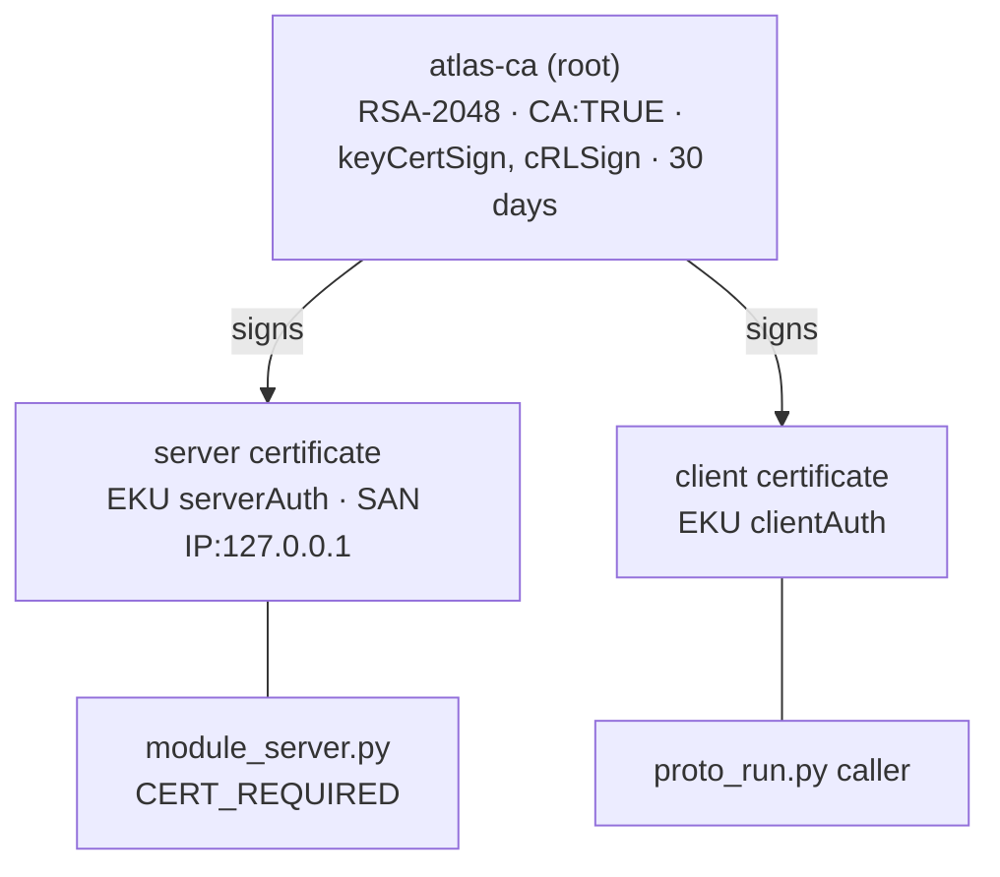
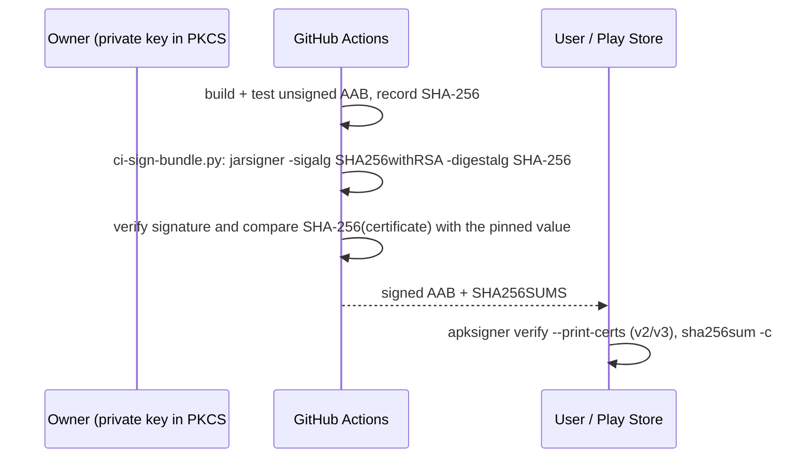

# Cryptography in ATLAS — a teaching guide

This guide uses ATLAS as a worked example for teaching applied cryptography: **hash functions and
checksums, public-key infrastructure (public keys, private keys and certificates), digital
signatures, and post-quantum cryptography (PQC)**. Every claim points at the file that implements it.

> **What is implemented and what is a teaching extension.**
>
> | Tag | Meaning |
> |---|---|
> | ✅ **Implemented** | Runs in this repository today; the file is named. |
> | 🧪 **Demo-grade** | Implemented with deliberately simple choices that suit a demo or a lab, not production. |
> | 🎓 **Teaching extension** | **Not** in the ATLAS code. Shows where a standard technique would fit. |
>
> ATLAS contains **no post-quantum cryptography**. §6 explains which ATLAS primitives a quantum
> computer would break, which it would not, and where ML-KEM, ML-DSA and SLH-DSA would go.

**Interactive companion:** [ATLAS Architecture Explorer → Cryptography](https://fullscipts.github.io/ATLAS/#crypto) —
hash text or a downloaded APK and check it against the published `SHA256SUMS`, verify the real upload
certificate's pinned fingerprint, build a small certificate authority, sign and verify releases with
ECDSA and RSA-PSS, and run a post-quantum Lamport signature, all with Web Crypto in your browser.

**Command-line lab:** `python3 security_lab/crypto_lab.py` runs 20 experiments on ATLAS's real
artefacts (standard library only; add `--verify atlas-go-1.2.0.apk` to check a download). They are split
into five files you can run on their own, and grouped into study paths (`--path NAME`):

| File | Category | Experiments |
|---|---|---|
| `crypto_a_hashing.py` | A. Hashing and integrity | 1 basics and the Unicode trap · 2 avalanche, measured · 3 truncated-hash preimages and collisions · 4 forging the prototype checksum · 5 forging CRC32 · 6 verifying releases and signing records · 7 supply-chain pins in CI |
| `crypto_b_mac_kdf_random.py` | B. MACs, key derivation, randomness | 8 length extension vs HMAC · 9 HMAC and PBKDF2 by hand, matching `accounts.py` · 10 predicting `random`, trusting `secrets` |
| `crypto_c_pki.py` | C. Certificates and PKI | 11 PEM, DER and the fingerprint pin · 12 walking the certificate's DER · 13 verifying its RSA-4096/SHA-384 self-signature by hand · 14 a private CA like the prototype's |
| `crypto_d_signatures.py` | D. Digital signatures | 15 textbook RSA and malleability · 16 SHA256withRSA (PKCS#1 v1.5) · 17 JAR signing: MANIFEST.MF, .SF and tampering |
| `crypto_e_post_quantum.py` | E. Post-quantum | 18 Lamport signatures · 19 forging after key reuse · 20 toy LWE KEM in a hybrid with Diffie-Hellman |

| Study path | Experiments | Goal |
|---|---|---|
| `foundations` | 1, 2, 4, 6, 11, 16 | Hash, verify, certificate, signature |
| `release-engineer` | 6, 7, 11, 13, 17 | Verify what ATLAS ships, the way CI does |
| `attacker` | 3, 5, 8, 10, 15, 19 | Break the weak constructions |
| `pki` | 11, 12, 13, 14 | Certificates from bytes to trust decisions |
| `post-quantum` | 3, 18, 19, 20 | What a quantum computer breaks, and what replaces it |

Companion guide: [INFORMATION_SECURITY.md](INFORMATION_SECURITY.md) covers authentication, password
storage (PBKDF2), identity management, SSO and Kerberos.

---

## Contents

1. [The cryptographic inventory of ATLAS](#1-the-cryptographic-inventory-of-atlas)
2. [Hash functions and checksums](#2-hash-functions-and-checksums---implemented)
3. [Public-key infrastructure: keys and certificates](#3-public-key-infrastructure-keys-and-certificates---implemented)
4. [Digital signatures: signing the ATLAS Go app](#4-digital-signatures-signing-the-atlas-go-app---implemented)
5. [Message authentication and constant-time comparison](#5-message-authentication-and-constant-time-comparison---implemented)
6. [Post-quantum cryptography](#6-post-quantum-cryptography---teaching-extension)
7. [Known gaps — exercises for students](#7-known-gaps--exercises-for-students)
8. [Suggested lesson plan](#8-suggested-lesson-plan)

---


## Standalone illustrated foundations — Cryptography

Read this chapter first. Each topic introduces the idea, a worked example, a GitHub-rendered Mermaid diagram, the limits of the example, and a matching source experiment. The ATLAS laboratory contains 20 source experiments; the companion Colab notebook adds a **measured execution chart** and a **clearly labeled conceptual illustration** for each. A successful test does not prove a cryptosystem secure.

**Every unit stands alone.** Each unit opens with a short summary, then an **"in depth — what, why and
how"** part: *what* the concept is, *why* it exists and matters, *how* it works step by step (with worked
numbers, runnable Python using only the standard library unless marked otherwise, and a diagram), the
common pitfalls and three self-check questions. Units can be taught in any order; cross-references are
for further reading, not prerequisites.

| Unit | Topic | Key algorithms and ideas |
|---|---|---|
| [C1](#c1--plaintext-ciphertext-keys-and-security-goals) | Security goals and keys | CIA, Kerckhoffs, symmetric vs asymmetric, security levels |
| [C2](#c2--sha-256-encoding-avalanche-preimages-and-collisions) | Hash functions | SHA-256 internals, SHA-3, birthday bound |
| [C3](#c3--checksums-cryptographic-hashes-and-artifact-verification) | Checksums vs hashes | CRC linearity, trusted digests |
| [C4](#c4--message-authentication-codes-hmac-and-length-extension) | MACs | HMAC construction, replay, constant-time checks |
| [C5](#c5--password-hashing-salt-pbkdf2-hkdf-and-randomness) | Passwords, KDFs, randomness | PBKDF2, Argon2id, HKDF, CSPRNG |
| [C6](#c6--authenticated-encryption-aes-gcm-and-the-nonce-rule) | Authenticated encryption | AES-GCM, nonce reuse |
| [C6.1](#c61--symmetric-ciphers-aes-chacha20-and-modes-of-operation) | Symmetric ciphers | AES rounds, ChaCha20, ECB/CBC/CTR/GCM |
| [C7](#c7--publicprivate-keys-rsa-and-digital-signatures) | Public-key cryptography | Hard problems, KEM vs key agreement vs signature |
| [C7.1](#c71--rsa-what-it-is-why-it-is-used-and-how-it-works) | **RSA** | Key generation, OAEP, PSS, CRT, attacks |
| [C7.2](#c72--diffiehellman-key-agreement-finite-field-ecdh-and-x25519) | **Diffie–Hellman** | DH, ECDH, X25519, forward secrecy, MITM |
| [C7.3](#c73--elliptic-curve-cryptography-and-ecdsa-plus-eddsa) | **ECC and ECDSA** | Point arithmetic, ECDSA, nonce reuse, Ed25519 |
| [C8](#c8--certificates-chain-of-trust-pki-and-mutual-tls) | Certificates and PKI | X.509, path validation, revocation, CT |
| [C9](#c9--signed-software-and-supply-chain-integrity) | Supply chain | APK v1–v4, SLSA, Sigstore |
| [C10](#c10--post-quantum-security-lamport-lwe-and-hybrid-exchange) | Post-quantum overview | Shor, Grover, Mosca, LWE, families |
| [C10.1](#c101--ml-kem-fips-203-post-quantum-key-encapsulation) | **ML-KEM** (FIPS 203) | MLWE, K-PKE, Fujisaki–Okamoto, sizes |
| [C10.2](#c102--ml-dsa-fips-204-and-fn-dsa-post-quantum-lattice-signatures) | **ML-DSA** (FIPS 204), FN-DSA | Fiat–Shamir with aborts, hints, sizes |
| [C10.3](#c103--hash-based-signatures-lamport-winternitz-merkle-trees-lmsxmss-and-slh-dsa-fips-205) | **Hash-based signatures** | Lamport, WOTS+, Merkle, LMS/XMSS, SLH-DSA |
| [C10.4](#c104--other-post-quantum-kems-hqc-and-classic-mceliece) | Code-based KEMs | HQC, Classic McEliece |
| [C10.5](#c105--migrating-to-post-quantum-cryptography-hybrids-crypto-agility-and-atlas) | PQ migration | X25519MLKEM768, composites, crypto-agility |
| [C11](#c11--each-cryptography-experiment-concept-and-illustration) | Experiments | Lab-to-unit map |

### C1 — Plaintext, ciphertext, keys, and security goals

**Plaintext** is readable information. **Encryption** converts plaintext into ciphertext using a secret or public key; authorized decryption restores plaintext. **Confidentiality** protects against unauthorized reading; **integrity** detects modifications; **authentication** validates the origin; **availability** ensures service. Encryption alone cannot prevent account misuse or unsafe business logic. **Symmetric** encryption shares a secret key, whereas **asymmetric** encryption/signature systems use private and public keys.

~~~mermaid
flowchart LR
 A["Plaintext"] -->|"Encryption + key"| B["Ciphertext"]
 B -->|"Decryption + authorized key"| C["Recovered plaintext"]
 A -->|"Hash"| D["Fixed-length digest"]
 A -->|"Sign with private key"| E["Signature"]
 E -->|"Verify with public key"| F["Origin / integrity check"]
~~~

**Analogy:** a locked parcel hides the letter (confidentiality); a tamper-evident seal detects alteration (integrity), but neither alone proves the address on the parcel is genuine. Real algorithms require strong keys and trustworthy implementations. Toy RSA and classroom ciphers must never protect real data.

#### C1 in depth — what, why and how

**What it is.** Cryptography is the study of techniques that keep information secure *in the presence
of an adversary*. A **cryptosystem** is a set of algorithms (key generation, encryption/signing,
decryption/verification) plus the rules for using them. Five building blocks recur through this guide:

| Building block | Input → output | Goal it serves | Example in this guide |
|---|---|---|---|
| Hash function | message → fixed-size digest | Integrity (with a trusted digest) | SHA-256 (C2) |
| Message authentication code (MAC) | key + message → tag | Integrity + origin, between parties sharing a key | HMAC (C4) |
| Symmetric cipher / AEAD | key + nonce + plaintext → ciphertext + tag | Confidentiality + integrity | AES-GCM, ChaCha20-Poly1305 (C6, C6.1) |
| Key agreement / KEM | public values → shared secret | Establish a fresh symmetric key over an open network | Diffie–Hellman, X25519 (C7.2), ML-KEM (C10.1) |
| Digital signature | private key + message → signature | Integrity + origin + **non-repudiation**, checkable by anyone | RSA-PSS (C7.1), ECDSA (C7.3), ML-DSA (C10.2) |

**Why it matters.** Networks, disks and phones are not trusted: packets can be read and modified,
devices are lost, servers are breached. Cryptography turns a small secret that *is* well protected
(a key) into protection for a large amount of data that is *not*. Without it there is no HTTPS, no
software signing, no password storage and no mobile payments.

**How it works — the core principles.**

1. **Kerckhoffs's principle.** A system must stay secure even if everything except the key is public.
   ATLAS publishes all of its code; only private keys and passwords are secret. "Security through
   obscurity" (hiding the algorithm) is not a control.
2. **Keys and key space.** A *k*-bit key has 2^k possibilities. Brute force against a 128-bit key
   needs ~2^127 trials on average — far beyond all computers on Earth for the lifetime of the universe.
   A cryptosystem is said to have **"n-bit security"** when the best known attack costs about 2^n operations.
3. **Symmetric vs asymmetric.**

   | | Symmetric (secret-key) | Asymmetric (public-key) |
   |---|---|---|
   | Keys | One shared secret key | Key pair: private (secret) and public (shared) |
   | Keys needed for *n* parties to talk pairwise | n(n−1)/2 | 2 per party (n pairs) |
   | Speed | Very fast (GB/s with AES hardware support) | 100–10 000× slower |
   | Typical algorithms | AES, ChaCha20, HMAC | RSA, Diffie–Hellman, ECDSA, ML-KEM, ML-DSA |
   | Main problem | How do the parties get the shared key? | How do you know a public key really belongs to its owner? (→ PKI, C8) |

   Real systems are **hybrid**: public-key cryptography establishes or authenticates a key, then fast
   symmetric cryptography protects the bulk data. TLS (S12) is exactly this pattern.
4. **Attacker models.** Security is always stated against an attacker with given powers:
   *ciphertext-only* (sees ciphertexts), *known-plaintext* (knows some plaintext/ciphertext pairs),
   *chosen-plaintext* (CPA — can get chosen messages encrypted) and *chosen-ciphertext* (CCA — can also
   get chosen ciphertexts decrypted, as a server does when it reports a "padding error"). Modern
   schemes aim for CCA security.
5. **Equivalent strengths (NIST SP 800-57 Part 1).**

   | Security strength | Symmetric | Hash (collision) | RSA / finite-field DH | Elliptic curve |
   |---|---|---|---|---|
   | 112 bits | 3-key 3DES (legacy) | SHA-224 | 2048-bit | 224-bit |
   | 128 bits | AES-128 | SHA-256 | 3072-bit | 256-bit (P-256, X25519) |
   | 192 bits | AES-192 | SHA-384 | 7680-bit | 384-bit (P-384) |
   | 256 bits | AES-256 | SHA-512 | 15360-bit | 512-bit (P-521) |

   The asymmetric columns are classical estimates only; a large quantum computer breaks all of them (C10).

**Perfect secrecy, briefly.** The one-time pad (XOR the message with a truly random key as long as the
message, used once) is provably unbreakable, but key distribution makes it impractical; reusing the pad
once (c₁ ⊕ c₂ = m₁ ⊕ m₂) destroys it. Practical ciphers replace the pad with a pseudorandom keystream
from a short key — which is why **nonce reuse** is so dangerous (C6).

**Common pitfalls.** Inventing your own cipher; confusing encoding (Base64, hex) with encryption;
confusing hashing with encryption; encrypting without authenticating; using a correct algorithm with a
bad key (hard-coded, low-entropy or reused).

**Check your understanding.** (1) Why does publishing the ATLAS source code not weaken its
cryptography? (2) Ten services must talk pairwise with symmetric keys — how many keys? With key pairs?
(3) Which building block gives non-repudiation, and why can a MAC not?

### C2 — SHA-256, encoding, avalanche, preimages and collisions

A cryptographic hash takes bytes and outputs a fixed-length **digest**. SHA-256 always yields **256 bits = 32 bytes = 64 hexadecimal characters**, whether the input has 1 byte or 1 gigabyte. A hash does not encrypt: there is no decryption operation. **Preimage resistance** protects against finding an input for a given digest; **second-preimage resistance** against replacing a fixed message; **collision resistance** against finding any different pair with the same digest.

~~~mermaid
flowchart TB
 A["Text → UTF-8 bytes"] --> H["SHA-256"]
 B["Changed byte / Unicode form"] --> H2["SHA-256"]
 H --> D["32-byte digest #1"]
 H2 --> E["32-byte digest #2"]
~~~

~~~python
import hashlib, unicodedata
assert len(hashlib.sha256(b"hello").digest()) == 32
assert hashlib.sha256(b"hello").digest() != hashlib.sha256(b"Hello").digest()
assert unicodedata.normalize("NFC", "e\u0301") == "é"
~~~

The **avalanche effect** predicts roughly 128 changed digest bits after one input bit flips for an ideal 256-bit hash, not exactly 128 each trial. Generic attacks on a b-bit ideal hash take approximately 2^b operations for preimages and 2^(b/2) for birthday collisions. These are work-factor estimates, not measured attack times.

#### C2 in depth — what, why and how

**What it is.** A cryptographic hash function H maps a message of (almost) any length to a short,
fixed-length digest and behaves, as far as anyone can tell, like a random function: the only way to
find inputs with a particular digest property is to try many inputs.

**Why it matters.** Hashes are the most widely used primitive in this guide. They fingerprint files
(`SHA256SUMS`), are signed instead of whole messages (hash-then-sign), build MACs (HMAC) and key
derivation (PBKDF2, HKDF), commit to data (Merkle trees, Git, certificate transparency) and are the
*only* assumption behind hash-based post-quantum signatures (C10.3).

**How SHA-256 works (SHA-2 family, FIPS 180-4).**

1. **Padding.** Append a single `1` bit, then `0` bits, then the original length as a 64-bit integer,
   so that the total is a multiple of 512 bits. "abc" (24 bits) becomes one 512-bit block.
2. **Merkle–Damgård chaining.** Start from a fixed 256-bit initial value (the first 32 bits of the
   fractional parts of the square roots of the first eight primes). Process the message one 512-bit
   block at a time with a **compression function**: `state = compress(state, block)`.
3. **Compression function.** The block is expanded into 64 32-bit words (message schedule); 64 rounds
   mix eight 32-bit working variables using additions mod 2³², rotations, XOR and the non-linear
   functions *Ch* and *Maj*, with 64 round constants (from cube roots of the first 64 primes).
4. **Output.** The final 256-bit state is the digest.

~~~mermaid
flowchart LR
 IV["Initial value 256 bits"] --> C1["compress"]
 B1["Block 1 - 512 bits"] --> C1
 C1 --> C2["compress"]
 B2["Block 2 - 512 bits"] --> C2
 C2 --> C3["compress"]
 B3["Last block + padding + length"] --> C3
 C3 --> D["Digest = final state"]
~~~

Because the digest *is* the final internal state, anyone who knows SHA-256(secret‖m) and the length
can keep hashing from that state — the **length-extension attack** (C4, lab C08). **SHA-3** (FIPS 202,
Keccak) uses a different design, the **sponge**: data is absorbed into a 1600-bit state and output is
squeezed out, and the hidden *capacity* part of the state means SHA-3 is not length-extendable.

**Security properties and their generic costs** for an ideal b-bit hash:

| Property | Attacker's task | Generic cost | SHA-256 |
|---|---|---|---|
| Preimage resistance | Given d, find m with H(m) = d | 2^b | 2^256 |
| Second-preimage resistance | Given m, find m′ ≠ m with H(m′) = H(m) | 2^b | 2^256 |
| Collision resistance | Find any m ≠ m′ with H(m) = H(m′) | 2^(b/2) (birthday bound) | 2^128 |

**The birthday bound.** With N possible digests and k random inputs, the probability of at least one
collision is about 1 − e^(−k²/2N). For birthdays (N = 365), k = 23 already gives ≈ 50 %. For a hash,
N = 2^b, so collisions appear after about 2^(b/2) hashes. This is why a 128-bit *collision* security
level needs a 256-bit digest, and why truncating a hash to 32 bits (lab C03) makes collisions trivial.

**History matters.** MD5 (128-bit) has practical collisions (2004) and was used to forge a Microsoft
code-signing certificate in the Flame malware (2012). SHA-1 (160-bit) fell to a practical collision in
2017 ("SHAttered"). Both are unacceptable for signatures or certificates; SHA-256, SHA-384/512 and SHA-3
are current.

~~~python
import hashlib
# The empty string has a well-known SHA-256 digest
assert hashlib.sha256(b"").hexdigest().startswith("e3b0c44298fc1c14")
# Same input, same digest; one character different, unrelated digest
a = hashlib.sha256(b"ride=12").digest()
b = hashlib.sha256(b"ride=13").digest()
changed = sum(bin(x ^ y).count("1") for x, y in zip(a, b))
print("bits changed:", changed, "of 256")          # usually close to 128
# SHA-3 is a different construction with the same digest size
assert len(hashlib.sha3_256(b"ride=12").digest()) == 32
~~~

**Where hashes are not enough.** A hash has no key: anyone can recompute it. It proves integrity only if
the expected digest arrives over a channel the attacker cannot change (C3). Hashing a low-entropy value
(a password, a phone number) does not hide it, because an attacker can hash every candidate (C5).

**Check your understanding.** (1) Why does a 256-bit hash give only 128-bit collision resistance?
(2) Why is SHA-256(key‖message) not a safe MAC, while SHA3-256(key‖message) would not suffer length
extension? (3) Why is "hash the phone number for privacy" weak?

### C3 — Checksums, cryptographic hashes and artifact verification

A checksum such as CRC32 is designed primarily to detect accidental corruption. A malicious modifier can often engineer an equal checksum. A trusted cryptographic digest can detect changed bytes, but the digest must itself be authenticated or delivered through a trusted channel. ATLAS uses SHA256SUMS for release checks, while a simpler prototype checksum intentionally illustrates the limitation.

~~~mermaid
flowchart LR
 F["Downloaded APK"] --> H["Calculate SHA-256"]
 T["Trusted expected digest"] --> C["Compare"]
 H --> C
 C -->|"same"| OK["Byte-level integrity match"]
 C -->|"different"| REJ["Reject altered bytes"]
~~~

For example, 2 files may have the same length and additive byte sum but different contents; that additive checksum would miss the substitution. A matching hash is not independently proof of the publisher's identity. **Labs C01–C07.**

#### C3 in depth — what, why and how

**What it is.** A **checksum** or **error-detecting code** (parity bit, Luhn digit on card numbers,
CRC32 in ZIP and Ethernet, Adler-32) is a short value computed from data to detect *accidental*
changes. A **cryptographic digest** is a checksum that also resists *deliberate* changes, provided the
expected value is itself trustworthy.

**Why it matters.** Engineers often reach for whatever "checksum" a library offers. Against random
bit flips a CRC is excellent and very fast; against an attacker it is worthless, because it is linear
and has no secret.

**How CRC works and why it is forgeable.** CRC treats the message as a polynomial over GF(2) (bits are
coefficients, addition is XOR) and returns the remainder after division by a fixed generator
polynomial. Polynomial remainders are linear, so for equal-length messages
`CRC(a ⊕ b) = CRC(a) ⊕ CRC(b) ⊕ CRC(0…0)`. An attacker who changes some bytes can compute exactly which
other 4 bytes to change so that the CRC is unchanged (lab C05).

~~~python
import zlib
a, b = b"pay driver-a 10.00", b"pay driver-b 99.00"
z = bytes(len(a))
lhs = zlib.crc32(bytes(x ^ y for x, y in zip(a, b)))
rhs = zlib.crc32(a) ^ zlib.crc32(b) ^ zlib.crc32(z)
assert lhs == rhs        # linearity: changes to the CRC are predictable without any secret
~~~

**How artifact verification should work — the trust chain.**

| Step | Question | ATLAS answer |
|---|---|---|
| 1. Compute | What is SHA-256 of the bytes I actually downloaded? | `sha256sum atlas-go-1.2.0.apk` |
| 2. Obtain expected value | Where did the expected digest come from? | `SHA256SUMS` in the release and a second copy in the README |
| 3. Authenticate expected value | Could the same attacker have changed both the file and the digest? | Yes, if both come from one compromised server — so the digest file should itself be **signed** (gap 2 in §7) |
| 4. Authenticate the publisher | Is the signer the real publisher? | APK signature verified against the pinned upload / release certificate (§3.3) |

**Comparison.**

| | Parity / Luhn | CRC32 | SHA-256 | HMAC-SHA-256 | Signature |
|---|---|---|---|---|---|
| Detects random errors | Some | Excellent (all bursts ≤ 32 bits) | Yes | Yes | Yes |
| Resists an attacker who can modify data | No | No | Only with a trusted digest | Yes (needs shared key) | Yes |
| Anyone can verify | Yes | Yes | Yes | Only key holders | Yes (public key) |

**Common pitfalls.** Downloading the file and its `.sha256` from the same mirror; comparing only the
first few hex characters; comparing digests of *decoded text* instead of the exact bytes; trusting an
HTTPS download as if TLS proved the publisher's identity (TLS authenticates the server, not the author).

**Check your understanding.** (1) Why does a CRC catch a single flipped bit but not a malicious edit?
(2) If an attacker controls the download server, what does `sha256sum -c SHA256SUMS` prove?
(3) Which ATLAS mechanism links the APK bytes to the owner's key?

### C4 — Message authentication codes, HMAC and length extension

A **MAC** is an authenticity/integrity tag produced using a shared secret. **HMAC** wraps a cryptographic hash with inner and outer keyed computations. It resists hash length-extension attacks that affect unsafe constructions such as SHA256(secret || message). Compare tags with a constant-time comparison function to limit data-dependent timing.

~~~mermaid
sequenceDiagram
 participant S as Sender
 participant R as Receiver
 S->>S: tag = HMAC(key, message)
 S->>R: message, tag
 R->>R: recompute HMAC with secret key
 R-->>S: accept if tags match
~~~

~~~python
import hashlib, hmac, secrets
key = secrets.token_bytes(32)
text = b"ride=12"
tag = hmac.new(key, text, hashlib.sha256).digest()
assert hmac.compare_digest(tag, hmac.new(key, text, hashlib.sha256).digest())
assert not hmac.compare_digest(tag, hmac.new(key, text+b"!", hashlib.sha256).digest())
~~~

An ordinary SHA-256 digest of a public message is not a MAC. **Lab C08.**

#### C4 in depth — what, why and how

**What it is.** A **message authentication code** is a keyed checksum: `tag = MAC(K, m)`. Only parties
holding K can produce a valid tag, so a valid tag shows the message came from a key holder and was not
modified. HMAC (RFC 2104, FIPS 198-1) builds a MAC from any hash function.

**Why it matters.** Many systems need integrity between parties that already share a secret: session
cookies, API request signing (e.g. AWS Signature v4), JWTs with `HS256`, webhook signatures, the
`Finished` message in TLS, Kerberos tickets. A MAC is far faster than a signature and has much smaller
tags.

**How HMAC works.** With block size B (64 bytes for SHA-256): if K is longer than B, replace it with
H(K); pad K with zeros to B bytes (K′). Then

`HMAC(K, m) = H( (K′ ⊕ opad) ‖ H( (K′ ⊕ ipad) ‖ m ) )`,  with `ipad = 0x36…36`, `opad = 0x5c…5c`.

The outer hash hides the inner hash's internal state, which is why length extension does not work.

~~~python
import hashlib, hmac
def hmac_sha256(key, msg):
    B = 64
    if len(key) > B:
        key = hashlib.sha256(key).digest()
    key = key.ljust(B, b"\x00")
    inner = hashlib.sha256(bytes(k ^ 0x36 for k in key) + msg).digest()
    return hashlib.sha256(bytes(k ^ 0x5C for k in key) + inner).digest()
k, m = b"shared-secret", b"POST /v1/trips rider-7"
assert hmac_sha256(k, m) == hmac.new(k, m, hashlib.sha256).digest()
~~~

~~~mermaid
flowchart LR
 K["Key K padded"] --> I["K xor ipad"]
 K --> O["K xor opad"]
 I --> H1["SHA-256 of inner key and message"]
 M["Message"] --> H1
 H1 --> H2["SHA-256 of outer key and inner digest"]
 O --> H2
 H2 --> T["Tag 32 bytes"]
~~~

**Other MACs.** CMAC (AES-based), GMAC and Poly1305 (inside AES-GCM and ChaCha20-Poly1305), KMAC
(SHA-3 based; the sponge makes `H(key‖m)` safe).

**What a MAC does not do.**

- **No non-repudiation.** Both parties hold K, so either could have produced the tag; a judge cannot
  tell who did. Use a signature when third parties must verify.
- **No replay protection by itself.** A captured `(m, tag)` stays valid. Include a nonce, counter or
  timestamp in m and remember what was seen (Kerberos authenticators, S11, do exactly this).
- **No confidentiality.** The message travels in clear unless it is also encrypted. Combine as
  *encrypt-then-MAC*, or use an AEAD (C6).

**Verification must be constant-time.** Comparing tags with `==` can stop at the first differing byte,
leaking how many leading bytes were right through timing; an attacker can then forge a tag byte by byte.
`hmac.compare_digest` examines every byte regardless.

**Check your understanding.** (1) Why does HMAC hash twice? (2) A webhook includes
`X-Signature: HMAC(secret, body)`. What extra field stops an attacker replaying yesterday's webhook?
(3) When would you choose a signature instead of a MAC?

### C5 — Password hashing, salt, PBKDF2, HKDF and randomness

A **salt** is random, public data generated separately per password; it prevents equal passwords from automatically producing the same stored verifier. PBKDF2-HMAC-SHA256 repeats work to slow offline guessing. In ATLAS Go, account passwords use **16-byte salts and 200,000 iterations**. A larger iteration count makes authorized login slower too; it does not turn weak passwords into strong ones. **HKDF** derives purpose-separated keys from keying material and should not be confused with password-hardening PBKDF2. Use a **cryptographically secure RNG** for keys, salts and nonces, not Python's deterministic random module.

~~~mermaid
flowchart LR
 P["User password"] --> D["PBKDF2-HMAC-SHA256"]
 S["Unique random salt"] --> D
 I["Iteration count"] --> D
 D --> V["Stored verifier, not plaintext"]
~~~

~~~python
import hashlib, secrets
salt = secrets.token_bytes(16)
verifier = hashlib.pbkdf2_hmac("sha256", b"example-password", salt, 200000)
assert len(verifier) == 32
~~~

**Labs C09–C10; information-security S01–S08.**

#### C5 in depth — what, why and how

**What it is.** Three related but different tools:

| Tool | Input | Purpose | Speed by design |
|---|---|---|---|
| **Password hashing / password-based KDF** (PBKDF2, bcrypt, scrypt, Argon2id) | Low-entropy password + salt | Store a verifier, or derive a key from a password | **Deliberately slow** (and ideally memory-hard) |
| **Key derivation function** (HKDF) | High-entropy secret (e.g. a Diffie–Hellman output) | Turn one secret into several independent keys | Fast |
| **CSPRNG** (`secrets`, `os.urandom`, `/dev/urandom`, `getrandom`) | Operating-system entropy | Keys, salts, nonces, tokens | Fast and unpredictable |

**Why it matters.** Passwords are guessable: billions of real passwords have leaked, and attackers try
the most common first. A fast hash such as SHA-256 lets one GPU test billions of guesses per second
against a stolen database; a slow, salted KDF cuts that by the iteration factor and makes every account
a separate job. Separately, predictable "random" numbers have broken real systems (e.g. the 2008 Debian
OpenSSL bug left only 32 768 possible keys).

**How password hashing works.**

1. **Salt** (16 random bytes per account, stored in clear) → identical passwords give different
   verifiers, and precomputed rainbow tables are useless.
2. **Work factor** (iterations, memory, parallelism) → each guess costs the attacker the same as a
   legitimate login.
3. **Pepper (optional)** → an extra secret kept outside the database (e.g. in an HSM), so a database-only
   leak cannot be attacked offline at all.
4. **Verify** by recomputing with the stored salt and parameters, then constant-time compare.
5. **Upgrade** parameters at the next successful login ("rehash on login", lab S20).

| Algorithm | Memory-hard? | Notes | OWASP (2023+) minimum |
|---|---|---|---|
| Argon2id (RFC 9106) | Yes | Winner of the Password Hashing Competition; preferred | m = 19 MiB, t = 2, p = 1 |
| scrypt | Yes | Good alternative | N = 2^17, r = 8, p = 1 |
| bcrypt | Partly | Input limited to 72 bytes | cost 10 |
| PBKDF2-HMAC-SHA256 | No | In every standard library, FIPS-approved; GPUs parallelise it well | 600 000 iterations (ATLAS: 200 000) |

**Arithmetic for a lab report.** If an attacker achieves 10⁹ SHA-256/s and the user picked one of the
10⁶ most common passwords, an unsalted fast hash falls in about 1 ms. With PBKDF2 at 200 000 iterations
the same search costs about 2 × 10¹¹ HMAC computations — minutes instead of a millisecond — *per account*; with unique salts it must be repeated for
every account. A truly random 12-character password from 62 symbols (≈ 71 bits) stays out of reach
either way — the KDF buys time for *average* passwords.

**How HKDF works (RFC 5869).** *Extract*: `PRK = HMAC(salt, IKM)` concentrates the entropy of the input
keying material. *Expand*: `T(1) = HMAC(PRK, info ‖ 0x01)`, `T(i) = HMAC(PRK, T(i−1) ‖ info ‖ i)`;
output the first L bytes. Different `info` labels ("client key", "server key") give independent keys.
TLS 1.3 derives all of its traffic keys this way.

~~~python
import hashlib, hmac
def hkdf(ikm, salt, info, length):
    prk = hmac.new(salt, ikm, hashlib.sha256).digest()           # extract
    okm, t, i = b"", b"", 1
    while len(okm) < length:                                      # expand
        t = hmac.new(prk, t + info + bytes([i]), hashlib.sha256).digest()
        okm, i = okm + t, i + 1
    return okm[:length]
# RFC 5869 test case 1
okm = hkdf(bytes([0x0B] * 22), bytes(range(13)), bytes(range(0xF0, 0xFA)), 42)
assert okm.hex().startswith("3cb25f25faacd57a90434f64d0362f2a")
~~~

**How randomness goes wrong.** Python's `random` is the Mersenne Twister: after observing 624
consecutive 32-bit outputs, an attacker can reconstruct its whole state and predict every future value
(lab C10). Use `secrets.token_bytes`, `secrets.token_urlsafe` or `os.urandom` for anything security
relevant.

**Common pitfalls.** One global salt for all users; storing `SHA-256(password)`; using HKDF on a
password (it is fast, so it gives no protection); truncating bcrypt inputs silently; generating tokens
with `random` or with the current time.

**Check your understanding.** (1) Why must the salt be unique but need not be secret? (2) Why is
HKDF the right tool for a Diffie–Hellman secret but the wrong tool for a password? (3) Does raising
iterations help a user whose password is "password1"?

### C6 — Authenticated encryption, AES-GCM, and the nonce rule

**Authenticated encryption with associated data (AEAD)** protects ciphertext confidentiality and integrity together. AES-GCM is one AEAD mode. Its **nonce must not be reused with the same key**; reuse can destroy confidentiality and authenticity. **Associated data (AAD)** is authenticated but not encrypted, for example a protocol header.

~~~mermaid
flowchart TD
 P["Plaintext"] --> A["AES-GCM encrypt"]
 K["Secret key"] --> A
 N["Unique nonce"] --> A
 H["Associated data"] --> A
 A --> C["Ciphertext + authentication tag"]
 C --> D["Verify tag before releasing plaintext"]
~~~

This is a conceptual extension: the Android application's local state file is **not encrypted at rest**. Use vetted AEAD libraries, not hand-written ciphers.

#### C6 in depth — what, why and how

**What it is.** An **AEAD** (authenticated encryption with associated data) scheme has two functions:
`Encrypt(K, nonce, AD, P) → C ‖ tag` and `Decrypt(K, nonce, AD, C ‖ tag) → P or ⊥`. Decryption either
returns the exact plaintext or rejects; it never returns modified data.

**Why it matters.** Encryption without authentication is malleable: flipping a ciphertext bit in a
stream cipher flips the same plaintext bit ("pay 10" can become "pay 90" without knowing the key), and
CBC-mode servers that report padding errors have leaked whole plaintexts (*padding-oracle* attacks,
e.g. POODLE, Lucky Thirteen). AEAD removes both classes of bug by design. TLS 1.3 permits only AEAD
ciphers.

**How AES-GCM works.**

1. Derive the hash key `H = AES_K(0¹²⁸)`.
2. Encrypt in **counter mode**: keystream block i = `AES_K(nonce ‖ counter_i)`; `C = P ⊕ keystream`.
3. Authenticate AD and C with **GHASH**, a polynomial evaluation at H in GF(2¹²⁸), then encrypt that
   result with the first counter block to get a 128-bit **tag**.
4. The receiver recomputes the tag and compares in constant time **before** releasing any plaintext.

**The nonce rule, explained.** Reusing (K, nonce) reuses the keystream: `C₁ ⊕ C₂ = P₁ ⊕ P₂`, so knowing
or guessing one plaintext reveals the other. Worse, two tags under the same nonce let an attacker solve
for H and then forge tags for any message ("the forbidden attack"). With random 96-bit nonces, NIST
SP 800-38D limits one key to 2³² messages to keep the collision probability negligible. Counters,
or nonce-misuse-resistant modes such as AES-GCM-SIV (RFC 8452), are alternatives.

~~~python
import hashlib
def toy_keystream(key, nonce, n):              # a toy stream cipher: SHA-256 in counter mode
    out, ctr = b"", 0
    while len(out) < n:
        out += hashlib.sha256(key + nonce + ctr.to_bytes(4, "big")).digest(); ctr += 1
    return out[:n]
key, nonce = b"k" * 32, b"n" * 12
p1, p2 = b"pickup 53.3N 8.5W", b"dropoff 51.9N 8.4W"
ks = toy_keystream(key, nonce, max(len(p1), len(p2)))
c1 = bytes(a ^ b for a, b in zip(p1, ks)); c2 = bytes(a ^ b for a, b in zip(p2, ks))
leak = bytes(a ^ b for a, b in zip(c1, c2))          # attacker sees only c1, c2
assert leak == bytes(a ^ b for a, b in zip(p1, p2))  # ...and learns p1 XOR p2 without the key
~~~

**Using a real AEAD (requires `pip install cryptography`).**

~~~python
import os
try:
    from cryptography.hazmat.primitives.ciphers.aead import AESGCM
except ImportError:
    AESGCM = None
if AESGCM:
    key = AESGCM.generate_key(bit_length=256)
    aead, nonce = AESGCM(key), os.urandom(12)        # a fresh nonce for every message
    header = b"atlas-state-v1"                       # authenticated, not encrypted
    ct = aead.encrypt(nonce, b'{"session": "U-42"}', header)
    assert aead.decrypt(nonce, ct, header) == b'{"session": "U-42"}'
    tampered = ct[:-1] + bytes([ct[-1] ^ 1])
    try:
        aead.decrypt(nonce, tampered, header); raise SystemExit("tampering not detected")
    except Exception as exc:
        assert type(exc).__name__ == "InvalidTag"
~~~

**Where ATLAS would use it.** Gap 4 in the security guide: encrypt `state.json` with an AEAD key held in
the Android Keystore, putting the schema version in the associated data so an old file cannot be
replayed as a new format.

**Check your understanding.** (1) What does an attacker learn from two GCM ciphertexts with the same
key and nonce? (2) Why must the tag be checked before plaintext is used? (3) Give one value that
should be associated data rather than encrypted.

### C6.1 — Symmetric ciphers: AES, ChaCha20 and modes of operation

**What it is.** A **block cipher** is a keyed permutation on fixed-size blocks: AES (FIPS 197, the
Rijndael design) maps 128-bit blocks under a 128-, 192- or 256-bit key. A **stream cipher** such as
ChaCha20 (RFC 8439) produces a keystream that is XORed with the data. A **mode of operation** says how
to use a block cipher on messages longer than one block.

**Why it is.** Public-key operations are slow and limited in message size; every bulk-data protection
in practice (TLS records, disk encryption, Wi-Fi WPA2/WPA3, Signal messages, encrypted backups) is
symmetric. Choosing the wrong mode silently destroys security even when AES itself is unbroken.

**How AES works.** The 16-byte state is arranged as a 4 × 4 byte matrix and transformed for 10, 12 or
14 rounds (AES-128/192/256). Each round applies:

| Step | Operation | Purpose |
|---|---|---|
| SubBytes | Each byte through a fixed S-box (inversion in GF(2⁸) + affine map) | Non-linearity (confusion) |
| ShiftRows | Row r rotated left by r bytes | Spreads bytes across columns |
| MixColumns | Each column multiplied by a fixed matrix over GF(2⁸) | Diffusion within a column |
| AddRoundKey | XOR with a round key from the key schedule | Mixes in the secret |

After two rounds every output bit depends on every input bit. The best known attacks on full AES are
only marginally better than brute force. Modern CPUs implement AES in hardware (AES-NI, ARMv8 Crypto
Extensions), which also removes cache-timing side channels of table-based software.

**How ChaCha20 works.** A 512-bit state (constants, 256-bit key, 32-bit counter, 96-bit nonce) is
scrambled by 20 rounds of add-rotate-XOR "quarter rounds"; the result added to the input is 64 bytes of
keystream. It is fast and constant-time in software, so it is preferred on phones without AES hardware.
ChaCha20-Poly1305 is the AEAD used in TLS 1.3, WireGuard and SSH.

**Modes of operation.**

| Mode | How | Properties | Use today? |
|---|---|---|---|
| ECB | Each block encrypted independently | Equal plaintext blocks → equal ciphertext blocks (the "ECB penguin" image still shows through) | **Never** |
| CBC | Cᵢ = E(Pᵢ ⊕ Cᵢ₋₁), random IV | Needs padding; padding-oracle risk; no integrity | Legacy only, with a MAC (encrypt-then-MAC) |
| CTR | Keystream E(nonce ‖ counter) | Parallel, no padding; malleable; nonce reuse fatal | Inside GCM |
| GCM | CTR + GHASH tag | AEAD, fast with hardware | **Yes** (TLS, IPsec, disk metadata) |
| ChaCha20-Poly1305 | Stream + Poly1305 tag | AEAD, constant-time in software | **Yes** |
| XTS | Tweakable mode for sectors | Disk encryption without expansion; no integrity | Full-disk encryption |

~~~mermaid
flowchart LR
 N["Nonce + counter 1, 2, 3"] --> E["AES with key K"]
 E --> KS["Keystream blocks"]
 KS --> X["XOR"]
 P["Plaintext blocks"] --> X
 X --> C["Ciphertext"]
 C --> G["GHASH with H = AES of zero block"]
 AD["Associated data"] --> G
 G --> T["Authentication tag"]
~~~

**Key sizes and quantum computers.** Grover's algorithm reduces brute-force search on a k-bit key to
about 2^(k/2) quantum operations in the idealised model, but these operations are sequential and
extremely expensive, so NIST still classes AES-128 as its lowest post-quantum security category and
AES-256 as the highest (C10). Long-lived data is commonly given AES-256.

**Common pitfalls.** ECB mode (the default in some libraries); static or counter-reset IVs; encrypting
then not authenticating; deriving a key directly from a password without a KDF; storing the key next to
the ciphertext.

**Check your understanding.** (1) Why does ECB leak the outline of an image? (2) Why does CTR mode need
no padding? (3) When would you choose ChaCha20-Poly1305 over AES-GCM?

### C7 — Public/private keys, RSA and digital signatures

**Public-key encryption:** encrypt for a recipient using its public key; only the recipient's private key decrypts. **Digital signatures:** a signer uses a private key, and verifiers check with the authenticated public key. Textbook RSA has mathematical structure that permits forgery, so real signatures require secure standardized padding/encoding such as RSA-PSS or an appropriate established signature scheme. ATLAS Go's release signing uses SHA256withRSA through release tooling; this is not the insecure textbook RSA from the lab.

~~~mermaid
flowchart LR
 M["Release bytes"] --> HASH["SHA-256 digest"]
 HASH --> SIGN["Private-key signing"]
 SIGN --> PACKAGE["Signed archive"]
 PACKAGE --> VERIFY["Public-key verification"]
 VERIFY --> VALID["Valid / invalid"]
~~~

**Labs C15–C17.**

#### C7 in depth — what, why and how

**What it is.** Public-key (asymmetric) cryptography rests on **trapdoor one-way functions**: easy to
compute, infeasible to invert — unless you hold a secret trapdoor. Each user generates a key pair; the
public key can be published, the private key never leaves its owner.

| Hard problem | Easy direction | Hard direction | Schemes | Broken by Shor? |
|---|---|---|---|---|
| Integer factorisation | multiply p × q | factor n | RSA (C7.1) | Yes |
| Discrete logarithm (mod p) | gˣ mod p | find x | Diffie–Hellman, DSA (C7.2) | Yes |
| Elliptic-curve discrete log | k · G | find k | ECDH, X25519, ECDSA, Ed25519 (C7.3) | Yes |
| Module learning with errors / short integer solution | A·s + e | find s | ML-KEM, ML-DSA (C10.1–C10.2) | No known attack |
| Hash-function security | H(x) | invert / collide | SLH-DSA, LMS, XMSS (C10.3) | No (only Grover-type speed-up) |

**Why it is.** Symmetric cryptography needs a secret already shared. Public-key cryptography solves the
two problems that symmetric cryptography cannot: (1) agreeing a key with someone you have never met, over
a network an attacker can watch; (2) proving to *anyone* that a message came from a particular key
holder, which also gives **non-repudiation**.

**How — the four public-key operations.**

| Operation | Who uses which key | Output | Example |
|---|---|---|---|
| Public-key encryption | Sender: recipient's public key. Recipient: own private key | Ciphertext | RSA-OAEP (rare today) |
| Key encapsulation (KEM) | Sender encapsulates to the public key; recipient decapsulates | Shared secret + ciphertext | ML-KEM, RSA-KEM, DHKEM in HPKE (RFC 9180) |
| Key agreement | Both parties combine own private key with the other's public key | Same shared secret on both sides | (EC)DH, X25519 |
| Digital signature | Signer: private key. Verifier: public key | Signature | RSA-PSS, ECDSA, Ed25519, ML-DSA |

**Hash-then-sign.** Signature schemes sign H(m), not m: the hash makes the input fixed-size and, in
proper encodings (PSS, ECDSA), prevents algebraic forgeries. Consequently a signature is only as strong
as the hash — a SHA-1 collision lets one signature cover two documents.

**What "secure" means for a signature (EUF-CMA).** Even after seeing signatures on messages of their
choice, an attacker cannot produce a valid signature on any *new* message. Textbook RSA fails this
(lab C15); RSA-PSS, ECDSA with good nonces, Ed25519 and ML-DSA meet it under their assumptions.

**Sizes at the 128-bit level** (classical): RSA-3072 public key and signature 384 bytes each;
P-256 public key 64 bytes (65 uncompressed with prefix, 33 compressed), ECDSA signature 64 bytes raw
(~70–72 bytes DER); Ed25519 public key 32 bytes, signature 64 bytes. Post-quantum sizes are in §6.

**Check your understanding.** (1) Which operation does TLS 1.3 use to agree keys, and which to
authenticate the server? (2) Why is a signature on SHA-1(m) weaker than a signature on SHA-256(m)?
(3) Name two schemes whose hard problem Shor's algorithm does not solve.

### C7.1 — RSA: what it is, why it is used and how it works

**What it is.** RSA (Rivest, Shamir and Adleman, 1977; standardised in PKCS #1 / RFC 8017 and FIPS 186-5)
is the first widely deployed public-key cryptosystem. It provides both encryption and signatures, and
its security rests on the difficulty of factoring a large number n = p · q into its two prime factors.

**Why it is used.** RSA verification is very fast and the algorithm is supported everywhere, so it is
still the most common algorithm in certificates, code signing (ATLAS's upload key is RSA-4096, its
mTLS certificates RSA-2048, its bundle signature SHA256withRSA) and hardware tokens. Its weaknesses are
large keys, slow key generation and signing, no forward secrecy when used for key transport, and total
vulnerability to Shor's algorithm.

**How it works.**

*Key generation*

1. Choose two large random primes p and q of equal size (each 1024 bits for RSA-2048), using a
   CSPRNG and a primality test such as Miller–Rabin.
2. Compute the modulus n = p · q and λ(n) = lcm(p − 1, q − 1) (older texts use φ(n) = (p − 1)(q − 1);
   both work).
3. Choose the public exponent e, almost always 65537 = 2¹⁶ + 1 (prime, and fast: 17 multiplications).
4. Compute the private exponent d = e⁻¹ mod λ(n) with the extended Euclidean algorithm.
5. Public key (n, e). Private key d (in practice also p, q and CRT values). Discard nothing that must
   stay secret into logs; p and q are as secret as d.

*Encryption and decryption (textbook form):* c = mᵉ mod n, m = cᵈ mod n.
*Signing and verification (textbook form):* s = mᵈ mod n, check sᵉ mod n = m.

*Why decryption works:* e·d ≡ 1 (mod λ(n)), so m^(ed) = m^(1 + kλ(n)) ≡ m (mod n) by Euler's/Carmichael's
theorem (and the Chinese Remainder Theorem when m shares a factor with n).

**Worked example (toy numbers — never use small primes).**

| Step | Value |
|---|---|
| Primes | p = 61, q = 53 |
| Modulus | n = 3233 |
| φ(n) | 60 × 52 = 3120 |
| Public exponent | e = 17 (gcd(17, 3120) = 1) |
| Private exponent | d = 17⁻¹ mod 3120 = 2753 (check: 17 × 2753 = 46 801 = 15 × 3120 + 1) |
| Encrypt m = 65 | c = 65¹⁷ mod 3233 = 2790 |
| Decrypt | 2790²⁷⁵³ mod 3233 = 65 |
| CRT speed-up | d_p = d mod 60 = 53, d_q = d mod 52 = 49, q⁻¹ mod p = 38; two half-size exponentiations, about 4× faster |

~~~python
import secrets
def is_probable_prime(n, rounds=40):                 # Miller-Rabin
    if n < 2: return False
    for small in (2, 3, 5, 7, 11, 13, 17, 19, 23, 29):
        if n % small == 0: return n == small
    d, r = n - 1, 0
    while d % 2 == 0: d, r = d // 2, r + 1
    for _ in range(rounds):
        x = pow(secrets.randbelow(n - 3) + 2, d, n)
        if x in (1, n - 1): continue
        for _ in range(r - 1):
            x = pow(x, 2, n)
            if x == n - 1: break
        else:
            return False
    return True
def random_prime(bits):
    while True:
        c = secrets.randbits(bits) | (1 << (bits - 1)) | 1
        if is_probable_prime(c): return c
# toy example from the table
p, q, e = 61, 53, 17
n, phi = p * q, (p - 1) * (q - 1)
d = pow(e, -1, phi)
assert (n, d) == (3233, 2753) and pow(65, e, n) == 2790 and pow(2790, d, n) == 65
# a (still insecure, teaching-size) 512-bit key
e = 65537
while True:
    p, q = random_prime(256), random_prime(256)
    if p != q and (p - 1) % e and (q - 1) % e: break
n, d = p * q, pow(e, -1, (p - 1) * (q - 1))
m = int.from_bytes(b"ATLAS", "big")
assert pow(pow(m, e, n), d, n) == m
# textbook RSA is malleable: multiply the ciphertext by 2^e and the plaintext doubles
c = pow(m, e, n)
assert pow(c * pow(2, e, n) % n, d, n) == 2 * m
~~~

**Why textbook RSA is never used directly.**

| Problem with raw mᵉ / mᵈ | Consequence | Standard fix |
|---|---|---|
| Deterministic | Equal messages give equal ciphertexts; an attacker can test guesses ("is the vote YES?") | Randomised padding: **RSA-OAEP** for encryption |
| Multiplicative (malleable) | (m₁m₂)ᵉ = m₁ᵉ·m₂ᵉ: ciphertexts and signatures can be combined into new valid ones | Padding that destroys the structure: OAEP, **RSA-PSS** |
| Small m with e = 3 | If mᵉ < n there is no reduction; take the ordinary cube root | Padding fills the whole modulus |
| PKCS #1 v1.5 *encryption* | Bleichenbacher's padding-oracle attack (1998; again as ROBOT in 2017) decrypts messages | OAEP, or better a KEM; TLS 1.3 removed RSA key transport |

For **signatures**, PKCS #1 v1.5 (deterministic, used by ATLAS's `jarsigner`) has no known practical
attack when verifiers parse it strictly; **RSA-PSS** (randomised, with a security proof) is preferred
for new designs and is mandatory for RSA signatures inside TLS 1.3.

**Security in practice.**

- **Key size.** The best classical algorithm is the General Number Field Sieve. The largest public
  RSA challenge factored is RSA-250 (829 bits, 2020). RSA-2048 ≈ 112-bit security; RSA-3072 ≈ 128-bit.
- **Bad randomness.** A 2012 Internet-wide survey found many devices whose keys shared a prime with
  another device's key; one gcd computation then factors both. The 2017 ROCA flaw in a smart-card
  library produced keys with a structure that allowed factoring.
- **Side channels and faults.** Timing, power or cache leakage during cᵈ can reveal d; a single
  faulty CRT computation reveals a factor (the Bellcore attack) — implementations verify a signature
  before releasing it and use blinding.
- **Quantum.** Shor's algorithm factors n in polynomial time. A 33-year RSA-4096 signing key (ATLAS's
  upload key, valid to 2059) is therefore a migration priority (§6).

**Check your understanding.** (1) Using the toy key, compute the signature of m = 100 and verify it
(answer: s = 100²⁷⁵³ mod 3233 = 1391, and 1391¹⁷ mod 3233 = 100). (2) Why does knowing p and q reveal d?
(3) Why did TLS 1.3 drop RSA key transport but keep RSA signatures?

### C7.2 — Diffie–Hellman key agreement (finite-field, ECDH and X25519)

**What it is.** Diffie–Hellman (1976) lets two parties who share no secret compute the same secret key
by exchanging public values over a channel the attacker can read. It is a **key agreement** protocol,
not encryption and not a signature.

**Why it is used.** It is how almost every secure connection starts: TLS 1.3, SSH, IPsec/IKEv2,
WireGuard, Signal and WhatsApp all begin with an (elliptic-curve) Diffie–Hellman exchange. Used with
fresh ("ephemeral") values per session, it gives **forward secrecy**: stealing a server's long-term key
tomorrow does not decrypt the sessions recorded today, because the per-session secrets have been erased.

**How it works.**

1. Public parameters: a large prime p and a generator g of a large prime-order subgroup (standard groups
   such as RFC 7919 `ffdhe2048`, or an elliptic curve).
2. Alice picks a secret a, sends A = gᵃ mod p. Bob picks a secret b, sends B = gᵇ mod p.
3. Alice computes Bᵃ = g^(ab); Bob computes Aᵇ = g^(ab). Both now hold the same value.
4. Both feed g^(ab) and the transcript into a KDF (HKDF, C5) to derive the actual symmetric keys.
   The raw shared value is never used directly as a key.

The eavesdropper sees g, p, A and B. Recovering a from A is the **discrete logarithm problem**;
computing g^(ab) from gᵃ and gᵇ is the **computational Diffie–Hellman problem**. Both are believed hard
classically for well-chosen groups, and both are solved by Shor's algorithm.

**Worked example (toy numbers).** p = 23, g = 5. Alice a = 6 → A = 5⁶ mod 23 = 8. Bob b = 15 →
B = 5¹⁵ mod 23 = 19. Alice: 19⁶ mod 23 = 2. Bob: 8¹⁵ mod 23 = 2. Shared secret = 2.

~~~python
p, g = 23, 5
a, b = 6, 15                                   # private values (random in practice)
A, B = pow(g, a, p), pow(g, b, p)              # public values sent in clear
assert (A, B) == (8, 19)
assert pow(B, a, p) == pow(A, b, p) == 2       # both sides compute the same secret
~~~

~~~mermaid
sequenceDiagram
 participant A as Alice - app
 participant M as Mallory - attacker in the middle
 participant B as Bob - gateway
 A->>M: A = g^a
 M->>B: M1 = g^m1
 B->>M: B = g^b
 M->>A: M2 = g^m2
 Note over A,M: Alice shares g^(a m2) with Mallory
 Note over M,B: Bob shares g^(b m1) with Mallory
 Note over A,B: Fix - sign the transcript with a certified key, as TLS CertificateVerify does
~~~

**The man-in-the-middle problem.** Plain Diffie–Hellman authenticates nobody: an active attacker can
run one exchange with each side and relay traffic. Every real protocol therefore *authenticates* the
exchange — TLS 1.3 has the server sign the handshake transcript with its certificate key
(CertificateVerify); SSH uses host keys; Signal users compare safety numbers; IKE uses certificates or
pre-shared keys.

**Elliptic-curve Diffie–Hellman (ECDH).** Same idea in an elliptic-curve group (C7.3): A = a·G,
B = b·G, shared secret a·B = b·A = ab·G. A 256-bit curve gives ~128-bit security with 32-byte public
values instead of 384-byte ones. **X25519** (RFC 7748) is ECDH on Curve25519 (prime 2²⁵⁵ − 19): it uses
only x-coordinates, "clamps" private keys, accepts any 32-byte string as a public key and is easy to
implement in constant time. It is the default key exchange in TLS 1.3, SSH and WireGuard, and the
classical half of the hybrid X25519MLKEM768 (C10.5).

~~~python
try:
    from cryptography.hazmat.primitives.asymmetric.x25519 import X25519PrivateKey
except ImportError:
    X25519PrivateKey = None
if X25519PrivateKey:
    app, gateway = X25519PrivateKey.generate(), X25519PrivateKey.generate()
    s1 = app.exchange(gateway.public_key())
    s2 = gateway.exchange(app.public_key())
    assert s1 == s2 and len(s1) == 32            # then feed s1 into HKDF with the transcript
~~~

**Pitfalls.**

| Pitfall | What goes wrong | Fix |
|---|---|---|
| Small or shared groups | Logjam (2015): 512-bit "export" groups broken; precomputation against a few common 1024-bit primes | ≥ 2048-bit standard groups (RFC 7919) or elliptic curves |
| Unvalidated public values | Sending A = 1, p − 1 or a point of small order forces a predictable secret (small-subgroup / invalid-curve attacks) | Check range and subgroup membership; use X25519 which is designed for this |
| Static keys reused for years | No forward secrecy | Ephemeral keys per session (DHE, ECDHE) |
| Using the raw secret as a key | Biased bits, no context binding | HKDF over secret + transcript |
| No authentication | Man in the middle | Sign the transcript or use PSK / certificates |

**Check your understanding.** (1) With p = 23, g = 5, a = 3, b = 7, what is the shared secret?
(answer: 5²¹ mod 23 = 14 — check that 10⁷ mod 23 equals 14, where A = 10 and B = 17)
(2) Explain forward secrecy to a non-specialist in two sentences. (3) Why is Diffie–Hellman alone not
enough to stop a man in the middle?

### C7.3 — Elliptic-curve cryptography and ECDSA (plus EdDSA)

**What it is.** An elliptic curve over a prime field is the set of points (x, y) with
y² = x³ + ax + b (mod p), plus a "point at infinity" O. Points can be added with a geometric
*chord-and-tangent* rule, and this addition forms a group. **Scalar multiplication** k·G (adding G to
itself k times) is easy; recovering k from k·G is the **elliptic-curve discrete logarithm problem
(ECDLP)**. **ECDSA** (FIPS 186-5, ANSI X9.62) is the elliptic-curve version of the DSA signature scheme.

**Why it is used.** For the same classical security, curve keys are about 12 times smaller than RSA keys
(256 bits vs 3072 bits) and signing is much faster. ECDSA on P-256 protects FIDO2/passkeys, Android key
attestation, Apple and Google Pay tokens, many TLS certificates and much of the
modern Web PKI; Bitcoin and Ethereum use ECDSA on secp256k1.

**How point arithmetic works.** For P = (x₁, y₁) and Q = (x₂, y₂):

- slope λ = (y₂ − y₁)/(x₂ − x₁) if P ≠ Q, or λ = (3x₁² + a)/(2y₁) when doubling P = Q
  (division = multiplication by a modular inverse);
- x₃ = λ² − x₁ − x₂, y₃ = λ(x₁ − x₃) − y₁;
- P + (−P) = O, where −(x, y) = (x, −y).

Scalar multiplication uses **double-and-add** (about 256 doublings and ≤ 256 additions for a 256-bit k);
real implementations use constant-time ladders so that timing does not reveal the bits of k.

**Worked example.** Curve y² = x³ + 2x + 2 over F₁₇, base point G = (5, 1), which has prime order n = 19:

| k | 1 | 2 | 3 | 4 | 5 | 6 | 7 | … | 18 | 19 |
|---|---|---|---|---|---|---|---|---|---|---|
| k·G | (5,1) | (6,3) | (10,6) | (3,1) | (9,16) | (16,13) | (0,6) | … | (5,16) | O |

With private key d = 7 the public key is Q = 7G = (0, 6). Finding 7 from (0, 6) is trivial here because
the group has only 19 elements; on P-256 the group has about 2²⁵⁶ elements and the best generic attack
(Pollard's rho) needs about 2¹²⁸ steps.

**How ECDSA works** (curve with base point G of prime order n; hash H).

*Key generation:* private d random in [1, n − 1]; public Q = d·G.

*Signing message m:*

1. z = the leftmost bits of H(m) (as many bits as n has).
2. Pick a **fresh secret nonce** k in [1, n − 1].
3. (x₁, y₁) = k·G; r = x₁ mod n (restart if r = 0).
4. s = k⁻¹ (z + r·d) mod n (restart if s = 0). The signature is (r, s).

*Verification with Q:*

1. Check 1 ≤ r, s ≤ n − 1 and that Q is a valid curve point.
2. w = s⁻¹ mod n, u₁ = z·w mod n, u₂ = r·w mod n.
3. X = u₁·G + u₂·Q. Accept if X ≠ O and X.x mod n = r.

*Why it works:* u₁G + u₂Q = (z + r·d)·w·G = (z + r·d)·(z + r·d)⁻¹·k·G = k·G, whose x-coordinate gave r.

~~~mermaid
flowchart TD
 M["Message m"] --> Z["z = H(m) truncated"]
 K["Fresh secret nonce k"] --> R["r = x-coordinate of kG mod n"]
 Z --> S["s = k^-1 (z + r d) mod n"]
 R --> S
 D["Private key d"] --> S
 S --> SIG["Signature (r, s)"]
 SIG --> V["Verifier computes u1 G + u2 Q"]
 Q["Public key Q = dG"] --> V
 V --> OK["Valid if x-coordinate mod n equals r"]
~~~

~~~python
import hashlib
P, A, N, G = 17, 2, 19, (5, 1)          # y^2 = x^3 + 2x + 2 (mod 17); G has prime order 19
def add(p1, p2):
    if p1 is None: return p2
    if p2 is None: return p1
    (x1, y1), (x2, y2) = p1, p2
    if x1 == x2 and (y1 + y2) % P == 0: return None                  # P + (-P) = O
    if p1 == p2: lam = (3 * x1 * x1 + A) * pow(2 * y1, -1, P) % P      # tangent
    else:        lam = (y2 - y1) * pow(x2 - x1, -1, P) % P             # chord
    x3 = (lam * lam - x1 - x2) % P
    return (x3, (lam * (x1 - x3) - y1) % P)
def mul(k, pt):                                                        # double-and-add
    out = None
    while k:
        if k & 1: out = add(out, pt)
        pt, k = add(pt, pt), k >> 1
    return out
def h(msg): return int.from_bytes(hashlib.sha256(msg).digest(), "big") % N
d = 7; Q = mul(d, G); assert Q == (0, 6)
def sign(msg, k):
    r = mul(k, G)[0] % N
    return r, pow(k, -1, N) * (h(msg) + r * d) % N
def verify(msg, r, s):
    w = pow(s, -1, N)
    X = add(mul(h(msg) * w % N, G), mul(r * w % N, Q))
    return X is not None and X[0] % N == r
r, s = sign(b"fare=12.50", k=10)
assert verify(b"fare=12.50", r, s)
# The PS3 mistake: the same nonce k for two different messages reveals the private key
(r1, s1), (r2, s2) = sign(b"fare=12.50", k=10), sign(b"fare=99.00", k=10)
k = (h(b"fare=12.50") - h(b"fare=99.00")) * pow(s1 - s2, -1, N) % N
assert k == 10 and (s1 * k - h(b"fare=12.50")) * pow(r1, -1, N) % N == d
~~~

**The nonce is the weak point.**

| Nonce failure | Effect | Real case |
|---|---|---|
| Same k for two messages | Two linear equations, two unknowns → solve for k, then d (as in the code above) | Sony PlayStation 3 firmware signing key (2010) |
| k predictable (bad RNG) | d recovered from one signature | Android `SecureRandom` bug led to Bitcoin wallet thefts (2013) |
| A few bits of k leak through timing | Lattice attacks combine many signatures to recover d | Minerva and TPM-Fail (2019) |

Defences: **deterministic nonces** (RFC 6979 derives k = HMAC-DRBG(d, H(m))), or "hedged" nonces that
mix fresh randomness with that derivation; constant-time scalar multiplication.

**Other ECDSA details.** *Malleability:* (r, n − s) is also valid, so systems that use the signature
bytes as an identifier (Bitcoin) require "low-S". *Encoding:* X.509 and Java use ASN.1 DER
(SEQUENCE of two INTEGERs, ~70–72 bytes for P-256); JOSE/WebAuthn raw formats use 64 bytes.
*Public-key validation:* check that received points lie on the curve, or invalid-curve attacks can leak
an ECDH private key.

**EdDSA / Ed25519 (RFC 8032, FIPS 186-5).** A Schnorr-style signature on a twisted Edwards curve
equivalent to Curve25519. The nonce is derived deterministically, r = H(prefix ‖ m), so nonce reuse
across different messages cannot happen; formulas are complete (no special cases) and constant-time.
Signature = (R = r·B, S = r + H(R ‖ A ‖ m)·a mod L); public key 32 bytes, signature 64 bytes. Ed25519
is used by SSH, Signal, Tor, WireGuard's ecosystem and many package managers.

~~~python
try:
    from cryptography.hazmat.primitives.asymmetric import ec
    from cryptography.hazmat.primitives import hashes
except ImportError:
    ec = None
if ec:
    key = ec.generate_private_key(ec.SECP256R1())
    sig = key.sign(b"atlas-go-1.2.0.apk digest", ec.ECDSA(hashes.SHA256()))   # DER, ~70-72 bytes
    key.public_key().verify(sig, b"atlas-go-1.2.0.apk digest", ec.ECDSA(hashes.SHA256()))  # raises if invalid
~~~

**Check your understanding.** (1) On the toy curve compute 2G from G = (5, 1) by hand (answer (6, 3)).
(2) Derive the formula that recovers k when the same nonce signs two messages. (3) Why is Ed25519 more
robust than ECDSA against a broken random number generator?

### C8 — Certificates, chain of trust, PKI and mutual TLS

A **certificate** binds a public key to identity claims and is signed by a certificate authority (CA). Clients need to verify the trusted chain, identity/SAN, validity period, key usage and any appropriate policy. **PEM** is a textual wrapper of Base64-encoded bytes; **DER** is a binary encoding. A certificate fingerprint uniquely describes the bytes with overwhelming probability, but is meaningful for trust only if compared to a trusted pin.

~~~mermaid
flowchart TD
 ROOT["Trusted root CA"] -->|"signs"| INTER["Intermediate CA"]
 INTER -->|"signs"| SERVER["Server certificate / SAN"]
 SERVER --> VERIFY["Client validates chain, name, time, use"]
~~~

**TLS** normally authenticates the server; **mutual TLS (mTLS)** also asks the client to authenticate with a certificate. The ATLAS prototype demonstrates a private CA and mutual TLS; the Android app uses public Web PKI for map tiles. The upload certificate is for software signing, not for online user login. **Labs C11–C14.**

#### C8 in depth — what, why and how

**What it is.** An X.509 v3 certificate (RFC 5280) is a signed data structure:

| Field | Meaning | ATLAS example |
|---|---|---|
| Version, serial number | v3; unique per issuer | Random serial from `openssl` / `keytool` |
| Signature algorithm | How the issuer signed | `sha384WithRSAEncryption` (upload certificate) |
| Issuer, Subject | Distinguished names of signer and owner | Both `CN=ATLAS Go Upload` (self-signed) |
| Validity | notBefore / notAfter | 5 Nov 2026 → 13 Sep 2059 |
| SubjectPublicKeyInfo | Algorithm + public key | RSA-4096 |
| Extensions | basicConstraints, keyUsage, extendedKeyUsage, subjectAltName, subject/authority key identifiers, CRL distribution points, authority information access | `CA:TRUE` on the prototype root, `serverAuth`, `IP:127.0.0.1` |

A **PKI** is everything needed to decide whether to trust such a document: certificate authorities,
registration (identity checking), trust stores (root certificates shipped by browsers and operating
systems), revocation services, policies and audits.

**Why it is.** Public keys are just numbers; an attacker can generate a key pair and claim to be
`tile.openstreetmap.org`. A certificate lets a party you already trust (a CA) vouch for the binding
between a name and a key, so trust in ~100 root keys scales to billions of servers.

**How validation works (simplified RFC 5280 path validation).**

1. **Build a chain** from the leaf to a trusted root (the server sends intermediates; roots come from
   the local trust store).
2. For every certificate: verify its **signature** with the issuer's public key; check the **validity
   period**; check **revocation** status where required.
3. Every issuer must be a CA (`basicConstraints CA:TRUE`) with `keyCertSign`, and path-length and
   name constraints must hold.
4. The leaf must match the **name** the client asked for (DNS name or IP in `subjectAltName`; the old
   Common Name is ignored by modern clients) and have the right **key usage / EKU**
   (`serverAuth` for a TLS server).
5. Only then use the leaf's public key — e.g. to check the TLS CertificateVerify signature.

**Encodings.** Certificates are ASN.1 structures encoded with DER, a tag–length–value format: e.g.
`30 82 05 1a …` is a SEQUENCE (tag 0x30) whose length is the next two bytes (0x051a = 1306 bytes).
PEM is Base64 of the DER between `-----BEGIN CERTIFICATE-----` lines. A fingerprint is a hash of the
DER bytes, not of the PEM text (lab C11).

**Revocation and lifetimes.** A CA can revoke a certificate (key compromise, mis-issuance) through
CRLs (signed lists) or OCSP (online status; "stapled" by the server to avoid a privacy leak). Because
revocation checking is unreliable in practice, the industry is moving to short lifetimes: the
CA/Browser Forum has approved a schedule that reduces maximum public TLS certificate lifetimes from 398
days in steps to 47 days by 2029, which forces automation (ACME, RFC 8555).

**Certificate Transparency (RFC 6962/9162).** Public CAs must log every certificate in append-only
Merkle-tree logs; browsers require signed certificate timestamps (SCTs). Domain owners can monitor the
logs and spot certificates issued for their names without permission.

~~~mermaid
sequenceDiagram
 participant C as Client
 participant S as Server
 participant T as Trust store
 S->>C: Leaf + intermediate certificates
 C->>T: Find a trusted root that signed the intermediate
 C->>C: Verify each signature, validity and CA constraints
 C->>C: Check SAN matches the hostname and EKU is serverAuth
 C->>C: Check revocation or short lifetime and CT timestamps
 C->>S: Continue handshake, verify CertificateVerify with the leaf key
~~~

**Pinning.** Instead of (or in addition to) trusting CAs, a client can "pin" an expected certificate
or public-key hash, as ATLAS's CI does for the upload key. Pinning blocks a mis-issuing CA but makes key
rotation risky: if the pinned key is lost or rotated without updating clients, the clients stop
working. Browsers abandoned dynamic HTTP pinning (HPKP) for this reason; pinning remains common for
code signing and app-to-own-backend connections.

**Common pitfalls.** Disabling verification (`verify=False`) "just for testing"; checking the chain but
not the hostname; accepting any certificate signed by a private CA for every purpose; long-lived keys
with no rotation plan; committing private keys to Git.

**Check your understanding.** (1) Which extension prevents a leaf certificate's key from issuing other
certificates? (2) Why do short lifetimes reduce dependence on revocation? (3) What exactly is hashed
to obtain the fingerprint pinned in `SIGNED_VALIDATION.json`?

### C9 — Signed software and supply-chain integrity

Build artifacts may contain a manifest with per-entry digests and a signature over signing metadata. Verifying the signature and each archive entry guards against certain alterations, assuming the signing key and verifier are trusted. Pinning a CI tool by an immutable digest is stronger than trusting a movable tag. A valid signature does not mean the signed software is harmless or free of vulnerabilities.

~~~mermaid
flowchart LR
 INPUT["App content"] --> MAN["Manifest entry hashes"]
 MAN --> SF["Signature-file digest"]
 SF --> SIG["Release signature"]
 SIG --> CHECK["Verify metadata and entries"]
~~~

Different packaging mechanisms matter: JAR signing and Android APK Signature Scheme v2/v3 are not identical. **Labs C06,C07,C16,C17.**

#### C9 in depth — what, why and how

**What it is.** The **software supply chain** is everything between a developer's keyboard and the
code running on a user's device: source repository, dependencies, build tools, CI runners, signing keys,
package registries and update channels. **Supply-chain integrity** means a user can check that what they
run was built from the intended source by the intended builder and not modified afterwards.

**Why it matters.** Attackers increasingly target the chain rather than the product: the SolarWinds
build-system compromise (2020) inserted a backdoor into signed updates; the Codecov uploader script was
altered (2021); "dependency confusion" (2021) tricked build tools into fetching attacker packages with
internal names; the xz-utils backdoor (CVE-2024-3094) was introduced by a maintainer identity built up
over two years. A valid signature on a backdoored build is still a valid signature.

**How the defences fit together.**

| Layer | Control | ATLAS today |
|---|---|---|
| Source | Code review, protected branches, signed commits | Pull requests |
| Dependencies | Lock files with hashes, pinning by digest, SBOM (SPDX or CycloneDX) | `bundletool.jar` pinned by SHA-256 |
| Build | Isolated, ephemeral CI runners; least-privilege tokens; reproducible builds | GitHub Actions |
| Provenance | Signed attestation saying which source and workflow produced the artifact (SLSA levels, in-toto) | `SIGNED_VALIDATION.json` records hashes |
| Signing | Keys in HSM / secrets store; separation of upload and distribution keys | PKCS#12 via CI secret, Play App Signing |
| Distribution | Signature verified by the installer; checksums; transparency logs (Sigstore Rekor) | APK v2/v3 verified by Android |
| Update | Same signing key or a rotation proof; refuse downgrades | APK v3 rotation support |

**How Android APK signatures work.** *JAR signing (v1)* hashes each ZIP entry into `MANIFEST.MF`, hashes
the manifest into the `.SF` file and signs that — but ZIP metadata outside the entries is unprotected.
*APK Signature Scheme v2* signs the whole file in 1 MiB chunks (a Merkle-style digest over chunks),
stored in an "APK Signing Block" before the ZIP central directory, so any byte change breaks it and
verification is faster. *v3* adds a **proof-of-rotation** lineage so an app can move to a new signing
key; *v4* (Android 11) adds a separate signature file for incremental installs.

**Sigstore in one paragraph.** Instead of a long-lived signing key, a CI job obtains a short-lived
certificate (Fulcio) bound to its OIDC identity (e.g. "workflow X in repository Y"), signs the artifact,
and records the signature in a public transparency log (Rekor). Verifiers check the identity and the log
entry, not a key they had to obtain out of band. This is a natural fix for ATLAS gap 2 (unsigned
`SHA256SUMS`).

**Check your understanding.** (1) What does a reproducible build allow an independent party to check?
(2) Why is pinning an action to `@v6` weaker than pinning it to a commit SHA? (3) Which attack in the
list above would a signature check *not* have stopped, and why?

### C10 — Post-quantum security, Lamport, LWE and hybrid exchange

Shor's algorithm on a sufficiently large fault-tolerant quantum computer threatens RSA and elliptic-curve Diffie–Hellman. Symmetric keys and hashes face different quantum considerations, including Grover's idealized square-root search. NIST standards include **ML-KEM (FIPS 203)** for key encapsulation, **ML-DSA (FIPS 204)** for signatures and **SLH-DSA (FIPS 205)** for stateless hash-based signatures.

~~~mermaid
flowchart LR
 C["Classical key agreement secret"] --> KDF["Protocol-bound hybrid KDF"]
 P["Post-quantum KEM secret"] --> KDF
 CTX["Context and transcript"] --> KDF
 KDF --> KEY["Session traffic keys"]
~~~

**Lamport signatures** are one-time hash-based signatures; repeated signing with a one-time key leaks material needed for forgeries. **LWE** toy exercises demonstrate lattice-inspired hardness but are not standards-compliant ML-KEM. ATLAS's current PQ examples are **teaching extensions**, not deployed PQC. **Labs C18–C20.**

#### C10 in depth — what, why and how

**What it is.** **Post-quantum cryptography (PQC)** is classical software — it runs on ordinary
computers — built on mathematical problems that are believed hard for *both* classical and quantum
computers. It is different from *quantum cryptography* (quantum key distribution), which needs special
quantum hardware and optical links.

**Why it matters now, before large quantum computers exist.**

- **Shor's algorithm** (1994) factors integers and computes discrete logarithms — in finite fields and
  on elliptic curves — in polynomial time on a fault-tolerant quantum computer. RSA, Diffie–Hellman,
  ECDH, ECDSA and EdDSA would all fall at every key size.
- **Grover's algorithm** gives only a square-root speed-up for unstructured search (keys, preimages),
  and it parallelises poorly. AES-128 and SHA-256 keep useful security; AES-256 and SHA-384 keep a
  large margin.
- **Harvest now, decrypt later.** Encrypted traffic recorded today can be decrypted once a quantum
  computer exists. Location histories, health records and state secrets stay sensitive for decades.
- **Mosca's inequality.** If *x* = how long data must stay secret, *y* = how long migration takes and
  *z* = time until a cryptographically relevant quantum computer, then you are already late if
  x + y > z. Past migrations (MD5 → SHA-2, 3DES → AES) took 10–20 years.
- **Policy.** NIST's final transition report (IR 8547, October 2026) deprecates all quantum-vulnerable
  public-key algorithms (RSA, finite-field and elliptic-curve DH, ECDSA, EdDSA) after 2030 and
  disallows them under NIST standards after 2035.

**How — the families of post-quantum schemes.**

| Family | Hard problem | Standards / candidates | Strengths | Weaknesses |
|---|---|---|---|---|
| Lattice | Module-LWE, Module-SIS, NTRU | ML-KEM (FIPS 203), ML-DSA (FIPS 204), FN-DSA (draft FIPS 206) | Fast, moderate sizes, versatile | Newer assumptions; implementation side channels |
| Hash-based | Security of a hash function | SLH-DSA (FIPS 205), LMS and XMSS (SP 800-208) | Most conservative assumption | Large or slow signatures; LMS/XMSS need state |
| Code-based | Decoding random linear codes | HQC (selected 2025 as a backup KEM), Classic McEliece | Decades of cryptanalysis (McEliece 1978) | Large keys (McEliece: hundreds of KB) |
| Multivariate | Solving quadratic equation systems | Additional signature candidates | Small signatures | Rainbow broken in 2022 |
| Isogeny | Maps between elliptic curves | — | Tiny keys | SIKE broken classically in 2022 |

The 2022 breaks of Rainbow and SIKE — both late-round candidates, broken on a laptop — are the reason
for **hybrid** deployment and **crypto-agility**: pairing a new algorithm with a proven classical one,
and designing systems so algorithms can be swapped.

**NIST security categories.** Category 1 = at least as hard as a key search on AES-128; 2 = a
collision search on SHA-256; 3 = key search on AES-192; 4 = collision on SHA-384; 5 = key search on
AES-256. ML-KEM-512/768/1024 target categories 1/3/5.

**Learning with errors in one paragraph.** Pick a secret vector s. Publish many pairs (aᵢ, bᵢ = ⟨aᵢ, s⟩ + eᵢ mod q)
with small random errors eᵢ. Without the errors, s follows from Gaussian elimination; with them, finding
s is (as far as anyone knows) as hard as worst-case problems on lattices, even for quantum computers.
The errors are small enough that someone who knows s can still decode information that was hidden by
adding a large multiple of q/2 (lab C20, and the toy below).

~~~python
import random
rng = random.SystemRandom()
q, n, m = 97, 8, 20                                   # toy sizes; real schemes use n = 256 * k, q = 3329
s = [rng.randrange(q) for _ in range(n)]               # secret key
A = [[rng.randrange(q) for _ in range(n)] for _ in range(m)]
e = [rng.choice([-1, 0, 1]) for _ in range(m)]        # small errors
b = [(sum(a * x for a, x in zip(row, s)) + ei) % q for row, ei in zip(A, e)]   # public key (A, b)
def encrypt(bit):
    rows = [i for i in range(m) if rng.random() < 0.5]                          # random subset
    u = [sum(A[i][j] for i in rows) % q for j in range(n)]
    v = (sum(b[i] for i in rows) + bit * (q // 2)) % q
    return u, v
def decrypt(u, v):
    noisy = (v - sum(x * y for x, y in zip(u, s))) % q                          # = bit*q/2 + small
    return 1 if q // 4 < noisy < 3 * q // 4 else 0
assert all(decrypt(*encrypt(bit)) == bit for bit in [0, 1] * 100)
~~~

**Check your understanding.** (1) Why does Grover's algorithm not force us to replace AES-256?
(2) Apply Mosca's inequality to ATLAS's ride histories (secret for 10 years) if migration takes 5 years.
(3) Why did the SIKE break push the industry toward hybrids?

### C10.1 — ML-KEM (FIPS 203): post-quantum key encapsulation

**What it is.** ML-KEM (Module-Lattice-based Key-Encapsulation Mechanism, standardised as FIPS 203 in
August 2024, derived from CRYSTALS-Kyber) is a **KEM**: three algorithms

- `KeyGen() → (ek, dk)` — encapsulation (public) key and decapsulation (private) key;
- `Encaps(ek) → (K, c)` — a random 32-byte shared secret K and a ciphertext c that carries it;
- `Decaps(dk, c) → K` — the recipient recovers the same K.

**Why it is.** It replaces Diffie–Hellman/ECDH for establishing keys, in the post-quantum world.
NIST names ML-KEM-768 as the default parameter set, and the hybrid X25519MLKEM768 is already the default
key exchange in major browsers and CDNs, protecting a large share of today's HTTPS traffic against
harvest-now-decrypt-later. Its operations are faster than X25519 on modern CPUs; the cost is size
(about a kilobyte each way).

**How it works.**

*The algebra.* Elements are polynomials with 256 coefficients modulo q = 3329, multiplied modulo
X²⁵⁶ + 1 (the ring R_q). "Module" means vectors and k × k matrices of such polynomials: k = 2, 3, 4 for
ML-KEM-512, -768, -1024. Multiplication is done with the **number-theoretic transform (NTT)**, an FFT
over Z_q, which is why it is fast. "Small" polynomials have coefficients in a narrow range around 0,
sampled from a centred binomial distribution with parameter η.

*K-PKE, the inner public-key encryption:*

1. **KeyGen:** expand a 32-byte seed ρ into a public matrix A; sample small s and e; t = A·s + e.
   Public key (t, ρ); secret s. (This is an MLWE instance — finding s from t and A is hard.)
2. **Encrypt** a 32-byte message m with randomness r: sample small r, e₁, e₂;
   u = Aᵀ·r + e₁, v = tᵀ·r + e₂ + ⌈q/2⌋·m (each message bit becomes 0 or ≈ q/2 in one coefficient);
   compress u and v (drop low-order bits) to shrink the ciphertext.
3. **Decrypt:** v − sᵀ·u = eᵀ·r + e₂ − sᵀ·e₁ + ⌈q/2⌋·m. The first three terms are small, so rounding
   each coefficient to 0 or q/2 recovers m. The chance that the noise is too large is below 2⁻¹³⁸ for
   all parameter sets.

*The KEM (Fujisaki–Okamoto transform)* turns this CPA-secure encryption into a CCA-secure KEM:

1. **Encaps:** pick random m; (K, r) = G(m ‖ H(ek)); c = K-PKE.Encrypt(ek, m, r). Output (K, c).
2. **Decaps:** m′ = K-PKE.Decrypt(s, c); (K′, r′) = G(m′ ‖ H(ek)); **re-encrypt**
   c′ = Encrypt(ek, m′, r′). If c′ = c output K′, otherwise output a pseudo-random
   K̄ = J(z ‖ c) derived from a secret z (**implicit rejection**), so a tampered ciphertext reveals
   nothing — not even through an error message.

~~~mermaid
sequenceDiagram
 participant C as Client - app
 participant S as Server - gateway
 C->>C: KeyGen gives ek and dk
 C->>S: ek - 1184 bytes for ML-KEM-768
 S->>S: Encaps with ek gives K and c
 S->>C: c - 1088 bytes
 C->>C: Decaps with dk and c gives K
 Note over C,S: Both hold the same 32-byte K, then HKDF derives traffic keys
~~~

**Parameter sets.**

| | ML-KEM-512 | ML-KEM-768 | ML-KEM-1024 |
|---|---|---|---|
| NIST category | 1 | 3 | 5 |
| Module rank k | 2 | 3 | 4 |
| Encapsulation key | 800 B | 1 184 B | 1 568 B |
| Decapsulation key | 1 632 B | 2 400 B | 3 168 B |
| Ciphertext | 768 B | 1 088 B | 1 568 B |
| Shared secret | 32 B | 32 B | 32 B |

**A runnable toy with the same structure** (tiny sizes, not secure, not FIPS 203 compliant — it
illustrates the algebra, the noise and the re-encryption check):

~~~python
import hashlib, random, secrets
from functools import reduce
Q, N, K, ETA = 3329, 16, 2, 2                         # ML-KEM-768 uses N = 256, K = 3
def pmul(a, b):                                       # multiply in Z_q[X]/(X^N + 1)
    out = [0] * N
    for i, ai in enumerate(a):
        for j, bj in enumerate(b):
            if i + j < N: out[i + j] = (out[i + j] + ai * bj) % Q
            else:         out[i + j - N] = (out[i + j - N] - ai * bj) % Q   # X^N = -1
    return out
def padd(a, b): return [(x + y) % Q for x, y in zip(a, b)]
def psub(a, b): return [(x - y) % Q for x, y in zip(a, b)]
def small(rng): return [sum(rng.getrandbits(1) for _ in range(ETA)) - sum(rng.getrandbits(1) for _ in range(ETA)) for _ in range(N)]
def dot(u, v): return reduce(padd, [pmul(a, b) for a, b in zip(u, v)])
def mat_vec(A, v, transpose=False):
    return [dot([A[j][i] if transpose else A[i][j] for j in range(K)], v) for i in range(K)]
def expand(rho):
    r = random.Random(rho)
    return [[[r.randrange(Q) for _ in range(N)] for _ in range(K)] for _ in range(K)]
def keygen():
    rho, rng = secrets.token_bytes(32), random.Random(secrets.token_bytes(32))
    s, e = [small(rng) for _ in range(K)], [small(rng) for _ in range(K)]
    t = [padd(x, y) for x, y in zip(mat_vec(expand(rho), s), e)]          # t = A s + e
    return (rho, t), s
def pke_encrypt(ek, bits, coins):
    rho, t = ek; A, rng = expand(rho), random.Random(coins)
    r, e1, e2 = [small(rng) for _ in range(K)], [small(rng) for _ in range(K)], small(rng)
    u = [padd(x, y) for x, y in zip(mat_vec(A, r, transpose=True), e1)]  # u = A^T r + e1
    v = padd(padd(dot(t, r), e2), [b_ * ((Q + 1) // 2) for b_ in bits])  # v = t^T r + e2 + q/2 * m
    return u, v
def pke_decrypt(s, ct):
    u, v = ct
    return [1 if Q // 4 < c < 3 * Q // 4 else 0 for c in psub(v, dot(s, u))]
def G(m, ek): d = hashlib.sha3_512(m + hashlib.sha3_256(repr(ek).encode()).digest()).digest(); return d[:32], d[32:]
def to_bits(m): return [(m[i // 8] >> (i % 8)) & 1 for i in range(N)]
def from_bits(bits): return bytes(sum(bits[8 * i + j] << j for j in range(8)) for i in range(N // 8))
def encaps(ek):
    m = secrets.token_bytes(N // 8); key, coins = G(m, ek)
    return pke_encrypt(ek, to_bits(m), coins), key
def decaps(ek, s, z, ct):
    bits = pke_decrypt(s, ct); key, coins = G(from_bits(bits), ek)
    if pke_encrypt(ek, bits, coins) == ct: return key                        # re-encryption check
    return hashlib.sha3_256(z + repr(ct).encode()).digest()                  # implicit rejection
ek, s = keygen(); z = secrets.token_bytes(32)
ct, k_server = encaps(ek)
assert decaps(ek, s, z, ct) == k_server
u, v = ct; v = v[:]; v[0] = (v[0] + Q // 2) % Q                              # tamper with one coefficient
assert decaps(ek, s, z, (u, v)) != k_server                                  # a different, useless key
~~~

**Using it for real.** Python 3 has no ML-KEM in the standard library; use a vetted implementation —
OpenSSL 3.5+ (`openssl genpkey -algorithm ML-KEM-768`), BoringSSL/AWS-LC, liboqs (`oqs-python`), Go
1.24+ (`crypto/mlkem`) or Java 24+ (`KEM.getInstance("ML-KEM")`).

**Pitfalls.** Implementations must be constant-time (the KyberSlash timing bugs of 2024 hit several
libraries through secret-dependent division); decapsulation must not leak *why* it rejected; the
encapsulation key should be checked for well-formedness (FIPS 203 input checks); do not use a bare KEM
secret without binding it to the protocol transcript.

**Check your understanding.** (1) Why does decryption still work although noise was added?
(2) What would go wrong if decapsulation returned an error on a bad ciphertext instead of a
pseudo-random key? (3) How many extra bytes does a TLS handshake carry when it adds ML-KEM-768 to X25519?
(answer: about 1 184 from the client and 1 088 from the server)

### C10.2 — ML-DSA (FIPS 204) and FN-DSA: post-quantum lattice signatures

**What it is.** ML-DSA (Module-Lattice-based Digital Signature Algorithm, FIPS 204, August 2024,
derived from CRYSTALS-Dilithium) is NIST's primary general-purpose post-quantum signature. Like ML-KEM
it works with polynomials of 256 coefficients, here modulo q = 8 380 417, arranged in vectors and
matrices.

**Why it is.** It replaces RSA and ECDSA signatures in certificates, code signing, firmware signing,
documents and protocol authentication. Signing and verification are fast (comparable to or faster than
RSA signing), keys and signatures are a few kilobytes, and its security reduces to Module-LWE and
Module-SIS (finding a short vector solving a linear system).

**How it works — "Fiat–Shamir with aborts".**

*Key generation:* expand a public matrix A from a seed; sample small secret vectors s₁, s₂;
t = A·s₁ + s₂. To shorten the public key, t is split into high bits t₁ (published) and low bits t₀
(kept in the private key).

*Signing message M:*

1. μ = H(H(pk) ‖ M) (the message is bound to the public key).
2. Sample a **masking vector** y with coefficients in a range ±γ₁ (derived from the private key,
   μ and fresh randomness — "hedged" signing by default).
3. w = A·y; keep its high bits w₁.
4. **Challenge** c = H(μ ‖ w₁), expanded into a sparse polynomial with τ coefficients equal to ±1.
5. z = y + c·s₁.
6. **Reject and restart** if any coefficient of z is too large (≥ γ₁ − β) or if the low bits of
   w − c·s₂ are too large. Rejection guarantees that the distribution of z does not depend on s₁ —
   otherwise many signatures would leak the secret.
7. Output (c̃, z, h), where h is a small **hint** that lets the verifier fix rounding caused by the
   missing t₀. On average ML-DSA restarts a few times per signature.

*Verification:* check ‖z‖∞ < γ₁ − β; recompute w₁′ = UseHint(h, A·z − c·t₁·2ᵈ); accept if
H(μ ‖ w₁′) gives the same challenge c.

*Why it verifies:* A·z − c·t = A·y + c·A·s₁ − c·(A·s₁ + s₂) = A·y − c·s₂ = w − c·s₂, whose high bits
equal those of w because c·s₂ is small.

~~~python
import random
rng = random.SystemRandom()
GAMMA, BETA = 1000, 60           # toy one-dimensional version: y uniform in [-GAMMA, GAMMA], |c*s| <= BETA
def sign_response(secret):
    while True:
        y = rng.randint(-GAMMA, GAMMA)
        c = rng.choice([-1, 1]) * rng.randint(1, 3)
        z = y + c * secret
        if abs(z) <= GAMMA - BETA:          # abort if z is near the edge, where it would reveal the secret
            return z
for secret in (-20, 20):
    zs = [sign_response(secret) for _ in range(20000)]
    print(secret, min(zs), max(zs), round(sum(zs) / len(zs), 1))   # same range, mean near 0 for both secrets
~~~

**Parameter sets.**

| | ML-DSA-44 | ML-DSA-65 | ML-DSA-87 |
|---|---|---|---|
| NIST category | 2 | 3 | 5 |
| Matrix dimensions (k × ℓ) | 4 × 4 | 6 × 5 | 8 × 7 |
| Public key | 1 312 B | 1 952 B | 2 592 B |
| Private key | 2 560 B | 4 032 B | 4 896 B |
| Signature | 2 420 B | 3 309 B | 4 627 B |

Compare: Ed25519 has a 32-byte public key and 64-byte signature. A TLS certificate chain with ML-DSA
in every certificate grows by roughly 10–15 KB, which is the main deployment challenge.

**FN-DSA (Falcon), draft FIPS 206.** A hash-and-sign lattice signature over NTRU lattices that uses
fast Fourier sampling of short vectors with a trapdoor basis. FN-DSA-512 has an 897-byte public key and
signatures of about 666 bytes — much smaller than ML-DSA — but signing needs careful floating-point
Gaussian sampling that is hard to implement in constant time. As of late 2026 it is still a draft
standard; it suits size-constrained uses such as certificate chains once final.

**Pitfalls.** Treat ML-DSA as randomised: the deterministic variant exists but hedged signing better
resists fault attacks; use the "pure" mode unless a protocol specifies HashML-DSA; do not mix the same
key across ML-DSA and other schemes.

**Check your understanding.** (1) Why must signing sometimes restart? (2) What does the hint h
compensate for? (3) Why are lattice signatures larger than ECDSA signatures?

### C10.3 — Hash-based signatures: Lamport, Winternitz, Merkle trees, LMS/XMSS and SLH-DSA (FIPS 205)

**What it is.** Signature schemes whose only security assumption is that a hash function is
preimage- and collision-resistant. They grow from a one-time signature to a many-time scheme by
combining many one-time keys in Merkle trees.

**Why it is.** Hash functions are the best understood primitives we have, and quantum computers give
only a Grover-type speed-up against them, so hash-based signatures are the most **conservative**
post-quantum choice: ideal for long-lived roots of trust, firmware and software updates. NSA's CNSA 2.0
already requires LMS or XMSS for firmware signing. The cost is larger signatures (SLH-DSA) or a
**state** that must never be reused (LMS/XMSS).

**How it works, step by step.**

1. **Lamport one-time signature (1979).** Private key: 256 pairs of random 32-byte values. Public key:
   their hashes. To sign H(m), reveal one value from each pair according to each bit. Secure for
   **one** message; a second signature reveals more preimages and allows forgeries (labs C18–C19).
2. **Winternitz (WOTS / WOTS+).** Instead of one bit per secret, sign w-ary digits by walking **hash
   chains**: a secret x is hashed b times to sign digit b; the public key is the end of the chain,
   F^(w−1)(x). The verifier hashes the signature value the remaining (w − 1 − b) times and compares
   with the public key. A **checksum** of the digits is also signed, so an attacker cannot increase a
   digit (which would only require more hashing) without decreasing the checksum (which would require a
   preimage). With w = 16 and a 256-bit digest this needs 67 chains — about 2 KB instead of 8 KB.
3. **Merkle tree.** Hash 2ʰ one-time public keys pairwise up to a single **root**, which becomes the
   long-term public key. A signature = one-time signature + the index + the **authentication path**
   (h sibling hashes) proving that this one-time key is a leaf of the tree.
4. **Stateful schemes: LMS (RFC 8554) and XMSS (RFC 8391), NIST SP 800-208.** The signer must record
   which leaf index was used and never reuse it; restoring a backup or cloning a VM that holds the key
   can cause catastrophic reuse. They are therefore recommended mainly for HSM-held keys with careful
   state management.
5. **Stateless: SLH-DSA (FIPS 205, from SPHINCS+).** A **hypertree** of many layers of Merkle trees
   (each tree signing the root of the tree below), with a **FORS** few-time signature at the bottom. The
   leaf is chosen pseudo-randomly from the message and a randomiser, and the tree is so large (2⁶³ or
   more leaves) that accidental reuse is negligible, so no state is needed.

~~~mermaid
flowchart TD
 ROOT["Public key = root of top tree"] --> T1["Top-layer Merkle tree"]
 T1 -->|"WOTS+ signs the root below"| T2["Middle-layer trees"]
 T2 -->|"WOTS+ signs the root below"| T3["Bottom-layer tree"]
 T3 -->|"WOTS+ signs"| F["FORS few-time key"]
 F -->|"signs"| M["Message digest - leaf picked from hash of R and message"]
~~~

~~~python
import hashlib, secrets
def F(x, times):                                   # hash chain
    for _ in range(times): x = hashlib.sha256(x).digest()
    return x
W = 16                                             # Winternitz parameter: digits 0..15
def digits(msg):
    d = hashlib.sha256(msg).digest()
    ds = [n for byte in d for n in (byte >> 4, byte & 15)]            # 64 message digits
    csum = sum(W - 1 - x for x in ds)                                 # at most 960
    return ds + [(csum >> 8) & 15, (csum >> 4) & 15, csum & 15]       # + 3 checksum digits = 67 chains
sk = [secrets.token_bytes(32) for _ in range(67)]
pk = [F(x, W - 1) for x in sk]                                        # end of each chain
def wots_sign(msg): return [F(x, b) for x, b in zip(sk, digits(msg))]
def wots_verify(msg, sig): return all(F(s, W - 1 - b) == p for s, b, p in zip(sig, digits(msg), pk))
sig = wots_sign(b"atlas-go-1.2.0")
assert wots_verify(b"atlas-go-1.2.0", sig) and not wots_verify(b"atlas-go-6.6.6", sig)
# Merkle tree over 8 one-time public keys: the root is the long-term public key
leaves = [hashlib.sha256(b"".join(pk) + bytes([i])).digest() for i in range(8)]
level = leaves
while len(level) > 1:
    level = [hashlib.sha256(level[i] + level[i + 1]).digest() for i in range(0, len(level), 2)]
root = level[0]
print("WOTS signature:", 67 * 32, "bytes; Merkle root:", root.hex()[:16], "...")
~~~

**SLH-DSA parameter sets** ("s" = small signatures, slow signing; "f" = fast signing, larger
signatures; each available with SHA-2 or SHAKE):

| Parameter set | Category | Public key | Signature |
|---|---|---|---|
| SLH-DSA-128s | 1 | 32 B | 7 856 B |
| SLH-DSA-128f | 1 | 32 B | 17 088 B |
| SLH-DSA-192s | 3 | 48 B | 16 224 B |
| SLH-DSA-192f | 3 | 48 B | 35 664 B |
| SLH-DSA-256s | 5 | 64 B | 29 792 B |
| SLH-DSA-256f | 5 | 64 B | 49 856 B |

**Choosing among post-quantum signatures.**

| Need | Good choice | Why |
|---|---|---|
| General purpose (TLS, documents, code) | ML-DSA-65 | Fast, moderate size, final standard |
| Smallest signatures | FN-DSA (when FIPS 206 is final) | ~666-byte signatures |
| Most conservative, long-lived root or firmware key | SLH-DSA, or LMS/XMSS with an HSM | Hash-only security |
| Hybrid during transition | Composite ML-DSA + ECDSA/Ed25519 | Secure if either component holds |

**Check your understanding.** (1) Why can a Lamport key sign only once? (2) What does the WOTS
checksum prevent? (3) Why must a stateful LMS key never be restored from an old backup?

### C10.4 — Other post-quantum KEMs: HQC and Classic McEliece

**What it is.** Code-based KEMs whose security rests on decoding a random-looking error-correcting code.
**HQC** (Hamming Quasi-Cyclic) was selected by NIST in March 2025 as a second KEM standard, based on a
different hard problem from ML-KEM. **Classic McEliece** (1978 design, Goppa codes) has the longest track
record but public keys of about 261 KB (category 1) to over 1 MB.

**Why it is.** If a breakthrough attack were found against structured lattices, systems relying only on
ML-KEM would have no fallback. HQC provides **algorithmic diversity**; Classic McEliece suits cases
where a large public key is stored once and the ciphertext (around 100–200 bytes) is sent often.

**How it works (idea).** The public key describes a code in disguise. The sender encodes a random message
and adds a deliberately chosen error vector of known weight; only the holder of the secret structure can
decode efficiently and remove the error. As with ML-KEM, a Fujisaki–Okamoto-style transform gives CCA
security.

**Check your understanding.** (1) Why standardise a second KEM when ML-KEM already exists? (2) In what
deployment would a 261 KB public key be acceptable?

### C10.5 — Migrating to post-quantum cryptography: hybrids, crypto-agility and ATLAS

**What it is.** A **migration** replaces quantum-vulnerable algorithms in every protocol, file format,
certificate and device, without breaking interoperability. A **hybrid** combines one classical and one
post-quantum algorithm so the result is secure if *either* is secure.

**Why it is.** New algorithms might have undiscovered weaknesses (Rainbow, SIKE), implementations are
young, and many peers do not yet support PQC. Hybrids protect against both quantum attackers and
surprise breaks during the transition.

**How it works.**

*Hybrid key exchange in TLS 1.3 — X25519MLKEM768 (codepoint 0x11EC).* The client's key share is an
ML-KEM-768 encapsulation key concatenated with an X25519 public key (1 184 + 32 = 1 216 bytes); the
server replies with an ML-KEM ciphertext and its X25519 public key (1 088 + 32 = 1 120 bytes). The two
shared secrets are concatenated and fed into the normal TLS 1.3 HKDF key schedule together with the
transcript. It has been enabled by default in Chrome, Firefox, Edge, Cloudflare and others since
2024–2025, so many readers already use it.

~~~mermaid
flowchart LR
 C1["X25519 shared secret 32 B"] --> CAT["Concatenate ML-KEM secret and X25519 secret"]
 P1["ML-KEM-768 shared secret 32 B"] --> CAT
 CAT --> KS["TLS 1.3 HKDF key schedule"]
 TR["Handshake transcript hash"] --> KS
 KS --> TK["Client and server traffic keys"]
~~~

*Hybrid / composite signatures.* A composite certificate carries, for example, an ML-DSA-65 key and an
ECDSA P-256 key, and a signature is valid only if both component signatures verify (IETF LAMPS composite
drafts). Alternatively, systems run two certificate chains in parallel.

*Crypto-agility checklist.*

1. **Inventory** every use of public-key cryptography (§1 is ATLAS's inventory) — protocol, library,
   key length, key lifetime, data lifetime.
2. **Prioritise** by Mosca's inequality: long-lived secrets first (key exchange protecting location
   history), then long-lived signing keys (the 2059 upload key).
3. **Abstract** algorithm choice behind configuration, record algorithm identifiers in data formats and
   test with larger key/signature sizes (MTU, database column widths, QR codes, BLE packets).
4. **Deploy hybrids**, monitor performance, then retire the classical half when policy allows.
5. **Rotate keys** and shorten lifetimes so the next migration is easier.

**For ATLAS specifically.** Map-tile HTTPS and the prototype's mTLS can adopt X25519MLKEM768 as soon as
the Python/OpenSSL stack offers it; internal service traffic should move to mTLS with hybrid key
exchange; signing keys should be planned for ML-DSA or SLH-DSA when Android's signature schemes support
them, using APK v3 key rotation for the transition.

**Check your understanding.** (1) Why is a hybrid key exchange secure if only one of its components is
secure? (2) Name three places outside TLS where larger post-quantum keys might break an assumption.
(3) Which ATLAS key should be migrated first, and why?

### C11 — Each cryptography experiment: concept and illustration

The **source runner** performs the real numbered experiment. The visual companion's **observed chart** measures only process elapsed time and exit status; its separately labeled **concept chart** illustrates mathematical behavior or an expected qualitative outcome, not data measured by the experiment.

| Exp. | Real experiment | Explanation task for chart and log |
|---|---|---|
| C01 | SHA-256/Unicode | Fixed digest length despite input size |
| C02 | Bit avalanche | Why 128 changed bits is an expectation |
| C03 | Truncated hash attacks | Preimage work versus birthday bound |
| C04 | Prototype checksum forgery | Additive integrity is not authentication |
| C05 | CRC32 linearity | Accidental-corruption code is forgeable |
| C06 | Release verification | Trust the expected digest source |
| C07 | CI supply-chain pin | Immutable digest versus mutable tag |
| C08 | SHA prefix-MAC extension | HMAC construction is required |
| C09 | HMAC and PBKDF2 | Work scales with iteration count |
| C10 | Random-state prediction | CSPRNG versus predictable PRNG |
| C11 | PEM/DER fingerprint | Identify precisely hashed bytes |
| C12 | DER certificate fields | Explain issuer, subject and extensions |
| C13 | RSA certificate signature | Signed fields and key validity |
| C14 | Private CA validations | Chain, SAN, time, and usage |
| C15 | Raw textbook RSA | Multiplicativity and forgery risk |
| C16 | RSA encoded signing | Why safe padding and hashing matter |
| C17 | JAR signing | Find which modification breaks trust |
| C18 | Lamport signature | Size and one-time key constraints |
| C19 | Lamport key reuse | Why repeated signing is hazardous |
| C20 | Toy lattice + hybrid | Differentiate toy and real KEM |

**Use [Cryptography Colab](https://colab.research.google.com/github/FUllSCIPTS/ATLAS/blob/main/security_lab/Cryptography_Colab_Labs.ipynb).** Each experiment exports its source log, actual time/status graph, a clearly non-measured conceptual PNG and CSV, and a JSON summary. The notebook packages these as a ZIP. **Report:** define goal, trust/threat model, exact bytes/keys under test, observed output, theoretical reasoning, interpretation and limitations.

---

## 1. The cryptographic inventory of ATLAS

Knowing *which* algorithms a system uses, and *where*, is the first step of any crypto review (and of
any post-quantum migration). This is the inventory for ATLAS.

| Primitive | Algorithm | Where in ATLAS | Purpose | Status |
|---|---|---|---|---|
| Hash | SHA-256 | `SHA256SUMS` for every release; `finalize-handover.py`; release workflows | Integrity of downloads | ✅ |
| Hash (pinning) | SHA-256 | `atlas-android.yml` pins `bundletool.jar` | Supply-chain integrity of build tools | ✅ |
| Hash (records) | SHA-256 | `SIGNED_VALIDATION.json`, `SIGNED_ZIP_RECIPE.json`, `restore-signed-bundle.py` | Prove the signed bundle is exactly the tested one | ✅ |
| Hash (inventory) | SHA-256 | `starter/scripts/generate_blueprint.py` | Fingerprint every source file in the UML blueprint | ✅ |
| Checksum (non-cryptographic) | `(count, total, len(seen))` | `prototype/module_server.py`, recovery class C3 | Detect lost state after recovery | ✅ |
| Key derivation | PBKDF2-HMAC-SHA256, 200 000 rounds | `android-app/atlas_go/accounts.py` | Password storage (see the security guide) | ✅ |
| MAC / comparison | HMAC, `hmac.compare_digest` | `accounts.py`, `starter/packages/config.py` | Timing-safe equality | ✅ |
| Random | `secrets.token_bytes`, `uuid4` | `accounts.py`, starter services | Salts, identifiers | ✅ |
| Certificate (private CA) | RSA-2048, X.509 v3, 30 days | `prototype/proto_run.py` | Mutual TLS between processes | ✅ |
| Certificate (Web PKI) | Public CAs via `certifi` | `android-app/atlas_go/livemap.py` (`requests`) | HTTPS to the map tile server | ✅ |
| Certificate (code signing) | RSA-4096, sha384WithRSAEncryption, self-signed | `android-app/releases/upload-certificate.pem` | Identifies the app's upload key | ✅ |
| Certificate pinning | SHA-256 of the DER certificate | `ci-sign-bundle.py`, `publish-signed-android.yml` | Only the owner's key may sign | ✅ |
| Signature | SHA256withRSA (PKCS#1 v1.5) | `scripts/sign-release.py` (`jarsigner`) | Sign the Play bundle (AAB) | ✅ |
| Signature | APK Signature Scheme v2 and v3 | `releases/1.2.0` (`apksigner`) | Sign the installable APK | ✅ |
| Post-quantum KEM / signature | ML-KEM, ML-DSA, SLH-DSA | — | — | 🎓 §6 |

---

## 2. Hash functions and checksums — ✅ Implemented

A cryptographic hash maps any input to a fixed-size digest (SHA-256: 32 bytes) such that it is
infeasible to find an input for a given digest (**preimage resistance**), or two inputs with the same
digest (**collision resistance**). Changing one bit of input flips about half the output bits
(**avalanche effect**).

### Where ATLAS uses SHA-256

**1. Release checksums.** Every release folder ships `SHA256SUMS`, generated by CI
(`atlas-android.yml`: `sha256sum release/*.apk release/*.aab > release/SHA256SUMS`) and by
`android-app/scripts/finalize-handover.py`:

```text
737c41ec935e4a87d849a04b1434fbe66fa47bdcb9420387e2a94f58400813cb  atlas-go-1.2.0.apk
603330022c5557da665b56585f20aa75453b6e789e344a11897ce57c43ff1ca7  atlas-go-1.2.0-unsigned.aab
```

A user checks a download with `sha256sum -c SHA256SUMS`. The README also prints the APK's SHA-256 next
to the download link, so the expected value reaches the user by a second channel.

**2. Pinning build tools.** CI downloads Google's `bundletool.jar` and refuses to run it unless its
hash matches a value committed in the workflow:

```yaml
curl -fL https://github.com/google/bundletool/releases/download/1.18.3/bundletool-all-1.18.3.jar -o /tmp/bundletool.jar
echo 'a099cfa1543f55593bc2ed16a70a7c67fe54b1747bb7301f37fdfd6d91028e29  /tmp/bundletool.jar' | sha256sum -c -
```

This is **supply-chain integrity**: a compromised download server cannot substitute a different tool.

**3. Signing records.** `SIGNED_VALIDATION.json` records the SHA-256 of the signed bundle and of the
signing certificate; `restore-signed-bundle.py` rebuilds the signed bundle and refuses to continue
unless both the input (`unsigned_sha256`) and the output (`signed_sha256`) hashes match.

**4. Source inventory.** `generate_blueprint.py` stores a SHA-256 for every file in the UML blueprint,
so a reader can tell whether the documentation describes exactly the code in the repository.

### Checksum vs cryptographic hash

The prototype's recovery protocol compares a **checksum** after restoring a module:

```python
def checksum(self):            # prototype/module_server.py
    return (self.count, self.total, len(self.seen))
```

Recovery class **C3** in `run_recovery_mc.py` is "checksum mismatch → restore and replay". This is the
right tool for that job — it detects a lost or duplicated update cheaply — but it is **not** a security
control: two different states (swap one payment id) give the same checksum. Against an attacker you
need a cryptographic hash, and against an attacker who can also recompute the hash you need a **MAC**
(keyed) or a **signature**.

| | Detects accidental change | Detects deliberate change | Needs a key |
|---|---|---|---|
| Checksum (CRC, counters) | ✅ | ❌ | No |
| Cryptographic hash (SHA-256) | ✅ | ✅ *if the expected hash comes from a trusted channel* | No |
| MAC (HMAC-SHA-256) | ✅ | ✅ | Shared secret |
| Digital signature | ✅ | ✅, and proves *who* | Private key to sign, public key to verify |

---

## 3. Public-key infrastructure: keys and certificates — ✅ Implemented

**Key pair:** a private key (kept secret) and a public key (shared). What one encrypts or signs, only
the other can decrypt or verify. **Certificate:** a document binding a public key to a name, signed by
an issuer. **PKI:** the set of issuers (CAs), rules and trust anchors that let a verifier decide
whether to believe a certificate.

ATLAS uses three different trust models — a good teaching contrast.

### 3.1 A private CA for mutual TLS (prototype)

`prototype/proto_run.py` creates its own small PKI with `openssl` every run:



| Field | Value | Why it matters |
|---|---|---|
| `basicConstraints CA:TRUE` (root), `CA:FALSE` (leaves) | Only the root may issue certificates | A stolen leaf key cannot mint new certificates |
| `keyUsage` | `keyCertSign, cRLSign` (root); `digitalSignature, keyEncipherment` (leaves) | Limits what each key may do |
| `extendedKeyUsage` | `serverAuth` vs `clientAuth` | A server certificate cannot be used to log in as a client |
| `subjectAltName` | `IP:127.0.0.1` | Binds the certificate to the address the client connects to |
| Lifetime | 30 days; generated at run time, never committed | Short-lived credentials; no private key in Git |
| Trust anchor | `ca.crt`, loaded by both sides | Nothing else is trusted — not the public Web PKI |

### 3.2 The public Web PKI (map tiles)

ATLAS Go downloads OpenStreetMap tiles from `https://tile.openstreetmap.org` with `requests`, which
verifies the server certificate against the Mozilla CA bundle shipped by `certifi` (listed in
`buildozer.spec`). Here ATLAS *consumes* PKI: it trusts about a hundred public root CAs it did not
choose.

### 3.3 Code-signing certificates and fingerprint pinning (releases)

`android-app/releases/upload-certificate.pem` is the public certificate of the app's **upload key**:

| Field | Value |
|---|---|
| Subject = Issuer | `O=FUllSCIPTS, OU=Android Release, CN=ATLAS Go Upload` (self-signed) |
| Public key | RSA, 4096 bits |
| Signature algorithm | sha384WithRSAEncryption |
| Validity | 5 Nov 2026 → 13 Sep 2059 |
| Version | X.509 v3 with one extension, subjectKeyIdentifier (as current `keytool` adds by default); `notAfter` is a GeneralizedTime because it is after 2049 |
| SHA-256 fingerprint | `059076082129b3ed2f08c5b88a207bdebf2bba88304c0821b77d128c034944d7` |

A self-signed certificate has no CA vouching for it, so trust comes from **pinning**: the fingerprint
is committed in `SIGNED_VALIDATION.json`, and both `ci-sign-bundle.py` and
`publish-signed-android.yml` recompute it and fail the job on a mismatch:

```python
def certificate_sha256(bundle):                      # ci-sign-bundle.py
    pem = subprocess.run(['keytool', '-printcert', '-rfc', '-jarfile', str(bundle)], ...).stdout
    return hashlib.sha256(ssl.PEM_cert_to_DER_cert(pem[start:end])).hexdigest()
...
assert fingerprint == record['upload_certificate_sha256'], 'Upload certificate does not match'
```

**The two-key model.** The upload key signs what is *uploaded*; with Play App Signing, Google
re-signs what is *distributed* with an app-signing key it holds. The 1.2.0 installable APK carries a
separate release certificate (`CN=ATLAS Go Release`, SHA-256 `BF:6A:7C:48:…:C8:FB`). Losing the upload
key is recoverable (upload-key reset); losing a distribution key is not — so the most valuable key is
kept in the most protected place.

**Private-key handling.** The private key never enters the repository: the keystore is a PKCS#12 file
passed by environment variable (`sign-release.py`), or a base64 GitHub Actions secret written to a
temporary file and always deleted (`ci-sign-bundle.py`). `SIGNED_VALIDATION.json` records
`"private_key_published": false`.

---

## 4. Digital signatures: signing the ATLAS Go app — ✅ Implemented

A signature proves **integrity** (the bytes did not change) and **authenticity** (the holder of the
private key produced them), and anyone can check it with the public key. Signatures are computed over a
**hash** of the data (hash-then-sign).



| Artefact | Scheme | Tool | What is signed |
|---|---|---|---|
| Play bundle (`.aab`) | JAR signing, SHA256withRSA (RSA PKCS#1 v1.5) | `jarsigner` in `sign-release.py` | SHA-256 digest of each entry, listed in `META-INF/MANIFEST.MF`, then the manifest |
| Installable APK | APK Signature Scheme v2 and v3 | `apksigner` / bundletool | The whole file (v2) plus key-rotation support (v3) |

`sign-release.py` signs and then immediately runs `jarsigner -verify`; the passwords are passed by
environment-variable name (`-storepass:env`) so they never appear in a command line or log.

**Verify it yourself:**

```bash
sha256sum -c SHA256SUMS
apksigner verify --print-certs atlas-go-1.2.0.apk
```

---

## 5. Message authentication and constant-time comparison — ✅ Implemented

Two places compare secrets: password digests in `accounts.py` and bearer keys / the internal token in
`starter/packages/config.py`. Both use `hmac.compare_digest`, which takes the same time wherever the
inputs differ, so an attacker cannot learn a secret byte by byte from response times. PBKDF2 itself is
built from HMAC-SHA-256. Details are in the
[information-security guide](INFORMATION_SECURITY.md#2-how-user-passwords-are-stored---implemented).

---

## 6. Post-quantum cryptography — 🎓 Teaching extension

**ATLAS contains no PQC.** This section maps the threat onto ATLAS's inventory (§1).

A large quantum computer running **Shor's algorithm** would break RSA and elliptic-curve
cryptography outright. **Grover's algorithm** only gives a square-root speed-up against hashes and
symmetric ciphers, so SHA-256 and AES-256 keep a comfortable margin.

| ATLAS primitive | Quantum impact | Action |
|---|---|---|
| SHA-256 checksums, pins, records | Grover: preimage effort ~2¹²⁸ — still infeasible | Keep |
| PBKDF2-HMAC-SHA256 | Grover-limited; password guessability dominates | Keep; raise iterations |
| HMAC / `compare_digest` | Unaffected in practice | Keep |
| TLS key exchange (map tiles, mTLS) | **Broken by Shor** — and recorded traffic can be decrypted later (*harvest now, decrypt later*): location data is long-lived | Hybrid key exchange (X25519 + ML-KEM-768) |
| mTLS certificates (RSA-2048) | **Broken by Shor** (forgery) | ML-DSA certificates when the TLS stack supports them; short lifetimes help |
| Upload key RSA-4096, valid to **2059** | **Broken by Shor** — a 33-year signing key is the most exposed asset | Plan key rotation (APK v3 supports rotation) to a PQ scheme when Android supports one |

**The NIST standards (August 2024):**

| Standard | Algorithm | Type | Basis | Public key | Ciphertext / signature |
|---|---|---|---|---|---|
| FIPS 203 | ML-KEM-768 | Key encapsulation | Module lattices | 1 184 B | 1 088 B ciphertext |
| FIPS 204 | ML-DSA-65 | Signature | Module lattices | 1 952 B | 3 309 B |
| FIPS 205 | SLH-DSA-SHA2-128s | Signature | **Hash functions only** | 32 B | 7 856 B |
| *(classical)* | X25519 | Key exchange | Elliptic curve | 32 B | 32 B |
| *(classical)* | ECDSA P-256 | Signature | Elliptic curve | 64 B | 64 B |
| *(classical)* | RSA-4096 (ATLAS upload key) | Signature | Factoring | 512 B | 512 B |

**Hash-based signatures — the intuition.** SLH-DSA is secure if SHA-256 is. Its simplest ancestor, the
**Lamport one-time signature**, uses only a hash: the private key is 256 pairs of random values, the
public key their hashes; to sign, reveal one value from each pair according to the bits of the
message's hash. It is quantum-safe but large (16 KB public key, 8 KB signature) and **one-time**:
signing a second message reveals more secrets and enables forgery. SLH-DSA combines many one-time keys
in a hash tree to become many-time and compact. Run it in `crypto_e_post_quantum.py` (experiments 18–19) or in the Explorer.

**Hybrid KEM.** During migration, a hybrid key exchange combines a classical and a post-quantum
shared secret through a KDF, so the session stays secure if *either* holds. For ATLAS this would sit
under TLS between the app and the gateway, and between services (replacing the static
`X-Atlas-Internal` token with mTLS, see the security guide §9).

---

## 7. Known gaps — exercises for students

| # | Observation | Where | Exercise |
|---|---|---|---|
| 1 | Prototype state checksum is not collision-resistant | `module_server.py` | Replace with SHA-256 over a canonical snapshot; measure the cost |
| 2 | `SHA256SUMS` is not itself signed | `releases/` | Sign it (e.g. Sigstore or minisign) so the checksum file cannot be swapped |
| 3 | Upload certificate is valid until 2059 | `upload-certificate.pem` | Discuss key lifetime, rotation with APK v3, and PQ exposure |
| 4 | Tile requests trust the whole Web PKI | `livemap.py` | Discuss certificate pinning for an operator back end, and its operational risk |
| 5 | Service-to-service traffic in the starter is plain HTTP | `compose.yaml` | Reuse the prototype's private CA for mTLS |
| 6 | No crypto-agility record | — | Add the inventory in §1 to CI as a check, the first step of a PQ migration |
| 7 | GitHub Actions are pinned by movable tag (`@v6`), not commit SHA | `.github/workflows/` | Pin each `uses:` to a full commit SHA, as bundletool is pinned by hash (lab 7) |
| 8 | The prototype snapshot omits per-payment amounts | `module_server.py` | Even a SHA-256 over `snapshot()` misses moved money (lab 4); store and hash amounts per key |

---

## 8. Suggested lesson plan

| Session | Topic | ATLAS material | Activity |
|---|---|---|---|
| 1 | Hash functions | §2, lab 1–3, 6, Explorer *Hashes* | Avalanche effect; birthday bound; verify a real APK download |
| 2 | Checksums vs hashes vs MACs | §2, §5, lab 4, 5, 8, 9 | Forge the prototype checksum and a CRC32; length-extend a naive MAC; rebuild PBKDF2 |
| 3 | Public-key cryptography and certificates | §3, lab 11–13, Explorer *PKI* | Parse the real certificate's DER; verify its signature by hand |
| 4 | Trust models | §3.1–3.3, lab 7, 14 | Private CA vs Web PKI vs pinning; trip each certificate check |
| 5 | Digital signatures | §4, lab 15–17, Explorer *Signatures* | Textbook RSA forgery; PKCS#1 v1.5; tamper with a JAR-signed bundle |
| 6 | Post-quantum cryptography | §6, lab 18–20, Explorer *Post-quantum* | Forge after Lamport key reuse; build a hybrid KEM; plan ATLAS's migration |

**Pre-reading by session (standalone units):** 1 → C1, C2 · 2 → C3, C4, C5 · 3 → C7, C7.1, C8 ·
4 → C8, C9 · 5 → C7.1, C7.3 (and C7.2 for key agreement) · 6 → C10, C10.1–C10.5. C6 and C6.1
(symmetric encryption) fit before session 3 or as an extra session; every unit ends with self-check
questions that work as a short quiz.

---

*Code references are to the `main` branch (ATLAS Go 1.2.0 and the prototype) and the
`architecture-explorer` branch (server starter and Explorer).*
