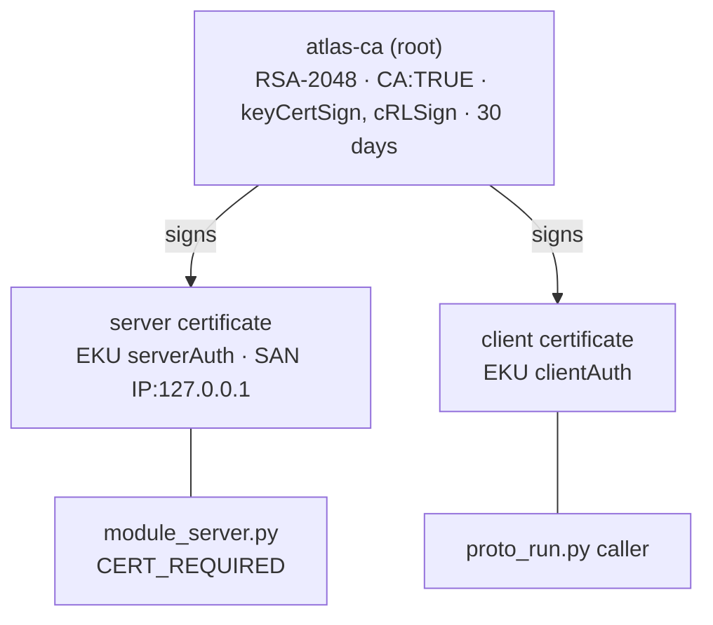

# Cryptography in ATLAS — a teaching guide

This guide uses ATLAS as a worked example for teaching applied cryptography: **hash functions and
checksums, public-key infrastructure (public keys, private keys and certificates), digital
signatures, and post-quantum cryptography (PQC)**. Every claim points at the file that implements it.

> **What is implemented and what is a teaching extension.**
>
> | Tag | Meaning |
> |---|---|
> | ✅ **Implemented** | Runs in this repository today; the file is named. |
> | 🧪 **Demo-grade** | Implemented with deliberately simple choices that suit a demo or a lab, not production. |
> | 🎓 **Teaching extension** | **Not** in the ATLAS code. Shows where a standard technique would fit. |
>
> ATLAS contains **no post-quantum cryptography**. §6 explains which ATLAS primitives a quantum
> computer would break, which it would not, and where ML-KEM, ML-DSA and SLH-DSA would go.

**Interactive companion:** [ATLAS Architecture Explorer → Cryptography](https://fullscipts.github.io/ATLAS/#crypto) —
hash text or a downloaded APK and check it against the published `SHA256SUMS`, verify the real upload
certificate's pinned fingerprint, build a small certificate authority, sign and verify releases with
ECDSA and RSA-PSS, and run a post-quantum Lamport signature, all with Web Crypto in your browser.

**Command-line lab:** `python3 security_lab/crypto_lab.py` (standard library only; add
`--verify atlas-go-1.2.0.apk` to check a download).

Companion guide: [INFORMATION_SECURITY.md](INFORMATION_SECURITY.md) covers authentication, password
storage (PBKDF2), identity management, SSO and Kerberos.

---

## Contents

1. [The cryptographic inventory of ATLAS](#1-the-cryptographic-inventory-of-atlas)
2. [Hash functions and checksums](#2-hash-functions-and-checksums--implemented)
3. [Public-key infrastructure: keys and certificates](#3-public-key-infrastructure-keys-and-certificates--implemented)
4. [Digital signatures: signing the ATLAS Go app](#4-digital-signatures-signing-the-atlas-go-app--implemented)
5. [Message authentication and constant-time comparison](#5-message-authentication-and-constant-time-comparison--implemented)
6. [Post-quantum cryptography](#6-post-quantum-cryptography--teaching-extension)
7. [Known gaps — exercises for students](#7-known-gaps--exercises-for-students)
8. [Suggested lesson plan](#8-suggested-lesson-plan)

---

## 1. The cryptographic inventory of ATLAS

Knowing *which* algorithms a system uses, and *where*, is the first step of any crypto review (and of
any post-quantum migration). This is the inventory for ATLAS.

| Primitive | Algorithm | Where in ATLAS | Purpose | Status |
|---|---|---|---|---|
| Hash | SHA-256 | `SHA256SUMS` for every release; `finalize-handover.py`; release workflows | Integrity of downloads | ✅ |
| Hash (pinning) | SHA-256 | `atlas-android.yml` pins `bundletool.jar` | Supply-chain integrity of build tools | ✅ |
| Hash (records) | SHA-256 | `SIGNED_VALIDATION.json`, `SIGNED_ZIP_RECIPE.json`, `restore-signed-bundle.py` | Prove the signed bundle is exactly the tested one | ✅ |
| Hash (inventory) | SHA-256 | `starter/scripts/generate_blueprint.py` | Fingerprint every source file in the UML blueprint | ✅ |
| Checksum (non-cryptographic) | `(count, total, len(seen))` | `prototype/module_server.py`, recovery class C3 | Detect lost state after recovery | ✅ |
| Key derivation | PBKDF2-HMAC-SHA256, 200 000 rounds | `android-app/atlas_go/accounts.py` | Password storage (see the security guide) | ✅ |
| MAC / comparison | HMAC, `hmac.compare_digest` | `accounts.py`, `starter/packages/config.py` | Timing-safe equality | ✅ |
| Random | `secrets.token_bytes`, `uuid4` | `accounts.py`, starter services | Salts, identifiers | ✅ |
| Certificate (private CA) | RSA-2048, X.509 v3, 30 days | `prototype/proto_run.py` | Mutual TLS between processes | ✅ |
| Certificate (Web PKI) | Public CAs via `certifi` | `android-app/atlas_go/livemap.py` (`requests`) | HTTPS to the map tile server | ✅ |
| Certificate (code signing) | RSA-4096, sha384WithRSAEncryption, self-signed | `android-app/releases/upload-certificate.pem` | Identifies the app's upload key | ✅ |
| Certificate pinning | SHA-256 of the DER certificate | `ci-sign-bundle.py`, `publish-signed-android.yml` | Only the owner's key may sign | ✅ |
| Signature | SHA256withRSA (PKCS#1 v1.5) | `scripts/sign-release.py` (`jarsigner`) | Sign the Play bundle (AAB) | ✅ |
| Signature | APK Signature Scheme v2 and v3 | `releases/1.2.0` (`apksigner`) | Sign the installable APK | ✅ |
| Post-quantum KEM / signature | ML-KEM, ML-DSA, SLH-DSA | — | — | 🎓 §6 |

---

## 2. Hash functions and checksums — ✅ Implemented

A cryptographic hash maps any input to a fixed-size digest (SHA-256: 32 bytes) such that it is
infeasible to find an input for a given digest (**preimage resistance**), or two inputs with the same
digest (**collision resistance**). Changing one bit of input flips about half the output bits
(**avalanche effect**).

### Where ATLAS uses SHA-256

**1. Release checksums.** Every release folder ships `SHA256SUMS`, generated by CI
(`atlas-android.yml`: `sha256sum release/*.apk release/*.aab > release/SHA256SUMS`) and by
`android-app/scripts/finalize-handover.py`:

```text
737c41ec935e4a87d849a04b1434fbe66fa47bdcb9420387e2a94f58400813cb  atlas-go-1.2.0.apk
603330022c5557da665b56585f20aa75453b6e789e344a11897ce57c43ff1ca7  atlas-go-1.2.0-unsigned.aab
```

A user checks a download with `sha256sum -c SHA256SUMS`. The README also prints the APK's SHA-256 next
to the download link, so the expected value reaches the user by a second channel.

**2. Pinning build tools.** CI downloads Google's `bundletool.jar` and refuses to run it unless its
hash matches a value committed in the workflow:

```yaml
curl -fL https://github.com/google/bundletool/releases/download/1.18.3/bundletool-all-1.18.3.jar -o /tmp/bundletool.jar
echo 'a099cfa1543f55593bc2ed16a70a7c67fe54b1747bb7301f37fdfd6d91028e29  /tmp/bundletool.jar' | sha256sum -c -
```

This is **supply-chain integrity**: a compromised download server cannot substitute a different tool.

**3. Signing records.** `SIGNED_VALIDATION.json` records the SHA-256 of the signed bundle and of the
signing certificate; `restore-signed-bundle.py` rebuilds the signed bundle and refuses to continue
unless both the input (`unsigned_sha256`) and the output (`signed_sha256`) hashes match.

**4. Source inventory.** `generate_blueprint.py` stores a SHA-256 for every file in the UML blueprint,
so a reader can tell whether the documentation describes exactly the code in the repository.

### Checksum vs cryptographic hash

The prototype's recovery protocol compares a **checksum** after restoring a module:

```python
def checksum(self):            # prototype/module_server.py
    return (self.count, self.total, len(self.seen))
```

Recovery class **C3** in `run_recovery_mc.py` is "checksum mismatch → restore and replay". This is the
right tool for that job — it detects a lost or duplicated update cheaply — but it is **not** a security
control: two different states (swap one payment id) give the same checksum. Against an attacker you
need a cryptographic hash, and against an attacker who can also recompute the hash you need a **MAC**
(keyed) or a **signature**.

| | Detects accidental change | Detects deliberate change | Needs a key |
|---|---|---|---|
| Checksum (CRC, counters) | ✅ | ❌ | No |
| Cryptographic hash (SHA-256) | ✅ | ✅ *if the expected hash comes from a trusted channel* | No |
| MAC (HMAC-SHA-256) | ✅ | ✅ | Shared secret |
| Digital signature | ✅ | ✅, and proves *who* | Private key to sign, public key to verify |

---

## 3. Public-key infrastructure: keys and certificates — ✅ Implemented

**Key pair:** a private key (kept secret) and a public key (shared). What one encrypts or signs, only
the other can decrypt or verify. **Certificate:** a document binding a public key to a name, signed by
an issuer. **PKI:** the set of issuers (CAs), rules and trust anchors that let a verifier decide
whether to believe a certificate.

ATLAS uses three different trust models — a good teaching contrast.

### 3.1 A private CA for mutual TLS (prototype)

`prototype/proto_run.py` creates its own small PKI with `openssl` every run:



| Field | Value | Why it matters |
|---|---|---|
| `basicConstraints CA:TRUE` (root), `CA:FALSE` (leaves) | Only the root may issue certificates | A stolen leaf key cannot mint new certificates |
| `keyUsage` | `keyCertSign, cRLSign` (root); `digitalSignature, keyEncipherment` (leaves) | Limits what each key may do |
| `extendedKeyUsage` | `serverAuth` vs `clientAuth` | A server certificate cannot be used to log in as a client |
| `subjectAltName` | `IP:127.0.0.1` | Binds the certificate to the address the client connects to |
| Lifetime | 30 days; generated at run time, never committed | Short-lived credentials; no private key in Git |
| Trust anchor | `ca.crt`, loaded by both sides | Nothing else is trusted — not the public Web PKI |

### 3.2 The public Web PKI (map tiles)

ATLAS Go downloads OpenStreetMap tiles from `https://tile.openstreetmap.org` with `requests`, which
verifies the server certificate against the Mozilla CA bundle shipped by `certifi` (listed in
`buildozer.spec`). Here ATLAS *consumes* PKI: it trusts about a hundred public root CAs it did not
choose.

### 3.3 Code-signing certificates and fingerprint pinning (releases)

`android-app/releases/upload-certificate.pem` is the public certificate of the app's **upload key**:

| Field | Value |
|---|---|
| Subject = Issuer | `O=FUllSCIPTS, OU=Android Release, CN=ATLAS Go Upload` (self-signed) |
| Public key | RSA, 4096 bits |
| Signature algorithm | sha384WithRSAEncryption |
| Validity | 5 Nov 2026 → 13 Sep 2059 |
| Version | X.509 v1 (no extensions) — typical of `keytool`-generated signing certificates |
| SHA-256 fingerprint | `059076082129b3ed2f08c5b88a207bdebf2bba88304c0821b77d128c034944d7` |

A self-signed certificate has no CA vouching for it, so trust comes from **pinning**: the fingerprint
is committed in `SIGNED_VALIDATION.json`, and both `ci-sign-bundle.py` and
`publish-signed-android.yml` recompute it and fail the job on a mismatch:

```python
def certificate_sha256(bundle):                      # ci-sign-bundle.py
    pem = subprocess.run(['keytool', '-printcert', '-rfc', '-jarfile', str(bundle)], ...).stdout
    return hashlib.sha256(ssl.PEM_cert_to_DER_cert(pem[start:end])).hexdigest()
...
assert fingerprint == record['upload_certificate_sha256'], 'Upload certificate does not match'
```

**The two-key model.** The upload key signs what is *uploaded*; with Play App Signing, Google
re-signs what is *distributed* with an app-signing key it holds. The 1.2.0 installable APK carries a
separate release certificate (`CN=ATLAS Go Release`, SHA-256 `BF:6A:7C:48:…:C8:FB`). Losing the upload
key is recoverable (upload-key reset); losing a distribution key is not — so the most valuable key is
kept in the most protected place.

**Private-key handling.** The private key never enters the repository: the keystore is a PKCS#12 file
passed by environment variable (`sign-release.py`), or a base64 GitHub Actions secret written to a
temporary file and always deleted (`ci-sign-bundle.py`). `SIGNED_VALIDATION.json` records
`"private_key_published": false`.

---

## 4. Digital signatures: signing the ATLAS Go app — ✅ Implemented

A signature proves **integrity** (the bytes did not change) and **authenticity** (the holder of the
private key produced them), and anyone can check it with the public key. Signatures are computed over a
**hash** of the data (hash-then-sign).

```mermaid
sequenceDiagram
  participant Dev as Owner (private key in PKCS#12)
  participant CI as GitHub Actions
  participant U as User / Play Store
  CI->>CI: build + test unsigned AAB, record SHA-256
  CI->>CI: ci-sign-bundle.py: jarsigner -sigalg SHA256withRSA -digestalg SHA-256
  CI->>CI: verify signature; SHA-256(certificate) == pinned value?
  CI-->>U: signed AAB + SHA256SUMS
  U->>U: apksigner verify --print-certs (v2/v3), sha256sum -c
```

| Artefact | Scheme | Tool | What is signed |
|---|---|---|---|
| Play bundle (`.aab`) | JAR signing, SHA256withRSA (RSA PKCS#1 v1.5) | `jarsigner` in `sign-release.py` | SHA-256 digest of each entry, listed in `META-INF/MANIFEST.MF`, then the manifest |
| Installable APK | APK Signature Scheme v2 and v3 | `apksigner` / bundletool | The whole file (v2) plus key-rotation support (v3) |

`sign-release.py` signs and then immediately runs `jarsigner -verify`; the passwords are passed by
environment-variable name (`-storepass:env`) so they never appear in a command line or log.

**Verify it yourself:**

```bash
sha256sum -c SHA256SUMS
apksigner verify --print-certs atlas-go-1.2.0.apk
```

---

## 5. Message authentication and constant-time comparison — ✅ Implemented

Two places compare secrets: password digests in `accounts.py` and bearer keys / the internal token in
`starter/packages/config.py`. Both use `hmac.compare_digest`, which takes the same time wherever the
inputs differ, so an attacker cannot learn a secret byte by byte from response times. PBKDF2 itself is
built from HMAC-SHA-256. Details are in the
[information-security guide](INFORMATION_SECURITY.md#2-how-user-passwords-are-stored--implemented).

---

## 6. Post-quantum cryptography — 🎓 Teaching extension

**ATLAS contains no PQC.** This section maps the threat onto ATLAS's inventory (§1).

A large quantum computer running **Shor's algorithm** would break RSA and elliptic-curve
cryptography outright. **Grover's algorithm** only gives a square-root speed-up against hashes and
symmetric ciphers, so SHA-256 and AES-256 keep a comfortable margin.

| ATLAS primitive | Quantum impact | Action |
|---|---|---|
| SHA-256 checksums, pins, records | Grover: preimage effort ~2¹²⁸ — still infeasible | Keep |
| PBKDF2-HMAC-SHA256 | Grover-limited; password guessability dominates | Keep; raise iterations |
| HMAC / `compare_digest` | Unaffected in practice | Keep |
| TLS key exchange (map tiles, mTLS) | **Broken by Shor** — and recorded traffic can be decrypted later (*harvest now, decrypt later*): location data is long-lived | Hybrid key exchange (X25519 + ML-KEM-768) |
| mTLS certificates (RSA-2048) | **Broken by Shor** (forgery) | ML-DSA certificates when the TLS stack supports them; short lifetimes help |
| Upload key RSA-4096, valid to **2059** | **Broken by Shor** — a 33-year signing key is the most exposed asset | Plan key rotation (APK v3 supports rotation) to a PQ scheme when Android supports one |

**The NIST standards (August 2024):**

| Standard | Algorithm | Type | Basis | Public key | Ciphertext / signature |
|---|---|---|---|---|---|
| FIPS 203 | ML-KEM-768 | Key encapsulation | Module lattices | 1 184 B | 1 088 B ciphertext |
| FIPS 204 | ML-DSA-65 | Signature | Module lattices | 1 952 B | 3 309 B |
| FIPS 205 | SLH-DSA-SHA2-128s | Signature | **Hash functions only** | 32 B | 7 856 B |
| *(classical)* | X25519 | Key exchange | Elliptic curve | 32 B | 32 B |
| *(classical)* | ECDSA P-256 | Signature | Elliptic curve | 64 B | 64 B |
| *(classical)* | RSA-4096 (ATLAS upload key) | Signature | Factoring | 512 B | 512 B |

**Hash-based signatures — the intuition.** SLH-DSA is secure if SHA-256 is. Its simplest ancestor, the
**Lamport one-time signature**, uses only a hash: the private key is 256 pairs of random values, the
public key their hashes; to sign, reveal one value from each pair according to the bits of the
message's hash. It is quantum-safe but large (16 KB public key, 8 KB signature) and **one-time**:
signing a second message reveals more secrets and enables forgery. SLH-DSA combines many one-time keys
in a hash tree to become many-time and compact. Run it in `crypto_lab.py` §6 or in the Explorer.

**Hybrid KEM.** During migration, a hybrid key exchange combines a classical and a post-quantum
shared secret through a KDF, so the session stays secure if *either* holds. For ATLAS this would sit
under TLS between the app and the gateway, and between services (replacing the static
`X-Atlas-Internal` token with mTLS, see the security guide §9).

---

## 7. Known gaps — exercises for students

| # | Observation | Where | Exercise |
|---|---|---|---|
| 1 | Prototype state checksum is not collision-resistant | `module_server.py` | Replace with SHA-256 over a canonical snapshot; measure the cost |
| 2 | `SHA256SUMS` is not itself signed | `releases/` | Sign it (e.g. Sigstore or minisign) so the checksum file cannot be swapped |
| 3 | Upload certificate is valid until 2059 | `upload-certificate.pem` | Discuss key lifetime, rotation with APK v3, and PQ exposure |
| 4 | Tile requests trust the whole Web PKI | `livemap.py` | Discuss certificate pinning for an operator back end, and its operational risk |
| 5 | Service-to-service traffic in the starter is plain HTTP | `compose.yaml` | Reuse the prototype's private CA for mTLS |
| 6 | No crypto-agility record | — | Add the inventory in §1 to CI as a check, the first step of a PQ migration |

---

## 8. Suggested lesson plan

| Session | Topic | ATLAS material | Activity |
|---|---|---|---|
| 1 | Hash functions | §2, lab §1–3, Explorer *Hashes* | Avalanche effect; verify a real APK download |
| 2 | Checksums vs hashes vs MACs | §2, lab §2 | Break the prototype checksum; fix it |
| 3 | Public-key cryptography and certificates | §3, Explorer *PKI* | Build a CA; trip each certificate check |
| 4 | Trust models | §3.1–3.3 | Private CA vs Web PKI vs pinning: who is trusted, and why? |
| 5 | Digital signatures | §4, lab §5, Explorer *Signatures* | Sign and tamper; compare ECDSA and RSA sizes |
| 6 | Post-quantum cryptography | §6, lab §6, Explorer *Post-quantum* | Lamport sign and forge after key reuse; plan ATLAS's migration |

---

*Code references are to the `main` branch (ATLAS Go 1.2.0 and the prototype) and the
`architecture-explorer` branch (server starter and Explorer).*
