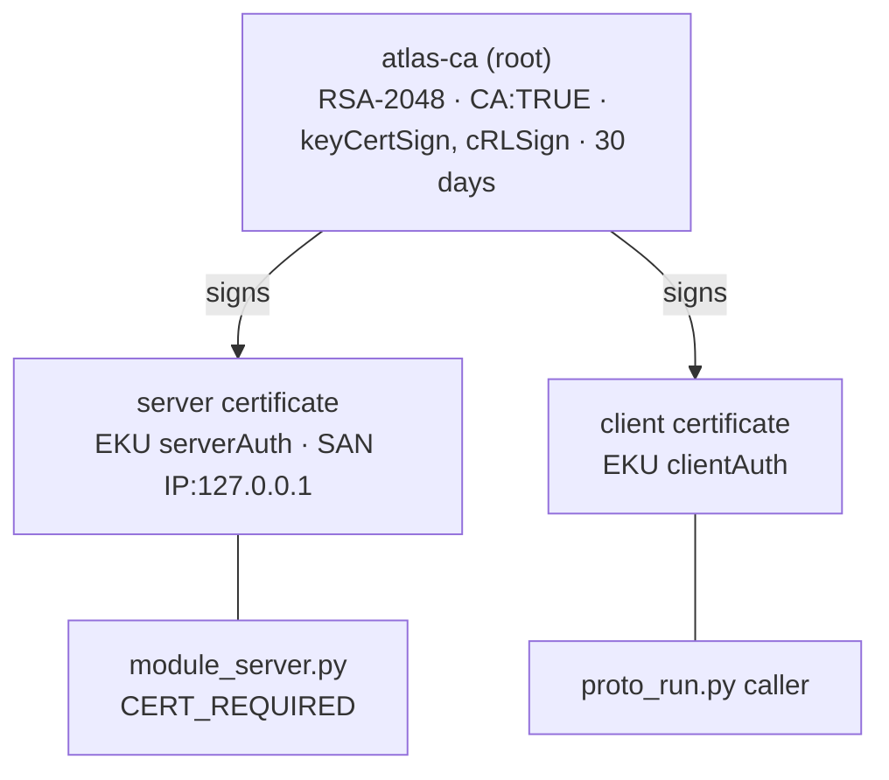

# Cryptography in ATLAS — a teaching guide

This guide uses ATLAS as a worked example for teaching applied cryptography: **hash functions and
checksums, public-key infrastructure (public keys, private keys and certificates), digital
signatures, and post-quantum cryptography (PQC)**. Every claim points at the file that implements it.

> **What is implemented and what is a teaching extension.**
>
> | Tag | Meaning |
> |---|---|
> | ✅ **Implemented** | Runs in this repository today; the file is named. |
> | 🧪 **Demo-grade** | Implemented with deliberately simple choices that suit a demo or a lab, not production. |
> | 🎓 **Teaching extension** | **Not** in the ATLAS code. Shows where a standard technique would fit. |
>
> ATLAS contains **no post-quantum cryptography**. §6 explains which ATLAS primitives a quantum
> computer would break, which it would not, and where ML-KEM, ML-DSA and SLH-DSA would go.

**Interactive companion:** [ATLAS Architecture Explorer → Cryptography](https://fullscipts.github.io/ATLAS/#crypto) —
hash text or a downloaded APK and check it against the published `SHA256SUMS`, verify the real upload
certificate's pinned fingerprint, build a small certificate authority, sign and verify releases with
ECDSA and RSA-PSS, and run a post-quantum Lamport signature, all with Web Crypto in your browser.

**Command-line lab:** `python3 security_lab/crypto_lab.py` runs 20 experiments on ATLAS's real
artefacts (standard library only; add `--verify atlas-go-1.2.0.apk` to check a download). They are split
into five files you can run on their own, and grouped into study paths (`--path NAME`):

| File | Category | Experiments |
|---|---|---|
| `crypto_a_hashing.py` | A. Hashing and integrity | 1 basics and the Unicode trap · 2 avalanche, measured · 3 truncated-hash preimages and collisions · 4 forging the prototype checksum · 5 forging CRC32 · 6 verifying releases and signing records · 7 supply-chain pins in CI |
| `crypto_b_mac_kdf_random.py` | B. MACs, key derivation, randomness | 8 length extension vs HMAC · 9 HMAC and PBKDF2 by hand, matching `accounts.py` · 10 predicting `random`, trusting `secrets` |
| `crypto_c_pki.py` | C. Certificates and PKI | 11 PEM, DER and the fingerprint pin · 12 walking the certificate's DER · 13 verifying its RSA-4096/SHA-384 self-signature by hand · 14 a private CA like the prototype's |
| `crypto_d_signatures.py` | D. Digital signatures | 15 textbook RSA and malleability · 16 SHA256withRSA (PKCS#1 v1.5) · 17 JAR signing: MANIFEST.MF, .SF and tampering |
| `crypto_e_post_quantum.py` | E. Post-quantum | 18 Lamport signatures · 19 forging after key reuse · 20 toy LWE KEM in a hybrid with Diffie-Hellman |

| Study path | Experiments | Goal |
|---|---|---|
| `foundations` | 1, 2, 4, 6, 11, 16 | Hash, verify, certificate, signature |
| `release-engineer` | 6, 7, 11, 13, 17 | Verify what ATLAS ships, the way CI does |
| `attacker` | 3, 5, 8, 10, 15, 19 | Break the weak constructions |
| `pki` | 11, 12, 13, 14 | Certificates from bytes to trust decisions |
| `post-quantum` | 3, 18, 19, 20 | What a quantum computer breaks, and what replaces it |

Companion guide: [INFORMATION_SECURITY.md](INFORMATION_SECURITY.md) covers authentication, password
storage (PBKDF2), identity management, SSO and Kerberos.

---

## Contents

1. [The cryptographic inventory of ATLAS](#1-the-cryptographic-inventory-of-atlas)
2. [Hash functions and checksums](#2-hash-functions-and-checksums--implemented)
3. [Public-key infrastructure: keys and certificates](#3-public-key-infrastructure-keys-and-certificates--implemented)
4. [Digital signatures: signing the ATLAS Go app](#4-digital-signatures-signing-the-atlas-go-app--implemented)
5. [Message authentication and constant-time comparison](#5-message-authentication-and-constant-time-comparison--implemented)
6. [Post-quantum cryptography](#6-post-quantum-cryptography--teaching-extension)
7. [Known gaps — exercises for students](#7-known-gaps--exercises-for-students)
8. [Suggested lesson plan](#8-suggested-lesson-plan)

---


## Standalone illustrated foundations — Cryptography

Read this chapter first. Each topic introduces the idea, a worked example, a GitHub-rendered Mermaid diagram, the limits of the example, and a matching source experiment. The ATLAS laboratory contains 20 source experiments; the companion Colab notebook adds a **measured execution chart** and a **clearly labeled conceptual illustration** for each. A successful test does not prove a cryptosystem secure.

### C1 — Plaintext, ciphertext, keys, and security goals

**Plaintext** is readable information. **Encryption** converts plaintext into ciphertext using a secret or public key; authorized decryption restores plaintext. **Confidentiality** protects against unauthorized reading; **integrity** detects modifications; **authentication** validates the origin; **availability** ensures service. Encryption alone cannot prevent account misuse or unsafe business logic. **Symmetric** encryption shares a secret key, whereas **asymmetric** encryption/signature systems use private and public keys.

~~~mermaid
flowchart LR
 A["Plaintext"] -->|"Encryption + key"| B["Ciphertext"]
 B -->|"Decryption + authorized key"| C["Recovered plaintext"]
 A -->|"Hash"| D["Fixed-length digest"]
 A -->|"Sign with private key"| E["Signature"]
 E -->|"Verify with public key"| F["Origin / integrity check"]
~~~

**Analogy:** a locked parcel hides the letter (confidentiality); a tamper-evident seal detects alteration (integrity), but neither alone proves the address on the parcel is genuine. Real algorithms require strong keys and trustworthy implementations. Toy RSA and classroom ciphers must never protect real data.

### C2 — SHA-256, encoding, avalanche, preimages and collisions

A cryptographic hash takes bytes and outputs a fixed-length **digest**. SHA-256 always yields **256 bits = 32 bytes = 64 hexadecimal characters**, whether the input has 1 byte or 1 gigabyte. A hash does not encrypt: there is no decryption operation. **Preimage resistance** protects against finding an input for a given digest; **second-preimage resistance** against replacing a fixed message; **collision resistance** against finding any different pair with the same digest.

~~~mermaid
flowchart TB
 A["Text → UTF-8 bytes"] --> H["SHA-256"]
 B["Changed byte / Unicode form"] --> H2["SHA-256"]
 H --> D["32-byte digest #1"]
 H2 --> E["32-byte digest #2"]
~~~

~~~python
import hashlib, unicodedata
assert len(hashlib.sha256(b"hello").digest()) == 32
assert hashlib.sha256(b"hello").digest() != hashlib.sha256(b"Hello").digest()
assert unicodedata.normalize("NFC", "e\u0301") == "é"
~~~

The **avalanche effect** predicts roughly 128 changed digest bits after one input bit flips for an ideal 256-bit hash, not exactly 128 each trial. Generic attacks on a b-bit ideal hash take approximately 2^b operations for preimages and 2^(b/2) for birthday collisions. These are work-factor estimates, not measured attack times.

### C3 — Checksums, cryptographic hashes and artifact verification

A checksum such as CRC32 is designed primarily to detect accidental corruption. A malicious modifier can often engineer an equal checksum. A trusted cryptographic digest can detect changed bytes, but the digest must itself be authenticated or delivered through a trusted channel. ATLAS uses SHA256SUMS for release checks, while a simpler prototype checksum intentionally illustrates the limitation.

~~~mermaid
flowchart LR
 F["Downloaded APK"] --> H["Calculate SHA-256"]
 T["Trusted expected digest"] --> C["Compare"]
 H --> C
 C -->|"same"| OK["Byte-level integrity match"]
 C -->|"different"| REJ["Reject altered bytes"]
~~~

For example, 2 files may have the same length and additive byte sum but different contents; that additive checksum would miss the substitution. A matching hash is not independently proof of the publisher's identity. **Labs C01–C07.**

### C4 — Message authentication codes, HMAC and length extension

A **MAC** is an authenticity/integrity tag produced using a shared secret. **HMAC** wraps a cryptographic hash with inner and outer keyed computations. It resists hash length-extension attacks that affect unsafe constructions such as SHA256(secret || message). Compare tags with a constant-time comparison function to limit data-dependent timing.

~~~mermaid
sequenceDiagram
 participant S as Sender
 participant R as Receiver
 S->>S: tag = HMAC(key, message)
 S->>R: message, tag
 R->>R: recompute HMAC with secret key
 R-->>S: accept if tags match
~~~

~~~python
import hashlib, hmac, secrets
key = secrets.token_bytes(32)
text = b"ride=12"
tag = hmac.new(key, text, hashlib.sha256).digest()
assert hmac.compare_digest(tag, hmac.new(key, text, hashlib.sha256).digest())
assert not hmac.compare_digest(tag, hmac.new(key, text+b"!", hashlib.sha256).digest())
~~~

An ordinary SHA-256 digest of a public message is not a MAC. **Lab C08.**

### C5 — Password hashing, salt, PBKDF2, HKDF and randomness

A **salt** is random, public data generated separately per password; it prevents equal passwords from automatically producing the same stored verifier. PBKDF2-HMAC-SHA256 repeats work to slow offline guessing. In ATLAS Go, account passwords use **16-byte salts and 200,000 iterations**. A larger iteration count makes authorized login slower too; it does not turn weak passwords into strong ones. **HKDF** derives purpose-separated keys from keying material and should not be confused with password-hardening PBKDF2. Use a **cryptographically secure RNG** for keys, salts and nonces, not Python's deterministic random module.

~~~mermaid
flowchart LR
 P["User password"] --> D["PBKDF2-HMAC-SHA256"]
 S["Unique random salt"] --> D
 I["Iteration count"] --> D
 D --> V["Stored verifier, not plaintext"]
~~~

~~~python
import hashlib, secrets
salt = secrets.token_bytes(16)
verifier = hashlib.pbkdf2_hmac("sha256", b"example-password", salt, 200000)
assert len(verifier) == 32
~~~

**Labs C09–C10; information-security S01–S08.**

### C6 — Authenticated encryption, AES-GCM, and the nonce rule

**Authenticated encryption with associated data (AEAD)** protects ciphertext confidentiality and integrity together. AES-GCM is one AEAD mode. Its **nonce must not be reused with the same key**; reuse can destroy confidentiality and authenticity. **Associated data (AAD)** is authenticated but not encrypted, for example a protocol header.

~~~mermaid
flowchart TD
 P["Plaintext"] --> A["AES-GCM encrypt"]
 K["Secret key"] --> A
 N["Unique nonce"] --> A
 H["Associated data"] --> A
 A --> C["Ciphertext + authentication tag"]
 C --> D["Verify tag before releasing plaintext"]
~~~

This is a conceptual extension: the Android application's local state file is **not encrypted at rest**. Use vetted AEAD libraries, not hand-written ciphers.

### C7 — Public/private keys, RSA and digital signatures

**Public-key encryption:** encrypt for a recipient using its public key; only the recipient's private key decrypts. **Digital signatures:** a signer uses a private key, and verifiers check with the authenticated public key. Textbook RSA has mathematical structure that permits forgery, so real signatures require secure standardized padding/encoding such as RSA-PSS or an appropriate established signature scheme. ATLAS Go's release signing uses SHA256withRSA through release tooling; this is not the insecure textbook RSA from the lab.

~~~mermaid
flowchart LR
 M["Release bytes"] --> HASH["SHA-256 digest"]
 HASH --> SIGN["Private-key signing"]
 SIGN --> PACKAGE["Signed archive"]
 PACKAGE --> VERIFY["Public-key verification"]
 VERIFY --> VALID["Valid / invalid"]
~~~

**Labs C15–C17.**

### C8 — Certificates, chain of trust, PKI and mutual TLS

A **certificate** binds a public key to identity claims and is signed by a certificate authority (CA). Clients need to verify the trusted chain, identity/SAN, validity period, key usage and any appropriate policy. **PEM** is a textual wrapper of Base64-encoded bytes; **DER** is a binary encoding. A certificate fingerprint uniquely describes the bytes with overwhelming probability, but is meaningful for trust only if compared to a trusted pin.

~~~mermaid
flowchart TD
 ROOT["Trusted root CA"] -->|"signs"| INTER["Intermediate CA"]
 INTER -->|"signs"| SERVER["Server certificate / SAN"]
 SERVER --> VERIFY["Client validates chain, name, time, use"]
~~~

**TLS** normally authenticates the server; **mutual TLS (mTLS)** also asks the client to authenticate with a certificate. The ATLAS prototype demonstrates a private CA and mutual TLS; the Android app uses public Web PKI for map tiles. The upload certificate is for software signing, not for online user login. **Labs C11–C14.**

### C9 — Signed software and supply-chain integrity

Build artifacts may contain a manifest with per-entry digests and a signature over signing metadata. Verifying the signature and each archive entry guards against certain alterations, assuming the signing key and verifier are trusted. Pinning a CI tool by an immutable digest is stronger than trusting a movable tag. A valid signature does not mean the signed software is harmless or free of vulnerabilities.

~~~mermaid
flowchart LR
 INPUT["App content"] --> MAN["Manifest entry hashes"]
 MAN --> SF["Signature-file digest"]
 SF --> SIG["Release signature"]
 SIG --> CHECK["Verify metadata and entries"]
~~~

Different packaging mechanisms matter: JAR signing and Android APK Signature Scheme v2/v3 are not identical. **Labs C06,C07,C16,C17.**

### C10 — Post-quantum security, Lamport, LWE and hybrid exchange

Shor's algorithm on a sufficiently large fault-tolerant quantum computer threatens RSA and elliptic-curve Diffie–Hellman. Symmetric keys and hashes face different quantum considerations, including Grover's idealized square-root search. NIST standards include **ML-KEM (FIPS 203)** for key encapsulation, **ML-DSA (FIPS 204)** for signatures and **SLH-DSA (FIPS 205)** for stateless hash-based signatures.

~~~mermaid
flowchart LR
 C["Classical key agreement secret"] --> KDF["Protocol-bound hybrid KDF"]
 P["Post-quantum KEM secret"] --> KDF
 CTX["Context and transcript"] --> KDF
 KDF --> KEY["Session traffic keys"]
~~~

**Lamport signatures** are one-time hash-based signatures; repeated signing with a one-time key leaks material needed for forgeries. **LWE** toy exercises demonstrate lattice-inspired hardness but are not standards-compliant ML-KEM. ATLAS's current PQ examples are **teaching extensions**, not deployed PQC. **Labs C18–C20.**

### C11 — Each cryptography experiment: concept and illustration

The **source runner** performs the real numbered experiment. The visual companion's **observed chart** measures only process elapsed time and exit status; its separately labeled **concept chart** illustrates mathematical behavior or an expected qualitative outcome, not data measured by the experiment.

| Exp. | Real experiment | Explanation task for chart and log |
|---|---|---|
| C01 | SHA-256/Unicode | Fixed digest length despite input size |
| C02 | Bit avalanche | Why 128 changed bits is an expectation |
| C03 | Truncated hash attacks | Preimage work versus birthday bound |
| C04 | Prototype checksum forgery | Additive integrity is not authentication |
| C05 | CRC32 linearity | Accidental-corruption code is forgeable |
| C06 | Release verification | Trust the expected digest source |
| C07 | CI supply-chain pin | Immutable digest versus mutable tag |
| C08 | SHA prefix-MAC extension | HMAC construction is required |
| C09 | HMAC and PBKDF2 | Work scales with iteration count |
| C10 | Random-state prediction | CSPRNG versus predictable PRNG |
| C11 | PEM/DER fingerprint | Identify precisely hashed bytes |
| C12 | DER certificate fields | Explain issuer, subject and extensions |
| C13 | RSA certificate signature | Signed fields and key validity |
| C14 | Private CA validations | Chain, SAN, time, and usage |
| C15 | Raw textbook RSA | Multiplicativity and forgery risk |
| C16 | RSA encoded signing | Why safe padding and hashing matter |
| C17 | JAR signing | Find which modification breaks trust |
| C18 | Lamport signature | Size and one-time key constraints |
| C19 | Lamport key reuse | Why repeated signing is hazardous |
| C20 | Toy lattice + hybrid | Differentiate toy and real KEM |

**Use [Cryptography Colab](https://colab.research.google.com/github/FUllSCIPTS/ATLAS/blob/main/security_lab/Cryptography_Colab_Labs.ipynb).** Each experiment exports its source log, actual time/status graph, a clearly non-measured conceptual PNG and CSV, and a JSON summary. The notebook packages these as a ZIP. **Report:** define goal, trust/threat model, exact bytes/keys under test, observed output, theoretical reasoning, interpretation and limitations.

---

## 1. The cryptographic inventory of ATLAS

Knowing *which* algorithms a system uses, and *where*, is the first step of any crypto review (and of
any post-quantum migration). This is the inventory for ATLAS.

| Primitive | Algorithm | Where in ATLAS | Purpose | Status |
|---|---|---|---|---|
| Hash | SHA-256 | `SHA256SUMS` for every release; `finalize-handover.py`; release workflows | Integrity of downloads | ✅ |
| Hash (pinning) | SHA-256 | `atlas-android.yml` pins `bundletool.jar` | Supply-chain integrity of build tools | ✅ |
| Hash (records) | SHA-256 | `SIGNED_VALIDATION.json`, `SIGNED_ZIP_RECIPE.json`, `restore-signed-bundle.py` | Prove the signed bundle is exactly the tested one | ✅ |
| Hash (inventory) | SHA-256 | `starter/scripts/generate_blueprint.py` | Fingerprint every source file in the UML blueprint | ✅ |
| Checksum (non-cryptographic) | `(count, total, len(seen))` | `prototype/module_server.py`, recovery class C3 | Detect lost state after recovery | ✅ |
| Key derivation | PBKDF2-HMAC-SHA256, 200 000 rounds | `android-app/atlas_go/accounts.py` | Password storage (see the security guide) | ✅ |
| MAC / comparison | HMAC, `hmac.compare_digest` | `accounts.py`, `starter/packages/config.py` | Timing-safe equality | ✅ |
| Random | `secrets.token_bytes`, `uuid4` | `accounts.py`, starter services | Salts, identifiers | ✅ |
| Certificate (private CA) | RSA-2048, X.509 v3, 30 days | `prototype/proto_run.py` | Mutual TLS between processes | ✅ |
| Certificate (Web PKI) | Public CAs via `certifi` | `android-app/atlas_go/livemap.py` (`requests`) | HTTPS to the map tile server | ✅ |
| Certificate (code signing) | RSA-4096, sha384WithRSAEncryption, self-signed | `android-app/releases/upload-certificate.pem` | Identifies the app's upload key | ✅ |
| Certificate pinning | SHA-256 of the DER certificate | `ci-sign-bundle.py`, `publish-signed-android.yml` | Only the owner's key may sign | ✅ |
| Signature | SHA256withRSA (PKCS#1 v1.5) | `scripts/sign-release.py` (`jarsigner`) | Sign the Play bundle (AAB) | ✅ |
| Signature | APK Signature Scheme v2 and v3 | `releases/1.2.0` (`apksigner`) | Sign the installable APK | ✅ |
| Post-quantum KEM / signature | ML-KEM, ML-DSA, SLH-DSA | — | — | 🎓 §6 |

---

## 2. Hash functions and checksums — ✅ Implemented

A cryptographic hash maps any input to a fixed-size digest (SHA-256: 32 bytes) such that it is
infeasible to find an input for a given digest (**preimage resistance**), or two inputs with the same
digest (**collision resistance**). Changing one bit of input flips about half the output bits
(**avalanche effect**).

### Where ATLAS uses SHA-256

**1. Release checksums.** Every release folder ships `SHA256SUMS`, generated by CI
(`atlas-android.yml`: `sha256sum release/*.apk release/*.aab > release/SHA256SUMS`) and by
`android-app/scripts/finalize-handover.py`:

```text
737c41ec935e4a87d849a04b1434fbe66fa47bdcb9420387e2a94f58400813cb  atlas-go-1.2.0.apk
603330022c5557da665b56585f20aa75453b6e789e344a11897ce57c43ff1ca7  atlas-go-1.2.0-unsigned.aab
```

A user checks a download with `sha256sum -c SHA256SUMS`. The README also prints the APK's SHA-256 next
to the download link, so the expected value reaches the user by a second channel.

**2. Pinning build tools.** CI downloads Google's `bundletool.jar` and refuses to run it unless its
hash matches a value committed in the workflow:

```yaml
curl -fL https://github.com/google/bundletool/releases/download/1.18.3/bundletool-all-1.18.3.jar -o /tmp/bundletool.jar
echo 'a099cfa1543f55593bc2ed16a70a7c67fe54b1747bb7301f37fdfd6d91028e29  /tmp/bundletool.jar' | sha256sum -c -
```

This is **supply-chain integrity**: a compromised download server cannot substitute a different tool.

**3. Signing records.** `SIGNED_VALIDATION.json` records the SHA-256 of the signed bundle and of the
signing certificate; `restore-signed-bundle.py` rebuilds the signed bundle and refuses to continue
unless both the input (`unsigned_sha256`) and the output (`signed_sha256`) hashes match.

**4. Source inventory.** `generate_blueprint.py` stores a SHA-256 for every file in the UML blueprint,
so a reader can tell whether the documentation describes exactly the code in the repository.

### Checksum vs cryptographic hash

The prototype's recovery protocol compares a **checksum** after restoring a module:

```python
def checksum(self):            # prototype/module_server.py
    return (self.count, self.total, len(self.seen))
```

Recovery class **C3** in `run_recovery_mc.py` is "checksum mismatch → restore and replay". This is the
right tool for that job — it detects a lost or duplicated update cheaply — but it is **not** a security
control: two different states (swap one payment id) give the same checksum. Against an attacker you
need a cryptographic hash, and against an attacker who can also recompute the hash you need a **MAC**
(keyed) or a **signature**.

| | Detects accidental change | Detects deliberate change | Needs a key |
|---|---|---|---|
| Checksum (CRC, counters) | ✅ | ❌ | No |
| Cryptographic hash (SHA-256) | ✅ | ✅ *if the expected hash comes from a trusted channel* | No |
| MAC (HMAC-SHA-256) | ✅ | ✅ | Shared secret |
| Digital signature | ✅ | ✅, and proves *who* | Private key to sign, public key to verify |

---

## 3. Public-key infrastructure: keys and certificates — ✅ Implemented

**Key pair:** a private key (kept secret) and a public key (shared). What one encrypts or signs, only
the other can decrypt or verify. **Certificate:** a document binding a public key to a name, signed by
an issuer. **PKI:** the set of issuers (CAs), rules and trust anchors that let a verifier decide
whether to believe a certificate.

ATLAS uses three different trust models — a good teaching contrast.

### 3.1 A private CA for mutual TLS (prototype)

`prototype/proto_run.py` creates its own small PKI with `openssl` every run:



| Field | Value | Why it matters |
|---|---|---|
| `basicConstraints CA:TRUE` (root), `CA:FALSE` (leaves) | Only the root may issue certificates | A stolen leaf key cannot mint new certificates |
| `keyUsage` | `keyCertSign, cRLSign` (root); `digitalSignature, keyEncipherment` (leaves) | Limits what each key may do |
| `extendedKeyUsage` | `serverAuth` vs `clientAuth` | A server certificate cannot be used to log in as a client |
| `subjectAltName` | `IP:127.0.0.1` | Binds the certificate to the address the client connects to |
| Lifetime | 30 days; generated at run time, never committed | Short-lived credentials; no private key in Git |
| Trust anchor | `ca.crt`, loaded by both sides | Nothing else is trusted — not the public Web PKI |

### 3.2 The public Web PKI (map tiles)

ATLAS Go downloads OpenStreetMap tiles from `https://tile.openstreetmap.org` with `requests`, which
verifies the server certificate against the Mozilla CA bundle shipped by `certifi` (listed in
`buildozer.spec`). Here ATLAS *consumes* PKI: it trusts about a hundred public root CAs it did not
choose.

### 3.3 Code-signing certificates and fingerprint pinning (releases)

`android-app/releases/upload-certificate.pem` is the public certificate of the app's **upload key**:

| Field | Value |
|---|---|
| Subject = Issuer | `O=FUllSCIPTS, OU=Android Release, CN=ATLAS Go Upload` (self-signed) |
| Public key | RSA, 4096 bits |
| Signature algorithm | sha384WithRSAEncryption |
| Validity | 5 Nov 2026 → 13 Sep 2059 |
| Version | X.509 v3 with one extension, subjectKeyIdentifier (as current `keytool` adds by default); `notAfter` is a GeneralizedTime because it is after 2049 |
| SHA-256 fingerprint | `059076082129b3ed2f08c5b88a207bdebf2bba88304c0821b77d128c034944d7` |

A self-signed certificate has no CA vouching for it, so trust comes from **pinning**: the fingerprint
is committed in `SIGNED_VALIDATION.json`, and both `ci-sign-bundle.py` and
`publish-signed-android.yml` recompute it and fail the job on a mismatch:

```python
def certificate_sha256(bundle):                      # ci-sign-bundle.py
    pem = subprocess.run(['keytool', '-printcert', '-rfc', '-jarfile', str(bundle)], ...).stdout
    return hashlib.sha256(ssl.PEM_cert_to_DER_cert(pem[start:end])).hexdigest()
...
assert fingerprint == record['upload_certificate_sha256'], 'Upload certificate does not match'
```

**The two-key model.** The upload key signs what is *uploaded*; with Play App Signing, Google
re-signs what is *distributed* with an app-signing key it holds. The 1.2.0 installable APK carries a
separate release certificate (`CN=ATLAS Go Release`, SHA-256 `BF:6A:7C:48:…:C8:FB`). Losing the upload
key is recoverable (upload-key reset); losing a distribution key is not — so the most valuable key is
kept in the most protected place.

**Private-key handling.** The private key never enters the repository: the keystore is a PKCS#12 file
passed by environment variable (`sign-release.py`), or a base64 GitHub Actions secret written to a
temporary file and always deleted (`ci-sign-bundle.py`). `SIGNED_VALIDATION.json` records
`"private_key_published": false`.

---

## 4. Digital signatures: signing the ATLAS Go app — ✅ Implemented

A signature proves **integrity** (the bytes did not change) and **authenticity** (the holder of the
private key produced them), and anyone can check it with the public key. Signatures are computed over a
**hash** of the data (hash-then-sign).

```mermaid
sequenceDiagram
  participant Dev as Owner (private key in PKCS#12)
  participant CI as GitHub Actions
  participant U as User / Play Store
  CI->>CI: build + test unsigned AAB, record SHA-256
  CI->>CI: ci-sign-bundle.py: jarsigner -sigalg SHA256withRSA -digestalg SHA-256
  CI->>CI: verify signature; SHA-256(certificate) == pinned value?
  CI-->>U: signed AAB + SHA256SUMS
  U->>U: apksigner verify --print-certs (v2/v3), sha256sum -c
```

| Artefact | Scheme | Tool | What is signed |
|---|---|---|---|
| Play bundle (`.aab`) | JAR signing, SHA256withRSA (RSA PKCS#1 v1.5) | `jarsigner` in `sign-release.py` | SHA-256 digest of each entry, listed in `META-INF/MANIFEST.MF`, then the manifest |
| Installable APK | APK Signature Scheme v2 and v3 | `apksigner` / bundletool | The whole file (v2) plus key-rotation support (v3) |

`sign-release.py` signs and then immediately runs `jarsigner -verify`; the passwords are passed by
environment-variable name (`-storepass:env`) so they never appear in a command line or log.

**Verify it yourself:**

```bash
sha256sum -c SHA256SUMS
apksigner verify --print-certs atlas-go-1.2.0.apk
```

---

## 5. Message authentication and constant-time comparison — ✅ Implemented

Two places compare secrets: password digests in `accounts.py` and bearer keys / the internal token in
`starter/packages/config.py`. Both use `hmac.compare_digest`, which takes the same time wherever the
inputs differ, so an attacker cannot learn a secret byte by byte from response times. PBKDF2 itself is
built from HMAC-SHA-256. Details are in the
[information-security guide](INFORMATION_SECURITY.md#2-how-user-passwords-are-stored--implemented).

---

## 6. Post-quantum cryptography — 🎓 Teaching extension

**ATLAS contains no PQC.** This section maps the threat onto ATLAS's inventory (§1).

A large quantum computer running **Shor's algorithm** would break RSA and elliptic-curve
cryptography outright. **Grover's algorithm** only gives a square-root speed-up against hashes and
symmetric ciphers, so SHA-256 and AES-256 keep a comfortable margin.

| ATLAS primitive | Quantum impact | Action |
|---|---|---|
| SHA-256 checksums, pins, records | Grover: preimage effort ~2¹²⁸ — still infeasible | Keep |
| PBKDF2-HMAC-SHA256 | Grover-limited; password guessability dominates | Keep; raise iterations |
| HMAC / `compare_digest` | Unaffected in practice | Keep |
| TLS key exchange (map tiles, mTLS) | **Broken by Shor** — and recorded traffic can be decrypted later (*harvest now, decrypt later*): location data is long-lived | Hybrid key exchange (X25519 + ML-KEM-768) |
| mTLS certificates (RSA-2048) | **Broken by Shor** (forgery) | ML-DSA certificates when the TLS stack supports them; short lifetimes help |
| Upload key RSA-4096, valid to **2059** | **Broken by Shor** — a 33-year signing key is the most exposed asset | Plan key rotation (APK v3 supports rotation) to a PQ scheme when Android supports one |

**The NIST standards (August 2024):**

| Standard | Algorithm | Type | Basis | Public key | Ciphertext / signature |
|---|---|---|---|---|---|
| FIPS 203 | ML-KEM-768 | Key encapsulation | Module lattices | 1 184 B | 1 088 B ciphertext |
| FIPS 204 | ML-DSA-65 | Signature | Module lattices | 1 952 B | 3 309 B |
| FIPS 205 | SLH-DSA-SHA2-128s | Signature | **Hash functions only** | 32 B | 7 856 B |
| *(classical)* | X25519 | Key exchange | Elliptic curve | 32 B | 32 B |
| *(classical)* | ECDSA P-256 | Signature | Elliptic curve | 64 B | 64 B |
| *(classical)* | RSA-4096 (ATLAS upload key) | Signature | Factoring | 512 B | 512 B |

**Hash-based signatures — the intuition.** SLH-DSA is secure if SHA-256 is. Its simplest ancestor, the
**Lamport one-time signature**, uses only a hash: the private key is 256 pairs of random values, the
public key their hashes; to sign, reveal one value from each pair according to the bits of the
message's hash. It is quantum-safe but large (16 KB public key, 8 KB signature) and **one-time**:
signing a second message reveals more secrets and enables forgery. SLH-DSA combines many one-time keys
in a hash tree to become many-time and compact. Run it in `crypto_e_post_quantum.py` (experiments 18–19) or in the Explorer.

**Hybrid KEM.** During migration, a hybrid key exchange combines a classical and a post-quantum
shared secret through a KDF, so the session stays secure if *either* holds. For ATLAS this would sit
under TLS between the app and the gateway, and between services (replacing the static
`X-Atlas-Internal` token with mTLS, see the security guide §9).

---

## 7. Known gaps — exercises for students

| # | Observation | Where | Exercise |
|---|---|---|---|
| 1 | Prototype state checksum is not collision-resistant | `module_server.py` | Replace with SHA-256 over a canonical snapshot; measure the cost |
| 2 | `SHA256SUMS` is not itself signed | `releases/` | Sign it (e.g. Sigstore or minisign) so the checksum file cannot be swapped |
| 3 | Upload certificate is valid until 2059 | `upload-certificate.pem` | Discuss key lifetime, rotation with APK v3, and PQ exposure |
| 4 | Tile requests trust the whole Web PKI | `livemap.py` | Discuss certificate pinning for an operator back end, and its operational risk |
| 5 | Service-to-service traffic in the starter is plain HTTP | `compose.yaml` | Reuse the prototype's private CA for mTLS |
| 6 | No crypto-agility record | — | Add the inventory in §1 to CI as a check, the first step of a PQ migration |
| 7 | GitHub Actions are pinned by movable tag (`@v6`), not commit SHA | `.github/workflows/` | Pin each `uses:` to a full commit SHA, as bundletool is pinned by hash (lab 7) |
| 8 | The prototype snapshot omits per-payment amounts | `module_server.py` | Even a SHA-256 over `snapshot()` misses moved money (lab 4); store and hash amounts per key |

---

## 8. Suggested lesson plan

| Session | Topic | ATLAS material | Activity |
|---|---|---|---|
| 1 | Hash functions | §2, lab 1–3, 6, Explorer *Hashes* | Avalanche effect; birthday bound; verify a real APK download |
| 2 | Checksums vs hashes vs MACs | §2, §5, lab 4, 5, 8, 9 | Forge the prototype checksum and a CRC32; length-extend a naive MAC; rebuild PBKDF2 |
| 3 | Public-key cryptography and certificates | §3, lab 11–13, Explorer *PKI* | Parse the real certificate's DER; verify its signature by hand |
| 4 | Trust models | §3.1–3.3, lab 7, 14 | Private CA vs Web PKI vs pinning; trip each certificate check |
| 5 | Digital signatures | §4, lab 15–17, Explorer *Signatures* | Textbook RSA forgery; PKCS#1 v1.5; tamper with a JAR-signed bundle |
| 6 | Post-quantum cryptography | §6, lab 18–20, Explorer *Post-quantum* | Forge after Lamport key reuse; build a hybrid KEM; plan ATLAS's migration |

---

*Code references are to the `main` branch (ATLAS Go 1.2.0 and the prototype) and the
`architecture-explorer` branch (server starter and Explorer).*
