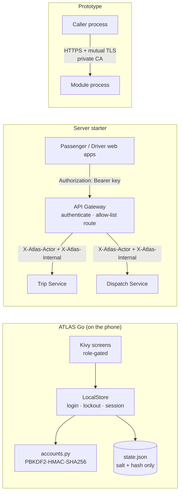
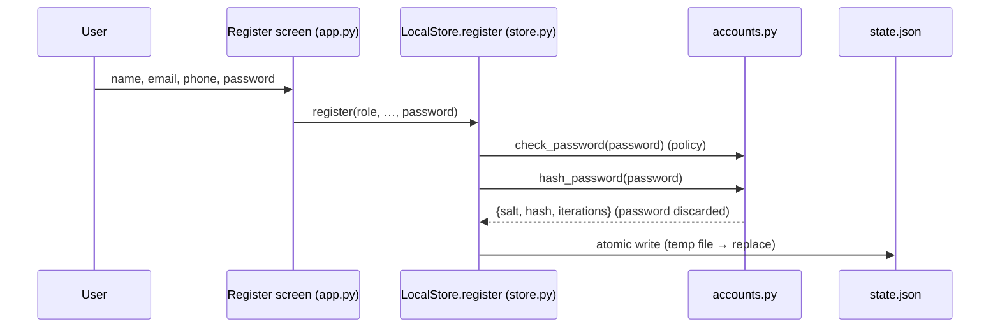
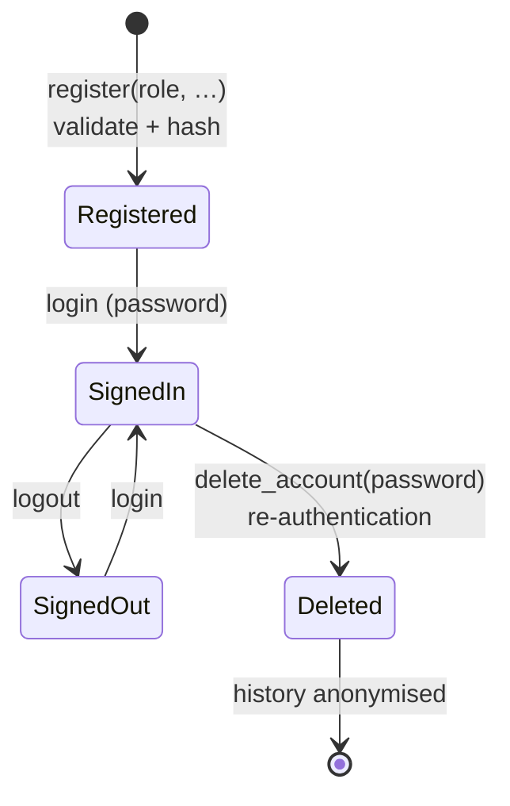
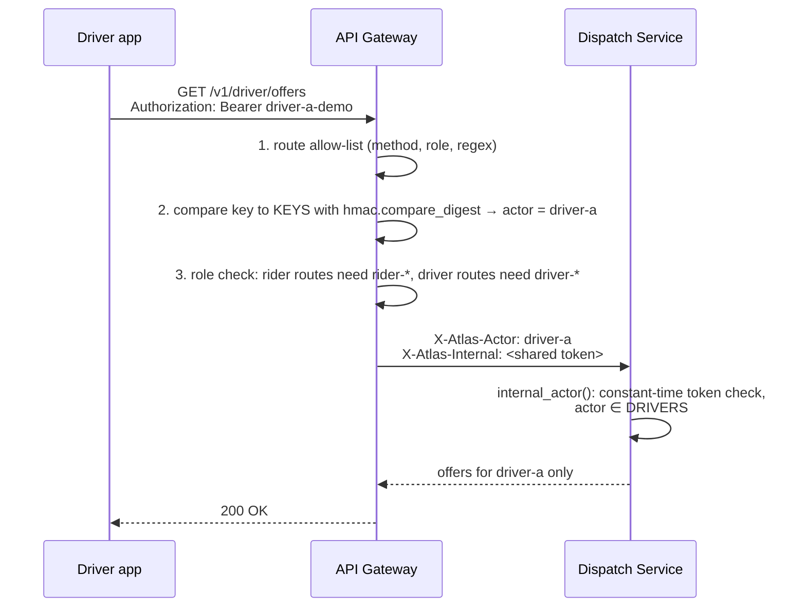
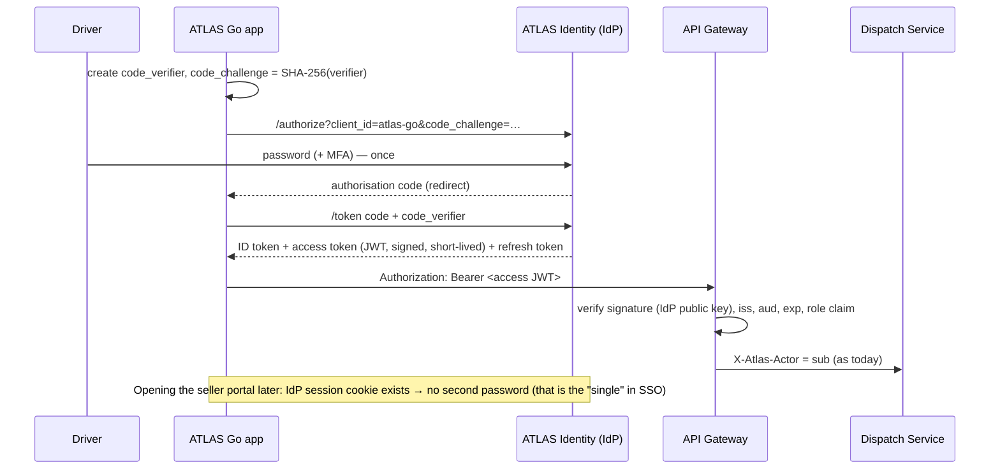
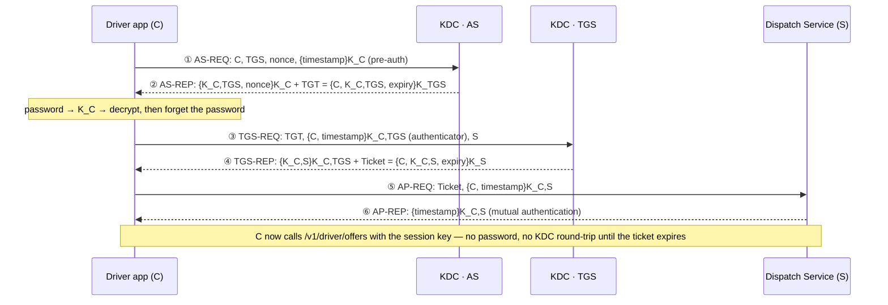
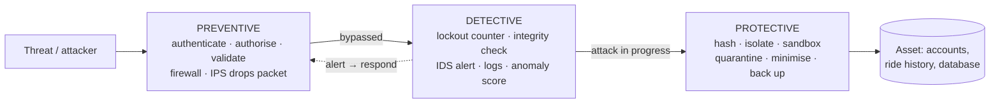
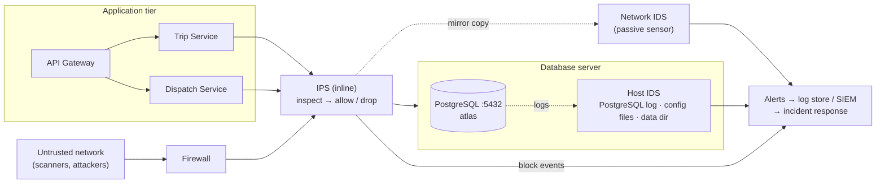

# Information Security in ATLAS — a teaching guide

This guide uses ATLAS as a worked example for teaching information security. It covers
**authentication, password storage, identity management, access control, single sign-on (SSO),
Kerberos, transport security, secure deployment and security control measures (preventive,
detective and protective, including the IDS and IPS on the database server)**, and points every
claim at the line of code that implements it.

> **Read this first — what is implemented and what is a teaching extension.**
> Every section is labelled with one of four tags.
>
> | Tag | Meaning |
> |---|---|
> | ✅ **Implemented** | Runs in this repository today; the file and function are named. |
> | 🧪 **Demo-grade** | Implemented, but with deliberately simple choices (shared demo keys, static tokens) that must change before production. Useful for "find the weakness" exercises. |
> | 🎓 **Teaching extension** | **Not** in the ATLAS code. Shows how a standard mechanism (SSO, Kerberos) would plug into the ATLAS components. The [Architecture Explorer → Security view](https://fullscipts.github.io/ATLAS/#security) runs it live in the browser. |
> | 🖥️ **Host deployment** | Installed and configured on the server host itself (operating system / network level), **outside** this repository. The guide explains its role and gives reference configuration; the repository holds no rules or agents for it. |
>
> ATLAS does **not** contain Kerberos, SSO or OAuth/OIDC code. Those sections are mappings of the
> standard protocols onto ATLAS's real components so students can see where each message would go.
> Likewise, the intrusion detection system (IDS) and intrusion prevention system (IPS) in
> [§11.5](#115-ids-and-ips-on-the-database-server---host-deployment) run on the server that holds
> the PostgreSQL database; they are host controls, not application code.

**Interactive companion:** [ATLAS Architecture Explorer → Security](https://fullscipts.github.io/ATLAS/#security) —
hash a password with the exact ATLAS parameters, trip the login lockout, step through the gateway's
authentication, and run a live Kerberos exchange (with replay, clock-skew, tampering and expiry
attacks) using real AES-GCM in your browser.

**Command-line lab:** `python3 security_lab/password_storage_demo.py` runs 20 experiments against
the app's real `accounts.py` and `store.py` (no extra dependencies). `--list` shows them; `--path NAME`
runs a study path; `-e N` runs one experiment. Each category is also its own file, runnable alone:
`lab_a_password_storage.py` (1-8), `lab_b_registration_identity.py` (9-11), `lab_c_signin_defences.py`
(12-15) and `lab_d_integrity_lifecycle.py` (16-20); [security_lab/README.md](../security_lab/README.md)
indexes them.

| Study path | Experiments | Question it answers |
|---|---|---|
| `foundations` | 1, 2, 3, 7, 8 | What exactly is stored, and why can nobody read the password back? |
| `attacker` | 4, 5, 6, 13, 14, 15 | How fast can a stolen file or a login screen be attacked, and what leaks? |
| `defender` | 9, 10, 11, 12, 13, 16 | Which controls run at registration and sign-in? |
| `integrity` | 8, 17, 18, 19 | How does the app keep its stored data trustworthy? |
| `lifecycle` | 9, 1, 12, 16, 19, 20 | One user from sign-up to deletion, plus rehash-on-login |

Groups: **A** what is stored (1-8: anatomy, salting, verification, work factor, guess-rate arithmetic,
dictionary attack, policy matrix, file forensics); **B** registration and identity (9-11: input
validation, one identity per email, role separation); **C** sign-in defences (12-15: lockout timeline,
no enumeration by message, timing side channel and the dummy-hash fix, limits of an in-memory per-email
lockout); **D** integrity and lifecycle (16-20: sessions, tamper quarantine, atomic save and rollback,
account deletion, upgrading old hashes). Several experiments surface real gaps (timing leak, lockout
reset on restart, `iterations=0` raising instead of failing closed) for students to fix in session 9.

---

## Contents

1. [The security map of ATLAS](#1-the-security-map-of-atlas)
2. [How user passwords are stored](#2-how-user-passwords-are-stored---implemented)
3. [Authentication on the phone: login, lockout, sessions](#3-authentication-on-the-phone-login-lockout-sessions---implemented)
4. [Identity management: the account lifecycle](#4-identity-management-the-account-lifecycle---implemented)
5. [Authorisation: role-based access control](#5-authorisation-role-based-access-control---implemented)
6. [Service authentication at the API gateway](#6-service-authentication-at-the-api-gateway---demo-grade)
7. [Single sign-on (SSO) for ATLAS](#7-single-sign-on-sso-for-atlas---teaching-extension)
8. [Kerberos, step by step, on ATLAS components](#8-kerberos-step-by-step-on-atlas-components---teaching-extension)
9. [Transport security: mutual TLS in the prototype](#9-transport-security-mutual-tls-in-the-prototype---implemented)
10. [Secure deployment and supply chain](#10-secure-deployment-and-supply-chain---implemented)
11. [Control measures: preventive, detective and protective](#11-control-measures-preventive-detective-and-protective)
    - [11.5 IDS and IPS on the database server](#115-ids-and-ips-on-the-database-server---host-deployment)
12. [Known gaps — exercises for students](#12-known-gaps--exercises-for-students)
13. [Suggested lesson plan](#13-suggested-lesson-plan)

---


## Standalone illustrated foundations — Information Security

This chapter explains each principle from the beginning, with concrete examples and diagrams. The 20 source experiments exercise ATLAS's actual local application controls. The two visualizations created for each experiment must be interpreted separately: **observed runtime/status** versus **illustrative model (not measured)**.

### S1 — Information security, CIA and threat modelling

The **CIA triad** is **confidentiality** (prevent unauthorized disclosure), **integrity** (detect or stop unauthorized changes) and **availability** (continue providing service). An **asset** is something worth protecting; a **threat** is a possible harmful event; a **vulnerability** is a weakness; a **control** reduces risk. Risk depends on likelihood and impact. A locked account is not enough if its ride history is exposed in a readable file.

~~~mermaid
flowchart LR
 ASSET["Asset: rider account/history"] --> THREAT["Threat: device/file theft"]
 THREAT --> WEAK["Weakness: unencrypted local state"]
 WEAK --> RISK["Risk: disclosure"]
 RISK --> CTRL["Controls: minimize, protect storage, monitor"]
~~~

The ATLAS Go state file is not encrypted at rest. Password hashing protects the verifier against direct reversal but does not encrypt unrelated personal data. **Labs S01,S08,S17.**

### S2 — Identity, authentication, authorization and accountability

**Identification** is claiming an account; **authentication** verifies evidence (password, token, physical authenticator); **authorization** decides permitted operations; **accountability** logs events for audit. Authentication alone does not grant all permissions.

~~~mermaid
flowchart TD
 I["Claim email / identity"] --> A["Verify credential"]
 A --> SESSION["Establish session"]
 SESSION --> ROLE["Resolve role"]
 ROLE --> CHECK["Authorize method"]
 CHECK --> AUDIT["Security event / result"]
~~~

A passenger may book, a driver may accept, a seller may update a menu. ATLAS Go checks roles in app screens and store operations. **Labs S09–S11,S16.**

### S3 — Password storage, salt, PBKDF2 and offline attacks

Passwords should not be stored in plaintext or via reversible encryption alone. A **salt** is a random per-user value; the app stores salt, iteration count and **password-derived verifier**. ATLAS Go uses PBKDF2-HMAC-SHA256 with 16-byte salts and 200,000 iterations. An attacker who steals the file may still guess offline; increasing iterations increases attacker cost per guess and legitimate login cost. Password distribution matters more than simplistic character-count entropy.

~~~mermaid
flowchart LR
 PASSWORD["Password"] --> KDF["PBKDF2-HMAC-SHA256"]
 SALT["16-byte random salt"] --> KDF
 ITER["200,000 iterations"] --> KDF
 KDF --> RECORD["Stored verifier"]
~~~

~~~python
import hashlib, hmac, secrets
password=b"Classroom-Example"
salt=secrets.token_bytes(16)
saved=hashlib.pbkdf2_hmac("sha256",password,salt,200000)
candidate=hashlib.pbkdf2_hmac("sha256",password,salt,200000)
assert hmac.compare_digest(saved,candidate)
~~~

**Offline** password guessing happens against a copied record and is not prevented by online account lockout. **Online** guessing goes through the login interface, where rate limits can help. **Labs S01–S08.**

### S4 — Input validation, registration and unique identities

**Validation** restricts formats, lengths and allowable values. **Normalization** makes representations consistent, but must follow a documented rule; Unicode and email-case equivalence are subtle. **Uniqueness** prevents two accounts from claiming an identity under the app's policy. Validation does not prove that a user actually owns an email address or phone number.

~~~mermaid
flowchart TD
 INPUT["Registration details"] --> FORMAT["Format, length, range checks"]
 FORMAT --> NORMAL["Approved normalization"]
 NORMAL --> UNIQUE["Identity uniqueness"]
 UNIQUE --> ROLE["Role-specific requirements"]
 ROLE --> COMMIT["Create account"]
~~~

**Labs S09 and S10** check validators and duplicate cases against real application code.

### S5 — RBAC, least privilege and state machines

**Role-based access control (RBAC)** maps roles to permissions. **Least privilege** means granting only needed powers. Never rely only on hiding a UI button: the underlying operation must enforce the rule too.

~~~mermaid
flowchart LR
 P["Passenger"] --> B["Book ride / food"]
 D["Driver"] --> R["Accept or advance job"]
 S["Seller"] --> M["Edit kitchen menu"]
 GUARD["Store-layer permission checks"] --> B
 GUARD --> R
 GUARD --> M
~~~

A ride's **state machine** controls legal transitions (pending→accepted→in progress→complete) but is not itself a queue data structure. **Lab S11.**

### S6 — Sign-in, lockout, account enumeration and timing attacks

ATLAS Go has a five-failure login lockout lasting 60 seconds. A **lockout counter** makes online guessing harder, but its effectiveness depends on persistence and whether it counts per account, device, source or other scope. ATLAS Go's counter is stored **in memory**, so restarting resets it. **Account enumeration** occurs when error text or time identifies whether a user exists; uniform error messages help but are not sufficient if unknown emails skip expensive password work.

~~~mermaid
stateDiagram-v2
 [*] --> Ready
 Ready --> Ready: failures 1..4
 Ready --> Locked: failure 5
 Locked --> Ready: 60-second interval expires
 Ready --> SignedIn: valid login
~~~

A **constant-time comparison** limits data-dependent comparison leakage but does not automatically equalize total login-processing time. A dummy hash may reduce one side channel; distributed protection requires stronger rate controls. **Labs S12–S15.**

### S7 — Sessions, guest state, logout and deletion

A **session** records authenticated state. It needs rules for validity, expiry, revocation and role changes. Logout should clear that state. Deletion requires suitable reauthentication and appropriate treatment of linked history. A guest should never acquire a logged-in user's privileges.

~~~mermaid
flowchart TD
 REG["Register"] --> LOGIN["Login"]
 LOGIN --> ACTIVE["Session active"]
 ACTIVE --> LOGOUT["Logout"]
 ACTIVE --> DELETE["Reauthenticate, delete account"]
 DELETE --> ANON["Anonymize relevant history"]
~~~

The ATLAS Go phone app uses local sessions; a hardened multi-device back end would need server-side token and revocation design. **Labs S16,S19,S20.**

### S8 — Saved-state validation, atomic writes and integrity

**Schema validation** verifies structure, allowable field values and invariants. **Atomic updates** use temporary-file replacement so a failed disk write need not leave half-written state. These controls help consistency but do not supply a cryptographic MAC against an attacker capable of rewriting valid-looking JSON.

~~~mermaid
flowchart LR
 OLD["Existing consistent file"] --> COPY["Prepare update"]
 COPY --> VALIDATE["Validate invariants"]
 VALIDATE --> TMP["Write temporary file"]
 TMP --> REPLACE["Atomic replace"]
 REPLACE --> NEW["Consistent saved state"]
~~~

ATLAS Go LocalStore demonstrates load, validate and commit. **Labs S08,S17,S18.**

### S9 — Secure APIs, gateways and bearer tokens

A **bearer credential** grants access to whoever possesses it. API gateways must authenticate external callers and avoid trusting unverified identity headers. Each internal service should verify the identity context and authorize the particular operation. TLS protects secrets in transit; secure storage, rotation, expiry and scopes matter.

~~~mermaid
sequenceDiagram
 participant Client
 participant Gateway
 participant Service
 Client->>Gateway: Request + credential
 Gateway->>Gateway: Authenticate and check route
 Gateway->>Service: Verified identity assertion
 Service->>Service: Authorize operation
 Service-->>Client: Result
~~~

The separate ATLAS architecture starter has a **demo-grade** gateway. The Android app itself does not run this live server back end today.

### S10 — SSO, OAuth 2.0 and OIDC

**Single sign-on (SSO)** means using one login to access several relying applications. **OAuth 2.0** is an authorization framework; **OpenID Connect (OIDC)** adds authentication and identity claims. An **access token** authorizes resource access; an **ID token** conveys authentication claims. For mobile/public clients, authorization-code flow with **PKCE** mitigates intercepted authorization codes.

~~~mermaid
sequenceDiagram
 participant App
 participant IdP as Identity provider
 participant API
 App->>IdP: Authorization request + PKCE challenge
 IdP-->>App: Code after authentication
 App->>IdP: Code + PKCE verifier
 IdP-->>App: Tokens
 App->>API: Access token
 API-->>App: Allowed response
~~~

Verify issuer, audience, expiration, signature, authorized redirect and nonce where needed. This is a **teaching extension**, not a feature deployed in ATLAS Go.

### S11 — Kerberos tickets and its six-message exchange

A Kerberos **Key Distribution Center** has an Authentication Service (AS) and Ticket Granting Service (TGS). A client obtains a ticket-granting ticket, exchanges it for a service ticket, and authenticates to the service, typically without passing a reusable password to that service. Freshness, clock synchronization and protected long-term keys matter.

~~~mermaid
sequenceDiagram
 participant C as Client
 participant AS
 participant TGS
 participant S as Service
 C->>AS: 1 AS-REQ
 AS-->>C: 2 AS-REP
 C->>TGS: 3 TGS-REQ
 TGS-->>C: 4 TGS-REP
 C->>S: 5 AP-REQ
 S-->>C: 6 AP-REP
~~~

The ATLAS explorer includes a teaching demonstration. Kerberos is not deployed as Android-app authentication.

### S12 — TLS, mTLS and certificate verification

**TLS** authenticates an endpoint and negotiates protected communication. HTTPS checks the server certificate; **mutual TLS (mTLS)** also requires a client certificate. Certificate validation must verify trusted issuer/chain, hostname/SAN, validity times and key usage. Certificate authentication is distinct from application authorization.

~~~mermaid
sequenceDiagram
 participant Client
 participant Server
 Client->>Server: ClientHello / key share
 Server-->>Client: ServerHello / certificate
 Client->>Client: Validate certificate and identity
 Client->>Server: Finished / client cert if mTLS
 Server-->>Client: Encrypted application data
~~~

This is a simplified conceptual handshake, not a complete TLS 1.3 protocol transcript. ATLAS Go fetches map tiles via HTTPS; the research prototype demonstrates mutual TLS.

### S13 — Supply chain, deployed secrets and boundaries

Build signing protects artifact provenance under trust assumptions, not software correctness. Controls include least-privilege CI, protected signing keys, content-addressed dependencies, release verification, restricted server exposure, secret rotation and audit. Separate **implemented**, **demo-grade** and **teaching-only** functionality: static internal gateway keys and unencrypted phone files are not hardened production patterns.

~~~mermaid
flowchart LR
 CODE["Reviewed source"] --> BUILD["Restricted CI build"]
 BUILD --> HASH["Hash artifacts"]
 HASH --> SIGN["Sign with protected key"]
 SIGN --> VERIFY["Verify before install"]
~~~

### S14 — Each information-security experiment: illustrative and observed results

The original numbered source lab runs the real code. The **observed PNG** reports measured elapsed seconds and exit status. The **conceptual PNG/CSV** shows a clearly marked explanatory model (not a measured output). Full source stdout/stderr is preserved in per-test logs.

| Exp. | Real test | Illustration / discussion |
|---|---|---|
| S01 | Stored credential anatomy | Salt and verifier vs plaintext |
| S02 | Unique per-account salt | Why salted hashes differ |
| S03 | Verification behavior | Constant-time comparison and malformed input |
| S04 | Work-factor sweep | Iterations versus per-guess cost |
| S05 | Guess-space arithmetic | Offline password strength assumptions |
| S06 | Dictionary attack demonstration | Offline guesses versus stored verifier |
| S07 | Password policy cases | Accepted/rejected classes |
| S08 | State-file forensics | What plaintext data remains |
| S09 | Input checks | Allow/reject boundaries |
| S10 | Duplicate email | Canonical identity policy |
| S11 | RBAC | Passenger/driver/seller permissions |
| S12 | Login lockout | Count and duration |
| S13 | Error-message consistency | Account enumeration |
| S14 | Timing difference | Dummy hashing versus no work |
| S15 | In-memory reset | Restart and persistent controls |
| S16 | Session lifecycle | Guest and account sessions |
| S17 | Tampered JSON | Validation versus cryptographic integrity |
| S18 | Atomic save | Rollback and crash safety |
| S19 | Deletion and history | Reauth and anonymization |
| S20 | Password hash upgrade | Iteration migration at login |

**Use [Information Security Colab](https://colab.research.google.com/github/FUllSCIPTS/ATLAS/blob/main/security_lab/Information_Security_Colab_Labs.ipynb)** for all 20 experiments, logs, actual timing/status charts and separately identified conceptual graphs. **Report:** threat/asset → assumption → source function → expected defense → observed result → timing and test status → conceptual explanation → limitations and improvements.

---

## 1. The security map of ATLAS

ATLAS has three runnable parts, and each teaches a different layer of security.

| Part | Where | Security topics it demonstrates |
|---|---|---|
| **ATLAS Go** Android app | [`android-app/atlas_go/`](../android-app/atlas_go/) | Password hashing (PBKDF2), login throttling, sessions, identity lifecycle, role-based screens, privacy-by-design |
| **Server starter** (FastAPI · PostgreSQL · Kafka) | [`architecture-explorer/starter/`](https://github.com/FUllSCIPTS/ATLAS/tree/architecture-explorer/architecture-explorer/starter) | API gateway authentication, bearer keys, constant-time comparison, route allow-listing, identity propagation to internal services |
| **Prototype** + **Explorer server** | [`prototype.zip`](../prototype.zip), [`architecture-explorer/server.mjs`](https://github.com/FUllSCIPTS/ATLAS/blob/architecture-explorer/architecture-explorer/server.mjs) | Mutual TLS with a private CA, HTTP security headers (CSP), loopback binding + SSH tunnel, systemd sandboxing, signed releases |



---

## 2. How user passwords are stored — ✅ Implemented

**File:** [`android-app/atlas_go/accounts.py`](../android-app/atlas_go/accounts.py) — `hash_password`, `verify_password`, `check_password`, `public_view`.

ATLAS Go **never stores a password**. On registration it stores three values:

```json
{
  "salt": "9f2c…(16 random bytes, hex)",
  "hash": "4b1e…(32 bytes, hex)",
  "iterations": 200000
}
```

### The algorithm

```python
PBKDF2_ITERATIONS = 200_000

def hash_password(password, salt=None, iterations=PBKDF2_ITERATIONS):
    salt = salt or secrets.token_bytes(16)                       # 1. fresh random salt per account
    digest = hashlib.pbkdf2_hmac('sha256', password.encode('utf-8'),
                                 salt, iterations)               # 2. slow, salted key derivation
    return dict(salt=salt.hex(), hash=digest.hex(), iterations=iterations)

def verify_password(password, record):
    ...                                                          # 3. recompute with the stored salt
    digest = hashlib.pbkdf2_hmac('sha256', password.encode('utf-8'), salt, iterations)
    return hmac.compare_digest(digest, expected)                 # 4. constant-time comparison
```

| Design choice | What it defends against | Teaching point |
|---|---|---|
| **Hash, not encrypt** | Anyone who reads `state.json` (backup, rooted phone) cannot reverse it | Encryption is reversible with a key; a password store should be one-way |
| **Random 16-byte salt per account** (`secrets.token_bytes`) | Rainbow tables; spotting two users with the same password | Same password → different hash. `test_password_hash_roundtrip_and_salt` proves it |
| **PBKDF2-HMAC-SHA256, 200 000 iterations** | Offline brute force after a leak | Each guess costs 200 000 HMACs; the attacker pays that for every guess |
| **Iterations stored with the hash** | Lets the work factor be raised later without breaking old accounts | "Upgrade on next login" pattern |
| **`hmac.compare_digest`** | Timing side channel | A normal `==` returns early on the first differing byte |
| **`public_view()` strips `salt`, `hash`, `iterations`** | Accidental display/logging of secrets | Data minimisation at the presentation boundary |
| **Password policy** (`check_password`): 8–128 chars, ≥1 letter and ≥1 digit | Trivial passwords; denial-of-service via huge inputs | Upper bound matters: PBKDF2 cost grows with input |
| **Form field cleared after submit** (`app.py`, `submit_login` pops `login_password`) | Password lingering in UI state | Minimise secret lifetime in memory |

**Registration → storage flow**



> **Discussion:** OWASP's current guidance for PBKDF2-HMAC-SHA256 is 600 000 iterations, and it
> prefers memory-hard Argon2id. ATLAS uses 200 000 because PBKDF2 is in the Python standard library
> and must run on low-end phones. Ask students to measure the cost on a phone and argue the trade-off
> (see [§12](#12-known-gaps--exercises-for-students)).

---

## 3. Authentication on the phone: login, lockout, sessions — ✅ Implemented

**File:** [`android-app/atlas_go/store.py`](../android-app/atlas_go/store.py) — `LocalStore.login`, `logout`, `continue_as_guest`.

```python
def login(self, email, password, now=None):
    count, until = self.failures.get(email, [0, 0])
    if until > now:                                    # locked out?
        raise ValueError('Too many attempts. Try again in N seconds.')
    account = next((a for a in self.accounts if a['email'] == email), None)
    if account is None or not acc.verify_password(password or '', account):
        count += 1                                     # 5 failures → 60 s lock
        ...
        raise ValueError('Email or password is not correct.')   # same message either way
    self.failures.pop(email, None)
    self.session = account['id']                       # session = account id
```

| Control | Value | Why |
|---|---|---|
| Failed-attempt limit | `MAX_FAILED_LOGINS = 5` | Slows online guessing |
| Lockout window | `LOCKOUT_SECONDS = 60` | Temporary, so a guesser cannot permanently lock a real user out |
| Generic error | "Email or password is not correct." for unknown email **and** wrong password | Prevents **user enumeration** |
| Session | `session` = account id, persisted in `state.json`; validated on load (`validate`: session must reference an existing account) | A stale or forged session id is discarded |
| Guest mode | `continue_as_guest` — no identity, passenger features only | Least privilege for anonymous use |

**Authentication factors.** ATLAS Go uses one factor: *something you know*. The phone itself is an
implicit *something you have* (accounts live only on that device). Multi-factor authentication is an
exercise in §12.

---

## 4. Identity management: the account lifecycle — ✅ Implemented

**Files:** `accounts.py` (validation), `store.py` (`register`, `login`, `logout`, `delete_account`, `reset`), [`docs/PRIVACY.md`](../android-app/docs/PRIVACY.md).



| Lifecycle stage | ATLAS implementation | IAM concept |
|---|---|---|
| **Identity proofing** | Email, phone (normalised to E.164), driver SPSV licence, vehicle plate, food-business number are **format-checked only** — self-declared, not verified with an authority | Identity assurance level: ATLAS is at the lowest level. A production service would verify with the issuing authority |
| **Unique identifier** | `id = U-<nanoseconds>`; email unique (enforced in `validate`) | Separate stable internal id from the login name |
| **Roles** | `ROLES = ('passenger', 'driver', 'seller')`, fixed at registration | Role assignment at provisioning |
| **Credential** | Salted PBKDF2 hash (§2) | Credential storage |
| **Re-authentication** | `delete_account(password)` asks for the password again | Step-up authentication for destructive actions |
| **De-provisioning** | Account removed; ride history kept with `passenger='deleted'`; seller kitchen closed and registration set to `REMOVED` | Right to erasure while keeping non-personal records |
| **Data minimisation** | Location stored only after the driver taps *Use my phone location*; overwritten each fix | Privacy by design (GDPR Art. 25) |

---

## 5. Authorisation: role-based access control — ✅ Implemented

Authentication says **who** you are; authorisation says **what you may do**. ATLAS enforces RBAC in
two places, at two layers — a good example of defence in depth.

**UI layer** — `app.py`, `render()`:

```python
allowed = {'driver': ('driver','map','activity','profile','privacy','intelligence','account'),
           'seller': ('seller','seller_menu','activity','profile','privacy','intelligence','account')}
if self.store.user and self.store.role in allowed and self.screen not in allowed[self.store.role]:
    self.screen = self.home_screen()        # a driver cannot open the food basket
```

**Business-rule layer** — `store.py` re-checks the role on every command, so a UI bug cannot grant access:

| Command | Rule |
|---|---|
| `book`, `checkout` | Only passengers or guests |
| `set_online`, `update_location`, `driver_respond` | Only `role == 'driver'` |
| `add_dish`, `seller_accept`, `seller_ready` | Only the seller who owns that kitchen |

| Role | May | May not |
|---|---|---|
| Passenger | Book rides, share rides, order food | Go online, edit menus |
| Driver | Go online, accept/decline offers, advance trips | Book rides, order food |
| Food seller | Edit own menu, accept and ready orders | Book rides, see other kitchens' orders |

---

## 6. Service authentication at the API gateway — 🧪 Demo-grade

**Files:** [`starter/services/gateway.py`](https://github.com/FUllSCIPTS/ATLAS/blob/architecture-explorer/architecture-explorer/starter/services/gateway.py), [`starter/packages/config.py`](https://github.com/FUllSCIPTS/ATLAS/blob/architecture-explorer/architecture-explorer/starter/packages/config.py), `services/trips.py`, `services/dispatch.py`.

The starter follows the **gateway pattern**: clients authenticate once at the edge, and internal
services trust an identity the gateway asserts. This is the same shape as SSO and Kerberos, which is
why it is a good bridge to §7–§8.



| Step | Code | Control |
|---|---|---|
| 1 | `ROUTES` table with `re.fullmatch` on path, exact method and role | **Allow-listing**: unknown routes → 404 before any auth work |
| 2 | `equal(key, expected)` → `hmac.compare_digest` | Bearer-key authentication, timing-safe |
| 3 | `(role == "rider") != actor.startswith("rider-")` → 401 | A driver key cannot call rider routes |
| 4 | Gateway sets `X-Atlas-Actor` and `X-Atlas-Internal`; clients cannot choose them because the gateway overwrites the header set | **Identity propagation** |
| 5 | `internal_actor()` in each service re-checks the internal token and the actor's role → 403 | **Zero-trust-ish**: services do not trust the network alone |
| — | Body limit 8 KiB → 413; `Idempotency-Key` forwarded | Abuse resistance; safe retries |

**Why it is demo-grade:** keys default to `rider-demo`, `driver-a-demo`, … and the internal token to
`local-internal-only` unless environment variables override them; the internal token is one static
shared secret and travels over plain HTTP between containers. §7 and §8 show the standard fixes.

---

## 7. Single sign-on (SSO) for ATLAS — 🎓 Teaching extension

**Not implemented in ATLAS.** ATLAS has several front ends — the passenger app, the driver app, the
seller kitchen, the Architecture Explorer — each of which would otherwise need its own password.
SSO lets one **Identity Provider (IdP)** authenticate the user once and issue tokens that every ATLAS
front end and the gateway accept.

**Mapping onto ATLAS (OpenID Connect, authorisation-code flow with PKCE — the standard for mobile apps):**

| SSO role | ATLAS component |
|---|---|
| End user | Passenger, driver or seller |
| Relying party / client | ATLAS Go app, driver web app, seller portal, Explorer |
| Identity Provider (IdP) | A new *ATLAS Identity* service (e.g. Keycloak) or the university IdP (SAML/Shibboleth) |
| Resource server | API Gateway → Trip and Dispatch services |
| Token claims | `sub` = account id, `role` = passenger/driver/seller |



**What would change in the code:** `KEYS` + `equal()` in `gateway.py` become JWT signature/claim
validation; `X-Atlas-Internal` becomes a gateway-signed token or mTLS (§9); the app stores the
refresh token in the Android Keystore (already listed under *Identity* in
[`android-app/docs/ARCHITECTURE.md`](../android-app/docs/ARCHITECTURE.md) → server roadmap).

**SSO trade-offs to discuss:** one password to remember and one place to enforce MFA and revoke
access (good); the IdP becomes a single point of failure and a high-value target (bad); logout must
propagate to every relying party.

---

## 8. Kerberos, step by step, on ATLAS components — 🎓 Teaching extension

**Not implemented in ATLAS.** Kerberos is the classic *trusted third party* SSO protocol (MIT,
RFC 4120; used by Windows Active Directory). It uses **only symmetric keys and tickets**: the user's
password never crosses the network, and services never see it.

### Cast — mapped onto ATLAS

| Kerberos principal | ATLAS stand-in | Long-term key |
|---|---|---|
| Client `C` | Driver `driver-a` using the driver app | `K_C` = key derived from the driver's password (string-to-key; ATLAS would reuse PBKDF2) |
| Authentication Server (AS) | ATLAS Identity — AS half | knows `K_C` |
| Ticket-Granting Server (TGS) | ATLAS Identity — TGS half | `K_TGS` (the `krbtgt` key) |
| Service `S` | Dispatch Service (`HTTP/dispatch.atlas`) | `K_S`, shared only with the KDC |

The AS and TGS together are the **Key Distribution Centre (KDC)**.

### The six messages



| # | What happens in ATLAS terms | Security property |
|---|---|---|
| ① | Driver app proves knowledge of the password by encrypting the current time with `K_C` | **Pre-authentication** stops offline guessing on an AS-REP for any user name |
| ② | KDC returns a TGT the app cannot read (sealed with `K_TGS`) and a session key the app can | Password used **once per day**, then discarded |
| ③ | App asks for a ticket to Dispatch, proving freshness with an **authenticator** | **Replay protection**: timestamp must be within ±5 min and not seen before (replay cache) |
| ④ | TGS issues a ticket sealed with Dispatch's key | Dispatch can verify it **without contacting the KDC** |
| ⑤ | App presents ticket + new authenticator to Dispatch | Dispatch learns `driver-a` and the session key from the ticket |
| ⑥ | Dispatch returns `timestamp` encrypted under the session key | **Mutual authentication**: the app knows it reached the real Dispatch |

### How it compares to what ATLAS does today (§6)

| Today (gateway + bearer keys) | With Kerberos |
|---|---|
| Static key sent on every request | Short-lived tickets; password never sent |
| Gateway is the trusted third party | KDC is the trusted third party |
| `X-Atlas-Internal` shared by all services | Each service has its own key `K_S`; a compromised Trip Service cannot mint tickets for Dispatch |
| No replay protection | Authenticator timestamps + replay cache |
| No mutual authentication | AP-REP proves the service's identity |

**Run it live:** the [Explorer → Security → Kerberos](https://fullscipts.github.io/ATLAS/#security-kerberos)
tab performs all six messages in real time with AES-GCM (Web Crypto) and PBKDF2 for the
string-to-key step, shows every ciphertext, and lets you trigger **wrong password**, **replayed
authenticator**, **clock skew**, **tampered ticket** and **expired ticket** to see which check fails.

**Kerberos weaknesses to discuss:** the KDC is a single point of failure and compromise
(golden-ticket attacks if `K_TGS` leaks); tight clock synchronisation is required; Kerberoasting
(offline cracking of service tickets for services with weak keys).

---

## 9. Transport security: mutual TLS in the prototype — ✅ Implemented

**File:** `prototype/proto_run.py` and `prototype/module_server.py` (in [`prototype.zip`](../prototype.zip)).

The prototype measures the cost of moving a module out of process. When it does, the two processes
authenticate **each other** with certificates from a private CA:

| Step | Code | Teaching point |
|---|---|---|
| Private CA | `openssl req -x509 … -subj /CN=atlas-ca` with `CA:TRUE`, `keyCertSign` | Root of trust you control |
| Server cert | `extendedKeyUsage=serverAuth`, `subjectAltName=IP:127.0.0.1` | Hostname/IP binding |
| Client cert | `extendedKeyUsage=clientAuth` | A server cert cannot be used as a client cert |
| Server | `ctx.verify_mode = ssl.CERT_REQUIRED`, `load_verify_locations(ca.crt)` | **Mutual** TLS: no client certificate → handshake fails |
| Client | `ssl.create_default_context(cafile=ca.crt)` + `load_cert_chain` | Verifies the server and presents its own identity |
| Lifetime | `-days 30`, generated at run time, not committed | Short-lived credentials, no secrets in Git |

The paper's prototype results (`results/prototype.json`) quantify the cost: HTTPS+mTLS keep-alive
vs plain HTTP, and the full handshake on a new connection — a concrete answer to "what does
security cost?".

mTLS is the standard fix for the starter's static `X-Atlas-Internal` token (§6).

---

## 10. Secure deployment and supply chain — ✅ Implemented

**Explorer server** — [`architecture-explorer/server.mjs`](https://github.com/FUllSCIPTS/ATLAS/blob/architecture-explorer/architecture-explorer/server.mjs) and `deploy/atlas-explorer.service`:

| Control | Setting | Threat addressed |
|---|---|---|
| Bind to loopback | `127.0.0.1:8080` | Not reachable from the network |
| Remote access | SSH tunnel (`ssh -L 8080:127.0.0.1:8080 …`) | Reuses SSH's strong authentication instead of adding a login page |
| Method allow-list | Only `GET`, `HEAD` → others 405 | Smaller attack surface |
| Static asset map | Only an explicit list of named files (`contentTypes`), loaded into memory at start-up | No path traversal; nothing else on disk is reachable |
| `Content-Security-Policy` | `default-src 'none'; script-src 'self'; frame-ancestors 'none'; form-action 'none'` | XSS, clickjacking, data exfiltration via forms |
| Other headers | `X-Content-Type-Options: nosniff`, `Referrer-Policy: no-referrer`, `Cache-Control: no-store` | MIME sniffing, URL leakage, cached content |
| systemd sandbox | `DynamicUser=yes`, `NoNewPrivileges=yes`, `ProtectSystem=strict`, `ProtectHome=yes`, `PrivateTmp=yes` | Least privilege if the process is compromised |

**Android release integrity** — [`android-app/releases/`](../android-app/releases/):
APK v2/v3 signatures, `SHA256SUMS` for every artefact, a published upload certificate, and a
release manifest. Students can verify a download with `sha256sum -c SHA256SUMS` and
`apksigner verify --print-certs`. Integrity (the "I" in CIA) applied to software distribution.

**App storage** — `state.json` lives in Android's app-private directory (sandboxed per app UID) and is
written atomically; a damaged file is quarantined as `state.invalid.json` (integrity and availability).

---

## 11. Control measures: preventive, detective and protective

Sections 2–10 describe individual mechanisms. This section regroups them by **what each control
does to an attack**, which is how security controls are selected, audited and reported (ISO/IEC
27001 Annex A tags each control as preventive, detective or corrective; the NIST Cybersecurity
Framework uses the functions *Protect*, *Detect*, *Respond* and *Recover*).

### 11.1 What a control measure is

A **control measure** (or *safeguard*) is any technical, administrative or physical measure that
reduces risk — either the **likelihood** that a threat exploits a vulnerability, or the **impact**
when it does (§S1). Classified by function:

| Type | Question it answers | Acts on | Typical examples |
|---|---|---|---|
| **Preventive** | *Can we stop the attack from succeeding?* | Likelihood — **before** the event | Authentication, access control, input validation, firewalls, **IPS**, patching |
| **Detective** | *Will we know that an attack is happening or has happened?* | Time-to-discovery — **during / after** the event | Logs and audit trails, integrity checks, failed-login counters, **IDS**, anomaly detection |
| **Protective** | *If an attacker gets in, how much can they take or damage, and can we recover?* | Impact — **limits the blast radius** | Hashing and encryption at rest, isolation and sandboxing, least privilege, backups, quarantine, data minimisation |

No single type is sufficient. Preventive controls eventually fail; detective controls are useless if
nobody can act on the alert; protective controls assume the first two have already been bypassed.
Layering all three around the same asset is **defence in depth**.



### 11.2 Preventive controls in ATLAS

| Control | Where | Status | Threat it prevents |
|---|---|---|---|
| Password policy (8–128 chars, letter + digit) | `accounts.py` → `check_password` | ✅ Implemented | Trivial passwords; DoS via huge PBKDF2 inputs |
| Login lockout (5 failures → 60 s) | `store.py` → `LocalStore.login` | ✅ Implemented | Online password guessing |
| Generic login error + dummy-hash option | `store.py`; lab experiments 13–14 | ✅ / exercise | Account enumeration by message or timing |
| Input validation and unique email | `accounts.py`, `store.py` → `validate` | ✅ Implemented | Malformed records, duplicate identities |
| Two-layer RBAC (UI + business rules) | `app.py` → `render`; `store.py` commands | ✅ Implemented | Privilege escalation (driver ordering food, seller editing other kitchens) |
| Re-authentication before deletion | `store.py` → `delete_account(password)` | ✅ Implemented | Account destruction from an unlocked phone |
| Route allow-list and bearer-key authentication | `starter/services/gateway.py` | 🧪 Demo-grade | Unknown endpoints; unauthenticated API calls |
| Gateway-overwritten identity headers + internal token re-check | `gateway.py`, `internal_actor()` | 🧪 Demo-grade | Clients spoofing `X-Atlas-Actor` |
| Request body limit (8 KiB → 413) | `gateway.py` | 🧪 Demo-grade | Resource exhaustion |
| Mutual TLS with private CA | `prototype/proto_run.py`, `module_server.py` | ✅ Implemented | Impersonation and eavesdropping between processes |
| Loopback binding, method allow-list, static asset map, CSP | `architecture-explorer/server.mjs` | ✅ Implemented | Network exposure, path traversal, XSS, clickjacking |
| Database not published to the host network | `starter/compose.yaml` (`postgres` has no `ports:`; only the gateway is published, on `127.0.0.1:8000`) | ✅ Implemented | Direct connections to PostgreSQL from outside the container network |
| **IPS** inline in front of the database server | Database host | 🖥️ Host deployment | Scans, brute force and exploit traffic reaching PostgreSQL — see §11.5 |

### 11.3 Detective controls in ATLAS

| Control | Where | Status | What it detects |
|---|---|---|---|
| Failed-login counter | `store.py` → `self.failures` | ✅ Implemented | Repeated wrong passwords against one email (then hands over to the preventive lockout) |
| Saved-state validation | `store.py` → `validate` | ✅ Implemented | Tampered or corrupt `state.json` (structure and invariants) |
| Stale or forged session check on load | `store.py` → `validate` | ✅ Implemented | A session id that does not reference a real account |
| Gateway 401 / 403 / 404 responses | `gateway.py`, `internal_actor()` | 🧪 Demo-grade | Bad keys, role mismatch, unknown routes — each is a signal worth logging |
| Container health checks (`pg_isready`, Kafka topic list) | `starter/compose.yaml` | ✅ Implemented | Database or broker unavailable (availability, the "A" in CIA) |
| Release checksums and signatures | `android-app/releases/SHA256SUMS`, `apksigner verify` | ✅ Implemented | Modified or substituted APK downloads |
| Anomaly detection (Isolation Forest, LOF, Mahalanobis) | [`ml_lab/machine_learning/ml15_anomaly_detection.py`](../ml_lab/machine_learning/ml15_anomaly_detection.py) | ✅ Implemented (lab) | Unusual behaviour without a known signature — the same idea as anomaly-based IDS |
| **IDS** on the database server | Database host | 🖥️ Host deployment | Intrusion attempts and suspicious database traffic — see §11.5 |

> **Detection needs a record.** ATLAS Go raises errors but keeps no persistent security log, so an
> attack that does not trip a counter leaves no trace. Adding an audit log is exercise 10 in §12.

### 11.4 Protective controls in ATLAS

| Control | Where | Status | How it limits damage |
|---|---|---|---|
| Salted PBKDF2-HMAC-SHA256 (200 000 iterations) | `accounts.py` → `hash_password` | ✅ Implemented | A stolen `state.json` gives verifiers, not passwords; each guess is expensive |
| `public_view()` strips salt, hash, iterations | `accounts.py` | ✅ Implemented | Secrets never reach screens or logs |
| App-private storage (per-app Linux UID) | Android sandbox | ✅ Implemented | Other apps cannot read the state file |
| Atomic write + quarantine to `state.invalid.json` | `store.py` | ✅ Implemented | A crash or tampered file cannot leave half-written or silently trusted state |
| Data minimisation (location only on tap, overwritten) | `store.py`, `docs/PRIVACY.md` | ✅ Implemented | Less to lose if the device is compromised |
| History anonymised on account deletion | `store.py` → `delete_account` | ✅ Implemented | Personal data removed while operational records survive |
| systemd sandbox (`DynamicUser`, `ProtectSystem=strict`, `NoNewPrivileges`, …) | `deploy/atlas-explorer.service` | ✅ Implemented | A compromised Explorer process cannot write to the system or escalate |
| Network segmentation (services on the compose network only) | `starter/compose.yaml` | ✅ Implemented | A compromise of one exposed port does not expose the database port |
| Persistent database volume (`pgdata`) | `starter/compose.yaml` | ✅ Implemented | Data survives container restarts (backups are still needed — exercise 11 in §12) |
| **IPS** blocking and **IDS** alerting on the database host | Database host | 🖥️ Host deployment | Cuts off an attack in progress and starts incident response — see §11.5 |

### 11.5 IDS and IPS on the database server — 🖥️ Host deployment

The server that holds the ATLAS **PostgreSQL** database (`postgres:16`, port `5432`, database
`atlas`) runs an **intrusion detection system (IDS)** and an **intrusion prevention system (IPS)**.
They are installed and configured on that host, not in this repository. The database is the
highest-value asset in the server architecture — accounts, trips and dispatch state all end up
there — so it receives controls at the network and host layer in addition to the application
controls above.

#### IDS versus IPS

| | **IDS** — intrusion *detection* | **IPS** — intrusion *prevention* |
|---|---|---|
| Control type | **Detective** | **Preventive** (and protective: it cuts off an attack in progress) |
| Placement | Passive: watches a copy of the traffic (SPAN/mirror port or tap) or host logs | Inline: every packet to the database passes through it |
| Action | Raises an alert; traffic is **not** changed | **Drops** packets, resets the connection or blocks the source |
| Effect of a false positive | Noise for the analyst | A legitimate client (e.g. the Trip Service) is blocked — an availability incident |
| Effect if it fails | Attacks go unseen; service unaffected | **Fail-open**: traffic flows uninspected. **Fail-closed**: the database becomes unreachable |
| Latency | None on the data path | Adds per-packet inspection delay (compare the prototype's cost-of-mTLS measurement in §9) |

Both come in two forms: **network-based (NIDS / NIPS)**, which inspect packets on the wire, and
**host-based (HIDS / HIPS)**, which watch the database server's own logs, processes and files —
for example the PostgreSQL log, `pg_hba.conf`, `postgresql.conf` and the data directory.

#### Where they sit



#### How they decide what is an attack

| Method | How it works | Strength | Weakness |
|---|---|---|---|
| **Signature-based** | Matches traffic against rules for known attacks (exploit payloads, scan patterns) | Precise, explainable, few false positives | Misses new (zero-day) attacks |
| **Anomaly-based** | Learns normal behaviour (who connects, how often, how much data) and flags deviations | Can catch unknown attacks | False positives; needs clean training data — see `ml15_anomaly_detection.py` |
| **Stateful protocol analysis** | Tracks the PostgreSQL wire protocol and flags messages that violate it | Catches protocol abuse | Requires a protocol decoder; blind to encrypted payloads |

#### What they watch for on the database server

| Threat | IDS (detect) | IPS (prevent) |
|---|---|---|
| Port scan of the database host | Alert on many SYNs to different ports | Block the scanning source for a period |
| Connection to `5432` from outside the application subnet | Alert: only the Trip, Dispatch and initialisation containers should connect | Drop the connection |
| Password brute force against PostgreSQL | Alert on repeated `password authentication failed` responses (the same 5-in-60-s idea as the app lockout in §3) | Block the source after the threshold |
| SQL injection that slips past the application | Alert on injection patterns in queries (cleartext connections only) and on unusual queries in the PostgreSQL log (HIDS) | Drop matching packets |
| Bulk data exfiltration | Alert on unusually large result volumes or new outbound destinations from the database host | Rate-limit or block |
| Tampering with `pg_hba.conf`, `postgresql.conf` or binaries | HIDS file-integrity alert | HIPS denies the write |

#### Reference rules (illustrative)

The rules below show the shape of a database-server policy in Suricata/Snort syntax. They are a
teaching reference, **not** a copy of the rules installed on the host; set `$APP_NET` and
`$DB_SERVER` to the real addresses and adapt them to the product in use.

```text
# DETECTIVE (IDS): any new PostgreSQL connection from outside the application subnet
alert tcp !$APP_NET any -> $DB_SERVER 5432 (msg:"ATLAS DB: PostgreSQL connection from outside app subnet"; \
  flow:to_server; flags:S; classtype:policy-violation; sid:9100001; rev:1;)

# DETECTIVE (IDS): 5 failed PostgreSQL logins to the same client within 60 s
alert tcp $DB_SERVER 5432 -> any any (msg:"ATLAS DB: repeated PostgreSQL authentication failures"; \
  flow:to_client,established; content:"password authentication failed"; nocase; \
  threshold:type both, track by_dst, count 5, seconds 60; classtype:attempted-user; sid:9100002; rev:1;)

# PREVENTIVE (IPS, inline mode): drop connections to PostgreSQL from outside the application subnet
drop tcp !$APP_NET any -> $DB_SERVER 5432 (msg:"ATLAS DB: blocked external PostgreSQL connection"; \
  flow:to_server; flags:S; classtype:policy-violation; sid:9100003; rev:1;)
```

#### Limits — what IDS and IPS do not do

- **Encryption hides payloads.** When application-to-database traffic uses TLS (recommended, see
  §9), a network sensor sees connection metadata only; content rules such as `sid:9100002` stop
  matching. Host-based monitoring of the PostgreSQL log then carries the detection.
- **They do not fix the weakness.** The demo compose file uses the password `atlas-local` for the
  `atlas` database user (🧪 demo-grade). An IDS can report guessing; only a strong, rotated secret,
  `pg_hba.conf` restrictions and least-privilege database roles remove the risk.
- **Alerts need an owner.** Detective controls only reduce impact when someone reviews alerts and
  responds; route them to a log store or SIEM and define who acts.
- **Rules must be tuned and versioned.** Untuned rules produce alert fatigue (IDS) or block real
  users (IPS). Keeping the rule set in version control is exercise 9 in §12.

### 11.6 Control matrix — one threat, three layers

| Threat | Preventive | Detective | Protective |
|---|---|---|---|
| Online password guessing (app) | Password policy, 5-failure lockout | Failed-login counter | PBKDF2 slows any guesses that get through |
| Offline attack on a stolen `state.json` | App-private storage | Release and file-integrity checks | Salted, iterated hashes; data minimisation |
| Forged API call | Route allow-list, bearer key, role check | 401 / 403 at gateway and services | Services re-check identity (`internal_actor`) |
| Direct attack on PostgreSQL | DB port not published; **IPS** drops external connections | **IDS** alerts; `pg_isready` health check | Network segmentation; persistent volume and backups |
| Tampered saved state | Schema validation before commit | `validate()` on load | Quarantine to `state.invalid.json`; atomic replace |
| Malicious release download | Signed builds from protected keys | `sha256sum -c`, `apksigner verify` | Android refuses mismatched signatures on update |
| Compromised Explorer process | Loopback binding, CSP, method allow-list | — (exercise: add access logging) | systemd sandbox, `NoNewPrivileges`, `DynamicUser` |

---

## 12. Known gaps — exercises for students

These are real properties of the current code, ideal for "find and fix" assignments.

| # | Gap | Where | Suggested exercise |
|---|---|---|---|
| 1 | PBKDF2 at 200 000 iterations (OWASP: 600 000) | `accounts.py` | Measure on a phone; implement *rehash on login* when `iterations < target`; compare Argon2id |
| 2 | Lockout counter is memory-only and per email | `store.py` (`self.failures`) | Restarting the app resets it. Persist it; add exponential back-off |
| 3 | No MFA, no password reset | — | Add TOTP (RFC 6238) as a second factor |
| 4 | `state.json` is not encrypted at rest | `store.py` | Encrypt with a key held in the Android Keystore |
| 5 | Default demo keys and internal token | `starter/packages/config.py` | Refuse to start when defaults are in use outside `local` mode |
| 6 | Static shared internal token; plain HTTP between services | `gateway.py`, `compose.yaml` | Replace with mTLS (reuse §9) or signed short-lived tokens |
| 7 | Bearer keys never expire | `gateway.py` | Replace with OIDC access tokens (§7) |
| 8 | Self-declared licences and business numbers | `accounts.py` | Discuss identity assurance levels; design a verification step |
| 9 | IDS/IPS rules live only on the database host | Database server (§11.5) | Version the rule set in `deploy/ids/`; replay a captured scan and brute-force `.pcap` and confirm each rule fires |
| 10 | No persistent security audit log | `store.py`, `gateway.py` | Log logins, lockouts, 401/403s and quarantines with timestamps; never log secrets |
| 11 | No database backup or restore procedure; demo database password | `starter/compose.yaml` | Add scheduled `pg_dump` backups, test a restore, and load the password from a secret |

---

## 13. Suggested lesson plan

| Session | Topic | ATLAS material | Activity |
|---|---|---|---|
| 1 | CIA triad, threat modelling | §1 security map, §10 | STRIDE on the Explorer's architecture view |
| 2 | Password storage | §2, `security_lab/password_storage_demo.py`, Explorer *Passwords* tab | Lab path `foundations` then `attacker`; crack a leaked record, time SHA-256 vs PBKDF2 |
| 3 | Authentication and identity lifecycle | §3, §4 | Lab paths `defender` and `lifecycle`; trip the lockout; measure the timing leak |
| 4 | Authorisation | §5, §6 | Try calling a rider route with a driver key; trace the 401 |
| 5 | SSO and federated identity | §7 | Draw the OIDC + PKCE flow for the seller portal |
| 6 | Kerberos | §8, Explorer *Kerberos* tab | Run the six messages; trigger each attack; explain which field stopped it |
| 7 | Transport security | §9 | Run the prototype; break mTLS by removing the client certificate |
| 8 | Control measures, IDS and IPS | §11 | Classify every ATLAS control as preventive, detective or protective; write and test an IDS rule for the database server |
| 9 | Secure engineering | §12 | Fix one gap and write a test for it |

---

*Code references are to the `main` branch (ATLAS Go 1.2.0) and the `architecture-explorer` branch
(server starter and Explorer). If you change the code, update this guide in the same commit.*
