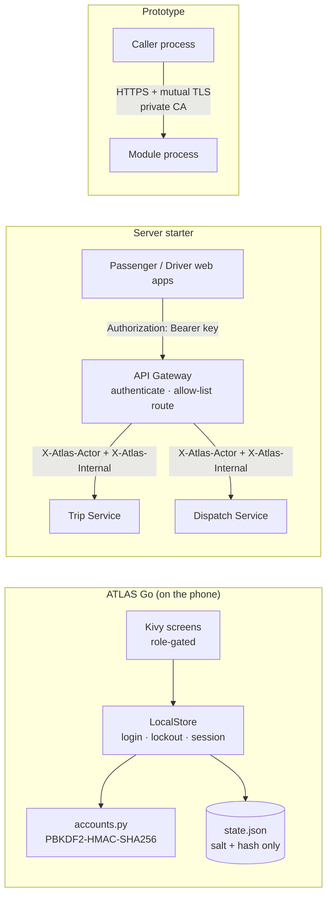
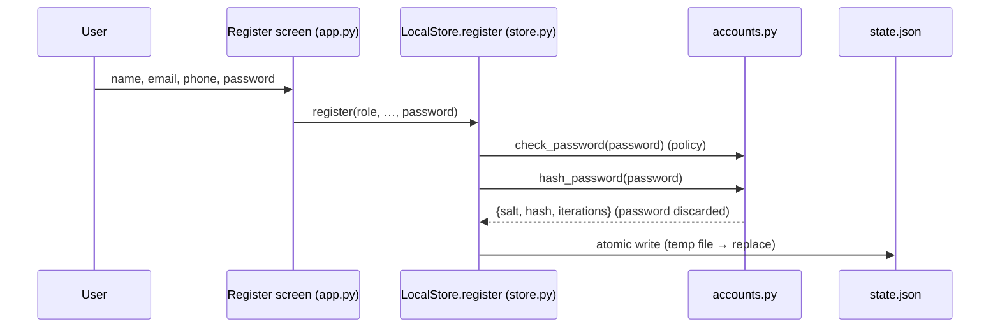
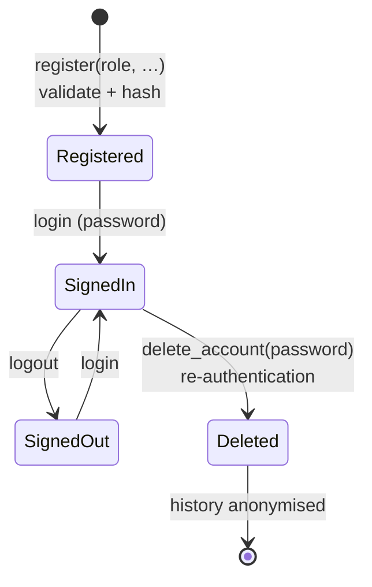
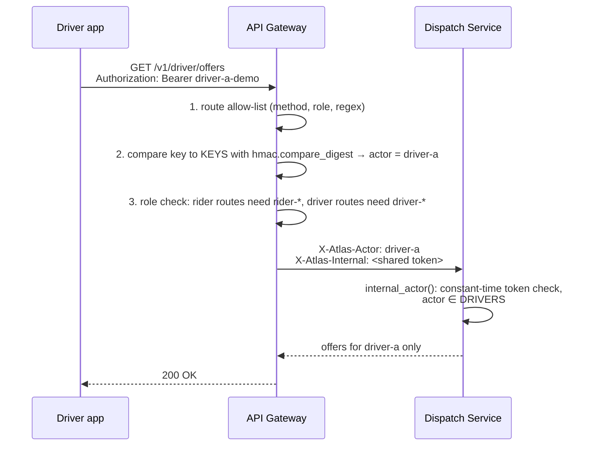
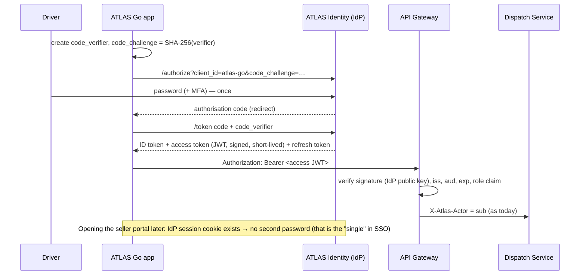

# Information Security in ATLAS — a teaching guide

This guide uses ATLAS as a worked example for teaching information security. It covers
**authentication, password storage, identity management, access control, single sign-on (SSO),
Kerberos, transport security and secure deployment**, and points every claim at the line of code
that implements it.

> **Read this first — what is implemented and what is a teaching extension.**
> Every section is labelled with one of three tags.
>
> | Tag | Meaning |
> |---|---|
> | ✅ **Implemented** | Runs in this repository today; the file and function are named. |
> | 🧪 **Demo-grade** | Implemented, but with deliberately simple choices (shared demo keys, static tokens) that must change before production. Useful for "find the weakness" exercises. |
> | 🎓 **Teaching extension** | **Not** in the ATLAS code. Shows how a standard mechanism (SSO, Kerberos) would plug into the ATLAS components. The [Architecture Explorer → Security view](https://fullscipts.github.io/ATLAS/#security) runs it live in the browser. |
>
> ATLAS does **not** contain Kerberos, SSO or OAuth/OIDC code. Those sections are mappings of the
> standard protocols onto ATLAS's real components so students can see where each message would go.

**Interactive companion:** [ATLAS Architecture Explorer → Security](https://fullscipts.github.io/ATLAS/#security) —
hash a password with the exact ATLAS parameters, trip the login lockout, step through the gateway's
authentication, and run a live Kerberos exchange (with replay, clock-skew, tampering and expiry
attacks) using real AES-GCM in your browser.

**Command-line lab:** `python3 security_lab/password_storage_demo.py` runs 20 experiments against
the app's real `accounts.py` and `store.py` (no extra dependencies). `--list` shows them; `--path NAME`
runs a study path; `-e N` runs one experiment. Each category is also its own file, runnable alone:
`lab_a_password_storage.py` (1-8), `lab_b_registration_identity.py` (9-11), `lab_c_signin_defences.py`
(12-15) and `lab_d_integrity_lifecycle.py` (16-20); [security_lab/README.md](../security_lab/README.md)
indexes them.

| Study path | Experiments | Question it answers |
|---|---|---|
| `foundations` | 1, 2, 3, 7, 8 | What exactly is stored, and why can nobody read the password back? |
| `attacker` | 4, 5, 6, 13, 14, 15 | How fast can a stolen file or a login screen be attacked, and what leaks? |
| `defender` | 9, 10, 11, 12, 13, 16 | Which controls run at registration and sign-in? |
| `integrity` | 8, 17, 18, 19 | How does the app keep its stored data trustworthy? |
| `lifecycle` | 9, 1, 12, 16, 19, 20 | One user from sign-up to deletion, plus rehash-on-login |

Groups: **A** what is stored (1-8: anatomy, salting, verification, work factor, guess-rate arithmetic,
dictionary attack, policy matrix, file forensics); **B** registration and identity (9-11: input
validation, one identity per email, role separation); **C** sign-in defences (12-15: lockout timeline,
no enumeration by message, timing side channel and the dummy-hash fix, limits of an in-memory per-email
lockout); **D** integrity and lifecycle (16-20: sessions, tamper quarantine, atomic save and rollback,
account deletion, upgrading old hashes). Several experiments surface real gaps (timing leak, lockout
reset on restart, `iterations=0` raising instead of failing closed) for students to fix in session 8.

---

## Contents

1. [The security map of ATLAS](#1-the-security-map-of-atlas)
2. [How user passwords are stored](#2-how-user-passwords-are-stored--implemented)
3. [Authentication on the phone: login, lockout, sessions](#3-authentication-on-the-phone-login-lockout-sessions--implemented)
4. [Identity management: the account lifecycle](#4-identity-management-the-account-lifecycle--implemented)
5. [Authorisation: role-based access control](#5-authorisation-role-based-access-control--implemented)
6. [Service authentication at the API gateway](#6-service-authentication-at-the-api-gateway--demo-grade)
7. [Single sign-on (SSO) for ATLAS](#7-single-sign-on-sso-for-atlas--teaching-extension)
8. [Kerberos, step by step, on ATLAS components](#8-kerberos-step-by-step-on-atlas-components--teaching-extension)
9. [Transport security: mutual TLS in the prototype](#9-transport-security-mutual-tls-in-the-prototype--implemented)
10. [Secure deployment and supply chain](#10-secure-deployment-and-supply-chain--implemented)
11. [Known gaps — exercises for students](#11-known-gaps--exercises-for-students)
12. [Suggested lesson plan](#12-suggested-lesson-plan)

---

## 1. The security map of ATLAS

ATLAS has three runnable parts, and each teaches a different layer of security.

| Part | Where | Security topics it demonstrates |
|---|---|---|
| **ATLAS Go** Android app | [`android-app/atlas_go/`](../android-app/atlas_go/) | Password hashing (PBKDF2), login throttling, sessions, identity lifecycle, role-based screens, privacy-by-design |
| **Server starter** (FastAPI · PostgreSQL · Kafka) | [`architecture-explorer/starter/`](https://github.com/FUllSCIPTS/ATLAS/tree/architecture-explorer/architecture-explorer/starter) | API gateway authentication, bearer keys, constant-time comparison, route allow-listing, identity propagation to internal services |
| **Prototype** + **Explorer server** | [`prototype.zip`](../prototype.zip), [`architecture-explorer/server.mjs`](https://github.com/FUllSCIPTS/ATLAS/blob/architecture-explorer/architecture-explorer/server.mjs) | Mutual TLS with a private CA, HTTP security headers (CSP), loopback binding + SSH tunnel, systemd sandboxing, signed releases |



---

## 2. How user passwords are stored — ✅ Implemented

**File:** [`android-app/atlas_go/accounts.py`](../android-app/atlas_go/accounts.py) — `hash_password`, `verify_password`, `check_password`, `public_view`.

ATLAS Go **never stores a password**. On registration it stores three values:

```json
{
  "salt": "9f2c…(16 random bytes, hex)",
  "hash": "4b1e…(32 bytes, hex)",
  "iterations": 200000
}
```

### The algorithm

```python
PBKDF2_ITERATIONS = 200_000

def hash_password(password, salt=None, iterations=PBKDF2_ITERATIONS):
    salt = salt or secrets.token_bytes(16)                       # 1. fresh random salt per account
    digest = hashlib.pbkdf2_hmac('sha256', password.encode('utf-8'),
                                 salt, iterations)               # 2. slow, salted key derivation
    return dict(salt=salt.hex(), hash=digest.hex(), iterations=iterations)

def verify_password(password, record):
    ...                                                          # 3. recompute with the stored salt
    digest = hashlib.pbkdf2_hmac('sha256', password.encode('utf-8'), salt, iterations)
    return hmac.compare_digest(digest, expected)                 # 4. constant-time comparison
```

| Design choice | What it defends against | Teaching point |
|---|---|---|
| **Hash, not encrypt** | Anyone who reads `state.json` (backup, rooted phone) cannot reverse it | Encryption is reversible with a key; a password store should be one-way |
| **Random 16-byte salt per account** (`secrets.token_bytes`) | Rainbow tables; spotting two users with the same password | Same password → different hash. `test_password_hash_roundtrip_and_salt` proves it |
| **PBKDF2-HMAC-SHA256, 200 000 iterations** | Offline brute force after a leak | Each guess costs 200 000 HMACs; the attacker pays that for every guess |
| **Iterations stored with the hash** | Lets the work factor be raised later without breaking old accounts | "Upgrade on next login" pattern |
| **`hmac.compare_digest`** | Timing side channel | A normal `==` returns early on the first differing byte |
| **`public_view()` strips `salt`, `hash`, `iterations`** | Accidental display/logging of secrets | Data minimisation at the presentation boundary |
| **Password policy** (`check_password`): 8–128 chars, ≥1 letter and ≥1 digit | Trivial passwords; denial-of-service via huge inputs | Upper bound matters: PBKDF2 cost grows with input |
| **Form field cleared after submit** (`app.py`, `submit_login` pops `login_password`) | Password lingering in UI state | Minimise secret lifetime in memory |

**Registration → storage flow**



> **Discussion:** OWASP's current guidance for PBKDF2-HMAC-SHA256 is 600 000 iterations, and it
> prefers memory-hard Argon2id. ATLAS uses 200 000 because PBKDF2 is in the Python standard library
> and must run on low-end phones. Ask students to measure the cost on a phone and argue the trade-off
> (see [§11](#11-known-gaps--exercises-for-students)).

---

## 3. Authentication on the phone: login, lockout, sessions — ✅ Implemented

**File:** [`android-app/atlas_go/store.py`](../android-app/atlas_go/store.py) — `LocalStore.login`, `logout`, `continue_as_guest`.

```python
def login(self, email, password, now=None):
    count, until = self.failures.get(email, [0, 0])
    if until > now:                                    # locked out?
        raise ValueError('Too many attempts. Try again in N seconds.')
    account = next((a for a in self.accounts if a['email'] == email), None)
    if account is None or not acc.verify_password(password or '', account):
        count += 1                                     # 5 failures → 60 s lock
        ...
        raise ValueError('Email or password is not correct.')   # same message either way
    self.failures.pop(email, None)
    self.session = account['id']                       # session = account id
```

| Control | Value | Why |
|---|---|---|
| Failed-attempt limit | `MAX_FAILED_LOGINS = 5` | Slows online guessing |
| Lockout window | `LOCKOUT_SECONDS = 60` | Temporary, so a guesser cannot permanently lock a real user out |
| Generic error | "Email or password is not correct." for unknown email **and** wrong password | Prevents **user enumeration** |
| Session | `session` = account id, persisted in `state.json`; validated on load (`validate`: session must reference an existing account) | A stale or forged session id is discarded |
| Guest mode | `continue_as_guest` — no identity, passenger features only | Least privilege for anonymous use |

**Authentication factors.** ATLAS Go uses one factor: *something you know*. The phone itself is an
implicit *something you have* (accounts live only on that device). Multi-factor authentication is an
exercise in §11.

---

## 4. Identity management: the account lifecycle — ✅ Implemented

**Files:** `accounts.py` (validation), `store.py` (`register`, `login`, `logout`, `delete_account`, `reset`), [`docs/PRIVACY.md`](../android-app/docs/PRIVACY.md).



| Lifecycle stage | ATLAS implementation | IAM concept |
|---|---|---|
| **Identity proofing** | Email, phone (normalised to E.164), driver SPSV licence, vehicle plate, food-business number are **format-checked only** — self-declared, not verified with an authority | Identity assurance level: ATLAS is at the lowest level. A production service would verify with the issuing authority |
| **Unique identifier** | `id = U-<nanoseconds>`; email unique (enforced in `validate`) | Separate stable internal id from the login name |
| **Roles** | `ROLES = ('passenger', 'driver', 'seller')`, fixed at registration | Role assignment at provisioning |
| **Credential** | Salted PBKDF2 hash (§2) | Credential storage |
| **Re-authentication** | `delete_account(password)` asks for the password again | Step-up authentication for destructive actions |
| **De-provisioning** | Account removed; ride history kept with `passenger='deleted'`; seller kitchen closed and registration set to `REMOVED` | Right to erasure while keeping non-personal records |
| **Data minimisation** | Location stored only after the driver taps *Use my phone location*; overwritten each fix | Privacy by design (GDPR Art. 25) |

---

## 5. Authorisation: role-based access control — ✅ Implemented

Authentication says **who** you are; authorisation says **what you may do**. ATLAS enforces RBAC in
two places, at two layers — a good example of defence in depth.

**UI layer** — `app.py`, `render()`:

```python
allowed = {'driver': ('driver','map','activity','profile','privacy','intelligence','account'),
           'seller': ('seller','seller_menu','activity','profile','privacy','intelligence','account')}
if self.store.user and self.store.role in allowed and self.screen not in allowed[self.store.role]:
    self.screen = self.home_screen()        # a driver cannot open the food basket
```

**Business-rule layer** — `store.py` re-checks the role on every command, so a UI bug cannot grant access:

| Command | Rule |
|---|---|
| `book`, `checkout` | Only passengers or guests |
| `set_online`, `update_location`, `driver_respond` | Only `role == 'driver'` |
| `add_dish`, `seller_accept`, `seller_ready` | Only the seller who owns that kitchen |

| Role | May | May not |
|---|---|---|
| Passenger | Book rides, share rides, order food | Go online, edit menus |
| Driver | Go online, accept/decline offers, advance trips | Book rides, order food |
| Food seller | Edit own menu, accept and ready orders | Book rides, see other kitchens' orders |

---

## 6. Service authentication at the API gateway — 🧪 Demo-grade

**Files:** [`starter/services/gateway.py`](https://github.com/FUllSCIPTS/ATLAS/blob/architecture-explorer/architecture-explorer/starter/services/gateway.py), [`starter/packages/config.py`](https://github.com/FUllSCIPTS/ATLAS/blob/architecture-explorer/architecture-explorer/starter/packages/config.py), `services/trips.py`, `services/dispatch.py`.

The starter follows the **gateway pattern**: clients authenticate once at the edge, and internal
services trust an identity the gateway asserts. This is the same shape as SSO and Kerberos, which is
why it is a good bridge to §7–§8.



| Step | Code | Control |
|---|---|---|
| 1 | `ROUTES` table with `re.fullmatch` on path, exact method and role | **Allow-listing**: unknown routes → 404 before any auth work |
| 2 | `equal(key, expected)` → `hmac.compare_digest` | Bearer-key authentication, timing-safe |
| 3 | `(role == "rider") != actor.startswith("rider-")` → 401 | A driver key cannot call rider routes |
| 4 | Gateway sets `X-Atlas-Actor` and `X-Atlas-Internal`; clients cannot choose them because the gateway overwrites the header set | **Identity propagation** |
| 5 | `internal_actor()` in each service re-checks the internal token and the actor's role → 403 | **Zero-trust-ish**: services do not trust the network alone |
| — | Body limit 8 KiB → 413; `Idempotency-Key` forwarded | Abuse resistance; safe retries |

**Why it is demo-grade:** keys default to `rider-demo`, `driver-a-demo`, … and the internal token to
`local-internal-only` unless environment variables override them; the internal token is one static
shared secret and travels over plain HTTP between containers. §7 and §8 show the standard fixes.

---

## 7. Single sign-on (SSO) for ATLAS — 🎓 Teaching extension

**Not implemented in ATLAS.** ATLAS has several front ends — the passenger app, the driver app, the
seller kitchen, the Architecture Explorer — each of which would otherwise need its own password.
SSO lets one **Identity Provider (IdP)** authenticate the user once and issue tokens that every ATLAS
front end and the gateway accept.

**Mapping onto ATLAS (OpenID Connect, authorisation-code flow with PKCE — the standard for mobile apps):**

| SSO role | ATLAS component |
|---|---|
| End user | Passenger, driver or seller |
| Relying party / client | ATLAS Go app, driver web app, seller portal, Explorer |
| Identity Provider (IdP) | A new *ATLAS Identity* service (e.g. Keycloak) or the university IdP (SAML/Shibboleth) |
| Resource server | API Gateway → Trip and Dispatch services |
| Token claims | `sub` = account id, `role` = passenger/driver/seller |



**What would change in the code:** `KEYS` + `equal()` in `gateway.py` become JWT signature/claim
validation; `X-Atlas-Internal` becomes a gateway-signed token or mTLS (§9); the app stores the
refresh token in the Android Keystore (already listed under *Identity* in
[`android-app/docs/ARCHITECTURE.md`](../android-app/docs/ARCHITECTURE.md) → server roadmap).

**SSO trade-offs to discuss:** one password to remember and one place to enforce MFA and revoke
access (good); the IdP becomes a single point of failure and a high-value target (bad); logout must
propagate to every relying party.

---

## 8. Kerberos, step by step, on ATLAS components — 🎓 Teaching extension

**Not implemented in ATLAS.** Kerberos is the classic *trusted third party* SSO protocol (MIT,
RFC 4120; used by Windows Active Directory). It uses **only symmetric keys and tickets**: the user's
password never crosses the network, and services never see it.

### Cast — mapped onto ATLAS

| Kerberos principal | ATLAS stand-in | Long-term key |
|---|---|---|
| Client `C` | Driver `driver-a` using the driver app | `K_C` = key derived from the driver's password (string-to-key; ATLAS would reuse PBKDF2) |
| Authentication Server (AS) | ATLAS Identity — AS half | knows `K_C` |
| Ticket-Granting Server (TGS) | ATLAS Identity — TGS half | `K_TGS` (the `krbtgt` key) |
| Service `S` | Dispatch Service (`HTTP/dispatch.atlas`) | `K_S`, shared only with the KDC |

The AS and TGS together are the **Key Distribution Centre (KDC)**.

### The six messages

```mermaid
sequenceDiagram
  participant C as Driver app (C)
  participant AS as KDC · AS
  participant TGS as KDC · TGS
  participant S as Dispatch Service (S)
  C->>AS: ① AS-REQ: C, TGS, nonce, {timestamp}K_C  (pre-auth)
  AS-->>C: ② AS-REP: {K_C,TGS, nonce}K_C  +  TGT = {C, K_C,TGS, expiry}K_TGS
  Note over C: password → K_C → decrypt; then forget the password
  C->>TGS: ③ TGS-REQ: TGT, {C, timestamp}K_C,TGS  (authenticator), S
  TGS-->>C: ④ TGS-REP: {K_C,S}K_C,TGS  +  Ticket = {C, K_C,S, expiry}K_S
  C->>S: ⑤ AP-REQ: Ticket, {C, timestamp}K_C,S
  S-->>C: ⑥ AP-REP: {timestamp}K_C,S  (mutual authentication)
  Note over C,S: C now calls /v1/driver/offers with the session key — no password, no KDC round-trip until the ticket expires
```

| # | What happens in ATLAS terms | Security property |
|---|---|---|
| ① | Driver app proves knowledge of the password by encrypting the current time with `K_C` | **Pre-authentication** stops offline guessing on an AS-REP for any user name |
| ② | KDC returns a TGT the app cannot read (sealed with `K_TGS`) and a session key the app can | Password used **once per day**, then discarded |
| ③ | App asks for a ticket to Dispatch, proving freshness with an **authenticator** | **Replay protection**: timestamp must be within ±5 min and not seen before (replay cache) |
| ④ | TGS issues a ticket sealed with Dispatch's key | Dispatch can verify it **without contacting the KDC** |
| ⑤ | App presents ticket + new authenticator to Dispatch | Dispatch learns `driver-a` and the session key from the ticket |
| ⑥ | Dispatch returns `timestamp` encrypted under the session key | **Mutual authentication**: the app knows it reached the real Dispatch |

### How it compares to what ATLAS does today (§6)

| Today (gateway + bearer keys) | With Kerberos |
|---|---|
| Static key sent on every request | Short-lived tickets; password never sent |
| Gateway is the trusted third party | KDC is the trusted third party |
| `X-Atlas-Internal` shared by all services | Each service has its own key `K_S`; a compromised Trip Service cannot mint tickets for Dispatch |
| No replay protection | Authenticator timestamps + replay cache |
| No mutual authentication | AP-REP proves the service's identity |

**Run it live:** the [Explorer → Security → Kerberos](https://fullscipts.github.io/ATLAS/#security-kerberos)
tab performs all six messages in real time with AES-GCM (Web Crypto) and PBKDF2 for the
string-to-key step, shows every ciphertext, and lets you trigger **wrong password**, **replayed
authenticator**, **clock skew**, **tampered ticket** and **expired ticket** to see which check fails.

**Kerberos weaknesses to discuss:** the KDC is a single point of failure and compromise
(golden-ticket attacks if `K_TGS` leaks); tight clock synchronisation is required; Kerberoasting
(offline cracking of service tickets for services with weak keys).

---

## 9. Transport security: mutual TLS in the prototype — ✅ Implemented

**File:** `prototype/proto_run.py` and `prototype/module_server.py` (in [`prototype.zip`](../prototype.zip)).

The prototype measures the cost of moving a module out of process. When it does, the two processes
authenticate **each other** with certificates from a private CA:

| Step | Code | Teaching point |
|---|---|---|
| Private CA | `openssl req -x509 … -subj /CN=atlas-ca` with `CA:TRUE`, `keyCertSign` | Root of trust you control |
| Server cert | `extendedKeyUsage=serverAuth`, `subjectAltName=IP:127.0.0.1` | Hostname/IP binding |
| Client cert | `extendedKeyUsage=clientAuth` | A server cert cannot be used as a client cert |
| Server | `ctx.verify_mode = ssl.CERT_REQUIRED`, `load_verify_locations(ca.crt)` | **Mutual** TLS: no client certificate → handshake fails |
| Client | `ssl.create_default_context(cafile=ca.crt)` + `load_cert_chain` | Verifies the server and presents its own identity |
| Lifetime | `-days 30`, generated at run time, not committed | Short-lived credentials, no secrets in Git |

The paper's prototype results (`results/prototype.json`) quantify the cost: HTTPS+mTLS keep-alive
vs plain HTTP, and the full handshake on a new connection — a concrete answer to "what does
security cost?".

mTLS is the standard fix for the starter's static `X-Atlas-Internal` token (§6).

---

## 10. Secure deployment and supply chain — ✅ Implemented

**Explorer server** — [`architecture-explorer/server.mjs`](https://github.com/FUllSCIPTS/ATLAS/blob/architecture-explorer/architecture-explorer/server.mjs) and `deploy/atlas-explorer.service`:

| Control | Setting | Threat addressed |
|---|---|---|
| Bind to loopback | `127.0.0.1:8080` | Not reachable from the network |
| Remote access | SSH tunnel (`ssh -L 8080:127.0.0.1:8080 …`) | Reuses SSH's strong authentication instead of adding a login page |
| Method allow-list | Only `GET`, `HEAD` → others 405 | Smaller attack surface |
| Static asset map | Only an explicit list of named files (`contentTypes`), loaded into memory at start-up | No path traversal; nothing else on disk is reachable |
| `Content-Security-Policy` | `default-src 'none'; script-src 'self'; frame-ancestors 'none'; form-action 'none'` | XSS, clickjacking, data exfiltration via forms |
| Other headers | `X-Content-Type-Options: nosniff`, `Referrer-Policy: no-referrer`, `Cache-Control: no-store` | MIME sniffing, URL leakage, cached content |
| systemd sandbox | `DynamicUser=yes`, `NoNewPrivileges=yes`, `ProtectSystem=strict`, `ProtectHome=yes`, `PrivateTmp=yes` | Least privilege if the process is compromised |

**Android release integrity** — [`android-app/releases/`](../android-app/releases/):
APK v2/v3 signatures, `SHA256SUMS` for every artefact, a published upload certificate, and a
release manifest. Students can verify a download with `sha256sum -c SHA256SUMS` and
`apksigner verify --print-certs`. Integrity (the "I" in CIA) applied to software distribution.

**App storage** — `state.json` lives in Android's app-private directory (sandboxed per app UID) and is
written atomically; a damaged file is quarantined as `state.invalid.json` (integrity and availability).

---

## 11. Known gaps — exercises for students

These are real properties of the current code, ideal for "find and fix" assignments.

| # | Gap | Where | Suggested exercise |
|---|---|---|---|
| 1 | PBKDF2 at 200 000 iterations (OWASP: 600 000) | `accounts.py` | Measure on a phone; implement *rehash on login* when `iterations < target`; compare Argon2id |
| 2 | Lockout counter is memory-only and per email | `store.py` (`self.failures`) | Restarting the app resets it. Persist it; add exponential back-off |
| 3 | No MFA, no password reset | — | Add TOTP (RFC 6238) as a second factor |
| 4 | `state.json` is not encrypted at rest | `store.py` | Encrypt with a key held in the Android Keystore |
| 5 | Default demo keys and internal token | `starter/packages/config.py` | Refuse to start when defaults are in use outside `local` mode |
| 6 | Static shared internal token; plain HTTP between services | `gateway.py`, `compose.yaml` | Replace with mTLS (reuse §9) or signed short-lived tokens |
| 7 | Bearer keys never expire | `gateway.py` | Replace with OIDC access tokens (§7) |
| 8 | Self-declared licences and business numbers | `accounts.py` | Discuss identity assurance levels; design a verification step |

---

## 12. Suggested lesson plan

| Session | Topic | ATLAS material | Activity |
|---|---|---|---|
| 1 | CIA triad, threat modelling | §1 security map, §10 | STRIDE on the Explorer's architecture view |
| 2 | Password storage | §2, `security_lab/password_storage_demo.py`, Explorer *Passwords* tab | Lab path `foundations` then `attacker`; crack a leaked record, time SHA-256 vs PBKDF2 |
| 3 | Authentication and identity lifecycle | §3, §4 | Lab paths `defender` and `lifecycle`; trip the lockout; measure the timing leak |
| 4 | Authorisation | §5, §6 | Try calling a rider route with a driver key; trace the 401 |
| 5 | SSO and federated identity | §7 | Draw the OIDC + PKCE flow for the seller portal |
| 6 | Kerberos | §8, Explorer *Kerberos* tab | Run the six messages; trigger each attack; explain which field stopped it |
| 7 | Transport security | §9 | Run the prototype; break mTLS by removing the client certificate |
| 8 | Secure engineering | §11 | Fix one gap and write a test for it |

---

*Code references are to the `main` branch (ATLAS Go 1.2.0) and the `architecture-explorer` branch
(server starter and Explorer). If you change the code, update this guide in the same commit.*
