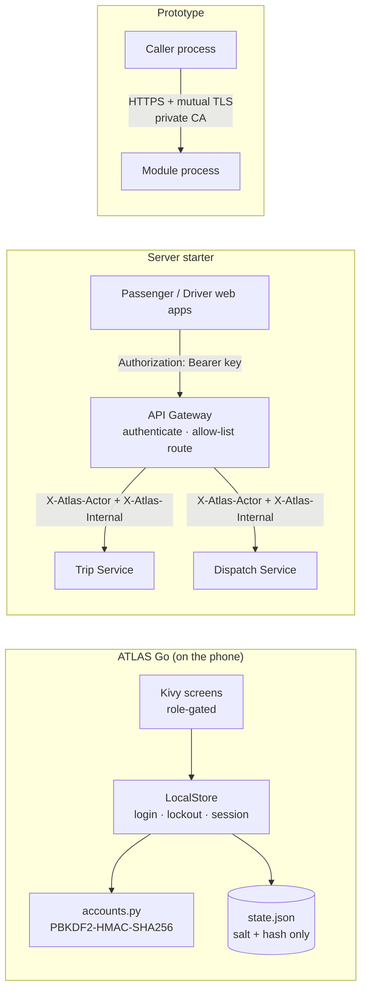
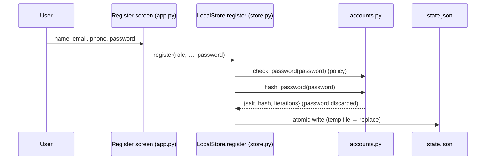
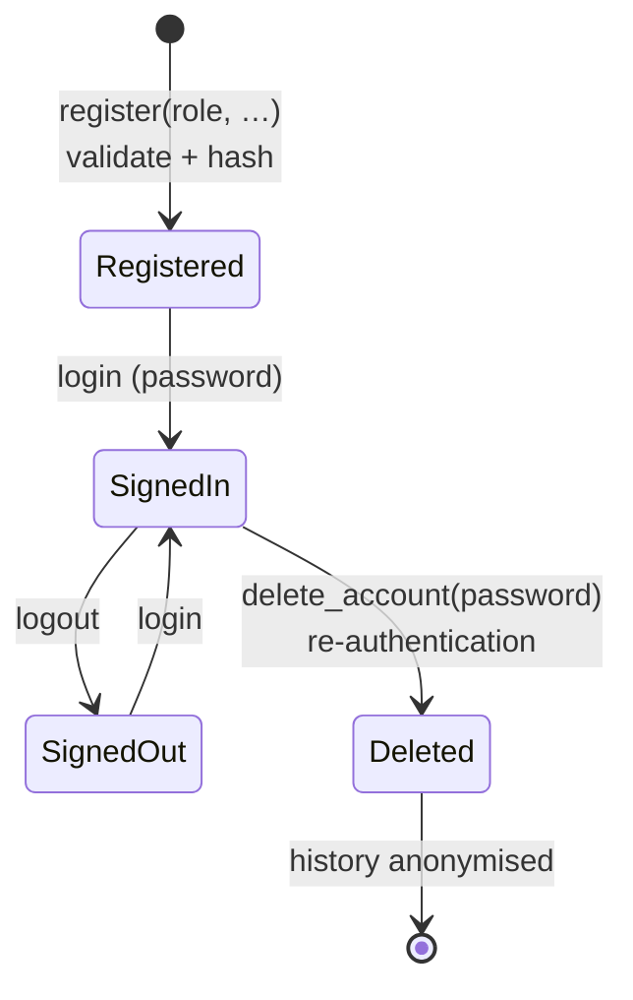
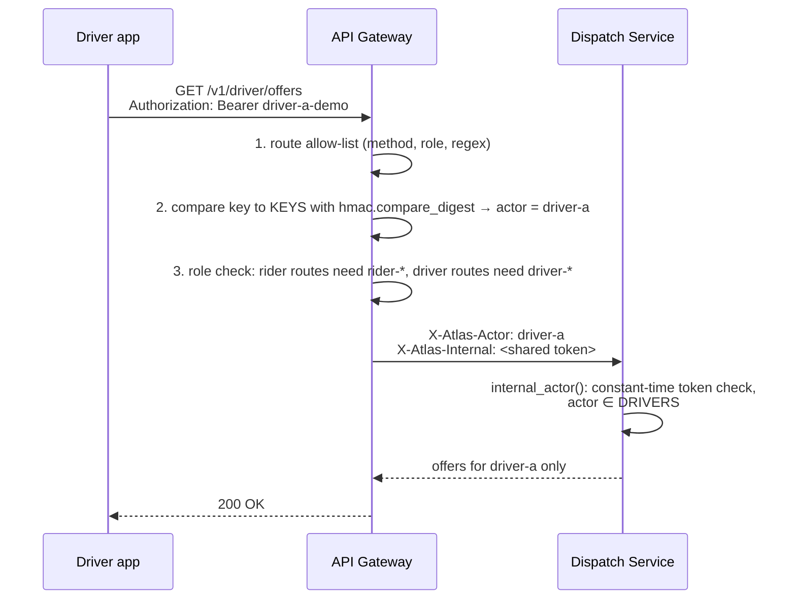
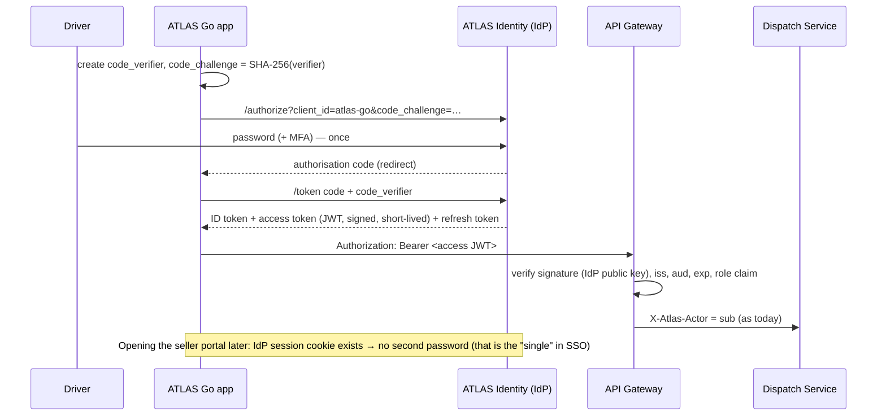
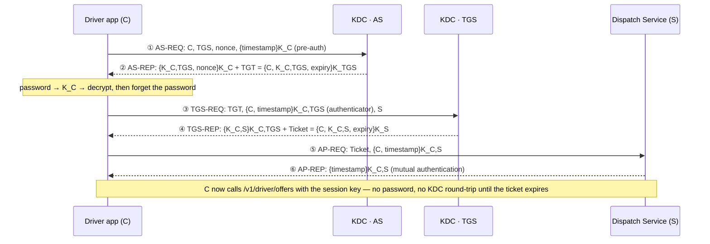
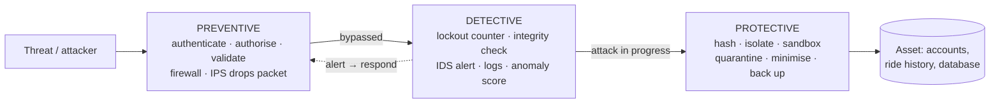
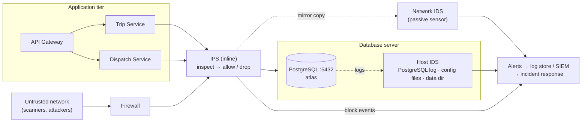

# Information Security in ATLAS — a teaching guide

This guide uses ATLAS as a worked example for teaching information security. It covers
**authentication, password storage, identity management, access control, single sign-on (SSO),
Kerberos, transport security, secure deployment and security control measures (preventive,
detective and protective, including the IDS and IPS on the database server)**, and points every
claim at the line of code that implements it.

> **Read this first — what is implemented and what is a teaching extension.**
> Every section is labelled with one of four tags.
>
> | Tag | Meaning |
> |---|---|
> | ✅ **Implemented** | Runs in this repository today; the file and function are named. |
> | 🧪 **Demo-grade** | Implemented, but with deliberately simple choices (shared demo keys, static tokens) that must change before production. Useful for "find the weakness" exercises. |
> | 🎓 **Teaching extension** | **Not** in the ATLAS code. Shows how a standard mechanism (SSO, Kerberos) would plug into the ATLAS components. The [Architecture Explorer → Security view](https://fullscipts.github.io/ATLAS/#security) runs it live in the browser. |
> | 🖥️ **Host deployment** | Installed and configured on the server host itself (operating system / network level), **outside** this repository. The guide explains its role and gives reference configuration; the repository holds no rules or agents for it. |
>
> ATLAS does **not** contain Kerberos, SSO or OAuth/OIDC code. Those sections are mappings of the
> standard protocols onto ATLAS's real components so students can see where each message would go.
> Likewise, the intrusion detection system (IDS) and intrusion prevention system (IPS) in
> [§11.5](#115-ids-and-ips-on-the-database-server---host-deployment) run on the server that holds
> the PostgreSQL database; they are host controls, not application code.

**Interactive companion:** [ATLAS Architecture Explorer → Security](https://fullscipts.github.io/ATLAS/#security) —
hash a password with the exact ATLAS parameters, trip the login lockout, step through the gateway's
authentication, and run a live Kerberos exchange (with replay, clock-skew, tampering and expiry
attacks) using real AES-GCM in your browser.

**Command-line lab:** `python3 security_lab/password_storage_demo.py` runs 20 experiments against
the app's real `accounts.py` and `store.py` (no extra dependencies). `--list` shows them; `--path NAME`
runs a study path; `-e N` runs one experiment. Each category is also its own file, runnable alone:
`lab_a_password_storage.py` (1-8), `lab_b_registration_identity.py` (9-11), `lab_c_signin_defences.py`
(12-15) and `lab_d_integrity_lifecycle.py` (16-20); [security_lab/README.md](../security_lab/README.md)
indexes them.

| Study path | Experiments | Question it answers |
|---|---|---|
| `foundations` | 1, 2, 3, 7, 8 | What exactly is stored, and why can nobody read the password back? |
| `attacker` | 4, 5, 6, 13, 14, 15 | How fast can a stolen file or a login screen be attacked, and what leaks? |
| `defender` | 9, 10, 11, 12, 13, 16 | Which controls run at registration and sign-in? |
| `integrity` | 8, 17, 18, 19 | How does the app keep its stored data trustworthy? |
| `lifecycle` | 9, 1, 12, 16, 19, 20 | One user from sign-up to deletion, plus rehash-on-login |

Groups: **A** what is stored (1-8: anatomy, salting, verification, work factor, guess-rate arithmetic,
dictionary attack, policy matrix, file forensics); **B** registration and identity (9-11: input
validation, one identity per email, role separation); **C** sign-in defences (12-15: lockout timeline,
no enumeration by message, timing side channel and the dummy-hash fix, limits of an in-memory per-email
lockout); **D** integrity and lifecycle (16-20: sessions, tamper quarantine, atomic save and rollback,
account deletion, upgrading old hashes). Several experiments surface real gaps (timing leak, lockout
reset on restart, `iterations=0` raising instead of failing closed) for students to fix in session 9.

---

## Contents

1. [The security map of ATLAS](#1-the-security-map-of-atlas)
2. [How user passwords are stored](#2-how-user-passwords-are-stored---implemented)
3. [Authentication on the phone: login, lockout, sessions](#3-authentication-on-the-phone-login-lockout-sessions---implemented)
4. [Identity management: the account lifecycle](#4-identity-management-the-account-lifecycle---implemented)
5. [Authorisation: role-based access control](#5-authorisation-role-based-access-control---implemented)
6. [Service authentication at the API gateway](#6-service-authentication-at-the-api-gateway---demo-grade)
7. [Single sign-on (SSO) for ATLAS](#7-single-sign-on-sso-for-atlas---teaching-extension)
8. [Kerberos, step by step, on ATLAS components](#8-kerberos-step-by-step-on-atlas-components---teaching-extension)
9. [Transport security: mutual TLS in the prototype](#9-transport-security-mutual-tls-in-the-prototype---implemented)
10. [Secure deployment and supply chain](#10-secure-deployment-and-supply-chain---implemented)
11. [Control measures: preventive, detective and protective](#11-control-measures-preventive-detective-and-protective)
    - [11.5 IDS and IPS on the database server](#115-ids-and-ips-on-the-database-server---host-deployment)
12. [Known gaps — exercises for students](#12-known-gaps--exercises-for-students)
13. [Suggested lesson plan](#13-suggested-lesson-plan)

---


## Standalone illustrated foundations — Information Security

This chapter explains each principle from the beginning, with concrete examples and diagrams. The 20 source experiments exercise ATLAS's actual local application controls. The two visualizations created for each experiment must be interpreted separately: **observed runtime/status** versus **illustrative model (not measured)**.

**Every unit stands alone.** Each unit opens with a short summary, then an **"in depth — what, why and
how"** part: *what* the concept is, *why* it matters, *how* it works (step by step, with tables, runnable
standard-library Python and diagrams), common pitfalls and three self-check questions. Units S13.1–S13.6
cover topics that complete an information-security course beyond the ATLAS code.

| Unit | Topic | Key ideas |
|---|---|---|
| [S1](#s1--information-security-cia-and-threat-modelling) | CIA and threat modelling | Risk, STRIDE, attack trees, design principles |
| [S2](#s2--identity-authentication-authorization-and-accountability) | Identity and IAAA | Factors, MFA, assurance levels |
| [S3](#s3--password-storage-salt-pbkdf2-and-offline-attacks) | Password storage | Attack types, entropy, NIST 800-63B |
| [S4](#s4--input-validation-registration-and-unique-identities) | Input validation | Allow-lists, canonicalisation, SQL injection |
| [S5](#s5--rbac-least-privilege-and-state-machines) | Access control | DAC, MAC, RBAC, ABAC, IDOR |
| [S6](#s6--sign-in-lockout-account-enumeration-and-timing-attacks) | Sign-in defences | Lockout, TOTP, passkeys/FIDO2 |
| [S7](#s7--sessions-guest-state-logout-and-deletion) | Sessions | Cookies, fixation, CSRF, JWT revocation |
| [S8](#s8--saved-state-validation-atomic-writes-and-integrity) | Data integrity | Atomic writes, HMAC, rollback, backups |
| [S9](#s9--secure-apis-gateways-and-bearer-tokens) | API security | OWASP API Top 10, JWT verification |
| [S10](#s10--sso-oauth-20-and-oidc) | SSO, OAuth 2.0, OIDC | PKCE, token types, SAML |
| [S11](#s11--kerberos-tickets-and-its-six-message-exchange) | Kerberos | Exchanges, roasting, golden tickets |
| [S12](#s12--tls-mtls-and-certificate-verification) | TLS 1.3 | Handshake, forward secrecy, 0-RTT |
| [S13](#s13--supply-chain-deployed-secrets-and-boundaries) | Secure deployment | Secrets, hardening, patching |
| [S13.1](#s131--network-security-firewalls-segmentation-vpns-and-zero-trust) | Network security | Firewalls, segmentation, zero trust |
| [S13.2](#s132--web-application-vulnerabilities-the-owasp-top-10) | OWASP Top 10 | XSS, CSRF, injection |
| [S13.3](#s133--security-logging-monitoring-and-incident-response) | Logging and incident response | NIST SP 800-61 |
| [S13.4](#s134--privacy-and-data-protection-gdpr) | Privacy and GDPR | Article 5 principles, breach notification |
| [S13.5](#s135--security-governance-standards-and-risk-frameworks) | Governance | ISO 27001, NIST CSF 2.0 |
| [S13.6](#s136--human-factors-social-engineering-and-malware) | Human factors and malware | Phishing, ransomware |
| [S14](#s14--each-information-security-experiment-illustrative-and-observed-results) | Experiments | Lab-to-unit map |

### S1 — Information security, CIA and threat modelling

The **CIA triad** is **confidentiality** (prevent unauthorized disclosure), **integrity** (detect or stop unauthorized changes) and **availability** (continue providing service). An **asset** is something worth protecting; a **threat** is a possible harmful event; a **vulnerability** is a weakness; a **control** reduces risk. Risk depends on likelihood and impact. A locked account is not enough if its ride history is exposed in a readable file.

~~~mermaid
flowchart LR
 ASSET["Asset: rider account/history"] --> THREAT["Threat: device/file theft"]
 THREAT --> WEAK["Weakness: unencrypted local state"]
 WEAK --> RISK["Risk: disclosure"]
 RISK --> CTRL["Controls: minimize, protect storage, monitor"]
~~~

The ATLAS Go state file is not encrypted at rest. Password hashing protects the verifier against direct reversal but does not encrypt unrelated personal data. **Labs S01,S08,S17.**

#### S1 in depth — what, why and how

**What it is.** **Information security** protects information and the systems that process it against
unauthorised access, use, disclosure, disruption, modification or destruction. The **CIA triad** names
the three core goals; two more are usually added:

| Goal | Question | Typical controls | ATLAS example |
|---|---|---|---|
| Confidentiality | Can only authorised parties read it? | Encryption, access control, data minimisation | Password stored only as a PBKDF2 verifier |
| Integrity | Can unauthorised changes be prevented or detected? | Hashes, MACs, signatures, validation, version control | `validate()` on load, signed APK |
| Availability | Is it there when needed? | Redundancy, backups, rate limits, capacity, DDoS protection | Atomic save; temporary (not permanent) lockout |
| Authenticity | Is the origin genuine? | Authentication, signatures, certificates | Pinned upload certificate |
| Accountability / non-repudiation | Can actions be traced to whoever performed them? | Audit logs, signatures | Gap: no persistent security log (§12 #10) |

**Why it matters.** Breaches harm people (stalking from leaked location data, fraud from stolen
accounts), organisations (fines — up to 4 % of global turnover under GDPR — lost trust, downtime) and
society (critical infrastructure). Security is also a *design* property: it is far cheaper to build in
than to bolt on.

**How — risk management in four steps.**

1. **Identify assets** and their value (accounts, ride history, payment records, signing keys).
2. **Identify threats and vulnerabilities** — *threat modelling*.
3. **Assess risk** = likelihood × impact, often on a 1–5 × 1–5 matrix.
4. **Treat risk**: *mitigate* (add controls), *transfer* (insurance, outsourcing), *avoid* (drop the
   feature) or *accept* (documented decision). What remains is **residual risk**.

**Threat modelling with STRIDE** (Microsoft) — each letter is the violation of one property:

| Threat | Violates | ATLAS question | Example control |
|---|---|---|---|
| **S**poofing | Authenticity | Can someone log in as a driver? | Passwords + lockout; mTLS between services |
| **T**ampering | Integrity | Can `state.json` or an API request be modified? | Validation, signatures, MACs |
| **R**epudiation | Accountability | Can a seller deny changing a menu? | Audit log (gap) |
| **I**nformation disclosure | Confidentiality | Can ride history leak from a lost phone? | Encryption at rest (gap), app sandbox |
| **D**enial of service | Availability | Can an attacker lock all users out? | Temporary lockout, body-size limits |
| **E**levation of privilege | Authorisation | Can a passenger act as a driver? | Two-layer RBAC |

Work through a **data-flow diagram**: draw processes, data stores, external entities and data flows,
mark **trust boundaries** (phone ↔ network, gateway ↔ services, service ↔ database) and apply STRIDE to
each element that crosses a boundary. **Attack trees** are a complementary method: the root is the
attacker's goal ("read another rider's history"), children are alternative or combined ways to reach it.

**Security design principles** (Saltzer and Schroeder, 1975, still current): economy of mechanism,
fail-safe defaults (deny unless allowed), complete mediation (check every access), open design,
separation of privilege, least privilege, least common mechanism and psychological acceptability. Add
**defence in depth** and **secure by default**.

**Check your understanding.** (1) Classify "an attacker floods the login endpoint" under CIA and
STRIDE. (2) Give one risk ATLAS might reasonably *accept* and justify it. (3) Draw the trust boundaries
for the server starter (S9).

### S2 — Identity, authentication, authorization and accountability

**Identification** is claiming an account; **authentication** verifies evidence (password, token, physical authenticator); **authorization** decides permitted operations; **accountability** logs events for audit. Authentication alone does not grant all permissions.

~~~mermaid
flowchart TD
 I["Claim email / identity"] --> A["Verify credential"]
 A --> SESSION["Establish session"]
 SESSION --> ROLE["Resolve role"]
 ROLE --> CHECK["Authorize method"]
 CHECK --> AUDIT["Security event / result"]
~~~

A passenger may book, a driver may accept, a seller may update a menu. ATLAS Go checks roles in app screens and store operations. **Labs S09–S11,S16.**

#### S2 in depth — what, why and how

**What it is.** The **IAAA** chain: **I**dentification (who do you claim to be?), **A**uthentication
(prove it), **A**uthorisation (what may you do?), **A**ccountability (what did you do?). An **identity**
is a set of attributes about a subject; an **account** is one representation of it in one system; a
**credential** is something bound to the account that is used to authenticate.

**Why it matters.** Most real breaches abuse identity: stolen or guessed passwords, session hijacking,
missing authorisation checks. Separating the four steps clarifies which control fails: a correct login
followed by a missing authorisation check (e.g. "any logged-in user can read any ride by changing the
ID") is the top web risk in OWASP's list (S13.2).

**How — authentication factors and assurance.**

| Factor | Examples | Main threats |
|---|---|---|
| Something you **know** | Password, PIN, security answer | Guessing, phishing, reuse across sites |
| Something you **have** | Phone with TOTP app, FIDO2 security key, smart card, the ATLAS phone itself | Theft, SIM swap (for SMS), malware |
| Something you **are** | Fingerprint, face | Spoofing, cannot be changed if leaked; usually unlocks a local key rather than being sent |
| (Context) | Location, device, time | Supports risk-based decisions; not a factor on its own |

**Multi-factor authentication (MFA)** requires factors from *different* categories; two passwords are
still one factor. NIST SP 800-63B defines **authenticator assurance levels**: AAL1 (single factor),
AAL2 (two factors), AAL3 (hardware-based, phishing-resistant, verifier-impersonation-resistant
authenticator such as a FIDO2 key).

**Authorisation decisions** need a *subject* (who), an *action* (book, accept, edit), an *object*
(which ride, which kitchen) and a *policy*. Accountability needs **unique** identities (no shared
accounts), synchronised clocks and tamper-resistant logs.

**Check your understanding.** (1) Which IAAA step fails when a driver opens another driver's offer by
editing a URL? (2) Why is "password + security question" not MFA? (3) What makes a hardware security key
AAL3 while a TOTP app is not?

### S3 — Password storage, salt, PBKDF2 and offline attacks

Passwords should not be stored in plaintext or via reversible encryption alone. A **salt** is a random per-user value; the app stores salt, iteration count and **password-derived verifier**. ATLAS Go uses PBKDF2-HMAC-SHA256 with 16-byte salts and 200,000 iterations. An attacker who steals the file may still guess offline; increasing iterations increases attacker cost per guess and legitimate login cost. Password distribution matters more than simplistic character-count entropy.

~~~mermaid
flowchart LR
 PASSWORD["Password"] --> KDF["PBKDF2-HMAC-SHA256"]
 SALT["16-byte random salt"] --> KDF
 ITER["200,000 iterations"] --> KDF
 KDF --> RECORD["Stored verifier"]
~~~

~~~python
import hashlib, hmac, secrets
password=b"Classroom-Example"
salt=secrets.token_bytes(16)
saved=hashlib.pbkdf2_hmac("sha256",password,salt,200000)
candidate=hashlib.pbkdf2_hmac("sha256",password,salt,200000)
assert hmac.compare_digest(saved,candidate)
~~~

**Offline** password guessing happens against a copied record and is not prevented by online account lockout. **Online** guessing goes through the login interface, where rate limits can help. **Labs S01–S08.**

#### S3 in depth — what, why and how

**What it is.** Password storage turns a secret the user remembers into a **verifier** the server can
check without being able to recover the password: `verifier = KDF(password, salt, cost)`.

**Why it matters.** Databases leak — through SQL injection, stolen backups, insider access or a lost
phone. When they do, the question is how many passwords the attacker recovers and how quickly. Users
reuse passwords, so a recovered password also opens their email or bank (**credential stuffing**).

**How attacks work.**

| Attack | Where | What stops or slows it |
|---|---|---|
| Plaintext read | Stolen database | Never store plaintext or reversibly encrypted passwords |
| Rainbow table / precomputation | Stolen unsalted hashes | Unique random salt per account |
| Dictionary + rules (e.g. hashcat) | Stolen salted hashes, offline | Slow, memory-hard KDF; strong passwords; pepper |
| Brute force | Offline | Same as above; password length |
| Online guessing | Login form | Rate limiting, lockout, MFA (S6) |
| Credential stuffing | Login form, with passwords from other sites' leaks | MFA, breached-password checks, bot detection |
| Phishing | User | Phishing-resistant MFA (passkeys) |

**How to quantify strength.** For a *random* password, entropy = length × log₂(alphabet): 8 random
lowercase letters ≈ 37.6 bits; 12 random characters from 94 printable symbols ≈ 78.7 bits. Human-chosen
passwords are far weaker than such formulas suggest — attackers try leaked passwords and common patterns
("Summer2026!") first — so NIST SP 800-63B recommends allowing long passphrases (at least 64 characters
accepted), checking new passwords against lists of breached and common passwords, and *not* forcing
arbitrary composition rules or periodic changes without evidence of compromise.

**Worked example.** An attacker has a leaked ATLAS record and a GPU doing 10⁵ PBKDF2-200 000 guesses per
second (illustrative). A password among the 10⁶ most common is found within about 10 seconds; a random
4-word passphrase from a 7 776-word list (≈ 51.7 bits, ≈ 3.7 × 10¹⁵ options) needs on average
~1.8 × 10¹⁰ seconds ≈ 580 years. The KDF matters most for the *middle* of the distribution.

~~~python
import math
def entropy_bits(alphabet, length): return length * math.log2(alphabet)
print(round(entropy_bits(26, 8), 1), round(entropy_bits(94, 12), 1), round(entropy_bits(7776, 4), 1))
rate = 1e5                                          # PBKDF2 guesses per second (illustrative)
print("common list:", 1e6 / rate, "s;  passphrase (avg):", round(7776**4 / 2 / rate / 3.15e7), "years")
~~~

**Check your understanding.** (1) Why does online lockout not protect a stolen `state.json`?
(2) What does a pepper add, and where must it be stored? (3) Why are composition rules a weak
substitute for a breached-password check?

### S4 — Input validation, registration and unique identities

**Validation** restricts formats, lengths and allowable values. **Normalization** makes representations consistent, but must follow a documented rule; Unicode and email-case equivalence are subtle. **Uniqueness** prevents two accounts from claiming an identity under the app's policy. Validation does not prove that a user actually owns an email address or phone number.

~~~mermaid
flowchart TD
 INPUT["Registration details"] --> FORMAT["Format, length, range checks"]
 FORMAT --> NORMAL["Approved normalization"]
 NORMAL --> UNIQUE["Identity uniqueness"]
 UNIQUE --> ROLE["Role-specific requirements"]
 ROLE --> COMMIT["Create account"]
~~~

**Labs S09 and S10** check validators and duplicate cases against real application code.

#### S4 in depth — what, why and how

**What it is.** **Input validation** checks that data meets the application's rules *before* it is
used. **Canonicalisation / normalisation** converts equivalent representations to one form (Unicode NFC,
lower-case email domains, phone numbers in E.164). **Output encoding** makes data safe for the place it is
written to (HTML, SQL, shell, JSON).

**Why it matters.** Untrusted input is the root of the injection family — SQL injection, cross-site
scripting (XSS), command injection, path traversal — and of many logic bugs (negative quantities,
out-of-range fares, 10 MB names that exhaust memory). In ATLAS, a duplicate email or a malformed licence
number would break the "one identity per email" rule.

**How to validate well.**

| Principle | Meaning | Example |
|---|---|---|
| Allow-list over deny-list | Define what is valid; reject everything else | Phone matches `^\+[1-9]\d{6,14}$` after normalisation |
| Validate on the server / trusted layer | Client checks are for usability only | `store.py` re-checks what the screen checked |
| Canonicalise, then validate | Otherwise `ＡＢＣ@x.ie` and `abc@x.ie` may both pass as different | NFKC/NFC, `casefold()` per a documented policy |
| Check type, length, range, format and business rules | Each is a separate check | Password 8–128 chars; fare > 0 |
| Fail closed with a generic message | Do not reveal internals | "Details are not valid" |
| Encode on output, parameterise queries | Validation is not a substitute | `cursor.execute("... WHERE email = %s", (email,))` |

~~~python
import re, unicodedata
def canonical_email(raw):
    text = unicodedata.normalize("NFKC", raw).strip()
    local, sep, domain = text.rpartition("@")
    if not sep or not local or len(text) > 254 or not re.fullmatch(r"[A-Za-z0-9.-]+\.[A-Za-z]{2,}", domain):
        raise ValueError("Email is not valid.")
    return f"{local}@{domain.lower()}"
assert canonical_email(" Rider@Example.IE ") == "Rider@example.ie"
assert canonical_email("ｒｉｄｅｒ@example.ie") == "rider@example.ie"     # full-width letters normalised
~~~

**SQL injection in one example.** Building `"SELECT * FROM users WHERE email = '" + email + "'"` lets
`' OR '1'='1` change the query's meaning. Parameterised queries send code and data separately, so input
can never become SQL — regardless of validation.

**Check your understanding.** (1) Why must the server repeat validation already done in the app?
(2) Give an input that passes a deny-list of `<script>` but still causes XSS. (3) Does validation prove
that the user owns an email address? What would?

### S5 — RBAC, least privilege and state machines

**Role-based access control (RBAC)** maps roles to permissions. **Least privilege** means granting only needed powers. Never rely only on hiding a UI button: the underlying operation must enforce the rule too.

~~~mermaid
flowchart LR
 P["Passenger"] --> B["Book ride / food"]
 D["Driver"] --> R["Accept or advance job"]
 S["Seller"] --> M["Edit kitchen menu"]
 GUARD["Store-layer permission checks"] --> B
 GUARD --> R
 GUARD --> M
~~~

A ride's **state machine** controls legal transitions (pending→accepted→in progress→complete) but is not itself a queue data structure. **Lab S11.**

#### S5 in depth — what, why and how

**What it is.** **Access control** decides whether a subject may perform an action on an object. The
main models:

| Model | Who decides | Rule form | Example |
|---|---|---|---|
| DAC — discretionary | The owner of the object | Access control lists, file permissions | Unix `chmod 640`, sharing a Google Doc |
| MAC — mandatory | The system, from labels | Clearance ≥ classification | SELinux, military systems; Bell–LaPadula ("no read up, no write down") for confidentiality, Biba ("no read down, no write up") for integrity |
| RBAC — role-based | Administrators assign roles; roles hold permissions | user → role → permission | ATLAS passenger / driver / seller |
| ABAC — attribute-based | Policies over attributes of subject, object, action and environment | "driver may read the offer if offer.driver == user.id and shift is active" | AWS IAM conditions, XACML, OPA |
| ReBAC — relationship-based | Graph of relationships | "seller may edit dishes of kitchens they own" | Google Zanzibar-style systems |

**Why it matters.** "Broken access control" is ranked first in the OWASP Top 10 (2021). The typical bug
is not a missing role check but a missing **object-level** check: the user is a legitimate driver but
accesses *another* driver's trip by changing an identifier (insecure direct object reference, IDOR).

**How to do it right.**

1. **Deny by default**; grant explicit permissions.
2. **Complete mediation**: check on every request, in the layer that performs the action (ATLAS's
   `store.py`), not only in the UI.
3. **Check both role and ownership**: `role == 'seller' and dish.kitchen_id == user.kitchen_id`.
4. **Least privilege** and **separation of duties**: no single role can both create and approve a payout;
   database accounts used by services get only the tables they need.
5. **State machines** constrain *when* an action is allowed: a driver may "complete" only a trip in
   `in_progress` that is assigned to them.
6. **Centralise policy** so it is consistent and testable; write tests for denied cases, not only allowed
   ones.

~~~python
PERMISSIONS = {"passenger": {"book", "order"}, "driver": {"go_online", "accept", "advance"},
               "seller": {"edit_menu", "accept_order"}}
TRANSITIONS = {("pending", "accept"): "accepted", ("accepted", "advance"): "in_progress",
               ("in_progress", "advance"): "complete"}
def authorise(user, action, trip=None):
    if action not in PERMISSIONS.get(user["role"], set()):                 # role check (RBAC)
        raise PermissionError("role")
    if trip is not None:
        if trip["driver"] not in (None, user["id"]):                       # object-level ownership check
            raise PermissionError("not your trip")
        if (trip["state"], action) not in TRANSITIONS:                    # state-machine check
            raise PermissionError("illegal transition")
        return TRANSITIONS[(trip["state"], action)]
driver = {"id": "driver-a", "role": "driver"}
assert authorise(driver, "accept", {"driver": None, "state": "pending"}) == "accepted"
for bad in ({"driver": "driver-b", "state": "accepted"}, {"driver": "driver-a", "state": "complete"}):
    try: authorise(driver, "advance", bad); raise SystemExit("should be denied")
    except PermissionError: pass
~~~

**Check your understanding.** (1) Which model fits "only during the driver's active shift"? (2) Why is
hiding the "Edit menu" button not access control? (3) Write a test that would catch an IDOR on
`GET /v1/trips/{id}`.

### S6 — Sign-in, lockout, account enumeration and timing attacks

ATLAS Go has a five-failure login lockout lasting 60 seconds. A **lockout counter** makes online guessing harder, but its effectiveness depends on persistence and whether it counts per account, device, source or other scope. ATLAS Go's counter is stored **in memory**, so restarting resets it. **Account enumeration** occurs when error text or time identifies whether a user exists; uniform error messages help but are not sufficient if unknown emails skip expensive password work.

~~~mermaid
stateDiagram-v2
 [*] --> Ready
 Ready --> Ready: failures 1..4
 Ready --> Locked: failure 5
 Locked --> Ready: 60-second interval expires
 Ready --> SignedIn: valid login
~~~

A **constant-time comparison** limits data-dependent comparison leakage but does not automatically equalize total login-processing time. A dummy hash may reduce one side channel; distributed protection requires stronger rate controls. **Labs S12–S15.**

#### S6 in depth — what, why and how

**What it is.** The sign-in path and its defences: throttling (lockout, rate limits, back-off),
uniform responses, side-channel resistance and stronger authentication (MFA, passkeys).

**Why it matters.** The login form is the one endpoint every attacker can reach. Online guessing,
credential stuffing, account enumeration and denial of service against real users all happen here.

**How each defence works and where it fails.**

| Defence | Mechanism | Limitation | Better practice |
|---|---|---|---|
| Account lockout (ATLAS: 5 failures → 60 s) | Counter per email | Attacker can lock out a victim (DoS); per-account only; in memory resets on restart | Persist counters; exponential back-off; also rate-limit per IP/device; notify the user |
| Rate limiting | Token bucket per source | Botnets spread across many IPs | Combine with risk scoring and CAPTCHA after anomalies |
| Uniform error | Same message for unknown email and wrong password | Response *time* differs if unknown emails skip PBKDF2 | Run a dummy KDF for unknown accounts (lab S14) |
| Breached-password check | Compare against known leaked passwords (k-anonymity range queries) | List must be maintained | At registration and password change |
| MFA — TOTP (RFC 6238) | 6-digit code = HMAC of a shared secret and the current 30-s time step | Phishable (a fake site relays the code); secret stored on server | Use with rate limits; allow ±1 step |
| MFA — SMS codes | Code sent by SMS | SIM swap, interception | Restricted use only |
| Push approval | "Approve sign-in?" on phone | MFA fatigue (spamming prompts) | Number matching |
| Passkeys / FIDO2 / WebAuthn | Device signs a server challenge with a per-site key pair; signature bound to the site's origin | Account recovery must be equally strong | **Phishing-resistant**; preferred |

**How TOTP works.** Shared secret K (provisioned by QR code). Counter T = ⌊unix_time / 30⌋.
HOTP(K, T) = HMAC-SHA1(K, T as 8 bytes), then *dynamic truncation*: take 4 bytes at the offset given by
the last nibble, clear the top bit, reduce mod 10ᵈ.

~~~python
import hashlib, hmac, struct
def totp(secret, unix_time, step=30, digits=6, alg=hashlib.sha1):
    mac = hmac.new(secret, struct.pack(">Q", unix_time // step), alg).digest()
    offset = mac[-1] & 0x0F
    code = (int.from_bytes(mac[offset:offset + 4], "big") & 0x7FFFFFFF) % 10 ** digits
    return str(code).zfill(digits)
secret = b"12345678901234567890"                       # RFC 6238 test secret
assert totp(secret, 59, digits=8) == "94287082"        # RFC 6238 test vectors
assert totp(secret, 1111111109, digits=8) == "07081804"
def check(secret, code, now):                          # accept one step of clock drift either side
    return any(hmac.compare_digest(totp(secret, now + d * 30), code) for d in (-1, 0, 1))
assert check(secret, totp(secret, 1_700_000_000), 1_700_000_010)
~~~

**How passkeys resist phishing.** At registration the authenticator creates a key pair *for that origin*
(e.g. `atlas.example`) and gives the server the public key. At login the server sends a random challenge;
the browser passes the challenge *and the origin it is really talking to*; the authenticator signs both.
A look-alike site gets a signature for the wrong origin (or none at all), which the real server rejects.
Nothing reusable is ever typed by the user.

~~~mermaid
sequenceDiagram
 participant U as User and authenticator
 participant B as Browser or app
 participant S as ATLAS server
 S->>B: Random challenge
 B->>U: Challenge plus the real origin
 U->>U: User verification - fingerprint or PIN unlocks the site key
 U->>B: Signature over challenge and origin
 B->>S: Signature
 S->>S: Verify with the stored public key for this user and origin
~~~

**Check your understanding.** (1) How could an attacker abuse ATLAS's lockout to deny service to a
known driver? (2) Why does a phishing site defeat TOTP but not a passkey? (3) Why must account recovery
be as strong as the strongest factor?

### S7 — Sessions, guest state, logout and deletion

A **session** records authenticated state. It needs rules for validity, expiry, revocation and role changes. Logout should clear that state. Deletion requires suitable reauthentication and appropriate treatment of linked history. A guest should never acquire a logged-in user's privileges.

~~~mermaid
flowchart TD
 REG["Register"] --> LOGIN["Login"]
 LOGIN --> ACTIVE["Session active"]
 ACTIVE --> LOGOUT["Logout"]
 ACTIVE --> DELETE["Reauthenticate, delete account"]
 DELETE --> ANON["Anonymize relevant history"]
~~~

The ATLAS Go phone app uses local sessions; a hardened multi-device back end would need server-side token and revocation design. **Labs S16,S19,S20.**

#### S7 in depth — what, why and how

**What it is.** HTTP and most APIs are stateless, so after login the server issues a **session
identifier** or **token** that the client presents with each request. Session management covers how
that credential is created, stored, transmitted, refreshed, invalidated and bound to the user.

**Why it matters.** A stolen session token is as good as a password — and bypasses MFA. Classic attacks:
**session hijacking** (token stolen via XSS, malware, logs or an unencrypted network), **session
fixation** (attacker plants a known session ID before the victim logs in), **cross-site request forgery
(CSRF)** (the victim's browser sends its cookie on a request forged by another site) and tokens that
never expire or survive logout and password changes.

**How to manage sessions.**

| Rule | Why |
|---|---|
| Generate IDs with a CSPRNG, ≥ 128 bits (`secrets.token_urlsafe(32)`) | Unguessable |
| **Regenerate** the ID at login and at privilege change | Defeats fixation |
| Cookies: `Secure`, `HttpOnly`, `SameSite=Lax` or `Strict`, narrow `Path`/`Domain` | Not sent over HTTP, not readable by JavaScript (limits XSS theft), not sent on most cross-site requests (limits CSRF) |
| Idle timeout and absolute timeout | Limits the window for a stolen token |
| Server-side invalidation at logout, password change and account deletion | Logout must actually end access |
| CSRF tokens or `SameSite` + checking `Origin` for state-changing requests | Stops forged cross-site actions |
| Re-authenticate for sensitive actions (step-up) | ATLAS: password required to delete the account |
| Never put tokens in URLs or logs | URLs leak via history, Referer headers and proxies |

**Stateful sessions vs self-contained tokens.** A *server-side session* stores state in a database and
gives the client an opaque random ID — easy to revoke. A *JWT* (JSON Web Token) carries signed claims
(`sub`, `exp`, `aud`, `scope`) — no lookup needed, but revocation before `exp` requires a deny-list or
short lifetimes plus refresh tokens. Refresh tokens should be rotated on use so a stolen one is detected
when the legitimate client uses it again.

**Account deletion** is part of the lifecycle: re-authenticate, revoke all sessions and tokens, delete
or anonymise personal data according to the retention policy (GDPR right to erasure, S13.4), and keep
records the law requires in non-identifying form — as ATLAS does with `passenger='deleted'`.

~~~python
import secrets, time
SESSIONS = {}
IDLE, ABSOLUTE = 15 * 60, 12 * 3600
def login(user_id):
    sid = secrets.token_urlsafe(32)                       # new ID at every login: no fixation
    SESSIONS[sid] = {"user": user_id, "created": time.time(), "seen": time.time()}
    return sid
def current_user(sid):
    s = SESSIONS.get(sid)
    now = time.time()
    if not s or now - s["seen"] > IDLE or now - s["created"] > ABSOLUTE:
        SESSIONS.pop(sid, None); return None
    s["seen"] = now; return s["user"]
def logout_everywhere(user_id):
    for sid in [k for k, v in SESSIONS.items() if v["user"] == user_id]: del SESSIONS[sid]
sid = login("U-42"); assert current_user(sid) == "U-42"
logout_everywhere("U-42"); assert current_user(sid) is None
~~~

**Check your understanding.** (1) Which cookie attribute limits XSS token theft, and which limits CSRF?
(2) Why must a password change end other sessions? (3) What is the trade-off between a 15-minute and a
24-hour JWT lifetime?

### S8 — Saved-state validation, atomic writes and integrity

**Schema validation** verifies structure, allowable field values and invariants. **Atomic updates** use temporary-file replacement so a failed disk write need not leave half-written state. These controls help consistency but do not supply a cryptographic MAC against an attacker capable of rewriting valid-looking JSON.

~~~mermaid
flowchart LR
 OLD["Existing consistent file"] --> COPY["Prepare update"]
 COPY --> VALIDATE["Validate invariants"]
 VALIDATE --> TMP["Write temporary file"]
 TMP --> REPLACE["Atomic replace"]
 REPLACE --> NEW["Consistent saved state"]
~~~

ATLAS Go LocalStore demonstrates load, validate and commit. **Labs S08,S17,S18.**

#### S8 in depth — what, why and how

**What it is.** Keeping stored data **correct and trustworthy**: structural validation (schema, types),
semantic validation (invariants such as "a session refers to an existing account"), crash-consistent
writes, integrity protection against deliberate tampering, and backups for recovery.

**Why it matters.** Corrupt state can crash the app (availability), silently grant privileges
(a forged role field) or lose payments. Accidental corruption (power loss mid-write, full disk) and
deliberate tampering (rooted phone, malicious backup restore) need different controls.

**How the controls differ.**

| Threat | Control | Protects against an attacker who can write the file? |
|---|---|---|
| Half-written file after a crash | Write to temp file, `fsync`, atomic `os.replace` | — (accidents only) |
| Malformed or inconsistent data | Schema + invariant validation, quarantine (`state.invalid.json`) | No — a careful attacker writes *valid* JSON |
| Deliberate modification | **MAC** (HMAC) over the file with a key in the Android Keystore, or AEAD encryption (C6) | Yes, as long as the key is not extractable |
| Rollback to an older valid file | Version counter stored separately (e.g. in the Keystore) and included in the MAC | Yes |
| Loss of the device / file | Backups (3-2-1 rule: 3 copies, 2 media, 1 off-site), tested restores | — (availability) |

~~~python
import hashlib, hmac, json, os, secrets, tempfile
KEY = secrets.token_bytes(32)          # in a real app: a non-extractable Android Keystore key
def save(path, state):
    body = json.dumps(state, sort_keys=True).encode()
    tag = hmac.new(KEY, body, hashlib.sha256).hexdigest()
    fd, tmp = tempfile.mkstemp(dir=os.path.dirname(path) or ".")
    with os.fdopen(fd, "w") as f:
        json.dump({"body": body.decode(), "tag": tag}, f); f.flush(); os.fsync(f.fileno())
    os.replace(tmp, path)               # atomic: readers see the old or the new file, never half
def load(path):
    with open(path) as f: wrapper = json.load(f)
    body = wrapper["body"].encode()
    if not hmac.compare_digest(hmac.new(KEY, body, hashlib.sha256).hexdigest(), wrapper["tag"]):
        raise ValueError("state was modified outside the app")
    return json.loads(body)
path = os.path.join(tempfile.mkdtemp(), "state.json")
save(path, {"version": 3, "session": "U-42", "role": "passenger"})
assert load(path)["role"] == "passenger"
with open(path) as f: raw = json.load(f)
raw["body"] = raw["body"].replace("passenger", "driver")
with open(path, "w") as f: json.dump(raw, f)
try: load(path); raise SystemExit("tampering not detected")
except ValueError: pass
~~~

**Check your understanding.** (1) Why does schema validation not stop a user who edits their role on a
rooted phone? (2) What does `os.replace` guarantee that writing in place does not? (3) How would you
detect an attacker restoring last week's valid file?

### S9 — Secure APIs, gateways and bearer tokens

A **bearer credential** grants access to whoever possesses it. API gateways must authenticate external callers and avoid trusting unverified identity headers. Each internal service should verify the identity context and authorize the particular operation. TLS protects secrets in transit; secure storage, rotation, expiry and scopes matter.

~~~mermaid
sequenceDiagram
 participant Client
 participant Gateway
 participant Service
 Client->>Gateway: Request + credential
 Gateway->>Gateway: Authenticate and check route
 Gateway->>Service: Verified identity assertion
 Service->>Service: Authorize operation
 Service-->>Client: Result
~~~

The separate ATLAS architecture starter has a **demo-grade** gateway. The Android app itself does not run this live server back end today.

#### S9 in depth — what, why and how

**What it is.** API security covers authenticating clients, authorising each operation and object,
protecting credentials in transit and at rest, and limiting abuse. An **API gateway** is a single entry
point that terminates TLS, authenticates, applies routing allow-lists and rate limits, and forwards
verified identity to internal services.

**Why it matters.** Mobile and web apps are thin clients over APIs; attackers call the API directly with
scripts, ignoring the app's UI rules. The OWASP **API Security Top 10 (2023)** is led by Broken Object
Level Authorization (BOLA), Broken Authentication and Broken Object Property Level Authorization
(returning or accepting fields the user must not see or set — "mass assignment").

**How to secure an API.**

| Concern | Control | ATLAS starter |
|---|---|---|
| Who is calling? | OAuth 2.0 access tokens (JWT or opaque), mTLS for services, API keys only for low-risk machine clients | Static bearer keys (demo-grade) |
| May they call this route? | Route allow-list; scopes (`trips:read`) | `ROUTES` table |
| May they touch this object? | Object-level checks in the service | `internal_actor()` + per-driver filtering |
| Which fields? | Explicit response and request schemas (never bind whole request bodies to models) | FastAPI models |
| Abuse | Rate limits, body-size limits, pagination caps, timeouts | 8 KiB body limit |
| Identity propagation | Gateway strips client-supplied identity headers and adds a signed assertion | Overwrites `X-Atlas-Actor`, static internal token |
| Secrets | Load from a secret manager, rotate, never commit | Env vars with insecure defaults |
| Transport | TLS everywhere, including inside the cluster | Plain HTTP inside compose |

**Verifying a JWT correctly.** Pin the expected algorithm (never accept `alg: none` or let the token
choose between HMAC and RSA); verify the signature with the issuer's key (fetched from its JWKS
endpoint over TLS); check `iss`, `aud`, `exp`, `nbf`; then apply your own authorisation using `sub`
and `scope`. A valid signature alone does not mean the caller may perform the action.

**Check your understanding.** (1) Why must the gateway delete an `X-Atlas-Actor` header sent by a
client? (2) Describe a BOLA attack on the trip service. (3) What is wrong with a JWT verifier that reads
the algorithm from the token header?

### S10 — SSO, OAuth 2.0 and OIDC

**Single sign-on (SSO)** means using one login to access several relying applications. **OAuth 2.0** is an authorization framework; **OpenID Connect (OIDC)** adds authentication and identity claims. An **access token** authorizes resource access; an **ID token** conveys authentication claims. For mobile/public clients, authorization-code flow with **PKCE** mitigates intercepted authorization codes.

~~~mermaid
sequenceDiagram
 participant App
 participant IdP as Identity provider
 participant API
 App->>IdP: Authorization request + PKCE challenge
 IdP-->>App: Code after authentication
 App->>IdP: Code + PKCE verifier
 IdP-->>App: Tokens
 App->>API: Access token
 API-->>App: Allowed response
~~~

Verify issuer, audience, expiration, signature, authorized redirect and nonce where needed. This is a **teaching extension**, not a feature deployed in ATLAS Go.

#### S10 in depth — what, why and how

**What it is.** **Federated identity**: a user authenticates at an **identity provider (IdP)**, and
other applications (**relying parties**, **clients**) accept a signed statement from the IdP instead of
running their own password login. Main protocols: **SAML 2.0** (XML assertions, common for enterprise
web SSO), **OAuth 2.0** (RFC 6749 — *delegated authorisation*: an app obtains an access token to call an
API on the user's behalf) and **OpenID Connect** (OIDC — an identity layer on OAuth 2.0 that adds the
signed **ID token** saying who logged in).

**Why it matters.** One strong login (with MFA) instead of many weak ones; central account disabling
when someone leaves; no passwords given to third-party apps; standard libraries instead of home-grown
login code.

**How the authorisation-code flow with PKCE works** (RFC 7636, required for mobile and single-page apps):

1. The app creates a random `code_verifier` and sends `code_challenge = BASE64URL(SHA-256(verifier))`
   with the authorisation request, plus `state` (CSRF protection) and `nonce` (ID-token replay protection).
2. The user authenticates at the IdP (password + MFA) and consents.
3. The IdP redirects back to a **pre-registered redirect URI** with a one-time **authorisation code**.
4. The app exchanges the code *plus the original verifier* at the token endpoint. A malicious app that
   intercepted the code does not know the verifier, so the exchange fails.
5. The app receives an **ID token** (for itself: who the user is), an **access token** (for the API) and
   possibly a **refresh token** (to obtain new access tokens).

~~~python
import base64, hashlib, secrets
def pkce_pair():
    verifier = base64.urlsafe_b64encode(secrets.token_bytes(32)).rstrip(b"=").decode()
    challenge = base64.urlsafe_b64encode(hashlib.sha256(verifier.encode()).digest()).rstrip(b"=").decode()
    return verifier, challenge
# RFC 7636 Appendix B example
v = "dBjftJeZ4CVP-mB92K27uhbUJU1p1r_wW1gFWFOEjXk"
assert base64.urlsafe_b64encode(hashlib.sha256(v.encode()).digest()).rstrip(b"=").decode() \
       == "E9Melhoa2OwvFrEMTJguCHaoeK1t8URWbuGJSstw-cM"
~~~

| Token | Audience | Contains | Must be checked for |
|---|---|---|---|
| ID token (JWT) | The client app | `iss`, `sub`, `aud`, `exp`, `iat`, `nonce`, user claims | Signature, issuer, audience = client ID, expiry, nonce |
| Access token | The resource server (API) | Scopes, subject, expiry (JWT or opaque) | Signature or introspection, audience = API, expiry, scopes |
| Refresh token | The IdP's token endpoint | Opaque | Bound to the client; rotated on use |

**Deprecated patterns.** The *implicit* flow (tokens in the URL fragment) and the *resource-owner
password* flow (the app collects the user's password) are discouraged by the OAuth 2.0 Security Best
Current Practice (RFC 9700) and dropped in the OAuth 2.1 draft.

**SAML vs OIDC.** Both provide SSO. SAML uses XML-signed assertions through browser redirects/POSTs and
is common in universities and enterprises (e.g. Shibboleth); OIDC uses JSON/JWT, suits mobile apps and
APIs, and is the default for new systems.

**Check your understanding.** (1) What attack does PKCE stop, and why does a secret verifier help?
(2) Why should an API reject an ID token presented as an access token? (3) What is the IdP's role in
"single logout", and why is it hard?

### S11 — Kerberos tickets and its six-message exchange

A Kerberos **Key Distribution Center** has an Authentication Service (AS) and Ticket Granting Service (TGS). A client obtains a ticket-granting ticket, exchanges it for a service ticket, and authenticates to the service, typically without passing a reusable password to that service. Freshness, clock synchronization and protected long-term keys matter.

~~~mermaid
sequenceDiagram
 participant C as Client
 participant AS
 participant TGS
 participant S as Service
 C->>AS: 1 AS-REQ
 AS-->>C: 2 AS-REP
 C->>TGS: 3 TGS-REQ
 TGS-->>C: 4 TGS-REP
 C->>S: 5 AP-REQ
 S-->>C: 6 AP-REP
~~~

The ATLAS explorer includes a teaching demonstration. Kerberos is not deployed as Android-app authentication.

#### S11 in depth — what, why and how

**What it is.** Kerberos (MIT, version 5, RFC 4120) is a network authentication protocol based on a
**trusted third party**, the Key Distribution Center (KDC), and **symmetric** cryptography. Users get
time-limited **tickets** that prove their identity to services without sending a password to them.

**Why it matters.** It is the default authentication in Microsoft Active Directory, so it protects most
corporate Windows networks, and it is common in universities and Hadoop clusters. It gives single sign-on
inside a domain, mutual authentication and replay protection, with no public-key infrastructure needed.

**How it works — the three exchanges (six messages).**

| Exchange | Messages | Result |
|---|---|---|
| Authentication Service (AS) | AS-REQ / AS-REP | **Ticket-granting ticket (TGT)**, encrypted with the KDC's `krbtgt` key, plus a session key for the client, encrypted with the client's password-derived key |
| Ticket-Granting Service (TGS) | TGS-REQ / TGS-REP | **Service ticket** for one service, encrypted with that service's key, plus a client–service session key |
| Client/Server (AP) | AP-REQ / AP-REP | The service decrypts the ticket with its own key, checks the authenticator (fresh timestamp) and optionally proves itself back |

Key points: the password (or a key derived from it, the "string-to-key" step) is used only to decrypt
the AS-REP; **authenticators** (client name + timestamp encrypted with the session key) prove freshness,
and services keep a **replay cache**; clocks must agree within a tolerance (default 5 minutes); tickets
expire (often 10 hours) and can be renewed. Detailed message contents for ATLAS are in §8.

**Known attacks (useful for the defensive side of a course).**

| Attack | Idea | Defence |
|---|---|---|
| AS-REP roasting | Accounts without pre-authentication return material encrypted with the user's key → offline guessing | Require pre-authentication |
| Kerberoasting | Any user can request a service ticket; it is encrypted with the service account's key → offline guessing of weak service passwords | Long random service passwords, managed service accounts, AES only |
| Pass-the-ticket | Steal a ticket from memory and reuse it | Endpoint protection, short lifetimes, Credential Guard |
| Golden ticket | Steal the `krbtgt` key → forge any TGT | Protect domain controllers; rotate `krbtgt` twice after compromise |
| Silver ticket | Steal one service's key → forge tickets for that service | Rotate service keys; PAC validation |

**Extensions.** PKINIT (RFC 4556) uses certificates or smart cards for the initial exchange; FAST armouring
protects pre-authentication; cross-realm trust links several KDCs.

**Check your understanding.** (1) Why can the Dispatch Service verify a ticket without contacting the
KDC? (2) What does the authenticator's timestamp protect against, and why does it require synchronised
clocks? (3) Why is a leaked `krbtgt` key catastrophic?

### S12 — TLS, mTLS and certificate verification

**TLS** authenticates an endpoint and negotiates protected communication. HTTPS checks the server certificate; **mutual TLS (mTLS)** also requires a client certificate. Certificate validation must verify trusted issuer/chain, hostname/SAN, validity times and key usage. Certificate authentication is distinct from application authorization.

~~~mermaid
sequenceDiagram
 participant Client
 participant Server
 Client->>Server: ClientHello / key share
 Server-->>Client: ServerHello / certificate
 Client->>Client: Validate certificate and identity
 Client->>Server: Finished / client cert if mTLS
 Server-->>Client: Encrypted application data
~~~

This is a simplified conceptual handshake, not a complete TLS 1.3 protocol transcript. ATLAS Go fetches map tiles via HTTPS; the research prototype demonstrates mutual TLS.

#### S12 in depth — what, why and how

**What it is.** **Transport Layer Security** (TLS 1.3, RFC 8446) creates a secure channel over TCP (QUIC
embeds the same handshake over UDP for HTTP/3). It provides server authentication (optionally client
authentication), confidentiality and integrity of the data stream, and forward secrecy.

**Why it matters.** Everything ATLAS sends over the Internet — map-tile requests, API calls, logins —
would otherwise be readable and modifiable by anyone on the path: public Wi-Fi, ISPs, compromised routers.

**How the TLS 1.3 handshake works (one round trip).**

1. **ClientHello**: supported cipher suites (e.g. `TLS_AES_128_GCM_SHA256`,
   `TLS_CHACHA20_POLY1305_SHA256`), a random nonce, the server name (SNI) and one or more **key shares**
   (an X25519 public key; today often the hybrid X25519MLKEM768 share, see the cryptography guide C10.5).
2. **ServerHello**: the chosen suite and the server's key share. Both sides now compute the
   (EC)DHE / hybrid shared secret, and everything after this is encrypted with handshake keys derived by
   HKDF from that secret and the transcript hash.
3. **EncryptedExtensions**, **Certificate** (the chain), **CertificateVerify** (a signature over the
   transcript hash with the certificate's private key — this is what authenticates the server and
   prevents a man in the middle) and **Finished** (an HMAC over the transcript).
4. The client validates the certificate chain, hostname and CertificateVerify, then sends its own
   **Finished** (and, for mTLS, its Certificate and CertificateVerify first).
5. Application data flows under **traffic keys**; keys can be updated during the connection.

~~~mermaid
sequenceDiagram
 participant C as Client
 participant S as Server
 C->>S: ClientHello - suites, random, SNI, key share
 S->>C: ServerHello - chosen suite, key share
 Note over C,S: Both derive handshake keys with HKDF over the shared secret and transcript
 S->>C: EncryptedExtensions, Certificate, CertificateVerify, Finished
 C->>C: Validate chain, hostname, signature over transcript
 C->>S: Finished - and Certificate plus CertificateVerify for mTLS
 Note over C,S: Application data under traffic keys
~~~

**What TLS 1.3 removed compared with 1.2:** RSA key transport (no forward secrecy), static DH,
CBC-mode and RC4 ciphers, compression, renegotiation, and SHA-1 and MD5 in signatures. Fewer options mean
fewer downgrade and padding-oracle attacks (BEAST, POODLE, Lucky 13, ROBOT, FREAK, Logjam all targeted
older options).

**Session resumption and 0-RTT.** A server can give the client a pre-shared key ticket for faster
reconnection. *0-RTT early data* lets the client send data in its first flight, but that data can be
**replayed** by an attacker, so it must only be used for idempotent requests.

**Common deployment mistakes.** Turning off certificate verification; not checking the hostname;
supporting TLS 1.0/1.1; expired certificates; long-lived certificates without automation; mixed content
(HTTP resources on an HTTPS page); forgetting **HSTS** (`Strict-Transport-Security`) so the first
request can be downgraded to HTTP.

**Check your understanding.** (1) Which handshake message proves the server owns the certificate's
private key? (2) Why does an ephemeral key share give forward secrecy? (3) Why is 0-RTT data limited to
idempotent requests?

### S13 — Supply chain, deployed secrets and boundaries

Build signing protects artifact provenance under trust assumptions, not software correctness. Controls include least-privilege CI, protected signing keys, content-addressed dependencies, release verification, restricted server exposure, secret rotation and audit. Separate **implemented**, **demo-grade** and **teaching-only** functionality: static internal gateway keys and unencrypted phone files are not hardened production patterns.

~~~mermaid
flowchart LR
 CODE["Reviewed source"] --> BUILD["Restricted CI build"]
 BUILD --> HASH["Hash artifacts"]
 HASH --> SIGN["Sign with protected key"]
 SIGN --> VERIFY["Verify before install"]
~~~

#### S13 in depth — what, why and how

**What it is.** **Secure deployment** is the set of practices that keep a system safe once it leaves
the developer's machine: hardened configuration, secret management, least-privilege runtime,
network exposure control, patching and verifiable builds. The **supply chain** part (dependencies, CI,
signing) is detailed in the cryptography guide C9.

**Why it matters.** Many incidents are configuration, not code: a database exposed to the Internet with
default credentials, a cloud storage bucket made public, an API key committed to a public repository,
debug mode left on, an unpatched server. Automated scanners find such mistakes within minutes of
exposure.

**How — a deployment checklist mapped to ATLAS.**

| Area | Practice | ATLAS status |
|---|---|---|
| Secrets | Store in a secret manager or CI secrets; never in Git; rotate; scan commits (e.g. gitleaks); refuse to start with default secrets | Signing keystore via CI secret ✅; starter defaults to demo keys 🧪 |
| Exposure | Bind to loopback or private networks; publish only what users need; firewall the rest | Explorer on `127.0.0.1` ✅; database not published ✅ |
| Least privilege | Run as unprivileged users; drop capabilities; read-only file systems | systemd `DynamicUser`, `ProtectSystem=strict` ✅ |
| Hardening | Disable unused features and methods; security headers (CSP, HSTS, `nosniff`) | Explorer method allow-list and CSP ✅ |
| Patching | Track dependencies (Dependabot/Renovate), patch on a schedule, rebuild images | Exercise |
| Infrastructure as code | Review and version configuration like code; scan it (Checkov, tfsec) | `compose.yaml`, systemd unit in Git ✅ |
| Containers | Minimal base images, non-root `USER`, pinned digests, image scanning | Starter `Dockerfile` (exercise: pin by digest) |
| Monitoring | Logs, health checks, alerts with an owner | Health checks ✅; audit log is a gap |

**Check your understanding.** (1) Name two ways a secret can leak from a Git repository even after the
file is deleted. (2) Why is "refuse to start with default credentials" better than a warning in the log?
(3) Which systemd option limits damage if the Explorer process is compromised, and how?

### S13.1 — Network security: firewalls, segmentation, VPNs and zero trust

**What it is.** Controls that decide which network traffic may flow between which systems, and that
protect traffic crossing untrusted networks.

| Control | What it does | Layer |
|---|---|---|
| Packet-filter / stateful firewall | Allows or drops packets by address, port, protocol and connection state | 3–4 |
| Web application firewall (WAF) | Inspects HTTP requests for attack patterns (SQLi, XSS) | 7 |
| Segmentation / VLANs / security groups | Splits the network into zones with rules between them | 2–4 |
| DMZ | A zone for Internet-facing servers, separated from internal systems | Architecture |
| VPN (IPsec, WireGuard, TLS VPN) | Encrypted tunnel across an untrusted network | 3 or 4 |
| IDS / IPS | Detects (IDS) or blocks inline (IPS) malicious traffic | 3–7 (§11.5) |
| Zero-trust network access | Every request is authenticated and authorised by identity and device state, not by network location | Architecture |

**Why it is.** Networks used to rely on a hard perimeter with a trusted inside. Phishing, compromised
laptops and cloud services erased that boundary: once an attacker is inside, a flat network lets them move
laterally to the database. Segmentation limits that movement; zero trust (NIST SP 800-207) removes the
idea of a trusted inside altogether.

**How to design it for ATLAS.**

~~~mermaid
flowchart LR
 NET["Internet"] --> FW["Firewall - allow 443 only"]
 FW --> GW["DMZ - API gateway, TLS termination"]
 GW --> APP["App zone - Trip and Dispatch services"]
 APP --> DB["Data zone - PostgreSQL 5432"]
 ADMIN["Administrators"] --> VPN["VPN or SSH bastion with MFA"]
 VPN --> APP
 FW -.->|"deny"| DB
~~~

Rules follow **default deny**: Internet → gateway on 443 only; gateway → services on their ports only;
only services → database on 5432; administration only through a VPN or bastion with MFA; outbound
traffic from the database zone blocked except for updates and backups (limits exfiltration). Inside the
zones, mTLS between services gives the zero-trust property that each call is authenticated (§9).

**Check your understanding.** (1) Why does segmentation reduce the impact of a compromised Trip
Service? (2) What is the difference between a firewall and a WAF? (3) State the core assumption that
zero trust rejects.

### S13.2 — Web application vulnerabilities: the OWASP Top 10

**What it is.** The OWASP Top 10 is a widely used awareness list of the most critical web-application
security risks, built from data on real applications. The 2021 edition:

| # | Risk | What goes wrong | Primary prevention | Where in ATLAS |
|---|---|---|---|---|
| A01 | Broken access control | Users act outside their permissions (IDOR, missing checks) | Deny by default, server-side object-level checks | Two-layer RBAC (S5) |
| A02 | Cryptographic failures | Sensitive data unencrypted or weakly protected | TLS, AEAD at rest, strong KDFs | PBKDF2 ✅, plaintext `state.json` (gap) |
| A03 | Injection | Untrusted data interpreted as code (SQL, OS command, XSS) | Parameterised queries, output encoding, CSP | Explorer CSP ✅ |
| A04 | Insecure design | Missing security requirements and threat modelling | Threat models (S1), secure design patterns | This guide |
| A05 | Security misconfiguration | Defaults, verbose errors, open storage | Hardening, automation (S13) | Starter defaults 🧪 |
| A06 | Vulnerable and outdated components | Known CVEs in dependencies | Inventory (SBOM), patching | Exercise |
| A07 | Identification and authentication failures | Weak login, session flaws | MFA, rate limits, secure sessions (S6–S7) | Lockout ✅ |
| A08 | Software and data integrity failures | Unsigned updates, insecure deserialisation, CI compromise | Signatures, pinned dependencies (C9) | Signed releases ✅ |
| A09 | Security logging and monitoring failures | Attacks go unnoticed | Audit logs, alerting (S13.3) | Gap |
| A10 | Server-side request forgery (SSRF) | Server fetches attacker-chosen URLs (e.g. cloud metadata) | Allow-list destinations, block internal ranges | Tile URLs are fixed ✅ |

**Why it is.** Most successful attacks on web applications fall into these categories; the list gives
developers, testers and auditors a common vocabulary and a minimum baseline (often referenced in
contracts and standards such as PCI DSS).

**How two classic attacks work.**

- **Cross-site scripting (XSS).** A page includes user-controlled text without encoding, e.g. a dish
  name ``. Every visitor's browser runs the
  script with the site's privileges. Defences: context-aware output encoding (templating engines do this
  by default), a strict **Content-Security-Policy** (`script-src 'self'`, as the Explorer uses), and
  `HttpOnly` cookies.
- **Cross-site request forgery (CSRF).** A malicious page makes the victim's browser submit
  `POST /account/delete` to the real site, and the browser attaches the session cookie. Defences:
  `SameSite` cookies, anti-CSRF tokens, checking the `Origin` header, and re-authentication for
  destructive actions.

~~~python
import html, sqlite3
db = sqlite3.connect(":memory:")
db.execute("CREATE TABLE users (email TEXT, role TEXT)")
db.execute("INSERT INTO users VALUES ('a@x.ie', 'passenger'), ('b@x.ie', 'driver')")
evil = "nobody@x.ie' OR '1'='1"
unsafe = db.execute(f"SELECT * FROM users WHERE email = '{evil}'").fetchall()      # injection: returns every row
safe = db.execute("SELECT * FROM users WHERE email = ?", (evil,)).fetchall()       # parameterised: no rows
assert len(unsafe) == 2 and safe == []
dish = ""
assert html.escape(dish) == "&lt;img src=x onerror=alert(1)&gt;"                  # encoded for HTML output
~~~

**Check your understanding.** (1) Why does input validation alone not prevent SQL injection reliably?
(2) Which HTTP header limits the damage of an XSS bug? (3) Classify "the CI pipeline downloads an
unpinned build tool" in the Top 10.

### S13.3 — Security logging, monitoring and incident response

**What it is.** **Logging** records security-relevant events; **monitoring** analyses them (often in a
SIEM) and raises alerts; **incident response** is the organised process for handling a suspected breach.

**Why it is.** Prevention eventually fails. Industry breach reports regularly find that intrusions go
unnoticed for weeks or months, and that outsiders, not the victim, often discover them. Without logs an
organisation cannot tell what was accessed, cannot meet legal notification duties (GDPR: 72 hours to the
supervisory authority) and cannot learn from the incident.

**How — what to log.**

| Log | Fields | Never log |
|---|---|---|
| Authentication: login success/failure, lockout, MFA events, password change | Timestamp (UTC, synchronised), account ID, source IP/device, outcome, reason code | Passwords (even wrong ones — they are often the real password with a typo), full tokens |
| Authorisation failures (401/403) | Route, actor, object ID | Request bodies with personal data |
| Administrative and data changes | Who, what, before/after identifiers | Secrets, keys |
| Integrity events | Quarantined state, signature failures | — |

Protect logs from tampering (append-only storage, forwarding to a separate system, hash chaining) and
keep them for a defined retention period. Alert on patterns: many failures across accounts from one
source (credential stuffing), success after many failures, impossible travel, new admin accounts.

**The incident-response life cycle (NIST SP 800-61).**

1. **Preparation** — plans, contacts, tools, logging, exercises.
2. **Detection and analysis** — triage alerts, confirm an incident, scope it, preserve evidence.
3. **Containment, eradication and recovery** — isolate systems, revoke credentials, remove the
   attacker's access, patch, restore from clean backups, monitor closely.
4. **Post-incident activity** — blameless review, lessons learned, improved controls.

~~~mermaid
flowchart LR
 P["Preparation"] --> D["Detection and analysis"]
 D --> C["Containment, eradication, recovery"]
 C --> L["Post-incident lessons"]
 L --> P
 C --> D
~~~

**Check your understanding.** (1) Why should a failed-login log never contain the attempted password?
(2) An ATLAS seller reports menu prices changed overnight — walk through the four phases. (3) What makes
a log trustworthy as evidence?

### S13.4 — Privacy and data protection (GDPR)

**What it is.** **Privacy** is an individual's ability to control information about themselves; **data
protection** law regulates how organisations process personal data. In Ireland and the EU this is the
General Data Protection Regulation (GDPR) together with national law (Ireland's Data Protection Act
2018). Security protects data; privacy also asks whether data should be collected and used at all.

**Why it is.** Ride-hailing data is highly sensitive: location traces reveal home and work addresses,
religious attendance, medical visits and relationships. Breaches harm people directly and expose the
operator to regulatory fines and loss of trust.

**How — the GDPR principles (Article 5) applied to ATLAS.**

| Principle | Meaning | ATLAS practice |
|---|---|---|
| Lawfulness, fairness, transparency | A legal basis (e.g. contract, consent) and clear notices | `docs/PRIVACY.md` |
| Purpose limitation | Use data only for stated purposes | Location used for dispatch only |
| Data minimisation | Collect only what is needed | Driver location only after tapping *Use my phone location*, overwritten each fix |
| Accuracy | Keep data correct | Users edit their profile |
| Storage limitation | Delete when no longer needed | Account deletion anonymises history |
| Integrity and confidentiality | Appropriate security (Article 32) | Hashing, sandbox; encryption at rest is a gap |
| Accountability | Be able to demonstrate compliance | Records of processing; audit log is a gap |

Also: **privacy by design and by default** (Article 25), **data protection impact assessments** for
high-risk processing such as large-scale location tracking (Article 35), data-subject rights (access,
rectification, erasure, portability, objection), and **breach notification** within 72 hours to the
supervisory authority where there is a risk to individuals (Article 33). Technical tools: pseudonymisation
(still personal data), anonymisation (truly irreversible — hard for location traces), aggregation,
differential privacy for statistics.

**Check your understanding.** (1) Is a hashed phone number anonymous? Why not? (2) Which principle
justifies overwriting the driver's last location instead of storing a trail? (3) What must happen within
72 hours of discovering a breach of riders' trip histories?

### S13.5 — Security governance, standards and risk frameworks

**What it is.** **Governance** sets direction and accountability for security: policies, roles, risk
appetite, budgets and assurance. **Standards and frameworks** provide structured control sets and
processes.

| Framework | Purpose |
|---|---|
| ISO/IEC 27001 | Certifiable information security management system (ISMS): scope, risk assessment, Statement of Applicability, continual improvement; Annex A lists 93 controls (2022 edition) |
| ISO/IEC 27002 | Guidance for implementing those controls |
| NIST Cybersecurity Framework 2.0 (2024) | Six functions: Govern, Identify, Protect, Detect, Respond, Recover |
| NIST SP 800-53 | Detailed control catalogue (US federal) |
| CIS Critical Security Controls | Prioritised technical safeguards |
| PCI DSS | Mandatory requirements for handling payment card data |
| NIS2 Directive (EU) | Security and incident-reporting obligations for essential and important entities |

**Why it is.** Technical controls without ownership decay: keys are not rotated, alerts are ignored,
exceptions accumulate. Governance makes someone responsible, aligns spending with risk and provides
evidence to customers and regulators.

**How — the policy hierarchy and control types.**

1. **Policy** (management intent: "all remote access requires MFA") →
2. **Standard** (mandatory specifics: "FIDO2 or TOTP; no SMS") →
3. **Procedure** (step-by-step how-to) →
4. **Guideline** (recommended practice).

Controls are also classified by *nature*: **administrative** (policies, training, background checks),
**technical** (authentication, encryption, firewalls) and **physical** (locks, badges, CCTV) — in
addition to the *functional* classification (preventive, detective, protective/corrective) in §11.
Risk registers record each risk, owner, treatment and residual rating, and are reviewed regularly.

**Check your understanding.** (1) Turn "protect signing keys" into a policy statement, a standard and
one procedure step. (2) Which CSF 2.0 function was added in 2024, and why does it matter? (3) Classify
"security awareness training" by nature and by function.

### S13.6 — Human factors, social engineering and malware

**What it is.** Attacks that exploit people rather than code (**social engineering**: phishing,
spear-phishing, smishing, vishing, pretexting, business email compromise, MFA-fatigue prompts) and
**malware** that runs on victims' devices (viruses, worms, trojans, ransomware, spyware, banking trojans
that overlay fake login screens on Android).

**Why it is.** Phishing and stolen credentials are consistently among the most common initial access
routes in breach reports. Ransomware combines intrusion, encryption of data and extortion with stolen
data, and can halt hospitals and transport systems.

**How to defend — layered again.**

| Layer | Controls |
|---|---|
| People | Short, frequent, realistic training; easy reporting button; a no-blame culture for reporting mistakes |
| Process | Out-of-band verification for payment or bank-detail changes; least privilege for admins |
| Technology | Phishing-resistant MFA (passkeys), email authentication (SPF, DKIM, DMARC), link and attachment sandboxing, endpoint detection and response, application allow-listing, patching |
| Recovery | Offline/immutable backups with tested restores — the decisive control against ransomware |
| Mobile | Install apps only from trusted stores, verify signatures (as ATLAS publishes), keep OS updated, restrict accessibility-service permissions |

**Check your understanding.** (1) Why does a passkey defeat a perfect copy of the ATLAS login page?
(2) Why must backups be offline or immutable to help against ransomware? (3) Design a process control
for "a seller emails asking to change their payout bank account".

### S14 — Each information-security experiment: illustrative and observed results

The original numbered source lab runs the real code. The **observed PNG** reports measured elapsed seconds and exit status. The **conceptual PNG/CSV** shows a clearly marked explanatory model (not a measured output). Full source stdout/stderr is preserved in per-test logs.

| Exp. | Real test | Illustration / discussion |
|---|---|---|
| S01 | Stored credential anatomy | Salt and verifier vs plaintext |
| S02 | Unique per-account salt | Why salted hashes differ |
| S03 | Verification behavior | Constant-time comparison and malformed input |
| S04 | Work-factor sweep | Iterations versus per-guess cost |
| S05 | Guess-space arithmetic | Offline password strength assumptions |
| S06 | Dictionary attack demonstration | Offline guesses versus stored verifier |
| S07 | Password policy cases | Accepted/rejected classes |
| S08 | State-file forensics | What plaintext data remains |
| S09 | Input checks | Allow/reject boundaries |
| S10 | Duplicate email | Canonical identity policy |
| S11 | RBAC | Passenger/driver/seller permissions |
| S12 | Login lockout | Count and duration |
| S13 | Error-message consistency | Account enumeration |
| S14 | Timing difference | Dummy hashing versus no work |
| S15 | In-memory reset | Restart and persistent controls |
| S16 | Session lifecycle | Guest and account sessions |
| S17 | Tampered JSON | Validation versus cryptographic integrity |
| S18 | Atomic save | Rollback and crash safety |
| S19 | Deletion and history | Reauth and anonymization |
| S20 | Password hash upgrade | Iteration migration at login |

**Use [Information Security Colab](https://colab.research.google.com/github/FUllSCIPTS/ATLAS/blob/main/security_lab/Information_Security_Colab_Labs.ipynb)** for all 20 experiments, logs, actual timing/status charts and separately identified conceptual graphs. **Report:** threat/asset → assumption → source function → expected defense → observed result → timing and test status → conceptual explanation → limitations and improvements.

---

## 1. The security map of ATLAS

ATLAS has three runnable parts, and each teaches a different layer of security.

| Part | Where | Security topics it demonstrates |
|---|---|---|
| **ATLAS Go** Android app | [`android-app/atlas_go/`](../android-app/atlas_go/) | Password hashing (PBKDF2), login throttling, sessions, identity lifecycle, role-based screens, privacy-by-design |
| **Server starter** (FastAPI · PostgreSQL · Kafka) | [`architecture-explorer/starter/`](https://github.com/FUllSCIPTS/ATLAS/tree/architecture-explorer/architecture-explorer/starter) | API gateway authentication, bearer keys, constant-time comparison, route allow-listing, identity propagation to internal services |
| **Prototype** + **Explorer server** | [`prototype.zip`](../prototype.zip), [`architecture-explorer/server.mjs`](https://github.com/FUllSCIPTS/ATLAS/blob/architecture-explorer/architecture-explorer/server.mjs) | Mutual TLS with a private CA, HTTP security headers (CSP), loopback binding + SSH tunnel, systemd sandboxing, signed releases |



---

## 2. How user passwords are stored — ✅ Implemented

**File:** [`android-app/atlas_go/accounts.py`](../android-app/atlas_go/accounts.py) — `hash_password`, `verify_password`, `check_password`, `public_view`.

ATLAS Go **never stores a password**. On registration it stores three values:

```json
{
  "salt": "9f2c…(16 random bytes, hex)",
  "hash": "4b1e…(32 bytes, hex)",
  "iterations": 200000
}
```

### The algorithm

```python
PBKDF2_ITERATIONS = 200_000

def hash_password(password, salt=None, iterations=PBKDF2_ITERATIONS):
    salt = salt or secrets.token_bytes(16)                       # 1. fresh random salt per account
    digest = hashlib.pbkdf2_hmac('sha256', password.encode('utf-8'),
                                 salt, iterations)               # 2. slow, salted key derivation
    return dict(salt=salt.hex(), hash=digest.hex(), iterations=iterations)

def verify_password(password, record):
    ...                                                          # 3. recompute with the stored salt
    digest = hashlib.pbkdf2_hmac('sha256', password.encode('utf-8'), salt, iterations)
    return hmac.compare_digest(digest, expected)                 # 4. constant-time comparison
```

| Design choice | What it defends against | Teaching point |
|---|---|---|
| **Hash, not encrypt** | Anyone who reads `state.json` (backup, rooted phone) cannot reverse it | Encryption is reversible with a key; a password store should be one-way |
| **Random 16-byte salt per account** (`secrets.token_bytes`) | Rainbow tables; spotting two users with the same password | Same password → different hash. `test_password_hash_roundtrip_and_salt` proves it |
| **PBKDF2-HMAC-SHA256, 200 000 iterations** | Offline brute force after a leak | Each guess costs 200 000 HMACs; the attacker pays that for every guess |
| **Iterations stored with the hash** | Lets the work factor be raised later without breaking old accounts | "Upgrade on next login" pattern |
| **`hmac.compare_digest`** | Timing side channel | A normal `==` returns early on the first differing byte |
| **`public_view()` strips `salt`, `hash`, `iterations`** | Accidental display/logging of secrets | Data minimisation at the presentation boundary |
| **Password policy** (`check_password`): 8–128 chars, ≥1 letter and ≥1 digit | Trivial passwords; denial-of-service via huge inputs | Upper bound matters: PBKDF2 cost grows with input |
| **Form field cleared after submit** (`app.py`, `submit_login` pops `login_password`) | Password lingering in UI state | Minimise secret lifetime in memory |

**Registration → storage flow**



> **Discussion:** OWASP's current guidance for PBKDF2-HMAC-SHA256 is 600 000 iterations, and it
> prefers memory-hard Argon2id. ATLAS uses 200 000 because PBKDF2 is in the Python standard library
> and must run on low-end phones. Ask students to measure the cost on a phone and argue the trade-off
> (see [§12](#12-known-gaps--exercises-for-students)).

---

## 3. Authentication on the phone: login, lockout, sessions — ✅ Implemented

**File:** [`android-app/atlas_go/store.py`](../android-app/atlas_go/store.py) — `LocalStore.login`, `logout`, `continue_as_guest`.

```python
def login(self, email, password, now=None):
    count, until = self.failures.get(email, [0, 0])
    if until > now:                                    # locked out?
        raise ValueError('Too many attempts. Try again in N seconds.')
    account = next((a for a in self.accounts if a['email'] == email), None)
    if account is None or not acc.verify_password(password or '', account):
        count += 1                                     # 5 failures → 60 s lock
        ...
        raise ValueError('Email or password is not correct.')   # same message either way
    self.failures.pop(email, None)
    self.session = account['id']                       # session = account id
```

| Control | Value | Why |
|---|---|---|
| Failed-attempt limit | `MAX_FAILED_LOGINS = 5` | Slows online guessing |
| Lockout window | `LOCKOUT_SECONDS = 60` | Temporary, so a guesser cannot permanently lock a real user out |
| Generic error | "Email or password is not correct." for unknown email **and** wrong password | Prevents **user enumeration** |
| Session | `session` = account id, persisted in `state.json`; validated on load (`validate`: session must reference an existing account) | A stale or forged session id is discarded |
| Guest mode | `continue_as_guest` — no identity, passenger features only | Least privilege for anonymous use |

**Authentication factors.** ATLAS Go uses one factor: *something you know*. The phone itself is an
implicit *something you have* (accounts live only on that device). Multi-factor authentication is an
exercise in §12.

---

## 4. Identity management: the account lifecycle — ✅ Implemented

**Files:** `accounts.py` (validation), `store.py` (`register`, `login`, `logout`, `delete_account`, `reset`), [`docs/PRIVACY.md`](../android-app/docs/PRIVACY.md).



| Lifecycle stage | ATLAS implementation | IAM concept |
|---|---|---|
| **Identity proofing** | Email, phone (normalised to E.164), driver SPSV licence, vehicle plate, food-business number are **format-checked only** — self-declared, not verified with an authority | Identity assurance level: ATLAS is at the lowest level. A production service would verify with the issuing authority |
| **Unique identifier** | `id = U-<nanoseconds>`; email unique (enforced in `validate`) | Separate stable internal id from the login name |
| **Roles** | `ROLES = ('passenger', 'driver', 'seller')`, fixed at registration | Role assignment at provisioning |
| **Credential** | Salted PBKDF2 hash (§2) | Credential storage |
| **Re-authentication** | `delete_account(password)` asks for the password again | Step-up authentication for destructive actions |
| **De-provisioning** | Account removed; ride history kept with `passenger='deleted'`; seller kitchen closed and registration set to `REMOVED` | Right to erasure while keeping non-personal records |
| **Data minimisation** | Location stored only after the driver taps *Use my phone location*; overwritten each fix | Privacy by design (GDPR Art. 25) |

---

## 5. Authorisation: role-based access control — ✅ Implemented

Authentication says **who** you are; authorisation says **what you may do**. ATLAS enforces RBAC in
two places, at two layers — a good example of defence in depth.

**UI layer** — `app.py`, `render()`:

```python
allowed = {'driver': ('driver','map','activity','profile','privacy','intelligence','account'),
           'seller': ('seller','seller_menu','activity','profile','privacy','intelligence','account')}
if self.store.user and self.store.role in allowed and self.screen not in allowed[self.store.role]:
    self.screen = self.home_screen()        # a driver cannot open the food basket
```

**Business-rule layer** — `store.py` re-checks the role on every command, so a UI bug cannot grant access:

| Command | Rule |
|---|---|
| `book`, `checkout` | Only passengers or guests |
| `set_online`, `update_location`, `driver_respond` | Only `role == 'driver'` |
| `add_dish`, `seller_accept`, `seller_ready` | Only the seller who owns that kitchen |

| Role | May | May not |
|---|---|---|
| Passenger | Book rides, share rides, order food | Go online, edit menus |
| Driver | Go online, accept/decline offers, advance trips | Book rides, order food |
| Food seller | Edit own menu, accept and ready orders | Book rides, see other kitchens' orders |

---

## 6. Service authentication at the API gateway — 🧪 Demo-grade

**Files:** [`starter/services/gateway.py`](https://github.com/FUllSCIPTS/ATLAS/blob/architecture-explorer/architecture-explorer/starter/services/gateway.py), [`starter/packages/config.py`](https://github.com/FUllSCIPTS/ATLAS/blob/architecture-explorer/architecture-explorer/starter/packages/config.py), `services/trips.py`, `services/dispatch.py`.

The starter follows the **gateway pattern**: clients authenticate once at the edge, and internal
services trust an identity the gateway asserts. This is the same shape as SSO and Kerberos, which is
why it is a good bridge to §7–§8.



| Step | Code | Control |
|---|---|---|
| 1 | `ROUTES` table with `re.fullmatch` on path, exact method and role | **Allow-listing**: unknown routes → 404 before any auth work |
| 2 | `equal(key, expected)` → `hmac.compare_digest` | Bearer-key authentication, timing-safe |
| 3 | `(role == "rider") != actor.startswith("rider-")` → 401 | A driver key cannot call rider routes |
| 4 | Gateway sets `X-Atlas-Actor` and `X-Atlas-Internal`; clients cannot choose them because the gateway overwrites the header set | **Identity propagation** |
| 5 | `internal_actor()` in each service re-checks the internal token and the actor's role → 403 | **Zero-trust-ish**: services do not trust the network alone |
| — | Body limit 8 KiB → 413; `Idempotency-Key` forwarded | Abuse resistance; safe retries |

**Why it is demo-grade:** keys default to `rider-demo`, `driver-a-demo`, … and the internal token to
`local-internal-only` unless environment variables override them; the internal token is one static
shared secret and travels over plain HTTP between containers. §7 and §8 show the standard fixes.

---

## 7. Single sign-on (SSO) for ATLAS — 🎓 Teaching extension

**Not implemented in ATLAS.** ATLAS has several front ends — the passenger app, the driver app, the
seller kitchen, the Architecture Explorer — each of which would otherwise need its own password.
SSO lets one **Identity Provider (IdP)** authenticate the user once and issue tokens that every ATLAS
front end and the gateway accept.

**Mapping onto ATLAS (OpenID Connect, authorisation-code flow with PKCE — the standard for mobile apps):**

| SSO role | ATLAS component |
|---|---|
| End user | Passenger, driver or seller |
| Relying party / client | ATLAS Go app, driver web app, seller portal, Explorer |
| Identity Provider (IdP) | A new *ATLAS Identity* service (e.g. Keycloak) or the university IdP (SAML/Shibboleth) |
| Resource server | API Gateway → Trip and Dispatch services |
| Token claims | `sub` = account id, `role` = passenger/driver/seller |



**What would change in the code:** `KEYS` + `equal()` in `gateway.py` become JWT signature/claim
validation; `X-Atlas-Internal` becomes a gateway-signed token or mTLS (§9); the app stores the
refresh token in the Android Keystore (already listed under *Identity* in
[`android-app/docs/ARCHITECTURE.md`](../android-app/docs/ARCHITECTURE.md) → server roadmap).

**SSO trade-offs to discuss:** one password to remember and one place to enforce MFA and revoke
access (good); the IdP becomes a single point of failure and a high-value target (bad); logout must
propagate to every relying party.

---

## 8. Kerberos, step by step, on ATLAS components — 🎓 Teaching extension

**Not implemented in ATLAS.** Kerberos is the classic *trusted third party* SSO protocol (MIT,
RFC 4120; used by Windows Active Directory). It uses **only symmetric keys and tickets**: the user's
password never crosses the network, and services never see it.

### Cast — mapped onto ATLAS

| Kerberos principal | ATLAS stand-in | Long-term key |
|---|---|---|
| Client `C` | Driver `driver-a` using the driver app | `K_C` = key derived from the driver's password (string-to-key; ATLAS would reuse PBKDF2) |
| Authentication Server (AS) | ATLAS Identity — AS half | knows `K_C` |
| Ticket-Granting Server (TGS) | ATLAS Identity — TGS half | `K_TGS` (the `krbtgt` key) |
| Service `S` | Dispatch Service (`HTTP/dispatch.atlas`) | `K_S`, shared only with the KDC |

The AS and TGS together are the **Key Distribution Centre (KDC)**.

### The six messages



| # | What happens in ATLAS terms | Security property |
|---|---|---|
| ① | Driver app proves knowledge of the password by encrypting the current time with `K_C` | **Pre-authentication** stops offline guessing on an AS-REP for any user name |
| ② | KDC returns a TGT the app cannot read (sealed with `K_TGS`) and a session key the app can | Password used **once per day**, then discarded |
| ③ | App asks for a ticket to Dispatch, proving freshness with an **authenticator** | **Replay protection**: timestamp must be within ±5 min and not seen before (replay cache) |
| ④ | TGS issues a ticket sealed with Dispatch's key | Dispatch can verify it **without contacting the KDC** |
| ⑤ | App presents ticket + new authenticator to Dispatch | Dispatch learns `driver-a` and the session key from the ticket |
| ⑥ | Dispatch returns `timestamp` encrypted under the session key | **Mutual authentication**: the app knows it reached the real Dispatch |

### How it compares to what ATLAS does today (§6)

| Today (gateway + bearer keys) | With Kerberos |
|---|---|
| Static key sent on every request | Short-lived tickets; password never sent |
| Gateway is the trusted third party | KDC is the trusted third party |
| `X-Atlas-Internal` shared by all services | Each service has its own key `K_S`; a compromised Trip Service cannot mint tickets for Dispatch |
| No replay protection | Authenticator timestamps + replay cache |
| No mutual authentication | AP-REP proves the service's identity |

**Run it live:** the [Explorer → Security → Kerberos](https://fullscipts.github.io/ATLAS/#security-kerberos)
tab performs all six messages in real time with AES-GCM (Web Crypto) and PBKDF2 for the
string-to-key step, shows every ciphertext, and lets you trigger **wrong password**, **replayed
authenticator**, **clock skew**, **tampered ticket** and **expired ticket** to see which check fails.

**Kerberos weaknesses to discuss:** the KDC is a single point of failure and compromise
(golden-ticket attacks if `K_TGS` leaks); tight clock synchronisation is required; Kerberoasting
(offline cracking of service tickets for services with weak keys).

---

## 9. Transport security: mutual TLS in the prototype — ✅ Implemented

**File:** `prototype/proto_run.py` and `prototype/module_server.py` (in [`prototype.zip`](../prototype.zip)).

The prototype measures the cost of moving a module out of process. When it does, the two processes
authenticate **each other** with certificates from a private CA:

| Step | Code | Teaching point |
|---|---|---|
| Private CA | `openssl req -x509 … -subj /CN=atlas-ca` with `CA:TRUE`, `keyCertSign` | Root of trust you control |
| Server cert | `extendedKeyUsage=serverAuth`, `subjectAltName=IP:127.0.0.1` | Hostname/IP binding |
| Client cert | `extendedKeyUsage=clientAuth` | A server cert cannot be used as a client cert |
| Server | `ctx.verify_mode = ssl.CERT_REQUIRED`, `load_verify_locations(ca.crt)` | **Mutual** TLS: no client certificate → handshake fails |
| Client | `ssl.create_default_context(cafile=ca.crt)` + `load_cert_chain` | Verifies the server and presents its own identity |
| Lifetime | `-days 30`, generated at run time, not committed | Short-lived credentials, no secrets in Git |

The paper's prototype results (`results/prototype.json`) quantify the cost: HTTPS+mTLS keep-alive
vs plain HTTP, and the full handshake on a new connection — a concrete answer to "what does
security cost?".

mTLS is the standard fix for the starter's static `X-Atlas-Internal` token (§6).

---

## 10. Secure deployment and supply chain — ✅ Implemented

**Explorer server** — [`architecture-explorer/server.mjs`](https://github.com/FUllSCIPTS/ATLAS/blob/architecture-explorer/architecture-explorer/server.mjs) and `deploy/atlas-explorer.service`:

| Control | Setting | Threat addressed |
|---|---|---|
| Bind to loopback | `127.0.0.1:8080` | Not reachable from the network |
| Remote access | SSH tunnel (`ssh -L 8080:127.0.0.1:8080 …`) | Reuses SSH's strong authentication instead of adding a login page |
| Method allow-list | Only `GET`, `HEAD` → others 405 | Smaller attack surface |
| Static asset map | Only an explicit list of named files (`contentTypes`), loaded into memory at start-up | No path traversal; nothing else on disk is reachable |
| `Content-Security-Policy` | `default-src 'none'; script-src 'self'; frame-ancestors 'none'; form-action 'none'` | XSS, clickjacking, data exfiltration via forms |
| Other headers | `X-Content-Type-Options: nosniff`, `Referrer-Policy: no-referrer`, `Cache-Control: no-store` | MIME sniffing, URL leakage, cached content |
| systemd sandbox | `DynamicUser=yes`, `NoNewPrivileges=yes`, `ProtectSystem=strict`, `ProtectHome=yes`, `PrivateTmp=yes` | Least privilege if the process is compromised |

**Android release integrity** — [`android-app/releases/`](../android-app/releases/):
APK v2/v3 signatures, `SHA256SUMS` for every artefact, a published upload certificate, and a
release manifest. Students can verify a download with `sha256sum -c SHA256SUMS` and
`apksigner verify --print-certs`. Integrity (the "I" in CIA) applied to software distribution.

**App storage** — `state.json` lives in Android's app-private directory (sandboxed per app UID) and is
written atomically; a damaged file is quarantined as `state.invalid.json` (integrity and availability).

---

## 11. Control measures: preventive, detective and protective

Sections 2–10 describe individual mechanisms. This section regroups them by **what each control
does to an attack**, which is how security controls are selected, audited and reported (ISO/IEC
27001 Annex A tags each control as preventive, detective or corrective; the NIST Cybersecurity
Framework uses the functions *Protect*, *Detect*, *Respond* and *Recover*).

### 11.1 What a control measure is

A **control measure** (or *safeguard*) is any technical, administrative or physical measure that
reduces risk — either the **likelihood** that a threat exploits a vulnerability, or the **impact**
when it does (§S1). Classified by function:

| Type | Question it answers | Acts on | Typical examples |
|---|---|---|---|
| **Preventive** | *Can we stop the attack from succeeding?* | Likelihood — **before** the event | Authentication, access control, input validation, firewalls, **IPS**, patching |
| **Detective** | *Will we know that an attack is happening or has happened?* | Time-to-discovery — **during / after** the event | Logs and audit trails, integrity checks, failed-login counters, **IDS**, anomaly detection |
| **Protective** | *If an attacker gets in, how much can they take or damage, and can we recover?* | Impact — **limits the blast radius** | Hashing and encryption at rest, isolation and sandboxing, least privilege, backups, quarantine, data minimisation |

No single type is sufficient. Preventive controls eventually fail; detective controls are useless if
nobody can act on the alert; protective controls assume the first two have already been bypassed.
Layering all three around the same asset is **defence in depth**.



### 11.2 Preventive controls in ATLAS

| Control | Where | Status | Threat it prevents |
|---|---|---|---|
| Password policy (8–128 chars, letter + digit) | `accounts.py` → `check_password` | ✅ Implemented | Trivial passwords; DoS via huge PBKDF2 inputs |
| Login lockout (5 failures → 60 s) | `store.py` → `LocalStore.login` | ✅ Implemented | Online password guessing |
| Generic login error + dummy-hash option | `store.py`; lab experiments 13–14 | ✅ / exercise | Account enumeration by message or timing |
| Input validation and unique email | `accounts.py`, `store.py` → `validate` | ✅ Implemented | Malformed records, duplicate identities |
| Two-layer RBAC (UI + business rules) | `app.py` → `render`; `store.py` commands | ✅ Implemented | Privilege escalation (driver ordering food, seller editing other kitchens) |
| Re-authentication before deletion | `store.py` → `delete_account(password)` | ✅ Implemented | Account destruction from an unlocked phone |
| Route allow-list and bearer-key authentication | `starter/services/gateway.py` | 🧪 Demo-grade | Unknown endpoints; unauthenticated API calls |
| Gateway-overwritten identity headers + internal token re-check | `gateway.py`, `internal_actor()` | 🧪 Demo-grade | Clients spoofing `X-Atlas-Actor` |
| Request body limit (8 KiB → 413) | `gateway.py` | 🧪 Demo-grade | Resource exhaustion |
| Mutual TLS with private CA | `prototype/proto_run.py`, `module_server.py` | ✅ Implemented | Impersonation and eavesdropping between processes |
| Loopback binding, method allow-list, static asset map, CSP | `architecture-explorer/server.mjs` | ✅ Implemented | Network exposure, path traversal, XSS, clickjacking |
| Database not published to the host network | `starter/compose.yaml` (`postgres` has no `ports:`; only the gateway is published, on `127.0.0.1:8000`) | ✅ Implemented | Direct connections to PostgreSQL from outside the container network |
| **IPS** inline in front of the database server | Database host | 🖥️ Host deployment | Scans, brute force and exploit traffic reaching PostgreSQL — see §11.5 |

### 11.3 Detective controls in ATLAS

| Control | Where | Status | What it detects |
|---|---|---|---|
| Failed-login counter | `store.py` → `self.failures` | ✅ Implemented | Repeated wrong passwords against one email (then hands over to the preventive lockout) |
| Saved-state validation | `store.py` → `validate` | ✅ Implemented | Tampered or corrupt `state.json` (structure and invariants) |
| Stale or forged session check on load | `store.py` → `validate` | ✅ Implemented | A session id that does not reference a real account |
| Gateway 401 / 403 / 404 responses | `gateway.py`, `internal_actor()` | 🧪 Demo-grade | Bad keys, role mismatch, unknown routes — each is a signal worth logging |
| Container health checks (`pg_isready`, Kafka topic list) | `starter/compose.yaml` | ✅ Implemented | Database or broker unavailable (availability, the "A" in CIA) |
| Release checksums and signatures | `android-app/releases/SHA256SUMS`, `apksigner verify` | ✅ Implemented | Modified or substituted APK downloads |
| Anomaly detection (Isolation Forest, LOF, Mahalanobis) | [`ml_lab/machine_learning/ml15_anomaly_detection.py`](../ml_lab/machine_learning/ml15_anomaly_detection.py) | ✅ Implemented (lab) | Unusual behaviour without a known signature — the same idea as anomaly-based IDS |
| **IDS** on the database server | Database host | 🖥️ Host deployment | Intrusion attempts and suspicious database traffic — see §11.5 |

> **Detection needs a record.** ATLAS Go raises errors but keeps no persistent security log, so an
> attack that does not trip a counter leaves no trace. Adding an audit log is exercise 10 in §12.

### 11.4 Protective controls in ATLAS

| Control | Where | Status | How it limits damage |
|---|---|---|---|
| Salted PBKDF2-HMAC-SHA256 (200 000 iterations) | `accounts.py` → `hash_password` | ✅ Implemented | A stolen `state.json` gives verifiers, not passwords; each guess is expensive |
| `public_view()` strips salt, hash, iterations | `accounts.py` | ✅ Implemented | Secrets never reach screens or logs |
| App-private storage (per-app Linux UID) | Android sandbox | ✅ Implemented | Other apps cannot read the state file |
| Atomic write + quarantine to `state.invalid.json` | `store.py` | ✅ Implemented | A crash or tampered file cannot leave half-written or silently trusted state |
| Data minimisation (location only on tap, overwritten) | `store.py`, `docs/PRIVACY.md` | ✅ Implemented | Less to lose if the device is compromised |
| History anonymised on account deletion | `store.py` → `delete_account` | ✅ Implemented | Personal data removed while operational records survive |
| systemd sandbox (`DynamicUser`, `ProtectSystem=strict`, `NoNewPrivileges`, …) | `deploy/atlas-explorer.service` | ✅ Implemented | A compromised Explorer process cannot write to the system or escalate |
| Network segmentation (services on the compose network only) | `starter/compose.yaml` | ✅ Implemented | A compromise of one exposed port does not expose the database port |
| Persistent database volume (`pgdata`) | `starter/compose.yaml` | ✅ Implemented | Data survives container restarts (backups are still needed — exercise 11 in §12) |
| **IPS** blocking and **IDS** alerting on the database host | Database host | 🖥️ Host deployment | Cuts off an attack in progress and starts incident response — see §11.5 |

### 11.5 IDS and IPS on the database server — 🖥️ Host deployment

The server that holds the ATLAS **PostgreSQL** database (`postgres:16`, port `5432`, database
`atlas`) runs an **intrusion detection system (IDS)** and an **intrusion prevention system (IPS)**.
They are installed and configured on that host, not in this repository. The database is the
highest-value asset in the server architecture — accounts, trips and dispatch state all end up
there — so it receives controls at the network and host layer in addition to the application
controls above.

#### IDS versus IPS

| | **IDS** — intrusion *detection* | **IPS** — intrusion *prevention* |
|---|---|---|
| Control type | **Detective** | **Preventive** (and protective: it cuts off an attack in progress) |
| Placement | Passive: watches a copy of the traffic (SPAN/mirror port or tap) or host logs | Inline: every packet to the database passes through it |
| Action | Raises an alert; traffic is **not** changed | **Drops** packets, resets the connection or blocks the source |
| Effect of a false positive | Noise for the analyst | A legitimate client (e.g. the Trip Service) is blocked — an availability incident |
| Effect if it fails | Attacks go unseen; service unaffected | **Fail-open**: traffic flows uninspected. **Fail-closed**: the database becomes unreachable |
| Latency | None on the data path | Adds per-packet inspection delay (compare the prototype's cost-of-mTLS measurement in §9) |

Both come in two forms: **network-based (NIDS / NIPS)**, which inspect packets on the wire, and
**host-based (HIDS / HIPS)**, which watch the database server's own logs, processes and files —
for example the PostgreSQL log, `pg_hba.conf`, `postgresql.conf` and the data directory.

#### Where they sit



#### How they decide what is an attack

| Method | How it works | Strength | Weakness |
|---|---|---|---|
| **Signature-based** | Matches traffic against rules for known attacks (exploit payloads, scan patterns) | Precise, explainable, few false positives | Misses new (zero-day) attacks |
| **Anomaly-based** | Learns normal behaviour (who connects, how often, how much data) and flags deviations | Can catch unknown attacks | False positives; needs clean training data — see `ml15_anomaly_detection.py` |
| **Stateful protocol analysis** | Tracks the PostgreSQL wire protocol and flags messages that violate it | Catches protocol abuse | Requires a protocol decoder; blind to encrypted payloads |

#### What they watch for on the database server

| Threat | IDS (detect) | IPS (prevent) |
|---|---|---|
| Port scan of the database host | Alert on many SYNs to different ports | Block the scanning source for a period |
| Connection to `5432` from outside the application subnet | Alert: only the Trip, Dispatch and initialisation containers should connect | Drop the connection |
| Password brute force against PostgreSQL | Alert on repeated `password authentication failed` responses (the same 5-in-60-s idea as the app lockout in §3) | Block the source after the threshold |
| SQL injection that slips past the application | Alert on injection patterns in queries (cleartext connections only) and on unusual queries in the PostgreSQL log (HIDS) | Drop matching packets |
| Bulk data exfiltration | Alert on unusually large result volumes or new outbound destinations from the database host | Rate-limit or block |
| Tampering with `pg_hba.conf`, `postgresql.conf` or binaries | HIDS file-integrity alert | HIPS denies the write |

#### Reference rules (illustrative)

The rules below show the shape of a database-server policy in Suricata/Snort syntax. They are a
teaching reference, **not** a copy of the rules installed on the host; set `$APP_NET` and
`$DB_SERVER` to the real addresses and adapt them to the product in use.

```text
# DETECTIVE (IDS): any new PostgreSQL connection from outside the application subnet
alert tcp !$APP_NET any -> $DB_SERVER 5432 (msg:"ATLAS DB: PostgreSQL connection from outside app subnet"; \
  flow:to_server; flags:S; classtype:policy-violation; sid:9100001; rev:1;)

# DETECTIVE (IDS): 5 failed PostgreSQL logins to the same client within 60 s
alert tcp $DB_SERVER 5432 -> any any (msg:"ATLAS DB: repeated PostgreSQL authentication failures"; \
  flow:to_client,established; content:"password authentication failed"; nocase; \
  threshold:type both, track by_dst, count 5, seconds 60; classtype:attempted-user; sid:9100002; rev:1;)

# PREVENTIVE (IPS, inline mode): drop connections to PostgreSQL from outside the application subnet
drop tcp !$APP_NET any -> $DB_SERVER 5432 (msg:"ATLAS DB: blocked external PostgreSQL connection"; \
  flow:to_server; flags:S; classtype:policy-violation; sid:9100003; rev:1;)
```

#### Limits — what IDS and IPS do not do

- **Encryption hides payloads.** When application-to-database traffic uses TLS (recommended, see
  §9), a network sensor sees connection metadata only; content rules such as `sid:9100002` stop
  matching. Host-based monitoring of the PostgreSQL log then carries the detection.
- **They do not fix the weakness.** The demo compose file uses the password `atlas-local` for the
  `atlas` database user (🧪 demo-grade). An IDS can report guessing; only a strong, rotated secret,
  `pg_hba.conf` restrictions and least-privilege database roles remove the risk.
- **Alerts need an owner.** Detective controls only reduce impact when someone reviews alerts and
  responds; route them to a log store or SIEM and define who acts.
- **Rules must be tuned and versioned.** Untuned rules produce alert fatigue (IDS) or block real
  users (IPS). Keeping the rule set in version control is exercise 9 in §12.

### 11.6 Control matrix — one threat, three layers

| Threat | Preventive | Detective | Protective |
|---|---|---|---|
| Online password guessing (app) | Password policy, 5-failure lockout | Failed-login counter | PBKDF2 slows any guesses that get through |
| Offline attack on a stolen `state.json` | App-private storage | Release and file-integrity checks | Salted, iterated hashes; data minimisation |
| Forged API call | Route allow-list, bearer key, role check | 401 / 403 at gateway and services | Services re-check identity (`internal_actor`) |
| Direct attack on PostgreSQL | DB port not published; **IPS** drops external connections | **IDS** alerts; `pg_isready` health check | Network segmentation; persistent volume and backups |
| Tampered saved state | Schema validation before commit | `validate()` on load | Quarantine to `state.invalid.json`; atomic replace |
| Malicious release download | Signed builds from protected keys | `sha256sum -c`, `apksigner verify` | Android refuses mismatched signatures on update |
| Compromised Explorer process | Loopback binding, CSP, method allow-list | — (exercise: add access logging) | systemd sandbox, `NoNewPrivileges`, `DynamicUser` |

---

## 12. Known gaps — exercises for students

These are real properties of the current code, ideal for "find and fix" assignments.

| # | Gap | Where | Suggested exercise |
|---|---|---|---|
| 1 | PBKDF2 at 200 000 iterations (OWASP: 600 000) | `accounts.py` | Measure on a phone; implement *rehash on login* when `iterations < target`; compare Argon2id |
| 2 | Lockout counter is memory-only and per email | `store.py` (`self.failures`) | Restarting the app resets it. Persist it; add exponential back-off |
| 3 | No MFA, no password reset | — | Add TOTP (RFC 6238) as a second factor |
| 4 | `state.json` is not encrypted at rest | `store.py` | Encrypt with a key held in the Android Keystore |
| 5 | Default demo keys and internal token | `starter/packages/config.py` | Refuse to start when defaults are in use outside `local` mode |
| 6 | Static shared internal token; plain HTTP between services | `gateway.py`, `compose.yaml` | Replace with mTLS (reuse §9) or signed short-lived tokens |
| 7 | Bearer keys never expire | `gateway.py` | Replace with OIDC access tokens (§7) |
| 8 | Self-declared licences and business numbers | `accounts.py` | Discuss identity assurance levels; design a verification step |
| 9 | IDS/IPS rules live only on the database host | Database server (§11.5) | Version the rule set in `deploy/ids/`; replay a captured scan and brute-force `.pcap` and confirm each rule fires |
| 10 | No persistent security audit log | `store.py`, `gateway.py` | Log logins, lockouts, 401/403s and quarantines with timestamps; never log secrets |
| 11 | No database backup or restore procedure; demo database password | `starter/compose.yaml` | Add scheduled `pg_dump` backups, test a restore, and load the password from a secret |

---

## 13. Suggested lesson plan

| Session | Topic | ATLAS material | Activity |
|---|---|---|---|
| 1 | CIA triad, threat modelling | §1 security map, §10 | STRIDE on the Explorer's architecture view |
| 2 | Password storage | §2, `security_lab/password_storage_demo.py`, Explorer *Passwords* tab | Lab path `foundations` then `attacker`; crack a leaked record, time SHA-256 vs PBKDF2 |
| 3 | Authentication and identity lifecycle | §3, §4 | Lab paths `defender` and `lifecycle`; trip the lockout; measure the timing leak |
| 4 | Authorisation | §5, §6 | Try calling a rider route with a driver key; trace the 401 |
| 5 | SSO and federated identity | §7 | Draw the OIDC + PKCE flow for the seller portal |
| 6 | Kerberos | §8, Explorer *Kerberos* tab | Run the six messages; trigger each attack; explain which field stopped it |
| 7 | Transport security | §9 | Run the prototype; break mTLS by removing the client certificate |
| 8 | Control measures, IDS and IPS | §11 | Classify every ATLAS control as preventive, detective or protective; write and test an IDS rule for the database server |
| 9 | Secure engineering | §12 | Fix one gap and write a test for it |

**Pre-reading by session (standalone units):** 1 → S1, S13.5 · 2 → S3 · 3 → S2, S6, S7 · 4 → S5, S9 ·
5 → S10 · 6 → S11 · 7 → S12, S13.1 · 8 → S13.3 and §11 · 9 → S4, S8, S13, S13.2. S13.4 (privacy) and
S13.6 (human factors) suit an extra session or self-study; every unit ends with self-check questions.

---

*Code references are to the `main` branch (ATLAS Go 1.2.0) and the `architecture-explorer` branch
(server starter and Explorer). If you change the code, update this guide in the same commit.*
