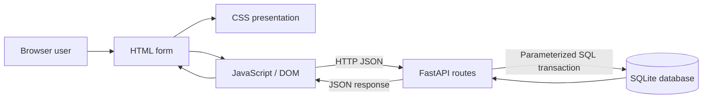
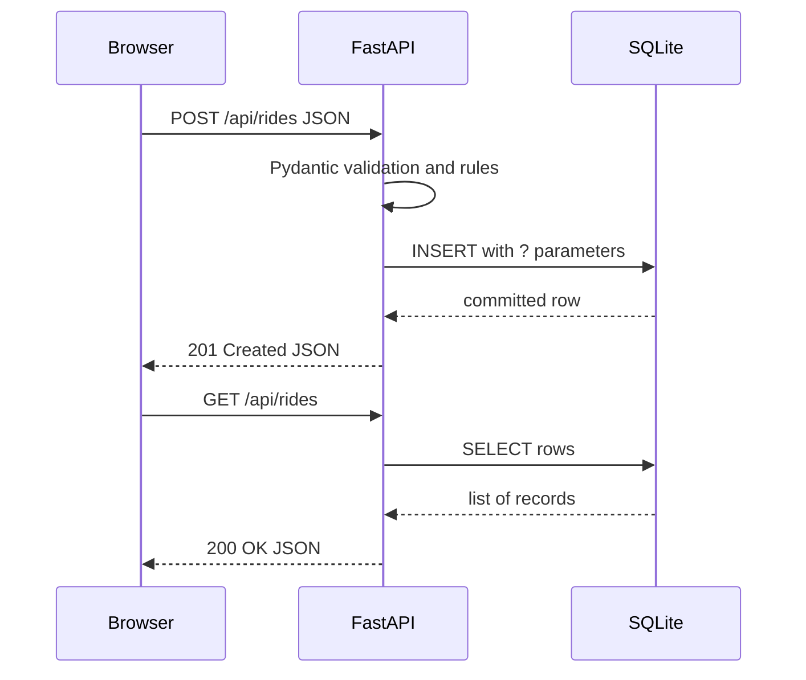

# Web Technology: HTML, CSS, JavaScript, Database, Backend and API Integration

**ATLAS option 11 — Standalone concept + practical laboratory textbook.** This is a self-contained beginner-to-intermediate course, with 18 explained lessons, diagrams, a working browser demonstration, 12 Colab-ready experiments, database queries and integration tests.

**Start:** [Full-stack lab manual](../web_lab/README.md) · [Open Colab experiments](https://colab.research.google.com/github/FUllSCIPTS/ATLAS/blob/main/web_lab/Web_Technology_Colab_Labs.ipynb) · [Web lab source](../web_lab/) · [ATLAS UML blueprint](https://github.com/FUllSCIPTS/ATLAS/blob/architecture-explorer/architecture-explorer/starter/docs/UML_BLUEPRINT.md) · [ATLAS Go Android method catalogue](../android-app/docs/ARCHITECTURE.md#complete-source-method-catalog).

> **Architecture distinction:** ATLAS Go 1.2.0 is a Python/Kivy Android app with on-device JSON storage; it does not currently use a live multi-device backend. The HTML, CSS, JavaScript, FastAPI and SQL reference implementation lives on the separate architecture-explorer branch. The new web_lab teaching app is an independent, local simulation with no authentication or real booking capability.

## Big picture: four-layer system



The **frontend** presents information and collects input. The **API** defines exactly how clients communicate with the server. The **backend** validates requests and enforces rules; the **database** stores structured state. Keeping these roles separate makes testing and future replacement easier.

## ATLAS reference component map

| Layer | Real reference and role | UML destination |
|---|---|---|
| HTML | [passenger/index.html](https://github.com/FUllSCIPTS/ATLAS/blob/architecture-explorer/architecture-explorer/starter/apps/passenger/index.html) and [driver/index.html](https://github.com/FUllSCIPTS/ATLAS/blob/architecture-explorer/architecture-explorer/starter/apps/driver/index.html) | [Web front end](https://github.com/FUllSCIPTS/ATLAS/blob/architecture-explorer/architecture-explorer/starter/docs/UML_BLUEPRINT.md#web-front-end) |
| CSS | [shared/demo.css](https://github.com/FUllSCIPTS/ATLAS/blob/architecture-explorer/architecture-explorer/starter/apps/shared/demo.css) | Web front end |
| JS | [shared/client.js](https://github.com/FUllSCIPTS/ATLAS/blob/architecture-explorer/architecture-explorer/starter/apps/shared/client.js), request and refresh | [Generated symbol catalogue](https://github.com/FUllSCIPTS/ATLAS/blob/architecture-explorer/architecture-explorer/starter/docs/UML_BLUEPRINT.md#generated-symbol-catalog) |
| Gateway | [gateway.py](https://github.com/FUllSCIPTS/ATLAS/blob/architecture-explorer/architecture-explorer/starter/services/gateway.py), proxy/route checks | [Component boundaries](https://github.com/FUllSCIPTS/ATLAS/blob/architecture-explorer/architecture-explorer/starter/docs/UML_BLUEPRINT.md#component-and-deployment-boundaries) |
| API | [trips.py](https://github.com/FUllSCIPTS/ATLAS/blob/architecture-explorer/architecture-explorer/starter/services/trips.py), Booking/book/status | [Booking and dispatch types](https://github.com/FUllSCIPTS/ATLAS/blob/architecture-explorer/architecture-explorer/starter/docs/UML_BLUEPRINT.md#booking-and-dispatch-types) |
| Database | [db.py](https://github.com/FUllSCIPTS/ATLAS/blob/architecture-explorer/architecture-explorer/starter/packages/db.py) and [schema.sql](https://github.com/FUllSCIPTS/ATLAS/blob/architecture-explorer/architecture-explorer/starter/infra/schema.sql) | [Persistence model](https://github.com/FUllSCIPTS/ATLAS/blob/architecture-explorer/architecture-explorer/starter/docs/UML_BLUEPRINT.md#persistence-model) |

## Lesson 01 — 1. Web and HTTP basics

**Concept:** A browser is a client. It requests a URL from a web server over HTTP; HTTPS adds TLS. The browser receives HTML, CSS, JS or JSON. GET reads, POST creates, PATCH changes, DELETE removes. Common status codes: 200 success, 201 created, 204 no body, 404 not found, 409 conflict, 422 invalid request.

**ATLAS source and UML mapping:** The ATLAS gateway serves passenger and driver pages and forwards role-scoped calls. [Inspect source](https://github.com/FUllSCIPTS/ATLAS/blob/architecture-explorer/architecture-explorer/starter/services/gateway.py).

**Practice:** Reproduce the demonstrated behavior in the standalone [web_lab](../web_lab/); describe inputs, outputs, status/error paths and where the data lives. Then compare with the exact [UML catalogue](https://github.com/FUllSCIPTS/ATLAS/blob/architecture-explorer/architecture-explorer/starter/docs/UML_BLUEPRINT.md).

## Lesson 02 — 2. HTML5 structure and semantic elements

**Concept:** HTML is a document markup language. html, head, meta, title and body form a page; header, nav, main, section and footer describe structure. h1 and p label content. Using semantic elements improves accessibility and search comprehension.

**ATLAS source and UML mapping:** The passenger page contains a labeled booking form, heading, status region and result container. [Inspect source](https://github.com/FUllSCIPTS/ATLAS/blob/architecture-explorer/architecture-explorer/starter/apps/passenger/index.html).

**Practice:** Reproduce the demonstrated behavior in the standalone [web_lab](../web_lab/); describe inputs, outputs, status/error paths and where the data lives. Then compare with the exact [UML catalogue](https://github.com/FUllSCIPTS/ATLAS/blob/architecture-explorer/architecture-explorer/starter/docs/UML_BLUEPRINT.md).

## Lesson 03 — 3. HTML forms and accessibility

**Concept:** form groups inputs; input has id and name; label for matches the id. required, maxlength, type, min and max support browser-level checks. Buttons trigger actions. aria-live and role=status announce changing results. Browser validation is convenient but always bypassable: validate again on the server.

**ATLAS source and UML mapping:** Passenger booking collects pickup, destination and zone; driver telemetry uses numeric and checkbox controls. [Inspect source](https://github.com/FUllSCIPTS/ATLAS/blob/architecture-explorer/architecture-explorer/starter/apps/driver/index.html).

**Practice:** Reproduce the demonstrated behavior in the standalone [web_lab](../web_lab/); describe inputs, outputs, status/error paths and where the data lives. Then compare with the exact [UML catalogue](https://github.com/FUllSCIPTS/ATLAS/blob/architecture-explorer/architecture-explorer/starter/docs/UML_BLUEPRINT.md).

## Lesson 04 — 4. CSS fundamentals

**Concept:** CSS styles HTML with selectors: tag, .class and #id. The cascade resolves competing declarations by origin, importance, specificity and source order. The box model is content + padding + border + margin. box-sizing:border-box simplifies widths. Flexbox aligns one dimension; Grid designs two-dimensional layouts.

**ATLAS source and UML mapping:** The starter demo.css styles forms, navigation, input fields and responsive widths. [Inspect source](https://github.com/FUllSCIPTS/ATLAS/blob/architecture-explorer/architecture-explorer/starter/apps/shared/demo.css).

**Practice:** Reproduce the demonstrated behavior in the standalone [web_lab](../web_lab/); describe inputs, outputs, status/error paths and where the data lives. Then compare with the exact [UML catalogue](https://github.com/FUllSCIPTS/ATLAS/blob/architecture-explorer/architecture-explorer/starter/docs/UML_BLUEPRINT.md).

## Lesson 05 — 5. Responsive web design

**Concept:** Different devices have different viewports. Use a viewport meta tag, fluid widths, relative units, CSS Grid/Flexbox and media queries. Prioritize readable forms, contrast, tab order and touch targets. Responsive web UI is distinct from Android Kivy widgets.

**ATLAS source and UML mapping:** The standalone teaching CSS changes two columns into one at narrow widths. [Inspect source](https://github.com/FUllSCIPTS/ATLAS/blob/main/web_lab/static/style.css).

**Practice:** Reproduce the demonstrated behavior in the standalone [web_lab](../web_lab/); describe inputs, outputs, status/error paths and where the data lives. Then compare with the exact [UML catalogue](https://github.com/FUllSCIPTS/ATLAS/blob/architecture-explorer/architecture-explorer/starter/docs/UML_BLUEPRINT.md).

## Lesson 06 — 6. JavaScript syntax and objects

**Concept:** JavaScript is the browser programming language. const and let bind variables; arrays are ordered containers, objects map property names to values, functions return results, and if/for implement control flow. Use strict comparison === and explicit Number() conversion when needed.

**ATLAS source and UML mapping:** Starter client.js defines request and refresh functions and holds trip state. [Inspect source](https://github.com/FUllSCIPTS/ATLAS/blob/architecture-explorer/architecture-explorer/starter/apps/shared/client.js).

**Practice:** Reproduce the demonstrated behavior in the standalone [web_lab](../web_lab/); describe inputs, outputs, status/error paths and where the data lives. Then compare with the exact [UML catalogue](https://github.com/FUllSCIPTS/ATLAS/blob/architecture-explorer/architecture-explorer/starter/docs/UML_BLUEPRINT.md).

## Lesson 07 — 7. DOM, events and safe rendering

**Concept:** The Document Object Model (DOM) is a tree of page nodes. document.querySelector finds an element; addEventListener handles submit/click/change; preventDefault suppresses built-in form navigation. textContent inserts text safely, unlike unsanitized innerHTML, which can cause XSS.

**ATLAS source and UML mapping:** The teaching app builds ride cards using createElement, textContent and replaceChildren. [Inspect source](https://github.com/FUllSCIPTS/ATLAS/blob/main/web_lab/static/app.js).

**Practice:** Reproduce the demonstrated behavior in the standalone [web_lab](../web_lab/); describe inputs, outputs, status/error paths and where the data lives. Then compare with the exact [UML catalogue](https://github.com/FUllSCIPTS/ATLAS/blob/architecture-explorer/architecture-explorer/starter/docs/UML_BLUEPRINT.md).

## Lesson 08 — 8. Async JavaScript, fetch and JSON

**Concept:** fetch makes asynchronous HTTP requests and returns a Promise. async/await makes asynchronous code readable. JSON.stringify serializes objects; response.json parses server JSON. fetch does not automatically throw on HTTP 4xx/5xx, so check response.ok. try/catch handles network or validation failures.

**ATLAS source and UML mapping:** The ATLAS shared client sends fetch requests with a bearer credential in a demo gateway; the teaching app calls same-origin /api/rides. [Inspect source](https://github.com/FUllSCIPTS/ATLAS/blob/architecture-explorer/architecture-explorer/starter/apps/shared/client.js).

**Practice:** Reproduce the demonstrated behavior in the standalone [web_lab](../web_lab/); describe inputs, outputs, status/error paths and where the data lives. Then compare with the exact [UML catalogue](https://github.com/FUllSCIPTS/ATLAS/blob/architecture-explorer/architecture-explorer/starter/docs/UML_BLUEPRINT.md).

## Lesson 09 — 9. Browser ecosystem

**Concept:** TypeScript adds static types to JavaScript before compilation. React, Vue and Angular offer component-based UI frameworks. npm manages packages; Vite builds/develops applications; ES modules import/export code. Learn plain HTML/CSS/JS first. These framework discussions are extensions: the inspected ATLAS browser starter uses plain technologies, not a verified React deployment.

**ATLAS source and UML mapping:** ATLAS Go Android UI is Python/Kivy, not browser HTML; compare with the separate starter branch. [Inspect source](https://github.com/FUllSCIPTS/ATLAS/blob/architecture-explorer/architecture-explorer/starter/apps/passenger/index.html).

**Practice:** Reproduce the demonstrated behavior in the standalone [web_lab](../web_lab/); describe inputs, outputs, status/error paths and where the data lives. Then compare with the exact [UML catalogue](https://github.com/FUllSCIPTS/ATLAS/blob/architecture-explorer/architecture-explorer/starter/docs/UML_BLUEPRINT.md).

## Lesson 10 — 10. Backend fundamentals

**Concept:** A backend receives requests, validates inputs, executes business rules, queries storage and returns status codes with JSON. Python FastAPI uses decorators such as @app.get; Pydantic BaseModel validates typed request bodies. Built-in OpenAPI exposes schemas via /docs.

**ATLAS source and UML mapping:** The starter services/trips.py declares Booking and book and status endpoints. [Inspect source](https://github.com/FUllSCIPTS/ATLAS/blob/architecture-explorer/architecture-explorer/starter/services/trips.py).

**Practice:** Reproduce the demonstrated behavior in the standalone [web_lab](../web_lab/); describe inputs, outputs, status/error paths and where the data lives. Then compare with the exact [UML catalogue](https://github.com/FUllSCIPTS/ATLAS/blob/architecture-explorer/architecture-explorer/starter/docs/UML_BLUEPRINT.md).

## Lesson 11 — 11. REST APIs and CRUD

**Concept:** CRUD means Create, Read, Update and Delete. Model collection /api/rides and item /api/rides/{id}. POST creates a record, GET lists or retrieves, PATCH changes a state, DELETE removes eligible records. Consistent status codes let clients handle errors reliably. Idempotency keys avoid double creation when clients retry after network timeouts.

**ATLAS source and UML mapping:** The starter booking endpoint combines validation with a unique request key; the educational API mirrors the idea at smaller scale. [Inspect source](https://github.com/FUllSCIPTS/ATLAS/blob/main/web_lab/app.py).

**Practice:** Reproduce the demonstrated behavior in the standalone [web_lab](../web_lab/); describe inputs, outputs, status/error paths and where the data lives. Then compare with the exact [UML catalogue](https://github.com/FUllSCIPTS/ATLAS/blob/architecture-explorer/architecture-explorer/starter/docs/UML_BLUEPRINT.md).

## Lesson 12 — 12. Relational database concepts

**Concept:** A database table stores rows in named columns. A primary key identifies a row; a foreign key references another table; NOT NULL, UNIQUE and CHECK enforce constraints; indexes speed selected queries at a write/storage cost. Normalization separates repeated entities so updates do not create inconsistent copies.

**ATLAS source and UML mapping:** The starter schema contains trips, drivers, offers, outbox, inbox and experience tables; teaching SQL uses just rides. [Inspect source](https://github.com/FUllSCIPTS/ATLAS/blob/architecture-explorer/architecture-explorer/starter/infra/schema.sql).

**Practice:** Reproduce the demonstrated behavior in the standalone [web_lab](../web_lab/); describe inputs, outputs, status/error paths and where the data lives. Then compare with the exact [UML catalogue](https://github.com/FUllSCIPTS/ATLAS/blob/architecture-explorer/architecture-explorer/starter/docs/UML_BLUEPRINT.md).

## Lesson 13 — 13. SQL statements

**Concept:** CREATE TABLE defines structure; INSERT writes rows; SELECT reads; WHERE filters; ORDER BY sorts; UPDATE changes; DELETE removes; JOIN combines related rows; GROUP BY aggregates. Always bind external values as query parameters instead of concatenating SQL strings.

**ATLAS source and UML mapping:** The teaching API calls sqlite3.execute with ? parameters; the starter DB adapter implements a similar query interface. [Inspect source](https://github.com/FUllSCIPTS/ATLAS/blob/architecture-explorer/architecture-explorer/starter/packages/db.py).

**Practice:** Reproduce the demonstrated behavior in the standalone [web_lab](../web_lab/); describe inputs, outputs, status/error paths and where the data lives. Then compare with the exact [UML catalogue](https://github.com/FUllSCIPTS/ATLAS/blob/architecture-explorer/architecture-explorer/starter/docs/UML_BLUEPRINT.md).

## Lesson 14 — 14. Transactions and ACID

**Concept:** A transaction bundles changes that must succeed or fail together. Atomicity prevents partial commits; Consistency preserves constraints; Isolation manages concurrent operations; Durability preserves committed changes. COMMIT finalizes and ROLLBACK cancels pending work. SQLite is an embedded DB; PostgreSQL is a server DB appropriate for wider multi-client needs.

**ATLAS source and UML mapping:** The starter database context manager commits and rolls back, and supports SQLite or PostgreSQL. [Inspect source](https://github.com/FUllSCIPTS/ATLAS/blob/architecture-explorer/architecture-explorer/starter/packages/db.py).

**Practice:** Reproduce the demonstrated behavior in the standalone [web_lab](../web_lab/); describe inputs, outputs, status/error paths and where the data lives. Then compare with the exact [UML catalogue](https://github.com/FUllSCIPTS/ATLAS/blob/architecture-explorer/architecture-explorer/starter/docs/UML_BLUEPRINT.md).

## Lesson 15 — 15. Complete frontend to API to database workflow

**Concept:** The HTML form collects fields; JS turns FormData into JSON and calls POST; FastAPI validates with Pydantic, checks business rules, writes SQL within a transaction and returns JSON; JS checks response.ok, then refreshes the ride cards. The database is the source of truth, not the browser state.

**ATLAS source and UML mapping:** Inspect teaching files in order: static/index.html, static/app.js, app.py and the SQLite file. [Inspect source](https://github.com/FUllSCIPTS/ATLAS/blob/main/web_lab/app.py).

**Practice:** Reproduce the demonstrated behavior in the standalone [web_lab](../web_lab/); describe inputs, outputs, status/error paths and where the data lives. Then compare with the exact [UML catalogue](https://github.com/FUllSCIPTS/ATLAS/blob/architecture-explorer/architecture-explorer/starter/docs/UML_BLUEPRINT.md).

## Lesson 16 — 16. Validation, security and browser trust

**Concept:** Client-side checks are bypassable. Prevent SQL injection with bound parameters, XSS by safe DOM text rendering, and authorization failures through server-side per-record checks. CORS permits certain cross-origin browser reads; it is not a login mechanism. CSRF protection matters for cookie-authenticated state-changing requests. Use TLS and managed secrets in real systems.

**ATLAS source and UML mapping:** This standalone demo has deliberately no authentication. Run only on localhost with synthetic inputs; never host publicly as a real ride system. [Inspect source](https://github.com/FUllSCIPTS/ATLAS/blob/main/web_lab/app.py).

**Practice:** Reproduce the demonstrated behavior in the standalone [web_lab](../web_lab/); describe inputs, outputs, status/error paths and where the data lives. Then compare with the exact [UML catalogue](https://github.com/FUllSCIPTS/ATLAS/blob/architecture-explorer/architecture-explorer/starter/docs/UML_BLUEPRINT.md).

## Lesson 17 — 17. Testing, OpenAPI and HTTP errors

**Concept:** Unit tests check one function; integration tests exercise FastAPI routes and a temporary SQLite database; end-to-end tests drive a browser. In FastAPI, /docs is interactive OpenAPI. Test status 201, 404, 409, 422 and legal state transitions. Read logs instead of hiding failures.

**ATLAS source and UML mapping:** The web_lab/tests suite covers CRUD, validation, injection strings, idempotency and state changes. [Inspect source](https://github.com/FUllSCIPTS/ATLAS/blob/main/web_lab/tests/test_integration.py).

**Practice:** Reproduce the demonstrated behavior in the standalone [web_lab](../web_lab/); describe inputs, outputs, status/error paths and where the data lives. Then compare with the exact [UML catalogue](https://github.com/FUllSCIPTS/ATLAS/blob/architecture-explorer/architecture-explorer/starter/docs/UML_BLUEPRINT.md).

## Lesson 18 — 18. Deployment, architecture and scaling

**Concept:** Use a local development server for learning; production needs authorization, HTTPS, secure configuration, schema migration, monitoring, database backups, worker queues, retries, audit logs and proper concurrency. A microservices architecture separates services but adds network and operational complexity. The architecture-explorer branch is a development starter with gateway, trip, dispatch, Kafka and model components.

**ATLAS source and UML mapping:** ATLAS Go itself still uses on-device data; the browser starter is not a production backend for the Android app. [Inspect source](https://github.com/FUllSCIPTS/ATLAS/blob/architecture-explorer/architecture-explorer/starter/README.md).

**Practice:** Reproduce the demonstrated behavior in the standalone [web_lab](../web_lab/); describe inputs, outputs, status/error paths and where the data lives. Then compare with the exact [UML catalogue](https://github.com/FUllSCIPTS/ATLAS/blob/architecture-explorer/architecture-explorer/starter/docs/UML_BLUEPRINT.md).

## Illustrated HTML + CSS + JavaScript walkthrough

The following HTML defines form meaning and connects labels to fields. In the full teaching app, JavaScript reads the same names and sends JSON to FastAPI:

```html
<form id="booking">
  <label for="pickup">Pickup</label>
  <input id="pickup" name="pickup" required maxlength="120">
  <label for="destination">Destination</label>
  <input id="destination" name="destination" required maxlength="120">
  <button type="submit">Send request</button>
</form>
<p id="message" role="status" aria-live="polite"></p>
```

CSS adds visual styling without changing the fields or API schema:

```css
.layout { display: grid; grid-template-columns: repeat(2,minmax(0,1fr)); gap:1rem; }
@media(max-width:800px) { .layout { grid-template-columns:1fr; } }
```

JavaScript turns a form event into an asynchronous JSON request, and checks HTTP errors:

```javascript
form.addEventListener('submit', async event => {
  event.preventDefault();
  const values = Object.fromEntries(new FormData(form));
  try {
    const response = await fetch('/api/rides', {
      method: 'POST', headers: {'Content-Type':'application/json'},
      body: JSON.stringify({...values, distance_km: Number(values.distance_km),
                            request_key: crypto.randomUUID()})
    });
    const data = await response.json();
    if (!response.ok) throw Error(JSON.stringify(data.detail));
    message.textContent = 'Saved ride ' + data.id;
  } catch (error) { message.textContent = error.message; }
});
```

## Illustrated database, SQL and API connection



SQL example: the question mark binds a value safely, rather than placing external input into SQL instructions.

```sql
CREATE TABLE rides(id TEXT PRIMARY KEY, status TEXT NOT NULL);
INSERT INTO rides(id,status) VALUES('demo1','requested');
SELECT * FROM rides WHERE status='requested';
UPDATE rides SET status='assigned' WHERE id='demo1';
DELETE FROM rides WHERE id='demo1';
```

```python
# Python sqlite3 (after opening a connection)
rows = db.execute('SELECT * FROM rides WHERE status=?', ('requested',)).fetchall()
```

## Full practical application: run locally

The standalone demonstration has a **real** HTML/CSS/JS form, fetch-based interactions, FastAPI request validation, a SQLite database, a legal ride-state machine, idempotency-key handling, GET/POST/PATCH/DELETE endpoints and tests. No real accounts, dispatch or payments are involved.

```bash
git clone https://github.com/FUllSCIPTS/ATLAS.git
cd ATLAS
python -m pip install -r web_lab/requirements.txt
python -m uvicorn web_lab.app:app --host 127.0.0.1 --port 8000 --reload
```

Open **http://127.0.0.1:8000** for the browser, and **http://127.0.0.1:8000/docs** for interactive OpenAPI. Inspect the browser Network tab and compare the POST request to the SQLite row. In a second terminal:

```bash
python -m pytest -q web_lab/tests
python -m web_lab.experiments --all --output web_lab/results
```

The first command tests the API against a temporary database; the second runs 12 real HTTP/database experiments, producing 12 CSV, 12 JSON and 12 PNG outputs. The Colab notebook runs the server **in-process** with TestClient and is not a hosted public browser.

## Twelve experiments and what they show

| Lab | Question / observed metric |
|---|---|
| W01 HTML response | HTTP response bytes and code |
| W02 CSS response | CSS response bytes and code |
| W03 JavaScript response | JS response bytes and code |
| W04 OpenAPI and health | OpenAPI response bytes and code |
| W05 POST insertion | Stored SQL row count |
| W06 GET and filter | Filtered vs total row count |
| W07 Idempotent retries | Retry count vs preserved row count |
| W08 Validation failure | 422 rejection count |
| W09 SQL injection string as data | Stored row count and intact table |
| W10 Legal/illegal state transitions | Accepted vs rejected transitions |
| W11 DELETE and 404 | 204 and 404 statuses |
| W12 Measured GET latency | Actual median/stdev TestClient milliseconds |

All experiment figures derive from executed test responses or data. **Only W12 is a time benchmark**; results for W01–W11 are counts, response codes or response sizes, and their y-axes should not be interpreted as speeds. W12 runs locally with in-process TestClient and is not a network throughput or production performance test.

## Security boundary

The teaching web app has **no authentication or record-level authorization**. Run only on localhost with synthetic names and addresses. Never expose it publicly or use real passengers, accounts, credentials, payments or live maps. A production deployment requires HTTPS, authentication, authorization, CSRF/session controls as applicable, secure tokens, backups, concurrency-safe changes, migrations and monitoring. The starter's demo bearer keys are also not production credentials.

## Ten-week classroom plan and final capstone

| Week | Concepts | Lab |
|---|---|---|
| 1 | HTTP and HTML semantics | W01 |
| 2 | Forms and accessibility | W01 |
| 3 | CSS and responsive layout | W02 |
| 4 | JavaScript, DOM, events | W03 |
| 5 | Fetch, JSON, APIs | W03–W04 |
| 6 | FastAPI, schemas, POST | W04–W05 |
| 7 | SQL and GET | W05–W06 |
| 8 | Idempotency, validation, SQL safety | W07–W09 |
| 9 | PATCH, DELETE and testing | W10–W11 |
| 10 | Profiling and capstone | W12 |

**Capstone:** add a synthetic drivers table, a driver listing API and a browser driver card, with a foreign key and integration tests. Compare the solution with the richer ATLAS UML. Mark all code classroom-only unless authentication and safety are separately implemented.

**Lab report template:** concept → UML-linked source → request / expected status → observed CSV/PNG → error handling → SQL state → limitations → improvement.
