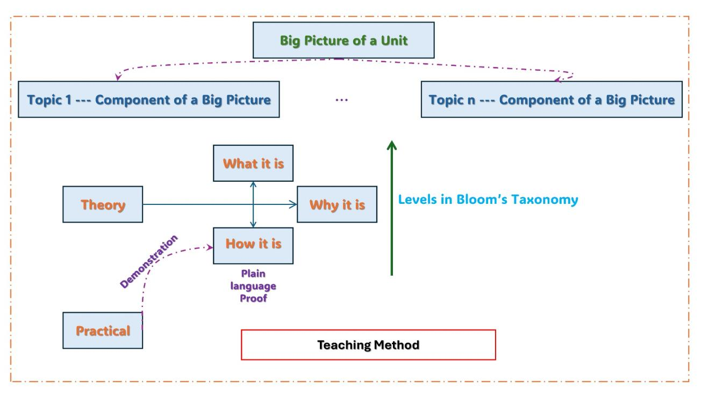
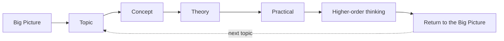
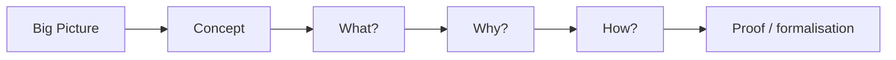
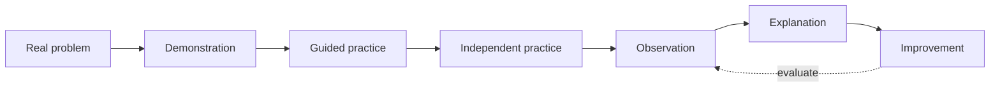
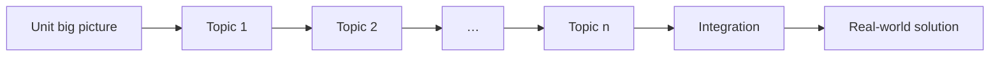
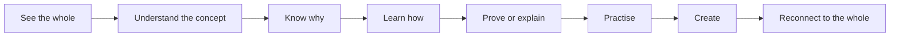

# Teaching Method — Big-Picture Concept–Theory–Practice (BCTP)

*A structured method for teaching each topic as a meaningful component of a complete unit.* Every course in this repository — Information Security, Cryptography, Machine Learning and Optimisation, Data Structures and Algorithms, Python Programming and Web Technology — is written to follow it, and the [Introduction to Data Structures lecture deck](Intro_Data_Structures_BCTP.pptx) is a complete 25-minute lesson taught with it.

**Downloads:** [BCTP method (PDF)](BCTP_Method.pdf) · [Lecture deck: Introduction to Data Structures, taught with BCTP (PowerPoint, 61 slides)](Intro_Data_Structures_BCTP.pptx) · [The course it introduces](../DATA_STRUCTURES_ALGORITHMS.md)

*Figure 1. Big-picture teaching framework connecting theory, practical learning and Bloom's taxonomy. Every topic is a component of the unit's big picture; theory moves through what, why and how; practical work connects to theory through demonstration; the vertical axis is depth in Bloom's taxonomy.*

## Contents

1. [Core idea](#1-core-idea-of-the-method) · 2. [Teaching sequence for every topic](#2-teaching-sequence-for-every-topic) · 3. [Theory path](#3-theory-teaching-path) · 4. [Practical path](#4-practical-teaching-path) · 5. [Bloom's taxonomy](#5-integration-with-blooms-taxonomy) · 6. [Feedback loop](#6-the-essential-feedback-loop) · 7. [Unit-level implementation](#7-complete-unit-level-implementation) · 8. [Lesson template](#8-suggested-lesson-template) · 9. [Worked example: the lecture deck](#9-worked-example-the-introduction-to-data-structures-lecture) · 10. [BCTP across this repository](#10-bctp-across-this-repository) · 11. [Conclusion](#11-conclusion)

## 1. Core idea of the method

**The central principle is to teach a topic as a component of a larger unit, not as an isolated chapter.** Students first see the complete system — the "big picture". Each topic is then introduced by explaining its concept, purpose, underlying theory, practical manifestation and contribution to the whole unit.

## 2. Teaching sequence for every topic

For every topic, organise instruction around one central concept and four guiding questions:

| Stage | Guiding question | Primary purpose | Typical learning action |
|---|---|---|---|
| Concept | What is it? | Build an intuitive mental model. | Define, identify, recognise and relate. |
| Reasoning | Why is it? | Explain the need, motivation and problem solved. | Question, compare, justify and connect. |
| Theory | How does it work? | Develop formal understanding of principles or mechanisms. | Derive, calculate, prove, trace or analyse. |
| Practical | Can we make or use it? | Convert understanding into observable performance. | Demonstrate, implement, test, measure and improve. |

## 3. Theory teaching path

Theory should not begin directly with equations, formal definitions or proofs. A more effective progression is:

| Step | What the teacher does | Data-structures example |
|---|---|---|
| Big Picture | Show where the topic sits within the complete unit, system or real-world problem. | Searching is one of the four modules of the unit map. |
| Concept | Introduce the central idea in plain language, with an analogy, diagram or familiar example. | A pile of books, sorted shelves, a library catalogue. |
| What is it? | Give the precise definition, key terms, objects, inputs, outputs and boundaries. | Binary search: a sorted, indexable array and a key; returns an index or −1. |
| Why is it? | Explain the need, the limitation it addresses and why it matters. | 1,000,000 comparisons become 20. |
| How does it work? | Introduce the mechanism, architecture, mathematics, algorithm, derivation or process. | Compare with the middle, discard half, repeat. |
| Proof / formal reasoning | Only after the purpose is understood: proof, theorem, derivation or rigorous justification. | T(n) = T(⌊n/2⌋) + 1 ⇒ ⌊log₂ n⌋ + 1 comparisons. |

> **Teaching principle:** students should know *what* is being explained and *why it matters* before they are expected to follow a formal proof or detailed derivation.

## 4. Practical teaching path

Practical work is connected to the theory rather than treated as a separate laboratory activity at the end of the chapter.

| Step | Meaning |
|---|---|
| Real problem | Start with a practical situation in which the topic is needed. |
| Demonstration | The teacher demonstrates the phenomenon, tool, code, experiment or construction process. |
| Guided practice | Students repeat the procedure with prompts and checkpoints. |
| Independent practice | Students implement or solve a similar problem with reduced assistance. |
| Observation | Students record what happened, including errors, outputs, measurements or unexpected behaviour. |
| Explanation | Students explain the observation using the theory learned earlier. |
| Improvement | Students modify the design, algorithm, experiment or solution and evaluate whether it performs better. |

## 5. Integration with Bloom's taxonomy

The vertical direction in Figure 1 represents increasing cognitive depth: the same topic deliberately moves students from basic understanding toward creation.

| Bloom level | BCTP activity | Example student task |
|---|---|---|
| Remember | What is it? | Recall the definition, terminology or components. |
| Understand | What and why? | Explain the concept in one's own words and state its purpose. |
| Apply | How, and practical? | Use the method, formula, program or procedure on a known problem. |
| Analyse | Why and how? | Break the system into parts, compare alternatives, and trace cause and effect. |
| Evaluate | Proof, testing and comparison | Judge correctness, efficiency, assumptions, limitations or results. |
| Create | Open practical task | Design, modify, combine or build a new solution using the concept. |

## 6. The essential feedback loop

**After completing each topic, reconnect the learning to the unit-level big picture.** A useful closing question:

> *"What new part of the big picture can we now understand, explain, or build because we learned this topic?"*

This loop prevents students from accumulating disconnected definitions, formulas, algorithms and laboratory procedures. Instead, every topic becomes a visible building block of the subject.

## 7. Complete unit-level implementation

- Begin the unit with a system-level diagram, motivating problem, project or real-life scenario.
- For Topic 1, follow Concept → What → Why → How → Demonstration → Practice → Analysis → Creation.
- Repeat the same structure for subsequent topics while explicitly showing the links among them.
- At the end of the unit, combine all topics in one integrated problem, experiment, program, design or project.
- Assess not only whether students remember individual topics, but whether they can connect them and use them together.

## 8. Suggested lesson template

| Lesson phase | Teacher action | Student outcome |
|---|---|---|
| 1. Connect | Show the big picture and locate today's topic. | Sees relevance and context. |
| 2. Conceptualise | Explain the core concept using plain language or analogy. | Forms an initial mental model. |
| 3. Motivate | Ask and answer "Why is it needed?" | Understands purpose and importance. |
| 4. Formalise | Teach the mechanism, mathematics, algorithm or proof. | Develops rigorous understanding. |
| 5. Demonstrate | Show a practical example or experiment. | Connects theory to observable behaviour. |
| 6. Practise | Provide guided and independent tasks. | Applies the concept. |
| 7. Challenge | Ask students to analyse, evaluate or modify. | Moves to higher-order thinking. |
| 8. Reconnect | Return to the big picture. | Integrates the topic into the complete unit. |

## 9. Worked example: the Introduction to Data Structures lecture

The [lecture deck](Intro_Data_Structures_BCTP.pptx) is a 25-minute first lecture of a Data Structures unit taught entirely with BCTP. Every slide carries a coloured stage tag (Big picture, Concept, Why, Theory, Proof, Practical, Challenge, Reconnect), and the speaker notes give timestamps and the answers to every exercise. Its four modules are the unit's big picture: **Foundations & Analysis · Linear structures · Non-linear structures · Sorting & Searching**, and every operation is judged by one thread — *its best, average and worst case*.

| Lesson phase | Slides | What happens |
|---|---|---|
| 1. Connect | 1–4 | the BCTP method and lesson template (slide 2), the loop repeated for every topic (slide 3) and the whole unit on one page (slide 4) |
| 2. Conceptualise | 7–9, 15–16, 21, 24, 33, 40 | algorithm, data structure vs ADT, memory and pointers, linked lists, stacks, trees, graphs — each in plain language with an analogy or diagram |
| 3. Motivate | 5, 30, 51 | *Find one student among 1,000,000 records*: 1,000,000 vs 20 vs ≈ 1 comparisons; why priority queues; why n log n sorts win |
| 4. Formalise | 10–13, 18, 20, 28, 36, 38, 46, 48, 52 (Theory) and 14, 19, 23, 25, 27, 29, 31, 35, 37, 39, 42, 45, 47, 49, 50, 53, 54 (Proof) | each Theory slide is followed by a "Rigour" slide that derives the best, average and worst case in three columns |
| 5. Demonstrate | 22, 26, 34, 41, 44, 56 | linked-list operations, infix → postfix, traversals, BFS/DFS, binary-search trace, and a live predict-then-count demonstration |
| 6. Practise | 57 | guided tasks with checkpoints, then independent tasks |
| 7. Challenge | 58–59 | analyse / evaluate / create questions, and the climb through Bloom's taxonomy |
| 8. Reconnect | 55, 60 | the whole unit on one page (best · average · worst) and the closing BCTP question |

The motivating slide (5) is written up in full, with traces and runnable code, as the [Motivation section of the Data Structures and Algorithms course](../DATA_STRUCTURES_ALGORITHMS.md#motivation--find-one-student-among-1000000-records).

## 10. BCTP across this repository

Each teaching guide maps the BCTP stages onto the same recurring elements, so a student meets the same rhythm in every subject:

| BCTP stage | Where it appears in every guide |
|---|---|
| Big picture | the guide's contents map and course diagram; the **ATLAS link** at the top of each lesson places the topic in a real system (ATLAS and the ATLAS Go app) |
| Concept — what is it? | definitions, plain-language explanations and diagrams |
| Why is it? | motivation sections and "Why …?" paragraphs |
| Theory — how does it work? | hand traces, invariants, complexity tables and proofs |
| Practical — can we make or use it? | runnable code in every lesson, Google Colab labs and the live views of the [Architecture Explorer](https://fullscipts.github.io/ATLAS/) |
| Challenge | common mistakes, exercises and lab extensions |
| Reconnect | lab reports and cross-links between lessons and courses |

| Course | Guide | Practice |
|---|---|---|
| Information Security | [INFORMATION_SECURITY.md](../INFORMATION_SECURITY.md) | [lab manual](../../security_lab/README.md) |
| Cryptography | [CRYPTOGRAPHY.md](../CRYPTOGRAPHY.md) | [lab manual](../../security_lab/README.md) |
| Machine Learning and Optimisation | [MACHINE_LEARNING_OPTIMISATION.md](../MACHINE_LEARNING_OPTIMISATION.md) | [44 experiments](../../ml_lab/README.md) |
| Data Structures and Algorithms | [DATA_STRUCTURES_ALGORITHMS.md](../DATA_STRUCTURES_ALGORITHMS.md) | [30 experiments](../../dsa_lab/README.md) |
| Python Programming | [PYTHON_PROGRAMMING.md](../PYTHON_PROGRAMMING.md) | [lab manual](../../python_lab/README.md) |
| Web Technology | [WEB_TECHNOLOGY.md](../WEB_TECHNOLOGY.md) | [full-stack lab](../../web_lab/README.md) |
| Web Technology 2 (Kivy) | [WEB_TECHNOLOGY_2.md](../WEB_TECHNOLOGY_2.md) | [lab manual](../../kivy_lab/README.md) |

## 11. Conclusion

The BCTP method is especially suited to college-level Computer Science and engineering education because it combines conceptual clarity, formal theory, implementation, reflection and higher-order problem solving within one consistent teaching structure.

*Method and lecture by Basker Palaniswamy, Insight Research Ireland Centre for Data Analytics, School of Computer Science & IT, University College Cork.*
